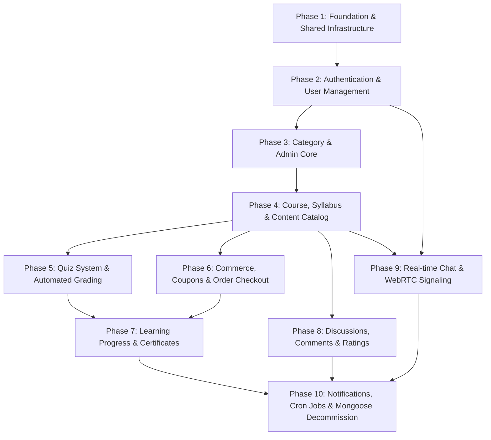

# APPLICATION MIGRATION — PHASE 0: BACKEND INVENTORY & MASTER MIGRATION PLAN
**Project:** E-Learning System (TMDEMY)  
**Database Target:** PostgreSQL 16.11 (`tmdemy`) via Prisma ORM 6.4.1  
**Legacy Stack:** Node.js / Express.js / MongoDB Atlas / Mongoose 8.x  
**Data Migration Status:** Phase 1–10 Complete & Audited (161 business records across 26 tables, `PASS_WITH_DOCUMENTED_EXCEPTIONS`)  
**Document Purpose:** Complete architectural audit, dependency mapping, compatibility analysis, and step-by-step application layer migration roadmap.

---

# EXECUTIVE SUMMARY

The Data Migration phase (Phases 1–10) has successfully transferred all historical data from MongoDB Atlas to PostgreSQL `tmdemy` using deterministic UUID v5 mapping. All 161 business records across 26 tables have been validated and foreign key integrity verified.

Phase 0 conducts an exhaustive, read-only analysis of the Express.js application layer (`src/`). The audit reveals:
1. **Zero Aggregations**: MongoDB `.aggregate()` with `$lookup` or `$facet` is not used anywhere in the codebase. All complex queries rely on `.find()`, `.populate()`, and programmatic manipulation in service functions.
2. **Zero Mongoose Transactions**: The legacy codebase did not utilize MongoDB sessions (`session.startTransaction()`). Several multi-step business mutations (e.g., checkout order creation, quiz submission scoring, course enrollment) were non-atomic. Transitioning to Prisma provides an immediate reliability boost via `prisma.$transaction([...])` and interactive transactions.
3. **Critical Validation Gotcha**: Almost every validation middleware (`src/middlewares/*`) uses `mongoose.Types.ObjectId.isValid(value)`. When the frontend sends 36-character UUIDs, these validators fail immediately with HTTP 400. Replacing ObjectId validators with standard UUID v4/v5 validators is prerequisite #1 for application migration.
4. **Embedded Document Decomposition**: MongoDB stored arrays of subdocuments directly inside documents (e.g., `Course.info.qa`, `Question.options`, `QuizSubmission.answers`, `User.courses`, `User.favorites`, `Comment.likes`, `Conversation.participants`). In PostgreSQL, these have been decomposed into 11 relational child and join tables. Queries must use Prisma nested writes (`create`, `connect`) and relational queries (`include`, `select`).
5. **No Schema Changes Permitted**: The Prisma schema (`prisma/schema.prisma`) is locked and in sync with the PostgreSQL database. Application code must adapt to the schema as defined.

---

# REPORT 1 — BACKEND INVENTORY

## 1. Database Models (19 Mongoose Models vs 26 Prisma Models)

The legacy Mongoose layer consists of 19 models in `src/models/`. In PostgreSQL/Prisma, embedded arrays and many-to-many relationships were normalized into 26 relational tables.

| # | Mongoose Model | File Path | Prisma Model | PostgreSQL Table | Architecture Change |
|---|---|---|---|---|---|
| 1 | `User` | `src/models/user.model.ts` | `User` | `users` | `courses` & `favorites` extracted into `Enrollment` and `FavoriteCourse`. `socialLinks` flattened into `social_facebook`, `social_instagram`, `social_github`. |
| 2 | `Category` | `src/models/category.model.ts` | `Category` | `categories` | `_destroy` mapped to `isDestroyed`. Direct 1:N with `Course`. |
| 3 | `Course` | `src/models/course.model.ts` | `Course`, `CourseFaq` | `courses`, `course_faqs` | `info` object flattened (`requirements`, `benefits`, etc.). `info.qa` extracted into `CourseFaq`. `chapters` & `rating` arrays converted to relational 1:N. |
| 4 | `Chapter` | `src/models/chapter.model.ts` | `Chapter` | `chapters` | `_destroy` mapped to `isDestroyed`. Direct 1:N with `Lesson`. |
| 5 | `Lesson` | `src/models/lesson.model.ts` | `Lesson` | `lessons` | Embedded `quiz` ObjectId converted to 1:1 relation with `Quiz`. |
| 6 | `Quiz` | `src/models/quiz.model.ts` | `Quiz` | `quizzes` | Embedded questions array converted to 1:N relation with `Question`. |
| 7 | `Question` | `src/models/question.model.ts` | `Question`, `QuestionOption` | `questions`, `question_options` | String array `options` extracted into relational `QuestionOption` table. |
| 8 | `QuizSubmission` | `src/models/quizSubmission.model.ts` | `QuizSubmission`, `QuizSubmissionAnswer` | `quiz_submissions`, `quiz_submission_answers` | Embedded `answers` array extracted into relational `QuizSubmissionAnswer` table. |
| 9 | `Order` | `src/models/order.model.ts` | `Order` | `orders` | `amount`, `discount`, `total` stored as `Decimal(12,2)`. Foreign keys to `User`, `Course`, `Coupon`. |
| 10 | `Coupon` | `src/models/coupon.model.ts` | `Coupon`, `CouponCourse` | `coupons`, `coupon_courses` | Array `courses` converted to explicit join table `CouponCourse`. |
| 11 | `Enrollment` | `src/models/enrollment.model.ts` | `Enrollment` | `enrollments` | Dedicated relational tracking between `User` and `Course`. |
| 12 | `Progress` | `src/models/progress.model.ts` | `Progress` | `progress` | Composite unique constraint `[userId, lessonId]`. |
| 13 | `Certificate` | `src/models/certificate.model.ts` | `Certificate` | `certificates` | Unique constraint `[userId, courseId]`. `grade` stored as `Decimal(5,2)`. |
| 14 | `Rating` | `src/models/rating.model.ts` | `Rating` | `ratings` | Unique constraint `[userId, courseId]`. |
| 15 | `FavoriteCourse` | `src/models/favoriteCourse.model.ts` | `FavoriteCourse` | `favorite_courses` | Unique constraint `[userId, courseId]`. |
| 16 | `Comment` | `src/models/comment.model.ts` | `Comment`, `CommentReaction` | `comments`, `comment_reactions` | Embedded `likes` & `dislikes` arrays extracted into `CommentReaction`. Self-relation for parent/replies. |
| 17 | `Conversation` | `src/models/conversation.model.ts` | `Conversation`, `ConversationParticipant` | `conversations`, `conversation_participants` | `participants` array extracted into join table `ConversationParticipant`. |
| 18 | `Message` | `src/models/message.model.ts` | `Message`, `MessageRead` | `messages`, `message_reads` | `readBy` array extracted into join table `MessageRead`. |
| 19 | `Notification` | `src/models/notification.model.ts` | `Notification` | `notifications` | Polymorphic `relatedId` string (nullable, no physical FK). Foreign keys to `sender` and `receiver`. |

---

## 2. Services (21 Services)

All 21 service files located in `src/services/`:

1. **`admin.service.ts`**: Admin operations: user pagination/filtering, role update, status update, user deletion, teacher creation, course approval/rejection/censorship, dashboard metrics, orders management.
2. **`category.service.ts`**: Category CRUD, slug generation, active/destroyed state toggling.
3. **`certificate.service.ts`**: Certificate issuance, verification, PDF generation triggering.
4. **`chapter.service.ts`**: Chapter CRUD, re-ordering, cascading destruction under courses.
5. **`comment.service.ts`**: Hierarchical comments (level 0 & replies), approval/rejection moderation, reaction toggling (like/dislike).
6. **`conversation.service.ts`**: Direct and group conversation lookup, creation, participant addition/removal.
7. **`coupon.service.ts`**: Coupon creation, validation by code, usage limit enforcement, course association.
8. **`course.service.ts`**: Course creation, updates, detail retrieval with chapters & lessons, public course catalog filtering.
9. **`enrollment.service.ts`**: User enrollment verification, course access checks, enrollment creation upon purchase.
10. **`favoriteCourse.service.ts`**: Toggle course favorite for users, list user's favorite courses.
11. **`lesson.service.ts`**: Lesson CRUD within chapters, video/text lesson handling, order sorting.
12. **`message.service.ts`**: Sending messages, message editing, soft/hard deletion, read receipt updates.
13. **`notification.service.ts`**: Pushing notifications (in-app & socket trigger), marking as read, fetching user notification feed.
14. **`order.service.ts`**: Checkout calculation, coupon application, order creation, payment status updates (e.g. simulated/webhook).
15. **`progress.service.ts`**: Tracking lesson completion status, calculating overall course progress percentage.
16. **`question.service.ts`**: Question CRUD for quizzes, options management, point allocation.
17. **`quiz.service.ts`**: Quiz creation/updates for lessons, question linkage, passing grade threshold.
18. **`quizSubmission.service.ts`**: Quiz submission, automated answer grading, score calculation, pass/fail determination.
19. **`rating.service.ts`**: Course reviews & star ratings, updating course average rating metrics.
20. **`teacher.service.ts`**: Teacher dashboard statistics, author course listings, author revenue insights.
21. **`user.service.ts`**: Auth workflows (register, verify OTP, login, refresh token, forgot password, reset password), profile view/update, avatar upload.

---

## 3. Controllers (21 Controllers)

Located in `src/controller/`:
- `admin.controller.ts`
- `category.controller.ts`
- `certificate.controller.ts`
- `chapter.controller.ts`
- `comment.controller.ts`
- `conversation.controller.ts`
- `coupon.controller.ts`
- `course.controller.ts`
- `enrollment.controller.ts`
- `favoriteCourse.controller.ts`
- `lesson.controller.ts`
- `message.controller.ts`
- `notification.controller.ts`
- `order.controller.ts`
- `progress.controller.ts`
- `question.controller.ts`
- `quiz.controller.ts`
- `quizSubmission.controller.ts`
- `raing.controller.ts` *(Note: original filename typo `raing.controller.ts` handles Ratings)*
- `teacher.controller.ts`
- `user.controller.ts`

---

## 4. Routes (22 Files, 21 Mounted API Endpoints)

Configured via `src/routes/index.route.ts`:
- `/api/users` -> `user.route.ts`
- `/api/admin` -> `admin.route.ts`
- `/api/teacher` -> `teacher.route.ts`
- `/api/courses` -> `course.route.ts`
- `/api/categories` -> `category.route.ts`
- `/api/chapters` -> `chapter.route.ts`
- `/api/lessons` -> `lesson.route.ts`
- `/api/coupons` -> `coupon.route.ts`
- `/api/orders` -> `order.route.ts`
- `/api/progress` -> `progress.route.ts`
- `/api/enrollments` -> `enrollment.route.ts`
- `/api/comments` -> `comment.route.ts`
- `/api/ratings` -> `rating.route.ts`
- `/api/favorites` -> `favoriteCourse.route.ts`
- `/api/notifications` -> `notification.route.ts`
- `/api/quiz` -> `quiz.route.ts`
- `/api/questions` -> `question.route.ts`
- `/api/submissions` -> `quizSubmission.route.ts`
- `/api/certificates` -> `certificate.route.ts`
- `/api/conversations` -> `conversation.route.ts`
- `/api/messages` -> `message.route.ts`

---

## 5. Middlewares (21 Files)

Located in `src/middlewares/`:
- **Authentication & Authorization**:
  - `verifyToken.ts`: `verifyAccessToken` (extracts Bearer token, validates JWT, populates `req.user`), `verifyRefreshToken` (validates refresh JWT).
  - `verifyRole.ts`: `isAdmin`, `isTeacher`, `isTeacherOrAdmin`.
- **Validation**:
  - `validate.ts`: Express-validator error collector and formatter.
  - Model-specific validation: `admin.middleware.ts`, `category.middleware.ts`, `chapter.middleware.ts`, `comment.middleware.ts`, `coupon.middleware.ts`, `course.middleware.ts`, `lesson.middleware.ts`, `message.middleware.ts`, `notification.middleware.ts`, `order.middleware.ts`, `progress.middleware.ts`, `question.middleware.ts`, `quiz.middleware.ts`, `quizSubmission.middleware.ts`, `rating.middleware.ts`, `user.middleware.ts`.
- **Error Handling & Token Utility**:
  - `errorHandler.ts`: Global Express error-handling middleware.
  - `generateToken.ts`: Generates access and refresh tokens.

---

## 6. Integration Modules & Utilities

- **Socket.IO** (`src/socket/initSocket.ts`):
  - Manages real-time connection, personal rooms (`socket.join(userId)`), room chats.
  - Event listeners: `join`, `sendMessage`, `editMessage`, `deleteMessage`, `callUser`, `answerCall`, WebRTC signaling (`webrtc-offer`, `webrtc-answer`, `webrtc-ice-candidate`).
  - Calls `message.service.ts` directly for DB mutations.
- **Node-Cron** (`src/cronJobs/deleteUnverifiedUsers.ts`):
  - Scheduled task executing daily (or per `UNVERIFIED_USER_CRON_EXPRESSION`).
  - Purges unverified accounts older than `UNVERIFIED_USER_EXPIRE_MINUTES`.
  - Currently queries MongoDB with `UserModel.deleteMany({ isVerified: { $ne: '' }, createdAt: { $lt: expireTime } })`.
- **Mailing Utility** (`src/utils/nodeMailer.ts`, `src/styles/sendEmailTemplate.ts`):
  - Uses `nodemailer` to dispatch OTP verification codes and password reset links.
- **PDF Generation Utility** (`src/utils/pdfGenerator.ts`):
  - Uses `pdfkit` to generate completion certificates dynamically.
- **General Utility** (`src/utils/ultis.ts`):
  - String manipulation and slug formatting functions.
- **Database Connection** (`src/config/dbConnect.ts`):
  - Legacy Mongoose connection (`mongoose.connect(process.env.MONGO_URI)`).

---

# REPORT 2 — MONGOOSE DEPENDENCY MAP

The table below catalogs every file in the codebase that interacts with Mongoose, the specific operations invoked, and the migration requirements:

| # | File Path | Mongoose Usage / APIs | Business Purpose | Migration Required | Target Prisma Equivalent |
|---|---|---|---|---|---|
| 1 | `src/config/dbConnect.ts` | `mongoose.connect()` | Database initialization | **Yes (Replace)** | Replace with Prisma Client singleton instance connection check |
| 2 | `src/cronJobs/deleteUnverifiedUsers.ts` | `UserModel.deleteMany()` | Background unverified user cleanup | **Yes** | `prisma.user.deleteMany({ where: { isVerified: false, createdAt: { lt: expireTime } } })` |
| 3 | `src/socket/initSocket.ts` | Delegates to `message.service.ts` | Real-time chat & signaling | **Indirect** | No direct Mongoose import, but relies on message service |
| 4 | `src/services/admin.service.ts` | `find()`, `findById()`, `findOne()`, `create()`, `countDocuments()`, `select()`, `skip()`, `limit()`, `sort()`, `findByIdAndUpdate()`, `Types.ObjectId.isValid()` | Admin management of users, teachers, courses, metrics | **Yes** | `prisma.user.*`, `prisma.course.*`, `prisma.order.*`, relational filters |
| 5 | `src/services/category.service.ts` | `find()`, `findOne()`, `findById()`, `create()`, `findByIdAndUpdate()`, `Types.ObjectId.isValid()` | Category catalog CRUD | **Yes** | `prisma.category.findMany()`, `create()`, `update()` |
| 6 | `src/services/certificate.service.ts` | `find()`, `findOne()`, `findById()`, `create()`, `populate()` | Certificate issuance & viewing | **Yes** | `prisma.certificate.findMany({ include: { course: true, user: true } })`, `create()` |
| 7 | `src/services/chapter.service.ts` | `find()`, `findById()`, `create()`, `findByIdAndUpdate()`, `findByIdAndDelete()`, `populate()` | Course syllabus structure | **Yes** | `prisma.chapter.*`, nested relations with `lessons` |
| 8 | `src/services/comment.service.ts` | `find()`, `findById()`, `create()`, `findByIdAndUpdate()`, `findByIdAndDelete()`, `populate()`, `Types.ObjectId.isValid()` | Course/lesson discussions & reactions | **Yes** | `prisma.comment.*`, `prisma.commentReaction.*` for likes/dislikes |
| 9 | `src/services/conversation.service.ts` | `find()`, `findOne()`, `findById()`, `create()`, `populate()` | Chat conversations | **Yes** | `prisma.conversation.*`, `prisma.conversationParticipant.*` |
| 10 | `src/services/coupon.service.ts` | `find()`, `findOne()`, `findById()`, `create()`, `findByIdAndUpdate()`, `populate()`, `Types.ObjectId.isValid()` | Discounts & promotions | **Yes** | `prisma.coupon.*`, `prisma.couponCourse.*` |
| 11 | `src/services/course.service.ts` | `find()`, `findOne()`, `findById()`, `create()`, `findByIdAndUpdate()`, `populate()`, `countDocuments()`, `Types.ObjectId.isValid()` | Course authoring & catalog | **Yes** | `prisma.course.*`, `prisma.courseFaq.*` |
| 12 | `src/services/enrollment.service.ts` | `find()`, `findOne()`, `findById()`, `create()`, `populate()` | Course access rights | **Yes** | `prisma.enrollment.findUnique()`, `create()` |
| 13 | `src/services/favoriteCourse.service.ts`| `findOne()`, `create()`, `findOneAndDelete()`, `populate()` | User wishlists | **Yes** | `prisma.favoriteCourse.findUnique()`, `create()`, `delete()` |
| 14 | `src/services/lesson.service.ts` | `find()`, `findById()`, `create()`, `findByIdAndUpdate()`, `findByIdAndDelete()`, `populate()` | Video & text learning units | **Yes** | `prisma.lesson.*` with chapter linkage |
| 15 | `src/services/message.service.ts` | `find()`, `findById()`, `create()`, `findByIdAndUpdate()`, `populate()` | Messaging & read receipts | **Yes** | `prisma.message.*`, `prisma.messageRead.*` |
| 16 | `src/services/notification.service.ts` | `find()`, `findById()`, `create()`, `updateMany()`, `populate()` | User notification alerts | **Yes** | `prisma.notification.*` |
| 17 | `src/services/order.service.ts` | `find()`, `findOne()`, `findById()`, `create()`, `findByIdAndUpdate()`, `populate()` | Order checkout & processing | **Yes** | `prisma.order.*` wrapped in `prisma.$transaction` |
| 18 | `src/services/progress.service.ts` | `find()`, `findOne()`, `create()`, `findOneAndUpdate()`, `populate()` | Student lesson completion | **Yes** | `prisma.progress.upsert()`, `prisma.enrollment.update()` |
| 19 | `src/services/question.service.ts` | `find()`, `findById()`, `create()`, `findByIdAndUpdate()`, `findByIdAndDelete()`, `populate()` | Quiz question authoring | **Yes** | `prisma.question.*`, `prisma.questionOption.*` |
| 20 | `src/services/quiz.service.ts` | `find()`, `findOne()`, `findById()`, `create()`, `findByIdAndUpdate()`, `populate()` | Lesson quizzes | **Yes** | `prisma.quiz.*` |
| 21 | `src/services/quizSubmission.service.ts`| `find()`, `findOne()`, `findById()`, `create()`, `populate()` | Student quiz grading | **Yes** | `prisma.quizSubmission.*`, `prisma.quizSubmissionAnswer.*` |
| 22 | `src/services/rating.service.ts` | `find()`, `findOne()`, `findById()`, `create()`, `findByIdAndUpdate()`, `populate()` | Star ratings & feedback | **Yes** | `prisma.rating.upsert()`, update `Course` stats |
| 23 | `src/services/teacher.service.ts` | `find()`, `countDocuments()`, `populate()`, `Types.ObjectId.isValid()` | Instructor metrics & courses | **Yes** | `prisma.course.findMany()`, `prisma.order.count()` |
| 24 | `src/services/user.service.ts` | `findOne()`, `findById()`, `create()`, `findByIdAndUpdate()`, `select()`, `save()` | Auth, profile, credentials | **Yes** | `prisma.user.*` |
| 25 | `src/middlewares/user.middleware.ts` | `mongoose.Types.ObjectId.isValid()`, `UserModel.findOne()` | User input validation | **Yes** | Replace with UUID validator & Prisma check |
| 26 | `src/middlewares/course.middleware.ts` | `mongoose.Types.ObjectId.isValid()` | Course parameter validation | **Yes** | Replace with UUID validator |
| 27 | `src/middlewares/category.middleware.ts` | `mongoose.Types.ObjectId.isValid()` | Category validation | **Yes** | Replace with UUID validator |
| 28 | `src/middlewares/chapter.middleware.ts` | `mongoose.Types.ObjectId.isValid()` | Chapter parameter validation | **Yes** | Replace with UUID validator |
| 29 | `src/middlewares/lesson.middleware.ts` | `mongoose.Types.ObjectId.isValid()` | Lesson parameter validation | **Yes** | Replace with UUID validator |
| 30 | `src/middlewares/quiz.middleware.ts` | `Types.ObjectId.isValid()` | Quiz parameter validation | **Yes** | Replace with UUID validator |
| 31 | `src/middlewares/question.middleware.ts` | `Types.ObjectId.isValid()` | Question validation | **Yes** | Replace with UUID validator |
| 32 | `src/middlewares/quizSubmission.middleware.ts` | `Types.ObjectId.isValid()` | Quiz submission validation | **Yes** | Replace with UUID validator |
| 33 | `src/middlewares/order.middleware.ts` | `mongoose.Types.ObjectId.isValid()` | Order & checkout validation | **Yes** | Replace with UUID validator |
| 34 | `src/middlewares/coupon.middleware.ts` | `mongoose.Types.ObjectId.isValid()` | Coupon validation | **Yes** | Replace with UUID validator |
| 35 | `src/middlewares/comment.middleware.ts` | `mongoose.Types.ObjectId.isValid()`, `Types.ObjectId.isValid()` | Comment validation | **Yes** | Replace with UUID validator |
| 36 | `src/middlewares/rating.middleware.ts` | `mongoose.Types.ObjectId.isValid()` | Rating validation | **Yes** | Replace with UUID validator |
| 37 | `src/middlewares/progress.middleware.ts` | `mongoose.Types.ObjectId.isValid()` | Progress validation | **Yes** | Replace with UUID validator |
| 38 | `src/middlewares/notification.middleware.ts` | `mongoose.Types.ObjectId.isValid()` | Notification validation | **Yes** | Replace with UUID validator |

---

# REPORT 3 — PRISMA COMPATIBILITY ANALYSIS

Each business domain has been evaluated and categorized into **Easy**, **Medium**, or **Complex** based on schema restructuring, relational joins, nested writes, and transaction requirements.

## Summary Matrix

| Business Domain | Prisma Model(s) | Category | Core Migration Challenge |
|---|---|---|---|
| Category Management | `Category` | **Easy** | 1:1 direct mapping from Mongoose to Prisma. |
| Favorite Courses | `FavoriteCourse` | **Easy** | Simple unique pair `[userId, courseId]`. |
| Certificates | `Certificate` | **Easy** | Single row per completion, simple PDF trigger. |
| Progress Tracking | `Progress` | **Easy** | Upsert on `[userId, lessonId]` with course progress percentage recalculation. |
| Chapters & Lessons | `Chapter`, `Lesson` | **Medium** | Re-ordering, cascading soft-destruction (`isDestroyed`), 1:1 quiz relation. |
| User & Authentication | `User` | **Medium** | Social links flattened, `isVerified` boolean truthiness, JWT token fields. |
| Ratings & Reviews | `Rating` | **Medium** | Rating upsert + recalculating course average rating. |
| Notifications | `Notification` | **Medium** | Polymorphic `relatedId` string mapping; preserving 5 historical dangling records. |
| Course Catalog & Authoring | `Course`, `CourseFaq` | **Complex** | Extraction of `info.qa` into `CourseFaq`, string array attributes, decimal price conversion. |
| Quizzes & Submissions | `Quiz`, `Question`, `QuestionOption`, `QuizSubmission`, `QuizSubmissionAnswer` | **Complex** | 5-table relational hierarchy replacing embedded documents; transactional grading. |
| Commerce: Orders & Coupons | `Order`, `Coupon`, `CouponCourse`, `Enrollment` | **Complex** | Multi-table ACID transaction: validate coupon -> create order -> create enrollment -> update course stats. Decimal arithmetic. |
| Social: Comments & Reactions | `Comment`, `CommentReaction` | **Complex** | Self-referential tree structure (replies) + array-to-table reaction toggling (`CommentReaction`). |
| Chat & Real-Time | `Conversation`, `ConversationParticipant`, `Message`, `MessageRead` | **Complex** | Decomposed chat participants and read receipts; real-time Socket.IO synchronization. |

---

## Detailed Entity & Business Logic Analysis

### 1. Categories (`Category`) — **Easy**
- **Mongoose**: Stored `name`, `slug`, `description`, `created_by`, `_destroy`.
- **Prisma**: Stored in `categories` table with `createdById` (UUID), `isDestroyed` (Boolean).
- **Migration Details**: Direct replacement of `CategoryModel.find()` with `prisma.category.findMany()`.
- **Risk Level**: Minimal.

### 2. User & Authentication (`User`) — **Medium**
- **Mongoose**: Stored `courses: ObjectId[]`, `favorites: ObjectId[]`, `socialLinks: { facebook, instagram, github }`, `isVerified: Boolean` (or `''` in legacy queries).
- **Prisma**: In `users`, `socialLinks` is flattened to `socialFacebook`, `socialInstagram`, `socialGithub`. `courses` and `favorites` are separate tables (`Enrollment`, `FavoriteCourse`).
- **Critical Quirk**: Legacy code queried `isVerified: ''` to find active users in `admin.service.ts` and `user.service.ts`. In PostgreSQL, `isVerified` is strictly a `Boolean` (`@default(false)`). All queries must check `isVerified: true` (or `isVerified: false` for unverified).
- **Field Name Changes**:
  - `otp_code` -> `otpCode`
  - `otp_expires` -> `otpExpires`
  - `refresh_token` -> `refreshToken`
  - `reset_password_token` -> `resetPasswordToken`
  - `reset_password_expires` -> `resetPasswordExpires`

### 3. Course Management (`Course`, `CourseFaq`) — **Complex**
- **Mongoose**: Course document contained nested `info` object:
  ```json
  "info": {
    "requirements": ["..."],
    "benefits": ["..."],
    "qa": [{ "question": "...", "answer": "..." }]
  }
  ```
- **Prisma**: 
  - `requirements`, `benefits`, `techniques`, `documents` are stored as PostgreSQL native string arrays (`String[]`).
  - `info.qa` is extracted into the separate relational table `CourseFaq` (`course_faqs`).
  - `price` and `oldPrice` are stored as `Decimal(12,2)`.
  - Embedded `chapters` and `rating` arrays are removed; relations are handled via foreign keys.
- **Migration Details**: Creating/updating a course requires nested Prisma operations:
  ```ts
  prisma.course.create({
    data: {
      ...,
      faqs: { createMany: { data: payload.qa } }
    }
  })
  ```

### 4. Quiz & Submissions — **Complex**
- **Mongoose**: A single `Quiz` document embedded all `questions`, and each question embedded `options: string[]`. `QuizSubmission` embedded `answers: [{ questionId, selectedAnswer, isCorrect }]`.
- **Prisma**: Decomposed into 5 physical tables: `quizzes`, `questions`, `question_options`, `quiz_submissions`, `quiz_submission_answers`.
- **Migration Details**:
  - Authoring: Creating questions requires creating `QuestionOption` rows.
  - Submitting: Evaluating a quiz submission requires reading questions and options, calculating score, and atomically writing `QuizSubmission` along with nested `QuizSubmissionAnswer` records.
  - Passing Logic: If score meets `passingGrade`, update `Enrollment` status or trigger certificate generation.

### 5. Orders, Coupons & Checkout — **Complex**
- **Mongoose**: `Order` was a standalone document. `Coupon` stored an array of allowed course IDs (`courses: ObjectId[]`).
- **Prisma**: 
  - `CouponCourse` join table connects `Coupon` and `Course`.
  - `Order` has relations to `User`, `Course`, and `Coupon`.
  - `amount`, `discount`, and `total` are `Decimal(12,2)`.
- **Transaction Requirement**: Legacy checkout was non-atomic. Prisma migration MUST wrap order checkout inside `prisma.$transaction`:
  1. Validate coupon validity, date, and `limit > used`.
  2. Increment `coupon.used`.
  3. Create `Order` record with status `COMPLETED`.
  4. Create or activate `Enrollment` record for the user.
  5. Increment `course.sold`.
- **3 Historical Orphan Orders**: Orders with `courseId = null` must be handled gracefully during retrieval (the Prisma relation is `course Course?`, allowing null).

### 6. Comments & Reactions — **Complex**
- **Mongoose**: Comments embedded arrays `likes: ObjectId[]` and `dislikes: ObjectId[]`. Replies were either queried via `parentId` or embedded.
- **Prisma**:
  - Stored in `comments` with self-relation (`parent` / `replies`).
  - `likes` and `dislikes` are stored as individual rows in `comment_reactions` with enum `CommentReactionType { LIKE, DISLIKE }`.
- **Migration Details**: Toggling a reaction requires querying `prisma.commentReaction.findUnique({ where: { commentId_userId } })`, then upserting or deleting depending on the incoming reaction.

### 7. Conversations, Messages & Socket.IO — **Complex**
- **Mongoose**: `Conversation` stored `participants: ObjectId[]`. `Message` stored `readBy: ObjectId[]`.
- **Prisma**:
  - `conversation_participants` links users to conversations.
  - `message_reads` tracks which user read which message.
- **Socket Integration**: `src/socket/initSocket.ts` delegates to `message.service.ts`. When a message is sent via WebSocket, `message.service.ts` must use Prisma to write the message and notify participant sockets.

### 8. Notifications — **Medium**
- **Mongoose**: Stored `sender`, `receiver`, `type`, `message`, `relatedId` (string).
- **Prisma**: Stored in `notifications`.
- **Crucial Architecture Rule**: `relatedId` is a `String? @db.VarChar(255)` without physical Foreign Key constraint. This intentionally accommodates:
  - Polymorphic targets (courses, lessons, comments, orders, quizzes).
  - The 5 historical dangling notification references.
  - The 10 comment notifications pointing directly to `lessonId`.

---

# REPORT 4 — API AND BUSINESS LOGIC PRESERVATION

To guarantee 100% backward compatibility with the Next.js frontend, all API contracts must remain identical in terms of URL, HTTP method, request payload, status codes, and response JSON envelope `{ success: boolean, message: string, data?: any }`.

| Endpoint | Method | Auth | Role | Request Input | Output Envelope | Key Side Effects |
|---|---|---|---|---|---|---|
| **`/api/users`** | | | | | | |
| `/api/users/register` | `POST` | None | Public | `{ username, email, password }` | `{ success, message }` | Dispatches OTP email via `nodemailer` |
| `/api/users/verify-otp` | `POST` | None | Public | `{ email, otp_code }` | `{ success, message }` | Marks `isVerified: true` |
| `/api/users/login` | `POST` | None | Public | `{ email, password }` | `{ success, message, data: { user, accessToken, refreshToken } }` | Sets `refreshToken` in DB |
| `/api/users/refresh-token`| `POST` | Token | Public | `{ refresh_token }` | `{ success, data: { accessToken } }` | Validates refresh token against DB |
| `/api/users/forgot-password`| `POST` | None | Public | `{ email }` | `{ success, message }` | Sends reset link email |
| `/api/users/reset-password` | `POST` | None | Public | `{ token, newPassword }` | `{ success, message }` | Resets password, invalidates token |
| `/api/users/profile` | `GET` | Bearer | Any | None | `{ success, data: user }` | Strips password & tokens |
| `/api/users/profile` | `PUT` | Bearer | Any | `{ bio, phone, socialLinks, avatar }` | `{ success, message, data: user }` | Updates profile fields |
| **`/api/admin`** | | | | | | |
| `/api/admin/users` | `GET` | Bearer | Admin | Query: `page, limit, role, status, search, sortBy` | `{ success, data: { users, pagination } }` | Filter by `isVerified: true` |
| `/api/admin/users/:id` | `GET` | Bearer | Admin | Param: `id` (UUID) | `{ success, data: user }` | Detailed user view |
| `/api/admin/users/:id` | `PUT` | Bearer | Admin | Param: `id`, Body: user updates | `{ success, message, data: user }` | Admin profile override |
| `/api/admin/teachers` | `POST` | Bearer | Admin | `{ username, email, password }` | `{ success, message, data }` | Creates user with `role: TEACHER` |
| `/api/admin/courses` | `GET` | Bearer | Admin | Query: `page, limit, status` | `{ success, data: { courses, pagination } }` | All course statuses |
| `/api/admin/courses/:id/status`| `PUT`| Bearer | Admin | Param: `id`, Body: `{ status }` | `{ success, message }` | Approves/rejects course; sends notification |
| `/api/admin/dashboard` | `GET` | Bearer | Admin | None | `{ success, data: { counts, revenue, stats } }` | Aggregate statistics across platform |
| **`/api/teacher`** | | | | | | |
| `/api/teacher/courses` | `GET` | Bearer | Teacher | Query: `page, limit` | `{ success, data: { courses, pagination } }` | Filter `authorId = req.user.id` |
| `/api/teacher/analytics` | `GET` | Bearer | Teacher | None | `{ success, data: { studentsCount, revenue } }` | Author sales & enrollment metrics |
| **`/api/courses`** | | | | | | |
| `/api/courses` | `GET` | None | Public | Query: `page, limit, category, level, search, minPrice, maxPrice` | `{ success, data: { courses, pagination } }` | Filter `status: APPROVED, isDestroyed: false` |
| `/api/courses/:slug` | `GET` | None | Public | Param: `slug` | `{ success, data: course }` | Includes chapters, lessons, FAQs, author |
| `/api/courses` | `POST` | Bearer | Teacher/Admin | Course payload + `qa: []` | `{ success, message, data: course }` | Creates course + nested `CourseFaq` rows |
| `/api/courses/:id` | `PUT` | Bearer | Teacher/Admin | Param: `id`, Body: updates | `{ success, message, data: course }` | Author or Admin validation |
| `/api/courses/:id` | `DELETE` | Bearer | Teacher/Admin | Param: `id` | `{ success, message }` | Soft-delete (`isDestroyed: true`) |
| **`/api/categories`** | | | | | | |
| `/api/categories` | `GET` | None | Public | None | `{ success, data: categories }` | Filter `isDestroyed: false` |
| `/api/categories` | `POST` | Bearer | Admin | `{ name, description }` | `{ success, message, data: category }` | Generates slug |
| `/api/categories/:id` | `PUT` | Bearer | Admin | Param: `id`, Body: updates | `{ success, message, data }` | Updates category |
| `/api/categories/:id` | `DELETE` | Bearer | Admin | Param: `id` | `{ success, message }` | Soft-delete |
| **`/api/chapters`** | | | | | | |
| `/api/chapters` | `POST` | Bearer | Teacher/Admin | `{ title, courseId, order }` | `{ success, message, data }` | Inserts chapter into syllabus |
| `/api/chapters/:id` | `PUT` | Bearer | Teacher/Admin | Param: `id`, Body: updates | `{ success, message, data }` | Updates title/order |
| `/api/chapters/:id` | `DELETE` | Bearer | Teacher/Admin | Param: `id` | `{ success, message }` | Cascades soft-delete |
| **`/api/lessons`** | | | | | | |
| `/api/lessons` | `POST` | Bearer | Teacher/Admin | `{ title, chapterId, courseId, type, videoUrl, content, duration, isDemo }` | `{ success, message, data }` | Creates lesson |
| `/api/lessons/:id` | `GET` | Bearer / Public if isDemo | Any | Param: `id` | `{ success, data: lesson }` | Checks enrollment if not demo |
| `/api/lessons/:id` | `PUT` | Bearer | Teacher/Admin | Param: `id`, Body: updates | `{ success, message, data }` | Updates lesson |
| `/api/lessons/:id` | `DELETE` | Bearer | Teacher/Admin | Param: `id` | `{ success, message }` | Deletes lesson |
| **`/api/quiz` & `/api/questions`** | | | | | | |
| `/api/quiz` | `POST` | Bearer | Teacher/Admin | `{ title, lessonId, courseId, duration, passingGrade }` | `{ success, message, data: quiz }` | Links quiz to lesson |
| `/api/quiz/lesson/:lessonId`| `GET`| Bearer | Any | Param: `lessonId` | `{ success, data: quiz }` | Includes questions & options (without answers for students) |
| `/api/questions` | `POST` | Bearer | Teacher/Admin | `{ quizId, title, type, answer, points, options }` | `{ success, message, data }` | Creates question + options |
| `/api/submissions` | `POST` | Bearer | User | `{ quizId, answers: [{ questionId, selectedAnswer }] }` | `{ success, message, data: submission }` | Transactional grading, writes answers |
| **`/api/orders` & `/api/coupons`** | | | | | | |
| `/api/coupons/apply` | `POST` | Bearer | User | `{ code, courseId }` | `{ success, data: { discount, finalPrice } }` | Validates coupon rules |
| `/api/orders/checkout` | `POST` | Bearer | User | `{ courseId, couponCode }` | `{ success, message, data: order }` | Transaction: Order + Enrollment + Stats |
| `/api/orders/my-orders` | `GET` | Bearer | User | None | `{ success, data: orders }` | Lists user's order history |
| **`/api/progress` & `/api/certificates`** | | | | | | |
| `/api/progress` | `POST` | Bearer | User | `{ courseId, lessonId, completed }` | `{ success, message, data: progress }` | Upsert progress, recalculates course % |
| `/api/certificates/:courseId` | `GET` | Bearer | User | Param: `courseId` | `{ success, data: certificate }` | Checks 100% progress, issues certificate |
| **`/api/comments` & `/api/ratings`** | | | | | | |
| `/api/comments` | `GET` | None | Public | Query: `lessonId, courseId` | `{ success, data: comments }` | Includes author, replies, reactions |
| `/api/comments` | `POST` | Bearer | User | `{ lessonId, courseId, content, parentId }` | `{ success, message, data: comment }` | Hierarchical comment; sends notification |
| `/api/comments/:id/reaction`| `POST` | Bearer | User | Param: `id`, Body: `{ type: 'LIKE'|'DISLIKE' }` | `{ success, message }` | Toggles reaction row |
| `/api/ratings` | `POST` | Bearer | User | `{ courseId, rate, content }` | `{ success, message, data: rating }` | Upsert rating; recalculates course average |
| **`/api/conversations` & `/api/messages`** | | | | | | |
| `/api/conversations` | `GET` | Bearer | Any | None | `{ success, data: conversations }` | Participant filter |
| `/api/messages/:conversationId`| `GET`| Bearer | Any | Param: `conversationId` | `{ success, data: messages }` | Message history with read status |
| **`/api/notifications`** | | | | | | |
| `/api/notifications` | `GET` | Bearer | Any | None | `{ success, data: notifications }` | User notifications, sorted by date |
| `/api/notifications/read` | `PUT` | Bearer | Any | `{ notificationIds: [] }` | `{ success, message }` | Marks notifications as read |

---

# REPORT 5 — APPLICATION MIGRATION ROADMAP

The migration is decomposed into **10 granular, sequentially dependent phases**. Each phase is self-contained, tested in isolation, and must achieve a PASS verdict before the subsequent phase commences.



---

## Phase 1: Foundation & Shared Infrastructure
- **Objective**: Establish the Prisma client connection, build universal validation utilities (UUID validator), and configure global error handling for Prisma exceptions.
- **Files Involved**:
  - `src/config/prisma.ts` (New: Prisma Client singleton)
  - `src/middlewares/validate.ts`
  - `src/middlewares/errorHandler.ts`
  - `src/utils/uuidValidator.ts` (New: Helper for express-validator)
- **Planned Changes**:
  - Instantiate and export a single `PrismaClient` instance with connection pooling.
  - Implement a reusable UUID validation middleware to replace `mongoose.Types.ObjectId.isValid()`.
  - Add Prisma error code handling (`P2002` unique constraint, `P2025` record not found) to `errorHandler.ts`.
- **Risks**: Memory leak if multiple PrismaClient instances are created.
- **Testing**: Connection verification script; test UUID validator against valid/invalid UUIDs and legacy ObjectIds.
- **PASS Criteria**: Successful PostgreSQL handshake via Prisma Client singleton; UUID validator tests PASS.

---

## Phase 2: Authentication & User Profile Management
- **Objective**: Migrate authentication, token lifecycle, and user profile management from Mongoose `UserModel` to Prisma `User`.
- **Files Involved**:
  - `src/models/user.model.ts` (Deprecate)
  - `src/services/user.service.ts`
  - `src/controller/user.controller.ts`
  - `src/middlewares/user.middleware.ts`
  - `src/middlewares/verifyToken.ts`
- **Planned Changes**:
  - Rewrite `user.service.ts` to use `prisma.user.*`.
  - Update `user.middleware.ts` to validate UUIDs and check user existence via Prisma.
  - Correct `isVerified` check from string `''` to boolean `false`/`true`.
  - Update `socialLinks` handling to write to `socialFacebook`, `socialInstagram`, `socialGithub`.
  - Map `otp_code` -> `otpCode`, `refresh_token` -> `refreshToken`, etc.
- **Risks**: Breaking login/refresh token flow if password hash or JWT payload field (`id`) mismatches.
- **Testing**: Test registration, OTP verification, login, refresh token, password reset, profile update against migrated PostgreSQL users.
- **PASS Criteria**: All auth and profile endpoints return identical payloads with HTTP 200/201.

---

## Phase 3: Category Management & Admin User Controls
- **Objective**: Migrate Category CRUD and Admin user management endpoints to Prisma.
- **Files Involved**:
  - `src/services/category.service.ts`, `src/controller/category.controller.ts`, `src/middlewares/category.middleware.ts`
  - `src/services/admin.service.ts` (User & Teacher management portions)
  - `src/middlewares/admin.middleware.ts`
- **Planned Changes**:
  - Rewrite `category.service.ts` using `prisma.category.*`.
  - Map `_destroy` to `isDestroyed`.
  - Implement Admin user pagination using `prisma.user.findMany({ skip, take, where })`.
  - Update Admin teacher creation to use `prisma.user.create({ data: { role: 'TEACHER', ... } })`.
- **Risks**: Admin pagination counts mismatching due to `isVerified` filter.
- **Testing**: Verify category CRUD and admin user pagination/filtering with existing PostgreSQL data.
- **PASS Criteria**: Category endpoints and admin user listings operate seamlessly with Prisma.

---

## Phase 4: Course Management, Syllabus & Content
- **Objective**: Migrate Courses, FAQs, Chapters, and Lessons to Prisma.
- **Files Involved**:
  - `src/services/course.service.ts`, `src/controller/course.controller.ts`, `src/middlewares/course.middleware.ts`
  - `src/services/chapter.service.ts`, `src/controller/chapter.controller.ts`, `src/middlewares/chapter.middleware.ts`
  - `src/services/lesson.service.ts`, `src/controller/lesson.controller.ts`, `src/middlewares/lesson.middleware.ts`
  - `src/services/teacher.service.ts` (Course listing portions)
- **Planned Changes**:
  - Extract and write `qa` into `prisma.courseFaq`.
  - Handle `requirements`, `benefits`, `techniques`, `documents` as PostgreSQL native text arrays.
  - Store `price` and `oldPrice` as `Prisma.Decimal`.
  - Rewrite course detail query to `include: { chapters: { include: { lessons: true } }, faqs: true, author: true }`.
  - Implement cascading soft-delete (`isDestroyed: true`) on courses, chapters, and lessons.
- **Risks**: Nested query performance on course detail pages.
- **Testing**: Query public course catalog, view course detail by slug, test chapter/lesson CRUD.
- **PASS Criteria**: Course catalog and syllabus endpoints return complete, accurately structured JSON.

---

## Phase 5: Quiz System & Automated Grading
- **Objective**: Migrate Quizzes, Questions, Options, Submissions, and Grading logic to the 5-table relational structure.
- **Files Involved**:
  - `src/services/quiz.service.ts`, `src/controller/quiz.controller.ts`, `src/middlewares/quiz.middleware.ts`
  - `src/services/question.service.ts`, `src/controller/question.controller.ts`, `src/middlewares/question.middleware.ts`
  - `src/services/quizSubmission.service.ts`, `src/controller/quizSubmission.controller.ts`, `src/middlewares/quizSubmission.middleware.ts`
- **Planned Changes**:
  - Decompose question creation into `prisma.question.create` + `prisma.questionOption.createMany`.
  - Student quiz query: omit `isCorrect` / `answer` fields for security.
  - Rewrite `quizSubmission.service.ts` to evaluate answers against `Question.answer`, calculate percentage, and save `QuizSubmission` + `QuizSubmissionAnswer[]` in a transaction.
- **Risks**: Data shape change between embedded answers and relational answers table.
- **Testing**: Submit quiz with valid answers; verify score calculation and answer record insertion in `tmdemy`.
- **PASS Criteria**: Quiz submission scores match expected calculations; answer rows correctly linked.

---

## Phase 6: Commerce System — Coupons, Orders & Checkout
- **Objective**: Migrate promotions, coupon validation, checkout transactions, and enrollment creation.
- **Files Involved**:
  - `src/services/coupon.service.ts`, `src/controller/coupon.controller.ts`, `src/middlewares/coupon.middleware.ts`
  - `src/services/order.service.ts`, `src/controller/order.controller.ts`, `src/middlewares/order.middleware.ts`
  - `src/services/enrollment.service.ts`, `src/controller/enrollment.controller.ts`, `src/middlewares/enrollment.middleware.ts`
- **Planned Changes**:
  - Check coupon applicability via `prisma.couponCourse.findUnique`.
  - Wrap order checkout in `prisma.$transaction`:
    - Increment `coupon.used`.
    - Create `Order` record with Decimal amounts.
    - Create `Enrollment` record.
    - Increment `course.sold`.
  - Handle historical orders with `courseId = null` gracefully.
- **Risks**: Decimal precision loss or race condition on coupon usage limit.
- **Testing**: Execute coupon application and checkout flow; verify ACID consistency across all 4 tables.
- **PASS Criteria**: Orders and enrollments are created atomically; coupon usage limits are enforced.

---

## Phase 7: Learning Progress, Ratings, Favorites & Certificates
- **Objective**: Migrate progress tracking, course completion logic, certificate issuance (PDFKit), ratings, and favorites.
- **Files Involved**:
  - `src/services/progress.service.ts`, `src/controller/progress.controller.ts`, `src/middlewares/progress.middleware.ts`
  - `src/services/certificate.service.ts`, `src/controller/certificate.controller.ts`
  - `src/services/rating.service.ts`, `src/controller/raing.controller.ts`, `src/middlewares/rating.middleware.ts`
  - `src/services/favoriteCourse.service.ts`, `src/controller/favoriteCourse.controller.ts`
- **Planned Changes**:
  - Upsert progress on `[userId, lessonId]` and update `Enrollment.progress` percentage.
  - When `Enrollment.progress === 100`, enable certificate creation and generate PDF.
  - Upsert `Rating` on `[userId, courseId]` and recalculate average rating.
  - Toggle `FavoriteCourse` using `create` / `delete`.
- **Risks**: Recalculating course average rating without aggregation.
- **Testing**: Toggle lesson completion, verify progress bar update, issue certificate, submit rating.
- **PASS Criteria**: Progress updates reflect accurately in course enrollment; ratings and favorites persist.

---

## Phase 8: Discussions, Comments & Reactions
- **Objective**: Migrate course/lesson comments, nested replies, moderation, and like/dislike reactions.
- **Files Involved**:
  - `src/services/comment.service.ts`, `src/controller/comment.controller.ts`, `src/middlewares/comment.middleware.ts`
- **Planned Changes**:
  - Fetch comments with self-relation: `include: { replies: { include: { user: true, reactions: true } }, user: true, reactions: true }`.
  - Toggling like/dislike: manage rows in `prisma.commentReaction` (`LIKE` vs `DISLIKE`).
  - Calculate `likeCount` and `dislikeCount` dynamically or via subqueries.
- **Risks**: Recursive reply depth performance.
- **Testing**: Post root comment, post reply, toggle like/dislike, verify reaction uniqueness per user.
- **PASS Criteria**: Comment tree renders with correct user info and reaction counts.

---

## Phase 9: Real-time Communication (Chat, Messaging & WebRTC)
- **Objective**: Migrate conversations, messages, participant tracking, and message read receipts while maintaining Socket.IO integration.
- **Files Involved**:
  - `src/services/conversation.service.ts`, `src/controller/conversation.controller.ts`
  - `src/services/message.service.ts`, `src/controller/message.controller.ts`, `src/middlewares/message.middleware.ts`
  - `src/socket/initSocket.ts`
- **Planned Changes**:
  - Create conversations with nested `participants: { createMany: { data: participantUserIds } }`.
  - Save messages to `prisma.message`, link sender, and update `conversation.lastMessageId`.
  - Mark messages as read by inserting into `prisma.messageRead`.
  - Update `src/socket/initSocket.ts` to pass UUIDs cleanly to `message.service.ts`.
- **Risks**: Socket event payload format differences causing frontend chat disconnects.
- **Testing**: Connect two test sockets, join conversation, send real-time message, verify persistence in PostgreSQL.
- **PASS Criteria**: Messages delivered via WebSocket are saved in `messages` and broadcast to participants.

---

## Phase 10: Notifications, Background Automation & Mongoose Decommission
- **Objective**: Migrate notification dispatching, update node-cron unverified user purge, verify all 5 historical dangling notifications and 3 orphan orders, and safely decommission Mongoose.
- **Files Involved**:
  - `src/services/notification.service.ts`, `src/controller/notification.controller.ts`, `src/middlewares/notification.middleware.ts`
  - `src/cronJobs/deleteUnverifiedUsers.ts`
  - `src/index.ts` (Remove `connectDB()`)
  - `src/config/dbConnect.ts` (Decommission)
  - `src/models/*` (Remove or archive Mongoose models)
  - `package.json` (Prepare Mongoose removal)
- **Planned Changes**:
  - Rewrite `notification.service.ts` with `prisma.notification.*`.
  - Preserve polymorphic `relatedId` string mapping (supporting lessonId for comments and historical dangling IDs).
  - Update cron job: `prisma.user.deleteMany({ where: { isVerified: false, createdAt: { lt: expireTime } } })`.
  - Remove Mongoose connection from `src/index.ts`.
  - Execute end-to-end regression tests across all 21 routes.
- **Risks**: Residual Mongoose import breaking application bootstrap.
- **Testing**: Run complete API test suite; verify zero Mongoose references in runtime logs.
- **PASS Criteria**: Server boots without Mongoose; all endpoints and cron jobs function with PostgreSQL; 100% test pass.

---

# REPORT 6 — RISKS AND SPECIAL CASES

### 1. `mongoose.Types.ObjectId.isValid` Validation Blocker
- **Issue**: 14 validation middlewares validate request parameters and bodies using `ObjectId.isValid()`. A PostgreSQL UUID v4/v5 string fails this check immediately, producing HTTP 400.
- **Mitigation**: Introduce a shared validation helper `isUUID` (using `validator.isUUID` or regex `/^[0-9a-f]{8}-[0-9a-f]{4}-[0-9a-f]{4}-[0-9a-f]{4}-[0-9a-f]{12}$/i`) in Phase 1 before migrating business routes.

### 2. User `isVerified` Query Discrepancy
- **Issue**: Legacy Mongo queries frequently checked `{ isVerified: '' }` to locate verified users (due to legacy OTP token storage in that field). In PostgreSQL, `isVerified` is strictly a `Boolean` (`@default(false)`).
- **Mitigation**: Update all active user filters in `user.service.ts` and `admin.service.ts` to explicitly check `isVerified: true`.

### 3. The 3 Historical Orphan Orders
- **Issue**: Data migration audit identified 3 historical orders whose referenced courses were deleted in MongoDB. These were migrated with `course_id = NULL`.
- **Mitigation**: Any service query populating or formatting orders (e.g. `order.service.ts`, `admin.service.ts`) must support `order.course === null` without throwing `Cannot read properties of null (reading 'title')`. Provide fallback labels such as `Deleted Course`.

### 4. The 5 Historical Dangling Notifications
- **Issue**: 5 notifications reference historical entities deleted before data migration (2 courses, 3 quiz submissions).
- **Mitigation**: The Prisma schema intentionally maintains `relatedId String?` without physical foreign keys. Notification retrieval logic must never assume `relatedId` can be joined to a live database entity.

### 5. Comment Notifications Referencing `lessonId`
- **Issue**: In MongoDB, `comment` and `comment_reply` notifications stored the `lessonId` (rather than the commentId) in `relatedId` so the frontend could navigate directly to the video player.
- **Mitigation**: Maintain this exact convention in `notification.service.ts`: when creating a comment notification, pass `lessonId` into `relatedId`.

### 6. Atomic Checkout & Decimal Calculations
- **Issue**: Mongoose stored currency as floating-point numbers. Prisma maps them to `Decimal(12,2)`. In JavaScript, arithmetic on Prisma `Decimal` requires `.toNumber()` or Decimal math methods.
- **Mitigation**: Always perform monetary computations with Decimal methods or format using `.toFixed(2)` before passing to Prisma Decimal fields. Wrap multi-table operations in `prisma.$transaction`.

### 7. Socket.IO ID Typing
- **Issue**: WebSockets emit and receive IDs as plain strings. Socket rooms are keyed by `userId`.
- **Mitigation**: Ensure all socket handlers treat IDs as standard UUID strings. No conversion to `Types.ObjectId` is necessary.

---

# SUMMARY OF RULES & CONSTRAINTS COMPLIANCE

During Phase 0, the following strict constraints were respected 100%:
- [x] Zero application source code was modified.
- [x] Zero Prisma schema files were edited.
- [x] Zero database structural changes or migrations were executed.
- [x] Zero writes, updates, or deletes were performed on MongoDB or PostgreSQL.
- [x] Mongoose was retained in `package.json`.
- [x] All 19 Mongoose models, 21 services, 21 controllers, 22 route files, and 21 middlewares were inspected.
- [x] Comprehensive migration roadmap established across 10 granular phases.
- [x] **WORK STOPPED AFTER PHASE 0 PLAN CREATION**. Ready for user review and approval.
