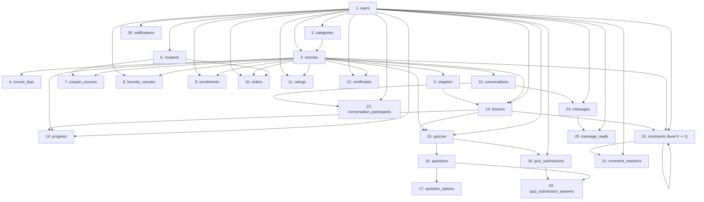

# KẾ HOẠCH MIGRATE DỮ LIỆU TỪ MONGODB SANG POSTGRESQL (DATA MIGRATION PLAN)

> **Giai đoạn**: PHASE: DATA MIGRATION PLAN  
> **Phiên bản tài liệu**: 1.0.0  
> **Ngày lập**: 2026-09-30  
> **Trạng thái thực thi**: **CHỈ LẬP KẾ HOẠCH & THIẾT KẾ** (Chưa migrate dữ liệu, chưa sửa code, MongoDB nguyên vẹn 100%).

---

## 1. MIGRATION SCOPE (PHẠM VI MIGRATION)

### 1.1 Mục tiêu chính
Chuyển đổi toàn bộ dữ liệu hiện tại từ **MongoDB Atlas** (`e-learning`) sang cơ sở dữ liệu quan hệ **PostgreSQL** (`tmdemy`) thông qua ORM **Prisma Client**, đảm bảo:
1. **Toàn vẹn quan hệ (Relational Integrity)**: Không vi phạm bất kỳ Foreign Key, Unique Constraint hay Check Constraint nào đã cấu hình trong PostgreSQL.
2. **Nguyên vẹn ngữ nghĩa nghiệp vụ (Business Semantics)**: Dữ liệu học viên, tiến độ học, điểm trắc nghiệm, lịch sử mua hàng, tin nhắn, bình luận giữ nguyên giá trị logic.
3. **Tính nhất quán của ID (ID Mapping Consistency)**: Một `ObjectId` của MongoDB chuyển đổi thành một `UUID` duy nhất và nhất quán xuyên suốt mọi quan hệ và bảng liên quan.
4. **An toàn tuyệt đối cho hệ thống hiện tại**: MongoDB và Mongoose backend đang phục vụ người dùng không bị gián đoạn hay thay đổi trong suốt quá trình chuẩn bị.

### 1.2 Dữ liệu thực tế phát hiện trong MongoDB (Audit tại 30/09/2026)
Hệ thống hiện tại có **19 collections** với tổng cộng **120 documents**:
- `notifications`: 28 docs
- `messages`: 12 docs
- `chapters`: 12 docs
- `orders`: 8 docs
- `courses`: 8 docs
- `comments`: 8 docs
- `lessons`: 7 docs
- `users`: 7 docs
- `questions`: 5 docs
- `enrollments`: 5 docs
- `progresses`: 4 docs
- `quizzes`: 3 docs
- `categories`: 3 docs
- `quizsubmissions`: 2 docs
- `conversations`: 2 docs
- `favoritecourses`: 2 docs
- `coupons`: 2 docs
- `certificates`: 1 doc
- `ratings`: 1 doc

---

## 2. MONGODB INVENTORY (DANH KÊ TOÀN BỘ MODEL MONGODB)

Dựa trên việc kiểm tra trực tiếp 19 Mongoose model trong `src/models/*.model.ts` và sample documents thực tế từ database:

### 2.1 Model: User
- **Collection**: `users` (7 documents)
- **Primary ID**: `_id` (`ObjectId`)
- **Fields**: `username` (string), `email` (string, unique), `password` (string - bcrypt hash), `status` (enum: 'active', 'inactive'), `avatar` (string), `phone` (string), `bio` (string), `role` (enum: 'user', 'admin', 'teacher'), `isVerified` (boolean/string hybrid), `otp_code` (string), `otp_expires` (Date), `refresh_token` (string), `reset_password_token` (string), `reset_password_expires` (Date), `createdAt` (Date), `updatedAt` (Date).
- **Embedded Objects**: `socialLinks` (`{ facebook: string, instagram: string, github: string }`).
- **Embedded Arrays / References**:
  - `courses`: `ObjectId[]` (ref 'Course' - danh sách khóa học đã mua, cache).
  - `favorites`: `ObjectId[]` (ref 'Course' - danh sách khóa học yêu thích, cache).
- **Potentially Missing / Nullable**: `avatar`, `phone`, `bio`, `otp_code`, `otp_expires`, `refresh_token`, `reset_password_token`, `reset_password_expires`.
- **Special Transformations**:
  - `isVerified` trong MongoDB chứa giá trị chuỗi rỗng `""` hoặc boolean `false`/`true`. Cần ép kiểu sang boolean thuần túy `(isVerified === true || isVerified === 'true')`.
  - Phẳng hóa `socialLinks` thành 3 cột riêng biệt `facebook`, `instagram`, `github`.
  - Bỏ `courses` và `favorites` mảng embedded trên User vì đã có bảng quan hệ chuẩn `enrollments` và `favorite_courses`.

### 2.2 Model: Category
- **Collection**: `categories` (3 documents)
- **Primary ID**: `_id` (`ObjectId`)
- **Fields**: `name` (string), `slug` (string, unique), `description` (string), `_destroy` (boolean, default false), `createdAt` (Date), `updatedAt` (Date).
- **References**: `created_by` (`ObjectId`, ref 'User').
- **Potentially Missing / Nullable**: `created_by` (optional), `description`.
- **Special Transformations**: `_destroy` -> `is_destroyed`, `created_by` -> `created_by_id`.

### 2.3 Model: Course
- **Collection**: `courses` (8 documents)
- **Primary ID**: `_id` (`ObjectId`)
- **Fields**: `title` (string), `slug` (string, unique), `image` (string), `intro_url` (string), `description` (string), `price` (number), `old_price` (number), `type` (enum: 'paid', 'free'), `status` (enum: 'approved', 'pending', 'rejected'), `level` (enum: 'beginner', 'intermediate', 'advanced'), `view` (number), `sold` (number), `_destroy` (boolean), `createdAt` (Date), `updatedAt` (Date).
- **References**: `author` (`ObjectId`, ref 'User'), `category` (`ObjectId`, ref 'Category').
- **Embedded Objects**:
  - `info`:
    - `requirements`: `string[]`
    - `benefits`: `string[]`
    - `techniques`: `string[]`
    - `documents`: `string[]`
    - `qa`: `[{ question: string, answer: string, _id: ObjectId }]` (FAQ embedded)
- **Embedded Arrays (Cache references)**: `chapters: ObjectId[]`, `rating: ObjectId[]`.
- **Special Transformations**:
  - `_destroy` -> `is_destroyed`.
  - `author` -> `author_id`.
  - `category` -> `category_id`.
  - `info.requirements` -> `requirements` (PostgreSQL `TEXT[]`).
  - `info.benefits` -> `benefits` (PostgreSQL `TEXT[]`).
  - `info.techniques` -> `techniques` (PostgreSQL `TEXT[]`).
  - `info.documents` -> `documents` (PostgreSQL `TEXT[]`).
  - `info.qa[]` -> Tách thành bảng quan hệ riêng `course_faqs`.

### 2.4 Model: Chapter
- **Collection**: `chapters` (12 documents)
- **Primary ID**: `_id` (`ObjectId`)
- **Fields**: `title` (string), `order` (number), `_destroy` (boolean), `createdAt` (Date), `updatedAt` (Date).
- **References**: `course` (`ObjectId`, ref 'Course').
- **Embedded Arrays**: `lessons: ObjectId[]` (cache ref).
- **Special Transformations**: `course` -> `course_id`, `_destroy` -> `is_destroyed`.

### 2.5 Model: Lesson
- **Collection**: `lessons` (7 documents)
- **Primary ID**: `_id` (`ObjectId`)
- **Fields**: `title` (string), `slug` (string), `order` (number), `duration` (number), `content` (string), `isDemo` (boolean), `type` (enum: 'video', 'text'), `videoUrl` (string), `createdAt` (Date), `updatedAt` (Date).
- **References**: `chapter` (`ObjectId`, ref 'Chapter'), `course` (`ObjectId`, ref 'Course'), `author` (`ObjectId`, ref 'User').
- **Special Transformations**: `chapter` -> `chapter_id`, `course` -> `course_id`, `author` -> `author_id`, `isDemo` -> `is_demo`, `videoUrl` -> `video_url`.

### 2.6 Model: Quiz
- **Collection**: `quizzes` (3 documents)
- **Primary ID**: `_id` (`ObjectId`)
- **Fields**: `title` (string), `duration` (number), `passing_grade` (number), `description` (string), `createdAt` (Date), `updatedAt` (Date).
- **References**: `lesson` (`ObjectId`, ref 'Lesson', quan hệ 1-1), `courseId` (`ObjectId`, ref 'Course'), `created_by` (`ObjectId`, ref 'User').
- **Embedded Arrays**: `questions: ObjectId[]` (cache ref).
- **Special Transformations**: `lesson` -> `lesson_id` (Unique 1-1), `courseId` -> `course_id`, `created_by` -> `created_by_id`, `passing_grade` -> `passing_grade`.

### 2.7 Model: Question
- **Collection**: `questions` (5 documents)
- **Primary ID**: `_id` (`ObjectId`)
- **Fields**: `title` (string), `type` (enum: 'multiple_choice', 'fill_in_blank'), `answer` (string - đáp án chuẩn), `points` (number, default 1), `createdAt` (Date), `updatedAt` (Date).
- **References**: `quiz` (`ObjectId`, ref 'Quiz').
- **Embedded Arrays**: `options: string[]` (danh sách các lựa chọn đáp án).
- **Special Transformations**:
  - `quiz` -> `quiz_id`.
  - `options: string[]` -> Tách thành bảng quan hệ `question_options` (với `option_text` và `order`).
  - `answer` -> Giữ nguyên kiểu chuỗi `TEXT` để so khớp trực tiếp với `option_text`.

### 2.8 Model: QuizSubmission
- **Collection**: `quizsubmissions` (2 documents)
- **Primary ID**: `_id` (`ObjectId`)
- **Fields**: `score` (number), `totalPoints` (number), `percentage` (number), `completedAt` (Date), `createdAt` (Date), `updatedAt` (Date).
- **References**: `quiz` (`ObjectId`, ref 'Quiz'), `user` (`ObjectId`, ref 'User').
- **Embedded Arrays**: `answers: [{ question: ObjectId, selectedAnswer: string, _id: ObjectId }]`.
- **Special Transformations**:
  - `quiz` -> `quiz_id`.
  - `user` -> `user_id`.
  - `totalPoints` -> `total_points`.
  - `completedAt` -> `completed_at`.
  - `answers[]` -> Tách thành các bản ghi trong bảng `quiz_submission_answers`.
  - Tính `is_correct` cho từng câu trả lời bằng cách đối chiếu `selectedAnswer` với `question.answer`.

### 2.9 Model: Order
- **Collection**: `orders` (8 documents)
- **Primary ID**: `_id` (`ObjectId`)
- **Fields**: `code` (string, unique), `discount` (number), `total` (number), `status` (enum: 'pending', 'completed', 'rejected'), `createdAt` (Date), `updatedAt` (Date).
- **References**: `user` (`ObjectId`, ref 'User'), `course` (`ObjectId`, ref 'Course'), `coupon` (`ObjectId`, ref 'Coupon', optional).
- **Special Transformations**: `user` -> `user_id`, `course` -> `course_id`, `coupon` -> `coupon_id`.
- **LƯU Ý ĐẶC BIỆT**: 3 đơn hàng đang tham chiếu tới các khóa học đã bị xóa ở MongoDB. Cần cơ chế xử lý tham chiếu mồ côi (Orphan Record Handling).

### 2.10 Model: Coupon
- **Collection**: `coupons` (2 documents)
- **Primary ID**: `_id` (`ObjectId`)
- **Fields**: `title` (string), `code` (string, unique), `type` (enum: 'percentage', 'number'), `value` (number), `limit` (number), `used` (number), `active` (boolean), `startDate` (Date), `endDate` (Date), `createdAt` (Date), `updatedAt` (Date).
- **References**: `author` (`ObjectId`, ref 'User').
- **Embedded Arrays**: `courses: ObjectId[]` (danh sách khóa học áp dụng mã).
- **Special Transformations**:
  - `author` -> `author_id`.
  - `startDate` -> `start_date`, `endDate` -> `end_date`.
  - `courses: ObjectId[]` -> Tách thành bảng trung gian N:N `coupon_courses` (`(coupon_id, course_id)`).

### 2.11 Model: Enrollment
- **Collection**: `enrollments` (5 documents)
- **Primary ID**: `_id` (`ObjectId`)
- **Fields**: `progress` (number, 0-100), `status` (enum: 'active', 'completed', 'canceled'), `enrolledAt` (Date), `createdAt` (Date), `updatedAt` (Date).
- **References**: `user` (`ObjectId`, ref 'User'), `course` (`ObjectId`, ref 'Course').
- **Special Transformations**: `user` -> `user_id`, `course` -> `course_id`, `enrolledAt` -> `enrolled_at`. Khóa kết hợp duy nhất `UNIQUE(user_id, course_id)`.

### 2.12 Model: Progress
- **Collection**: `progresses` (4 documents)
- **Primary ID**: `_id` (`ObjectId`)
- **Fields**: `completed` (boolean), `createdAt` (Date), `updatedAt` (Date).
- **References**: `user` (`ObjectId`, ref 'User'), `course` (`ObjectId`, ref 'Course'), `lesson` (`ObjectId`, ref 'Lesson').
- **Special Transformations**: `user` -> `user_id`, `course` -> `course_id`, `lesson` -> `lesson_id`. Khóa kết hợp duy nhất `UNIQUE(user_id, lesson_id)`.

### 2.13 Model: Certificate
- **Collection**: `certificates` (1 document)
- **Primary ID**: `_id` (`ObjectId`)
- **Fields**: `grade` (number), `certificateUrl` (string), `issuedAt` (Date), `createdAt` (Date), `updatedAt` (Date).
- **References**: `user` (`ObjectId`, ref 'User'), `course` (`ObjectId`, ref 'Course').
- **Special Transformations**: `user` -> `user_id`, `course` -> `course_id`, `certificateUrl` -> `certificate_url`, `issuedAt` -> `issued_at`. Khóa duy nhất `UNIQUE(user_id, course_id)`.

### 2.14 Model: Rating
- **Collection**: `ratings` (1 document)
- **Primary ID**: `_id` (`ObjectId`)
- **Fields**: `rate` (number, 1-5), `content` (string), `status` (enum: 'active', 'inactive'), `createdAt` (Date), `updatedAt` (Date).
- **References**: `user` (`ObjectId`, ref 'User'), `course` (`ObjectId`, ref 'Course').
- **Special Transformations**: `user` -> `user_id`, `course` -> `course_id`. Khóa duy nhất `UNIQUE(user_id, course_id)`.

### 2.15 Model: FavoriteCourse
- **Collection**: `favoritecourses` (2 documents)
- **Primary ID**: `_id` (`ObjectId`)
- **Fields**: `createdAt` (Date), `updatedAt` (Date).
- **References**: `user` (`ObjectId`, ref 'User'), `course` (`ObjectId`, ref 'Course').
- **Special Transformations**: `user` -> `user_id`, `course` -> `course_id`. Khóa duy nhất `UNIQUE(user_id, course_id)`.

### 2.16 Model: Comment
- **Collection**: `comments` (8 documents)
- **Primary ID**: `_id` (`ObjectId`)
- **Fields**: `content` (string), `status` (enum: 'approved', 'pending', 'rejected'), `level` (number, 0: gốc, 1: phản hồi), `createdAt` (Date), `updatedAt` (Date).
- **References**: `user` (`ObjectId`, ref 'User'), `course` (`ObjectId`, ref 'Course'), `lesson` (`ObjectId`, ref 'Lesson'), `parentId` (`ObjectId`, ref 'Comment', self-reference, optional).
- **Embedded Arrays**:
  - `likes`: `ObjectId[]` (ref 'User')
  - `dislikes`: `ObjectId[]` (ref 'User')
- **Special Transformations**:
  - `parentId` -> `parent_id` (tự tham chiếu).
  - `likes[]` & `dislikes[]` -> Tách thành bảng quan hệ `comment_reactions` (`type: 'like' | 'dislike'`).

### 2.17 Model: Conversation
- **Collection**: `conversations` (2 documents)
- **Primary ID**: `_id` (`ObjectId`)
- **Fields**: `name` (string), `isGroup` (boolean), `createdAt` (Date), `updatedAt` (Date).
- **References**:
  - `course`: `ObjectId` (ref 'Course', optional)
  - `lastMessage`: `ObjectId` (ref 'Message', optional)
- **Embedded Arrays**: `participants: ObjectId[]` (ref 'User').
- **Special Transformations**:
  - `course` -> `course_id`.
  - `isGroup` -> `is_group`.
  - `lastMessage` -> `last_message_id` (lưu dạng UUID chuỗi không FK ràng buộc vòng).
  - `participants[]` -> Tách thành bảng trung gian N:N `conversation_participants` (`(conversation_id, user_id)`).

### 2.18 Model: Message
- **Collection**: `messages` (12 documents)
- **Primary ID**: `_id` (`ObjectId`)
- **Fields**: `content` (string), `type` (enum: 'text', 'image', 'file'), `isEdited` (boolean), `createdAt` (Date), `updatedAt` (Date).
- **References**: `conversation` (`ObjectId`, ref 'Conversation'), `sender` (`ObjectId`, ref 'User').
- **Embedded Arrays**: `readBy: ObjectId[]` (ref 'User').
- **Special Transformations**:
  - `conversation` -> `conversation_id`.
  - `sender` -> `sender_id`.
  - `isEdited` -> `is_edited`.
  - `readBy[]` -> Tách thành bảng trung gian `message_reads` (`(message_id, user_id)`).

### 2.19 Model: Notification
- **Collection**: `notifications` (28 documents)
- **Primary ID**: `_id` (`ObjectId`)
- **Fields**: `type` (enum: 'comment', 'rating', 'order', 'message', 'system', 'course', 'lesson', 'comment_reply', 'quiz'), `message` (string), `relatedId` (string - polymorphic), `read` (boolean, default false), `createdAt` (Date), `updatedAt` (Date).
- **References**: `receiver` (`ObjectId`, ref 'User', required), `sender` (`ObjectId`, ref 'User', optional).
- **Special Transformations**:
  - `receiver` -> `receiver_id`.
  - `sender` -> `sender_id` (nullable).
  - `read` -> `is_read`.
  - `relatedId` -> `related_id` (Ánh xạ sang UUID nếu là ObjectId tồn tại trong hệ thống, ngược lại giữ nguyên chuỗi).

---

## 3. MAPPING MONGODB → POSTGRESQL

Ánh xạ chi tiết 19 Mongoose Models thành 26 PostgreSQL Tables:

| # | MongoDB Model | MongoDB Collection | PostgreSQL Table | Ghi chú cấu trúc |
|:---:|:---|:---|:---|:---|
| 1 | `User` | `users` | `users` | 1-to-1, tách `socialLinks` |
| 2 | `Category` | `categories` | `categories` | 1-to-1 |
| 3 | `Course` | `courses` | `courses` | 1-to-1, phẳng hóa `info` |
| 4 | `Course.info.qa` | *(embedded)* | `course_faqs` | Chuẩn hóa bảng 1:N từ `course.info.qa` |
| 5 | `Chapter` | `chapters` | `chapters` | 1-to-1 |
| 6 | `Lesson` | `lessons` | `lessons` | 1-to-1 |
| 7 | `Quiz` | `quizzes` | `quizzes` | 1-to-1 (với Lesson) |
| 8 | `Question` | `questions` | `questions` | 1-to-1 |
| 9 | `Question.options` | *(embedded)* | `question_options` | Chuẩn hóa bảng 1:N từ `question.options[]` |
| 10 | `QuizSubmission` | `quizsubmissions` | `quiz_submissions` | 1-to-1 |
| 11 | `QuizSubmission.answers` | *(embedded)* | `quiz_submission_answers` | Chuẩn hóa bảng 1:N từ `answers[]` |
| 12 | `Order` | `orders` | `orders` | 1-to-1 |
| 13 | `Coupon` | `coupons` | `coupons` | 1-to-1 |
| 14 | `Coupon.courses` | *(embedded)* | `coupon_courses` | Chuẩn hóa bảng trung gian N:N |
| 15 | `Enrollment` | `enrollments` | `enrollments` | 1-to-1 (UNIQUE userId + courseId) |
| 16 | `Progress` | `progresses` | `progress` | 1-to-1 (UNIQUE userId + lessonId) |
| 17 | `Certificate` | `certificates` | `certificates` | 1-to-1 (UNIQUE userId + courseId) |
| 18 | `Rating` | `ratings` | `ratings` | 1-to-1 (UNIQUE userId + courseId) |
| 19 | `FavoriteCourse` | `favoritecourses` | `favorite_courses` | 1-to-1 (UNIQUE userId + courseId) |
| 20 | `Comment` | `comments` | `comments` | 1-to-1 (cây đệ quy `parent_id`) |
| 21 | `Comment.likes/dislikes` | *(embedded)* | `comment_reactions` | Chuẩn hóa bảng 1:N từ 2 mảng user |
| 22 | `Conversation` | `conversations` | `conversations` | 1-to-1 |
| 23 | `Conversation.participants` | *(embedded)* | `conversation_participants` | Chuẩn hóa bảng trung gian N:N |
| 24 | `Message` | `messages` | `messages` | 1-to-1 |
| 25 | `Message.readBy` | *(embedded)* | `message_reads` | Chuẩn hóa bảng trung gian N:N |
| 26 | `Notification` | `notifications` | `notifications` | 1-to-1 (Polymorphic `related_id`) |

---

## 4. OBJECTID → UUID STRATEGY

### 4.1 Nguyên tắc cốt lõi
Toàn bộ khóa chính trong PostgreSQL là `UUID` (`v4` hoặc `v5`).
Để đảm bảo toàn vẹn tham chiếu chéo giữa các bảng:
```text
Cùng một Mongo ObjectId X  ===>  Luôn ánh xạ thành DUY NHẤT một PostgreSQL UUID Y
```

### 4.2 Phương pháp sinh UUID: Deterministic UUID v5 (Đề xuất tối ưu)
Thay vì dùng UUID v4 ngẫu nhiên (dễ gây lệch ID nếu migration bị gián đoạn và chạy lại), ta sử dụng **UUID v5 (Name-based / SHA-1 hash)** kết hợp một Namespace cố định của dự án:
```typescript
import { v5 as uuidv5 } from 'uuid';

const MIGRATION_NAMESPACE = '6ba7b810-9dad-11d1-80b4-00c04fd430c8'; // Hoặc UUID namespace riêng của dự án

export const toPostgresUuid = (mongoId: string | Types.ObjectId): string => {
  const idStr = mongoId.toString();
  return uuidv5(idStr, MIGRATION_NAMESPACE);
};
```

#### Ưu điểm vượt trội của UUID v5:
1. **Tính tất định 100% (Deterministic)**: Bất kể chạy ở đâu, bao nhiêu lần, `toPostgresUuid('68dcf8f9e3617ec76053b4d7')` luôn luôn trả về một chuỗi UUID duy nhất giống hệt nhau.
2. **Không phụ thuộc trạng thái (Stateless)**: Nếu migrate table `orders`, ta có thể sinh ngay UUID cho `course_id` từ Mongo `course._id` mà không cần phải truy vấn trước bảng `courses` trong database.
3. **Tuyệt đối chống Duplicate khi Retry**: Chạy lại script migration 10 lần thì UUID của mỗi bản ghi vẫn giữ nguyên, tương thích hoàn hảo với câu lệnh `ON CONFLICT DO UPDATE / DO NOTHING` (Idempotent).

---

## 5. MAPPING STORAGE STRATEGY (LƯU TRỮ ÁNH XẠ ID)

### 5.1 So sánh các phương án

| Tiêu chí | Option A: In-memory Map | Option B: Persistent Mapping Table (`_mongo_id_map`) | Option C: Deterministic UUID v5 + JSON Audit Log (ĐỀ XUẤT) |
|:---|:---|:---|:---|
| **Cơ chế** | `Map<mongoId, uuid>` trong RAM của Node.js process | Bảng riêng trong PostgreSQL: `(mongo_id VARCHAR, entity_name VARCHAR, pg_uuid UUID)` | Thuật toán toán học UUID v5 + xuất file `id_mapping_audit.json` |
| **Hiệu năng** | Cực nhanh (truy xuất RAM O(1)) | Tốn I/O ghi và đọc DB | Cực nhanh O(1), không tốn DB I/O |
| **Khả năng phục hồi (Resume)** | Mất toàn bộ khi process crash | Tốt (lưu trong DB) | Tuyệt đối (tính toán lại tức thì, không bao giờ mất) |
| **Độc lập giữa các file script** | Kém (phải truyền object Map giữa các module) | Tốt (mọi script có thể query DB) | Tuyệt đối (mọi module import hàm `toPostgresUuid` là dùng được ngay) |
| **Tác động Schema PostgreSQL** | Không tác động | Phải tạo thêm 1 bảng ngoài schema | Không tác động, schema sạch 100% |

### 5.2 Đề xuất lựa chọn: Option C (Hybrid UUID v5 + JSON Audit Cache)
- **ID Generator**: Dùng hàm `toPostgresUuid(mongoId)` chuẩn UUID v5.
- **Audit File**: Quá trình migration tự động ghi lại file `scripts/migration-logs/id_map_audit.json` để phục vụ:
  - Tra cứu khi kiểm thử thủ công.
  - Phục vụ migration `notifications.relatedId` (tra ngược ObjectId thuộc entity nào).
  - Đối chiếu kiểm tra tính toàn vẹn (Sample Verification).

---

## 6. MIGRATION DEPENDENCY GRAPH (ĐỒ THỊ PHỤ THUỘC)

Sơ đồ thứ tự phụ thuộc khóa ngoại từ trên xuống dưới:



---

## 7. MIGRATION ORDER (THỨ TỰ THỰC THI 8 GIAI ĐOẠN)

Để đảm bảo không bao giờ vi phạm ràng buộc Foreign Key, thứ tự thực thi chuẩn xác gồm 8 Phase:

### Phase 1: Core Foundation Entities
1. `users` (Độc lập, không có FK bắt buộc sang bảng khác)
2. `categories` (Phụ thuộc `users.id` qua `created_by_id`)

### Phase 2: Course Core Structure
3. `courses` (Phụ thuộc `users.id` qua `author_id`, `categories.id` qua `category_id`)
4. `course_faqs` (Phụ thuộc `courses.id`)
5. `chapters` (Phụ thuộc `courses.id`)

### Phase 3: Commercial & Learning Foundations
6. `coupons` (Phụ thuộc `users.id`)
7. `coupon_courses` (Phụ thuộc `coupons.id`, `courses.id`)
8. `orders` (Phụ thuộc `users.id`, `courses.id`, `coupons.id`)
9. `enrollments` (Phụ thuộc `users.id`, `courses.id`)
10. `favorite_courses` (Phụ thuộc `users.id`, `courses.id`)
11. `ratings` (Phụ thuộc `users.id`, `courses.id`)
12. `certificates` (Phụ thuộc `users.id`, `courses.id`)

### Phase 4: Lessons & Learning Progress
13. `lessons` (Phụ thuộc `chapters.id`, `courses.id`, `users.id`)
14. `progress` (Phụ thuộc `users.id`, `lessons.id`, `courses.id`)

### Phase 5: Quiz Assessment Flow
15. `quizzes` (Phụ thuộc `lessons.id` [1-1], `courses.id`, `users.id`)
16. `questions` (Phụ thuộc `quizzes.id`)
17. `question_options` (Phụ thuộc `questions.id`)
18. `quiz_submissions` (Phụ thuộc `quizzes.id`, `users.id`)
19. `quiz_submission_answers` (Phụ thuộc `quiz_submissions.id`, `questions.id`)

### Phase 6: Interactive Discussion Flow
20. `comments` (Phụ thuộc `lessons.id`, `courses.id`, `users.id`, tự tham chiếu `parent_id` - Migrate có thứ tự theo `level ASC`)
21. `comment_reactions` (Phụ thuộc `comments.id`, `users.id`)

### Phase 7: Real-time Communication Flow
22. `conversations` (Phụ thuộc `courses.id`)
23. `conversation_participants` (Phụ thuộc `conversations.id`, `users.id`)
24. `messages` (Phụ thuộc `conversations.id`, `users.id`)
25. `message_reads` (Phụ thuộc `messages.id`, `users.id`)
26. Cập nhật `conversations.last_message_id` (Post-update sau khi bảng messages đã hoàn tất)

### Phase 8: Notification & Polymorphic Resolution
27. `notifications` (Phụ thuộc `users.id` cho receiver/sender; resolve polymorphic `related_id`)

---

## 8. FIELD TRANSFORMATION RULES (QUY TẮC CHUYỂN ĐỔI FIELD)

| Kiểu dữ liệu MongoDB | Chuyển đổi sang PostgreSQL | Quy tắc xử lý chi tiết |
|:---|:---|:---|
| `_id: ObjectId` | `id: UUID` | `toPostgresUuid(doc._id)` (UUID v5 tất định) |
| `refField: ObjectId` | `refFieldId: UUID` | `refField ? toPostgresUuid(refField) : null` |
| `createdAt: Date` | `created_at: TIMESTAMP(3)` | `new Date(doc.createdAt)` |
| `updatedAt: Date` | `updated_at: TIMESTAMP(3)` | `new Date(doc.updatedAt)` |
| `isVerified: boolean/string` | `is_verified: BOOLEAN` | `doc.isVerified === true || doc.isVerified === 'true'` (default `false`) |
| `_destroy: boolean` | `is_destroyed: BOOLEAN` | `Boolean(doc._destroy)` (default `false`) |
| `socialLinks: Object` | `facebook`, `instagram`, `github` | `doc.socialLinks?.facebook \|\| null` |
| `price / old_price: Number` | `price / old_price: DECIMAL(10,2)` | `Number(doc.price \|\| 0)` |
| `progress / grade / score: Number` | `DOUBLE PRECISION` / `INTEGER` | Ép kiểu an toàn `Number(val)`, nếu NaN thì gán 0 |
| `status: String` | `Enum: CourseStatus / UserStatus...` | Chuyển đổi chính xác sang enum chữ thường tương ứng |
| `info.requirements: string[]` | `requirements: TEXT[]` | Mảng chuỗi giữ nguyên cấu trúc Array PostgreSQL |
| `options: string[]` | Table `question_options` | Duyệt mảng `(opt, index) => { optionText: opt, order: index }` |
| `qa: [{question, answer}]` | Table `course_faqs` | Duyệt mảng `qa.map(item => ({ question: item.question, answer: item.answer }))` |

---

## 9. EMBEDDED DATA TRANSFORMATION (DỮ LIỆU EMBEDDED)

### 9.1 Course: Các trường mảng & FAQ
1. **Requirements, Benefits, Techniques, Documents**:
   - Trong MongoDB: Nằm trong object lồng nhau `info.requirements`, `info.benefits`, `info.techniques`, `info.documents`.
   - Trong PostgreSQL: Được lưu trực tiếp dưới dạng PostgreSQL Native Array `TEXT[]` trên bảng `courses`.
   - Transformation: `requirements: doc.info?.requirements || []`.
2. **FAQ (`info.qa`)**:
   - Trong MongoDB: Là mảng embedded `info.qa: [{ question, answer, _id }]`.
   - Trong PostgreSQL: Được tách thành bảng riêng `course_faqs`.
   - Transformation: Mỗi phần tử trong `doc.info.qa` tạo ra một dòng trong `course_faqs` với `id = toPostgresUuid(item._id || uuidv4())`, `course_id = toPostgresUuid(doc._id)`.

### 9.2 Question: Các lựa chọn (`options`)
- Trong MongoDB: `question.options` là mảng string `["<ul>", "<ol>", "<li>", "<list>"]`.
- Trong PostgreSQL: Tách thành bảng con `question_options`.
- Transformation: Mỗi phần tử tạo dòng mới với `question_id = toPostgresUuid(question._id)`, `option_text = opt`, `order = index`.
- Đáp án đúng: `question.answer` lưu chuỗi `"<ul>"` (khớp trực tiếp với `option_text`).

### 9.3 Comment: Mảng Likes & Dislikes
- Trong MongoDB: `likes: ObjectId[]` và `dislikes: ObjectId[]`.
- Trong PostgreSQL: Tách thành bảng quan hệ `comment_reactions`.
- Transformation:
  - Với mỗi `userId` trong `comment.likes`: tạo 1 dòng `{ comment_id, user_id, type: 'like' }`.
  - Với mỗi `userId` trong `comment.dislikes`: tạo 1 dòng `{ comment_id, user_id, type: 'dislike' }`.
  - Có unique index `UNIQUE(comment_id, user_id)` tránh duplicate reaction.

### 9.4 Coupon: Danh sách khóa học áp dụng (`courses`)
- Trong MongoDB: `coupon.courses: ObjectId[]`.
- Trong PostgreSQL: Tách thành bảng trung gian `coupon_courses` (composite PK `coupon_id, course_id`).
- Transformation: Với mỗi `courseId` trong `coupon.courses`, tạo một dòng `(toPostgresUuid(coupon._id), toPostgresUuid(courseId))`.

### 9.5 Conversation & Message: Thành viên & Đã đọc
- `conversation.participants: ObjectId[]` -> `conversation_participants(conversation_id, user_id)`.
- `message.readBy: ObjectId[]` -> `message_reads(message_id, user_id)`.

---

## 10. QUIZ DATA MIGRATION (LUỒNG QUIZ & CHẤM ĐIỂM)

### 10.1 Cấu trúc thực tế đã phân tích
```text
Quiz (3 docs)
  ↓ 1:N
Question (5 docs, options[], answer: string)
  ↓ 1:N
QuestionOption (options[] tách ra, option_text, order)
  ↓
QuizSubmission (2 docs, score, totalPoints, percentage)
  ↓ 1:N
QuizSubmissionAnswer (answers[] tách ra)
```

### 10.2 Logic so khớp điểm số & `is_correct`
1. Trong MongoDB `quizSubmission.answers`, document chỉ lưu:
   ```json
   {
     "question": "68ee63ab181d7323813f925f",
     "selectedAnswer": "function myFunc() {}",
     "_id": "68ef69853c8bd4c6638d55ff"
   }
   ```
   **Field `is_correct` hoàn toàn KHÔNG có trong MongoDB document!**
2. Phân tích mã nguồn `src/services/quizSubmission.service.ts` (dòng 41-46):
   ```typescript
   for (const ans of answers) {
     const question = await QuestionModel.findById(ans.question)
     if (question && question.answer === ans.selectedAnswer) {
       score += question.points || 1
     }
   }
   ```
3. **Quy tắc Migration**:
   - Khi migrate từng câu trả lời vào `quiz_submission_answers`, script sẽ tra cứu đáp án của câu hỏi (`question.answer`).
   - Gán `is_correct = (question.answer.trim() === ans.selectedAnswer.trim())`.
   - Giữ nguyên `submission.score`, `submission.total_points`, `submission.percentage` đúng như giá trị lịch sử học viên đã đạt được trong MongoDB (không tự ý tính toán lại làm sai lệch kết quả đã ghi nhận).

---

## 11. ORDER / COUPON MIGRATION

### 11.1 Phân tích các mối liên kết
- `Order` liên kết với `User` (`user_id`), `Course` (`course_id`), và tùy chọn `Coupon` (`coupon_id`).
- Bảng `orders` trong PostgreSQL bảo vệ dữ liệu với:
  - `user_id`: `ON DELETE RESTRICT`
  - `course_id`: `ON DELETE RESTRICT`
  - `coupon_id`: `ON DELETE SET NULL`
  - `code`: `UNIQUE`

### 11.2 Xử lý Coupon & Giảm giá
- `Coupon.used`: Giữ nguyên số lần đã sử dụng thực tế từ MongoDB.
- `Coupon.limit`: Nếu null thì giữ null (không giới hạn).
- Bảng trung gian `coupon_courses`: Insert danh sách `(coupon_id, course_id)`.

### 11.3 VẤN ĐỀ ĐẶC BIỆT: THAM CHIẾU KHÓA HỌC BỊ XÓA (ORPHAN ORDERS)
*(Chi tiết được phân tích ở Section 22 và 23 để chờ quyết định).*

---

## 12. ENROLLMENT / PROGRESS / CERTIFICATE MIGRATION

### 12.1 Enrollment
- Khóa học đã ghi danh: Mongoose có cả `user.courses` (cache) và collection `enrollments`.
- **Source of truth**: Lấy trực tiếp từ collection `enrollments` (5 docs).
- Ánh xạ:
  - `user_id = toPostgresUuid(doc.user)`
  - `course_id = toPostgresUuid(doc.course)`
  - `enrolled_at = doc.enrolledAt ? new Date(doc.enrolledAt) : new Date(doc.createdAt)`
  - `progress = doc.progress || 0`
  - `status = doc.status || 'active'`
- Khóa duy nhất: Đảm bảo không trùng `(user_id, course_id)`. Nếu có bản ghi duplicate trong MongoDB, lấy bản ghi có `enrolledAt` mới nhất.

### 12.2 Progress
- Lưu tiến độ từng bài học: collection `progresses` (4 docs).
- Ánh xạ:
  - `user_id = toPostgresUuid(doc.user)`
  - `course_id = toPostgresUuid(doc.course)`
  - `lesson_id = toPostgresUuid(doc.lesson)`
  - `completed = Boolean(doc.completed)`
- Ràng buộc: `UNIQUE(user_id, lesson_id)`.

### 12.3 Certificate
- Chứng chỉ đã cấp: collection `certificates` (1 doc).
- Ánh xạ:
  - `user_id = toPostgresUuid(doc.user)`
  - `course_id = toPostgresUuid(doc.course)`
  - `grade = Number(doc.grade || 0)`
  - `certificate_url = doc.certificateUrl`
  - `issued_at = new Date(doc.issuedAt)`
- Ràng buộc: `UNIQUE(user_id, course_id)`.

---

## 13. COMMENT MIGRATION (CÂY BÌNH LUẬN ĐỆ QUY)

### 13.1 Cấu trúc cây
- Comment gốc: `level = 0`, `parentId = null`.
- Reply cấp 1: `level = 1`, `parentId = <_id của comment gốc>`.
- Reply cấp 2 (nếu có): `level = 2`, `parentId = <_id của reply cấp 1>`.

### 13.2 Chiến lược Migrate không lỗi Foreign Key
Nếu insert song song hoặc ngẫu nhiên, một comment con có thể insert trước comment cha, dẫn tới lỗi vi phạm Foreign Key `comments_parent_id_fkey`.
**Giải pháp**:
1. Đọc toàn bộ 8 comments từ MongoDB.
2. Sắp xếp mảng theo thứ tự tăng dần của `level`:
   ```typescript
   comments.sort((a, b) => (a.level || 0) - (b.level || 0));
   ```
3. Lặp tuần tự qua danh sách đã sắp xếp:
   - Các comment `level = 0` được insert trước.
   - Khi đến comment `level = 1`, comment cha (`parent_id`) chắc chắn đã tồn tại trong PostgreSQL!
4. Sau khi insert xong bảng `comments`, tiếp tục migrate mảng `likes` và `dislikes` của từng comment sang bảng `comment_reactions`.

---

## 14. CHAT MIGRATION (HỘI THOẠI & TIN NHẮN)

### 14.1 Quan hệ Circular giữa Conversation và Message
- `Conversation.lastMessage` tham chiếu tới `Message._id`.
- `Message.conversation` tham chiếu tới `Conversation._id`.
- **Trong PostgreSQL**: Để tránh khóa ngoại vòng (circular FK), schema Prisma đã thiết kế `last_message_id` là cột `UUID` độc lập không đặt foreign key ràng buộc.

### 14.2 Quy trình Migrate 4 bước
1. **Bước 1**: Insert toàn bộ bản ghi `conversations` với `last_message_id = null`.
2. **Bước 2**: Insert các thành viên vào `conversation_participants` từ mảng `conversation.participants`.
3. **Bước 3**: Insert toàn bộ bản ghi `messages` (có foreign key trỏ về `conversation_id` và `sender_id`). Sau đó insert `message_reads` từ `message.readBy`.
4. **Bước 4 (Post-update)**: Duyệt lại các conversation có `lastMessage` trong MongoDB, cập nhật lại:
   ```sql
   UPDATE conversations SET last_message_id = toPostgresUuid(lastMessage) WHERE id = toPostgresUuid(_id);
   ```

---

## 15. NOTIFICATION MIGRATION (THAM CHIẾU ĐA HÌNH POLYMORPHIC)

### 15.1 Đặc tính trường `relatedId`
Trong MongoDB:
- Khi `type = 'order'`: `relatedId` lưu `order._id`.
- Khi `type = 'rating'`: `relatedId` lưu `rating._id`.
- Khi `type = 'quiz'`: `relatedId` lưu `quizSubmission._id`.
- Khi `type = 'system'`: `relatedId` có thể là null hoặc chuỗi văn bản.

### 15.2 Chiến lược chuyển đổi
Trong PostgreSQL: `related_id VARCHAR(255)` (nullable, không foreign key).
- Kiểm tra `doc.relatedId`:
  - Nếu `relatedId` là chuỗi 24 ký tự hex (MongoDB ObjectId) và nằm trong danh sách ID đã ánh xạ:
    `related_id = toPostgresUuid(doc.relatedId)`
  - Nếu không phải ObjectId hoặc là chuỗi tự do: Giữ nguyên giá trị gốc `doc.relatedId`.
- `read` (boolean) -> `is_read`.
- `sender` (ObjectId, có thể null) -> `sender_id` (UUID nullable).
- `receiver` (ObjectId, bắt buộc) -> `receiver_id` (UUID).

---

## 16. PRE-MIGRATION VALIDATION (KIỂM TRA CHẤT LƯỢNG DỮ LIỆU)

Script kiểm tra tiền migration (Pre-flight Data Audit) phải tự động quét các điều kiện sau trước khi bắt đầu:

1. **Email trùng lặp trong User**:
   - Query: Nhóm user theo email, phát hiện nếu `count > 1`.
   - Kết quả thực tế: Đạt (0 duplicate email).
2. **Slug trùng lặp trong Course / Category / Lesson**:
   - Kết quả thực tế: Đạt (Tất cả slug đều unique).
3. **Khóa ngoại mồ côi (Dangling / Orphan Foreign Keys)**:
   - Quét toàn bộ `course.author`, `chapter.course`, `lesson.chapter`, `rating.course`, `enrollment.user`, `quiz.lesson`...
   - Kết quả thực tế: Phát hiện **3 orders mồ côi** tham chiếu course không tồn tại (xem Mục 22). Tất cả các bảng khác đạt 100%.
4. **Kiểm tra giá trị Null / Undefined trên các cột NOT NULL**:
   - `users.password`, `users.username`, `courses.title`, `lessons.title`, v.v.
   - Kết quả thực tế: Đạt 100%.
5. **Kiểm tra tính hợp lệ của Enum**:
   - Toàn bộ giá trị string trong MongoDB phải nằm trong danh sách enum hợp lệ của PostgreSQL.

---

## 17. POST-MIGRATION VALIDATION (ĐỐI SOÁT SAU MIGRATION)

Sau khi chạy xong script migration, tự động thực hiện 4 bước đối soát:

### 17.1 Kiểm tra số lượng dòng (Row Count Verification)
So sánh số lượng document trong MongoDB với số dòng trong PostgreSQL:
- `users`: Mongo (7) == Postgres (7)
- `categories`: Mongo (3) == Postgres (3)
- `courses`: Mongo (8) == Postgres (8)
- `chapters`: Mongo (12) == Postgres (12)
- `lessons`: Mongo (7) == Postgres (7)
- `quizzes`: Mongo (3) == Postgres (3)
- `questions`: Mongo (5) == Postgres (5)
- `question_options`: Postgres == Tổng số phần tử trong tất cả mảng `questions.options`
- `quiz_submissions`: Mongo (2) == Postgres (2)
- `quiz_submission_answers`: Postgres == Tổng số phần tử trong tất cả mảng `quizsubmissions.answers`
- `orders`: Mongo (8) == Postgres (8 hoặc 5 tùy quyết định orphan)
- `coupons`: Mongo (2) == Postgres (2)
- `coupon_courses`: Postgres == Tổng số phần tử trong `coupons.courses`
- `enrollments`: Mongo (5) == Postgres (5)
- `progress`: Mongo (4) == Postgres (4)
- `certificates`: Mongo (1) == Postgres (1)
- `ratings`: Mongo (1) == Postgres (1)
- `favorite_courses`: Mongo (2) == Postgres (2)
- `comments`: Mongo (8) == Postgres (8)
- `comment_reactions`: Postgres == Tổng số phần tử trong mảng `likes` + `dislikes`
- `conversations`: Mongo (2) == Postgres (2)
- `conversation_participants`: Postgres == Tổng số phần tử trong `conversations.participants`
- `messages`: Mongo (12) == Postgres (12)
- `message_reads`: Postgres == Tổng số phần tử trong `messages.readBy`
- `notifications`: Mongo (28) == Postgres (28)

### 17.2 Kiểm tra toàn vẹn quan hệ (Relationship Integrity Check)
Thực hiện các query JOIN ngẫu nhiên:
```sql
-- Xác minh mọi enrollment đều có user và course hợp lệ
SELECT COUNT(*) FROM enrollments e
LEFT JOIN users u ON e.user_id = u.id
LEFT JOIN courses c ON e.course_id = c.id
WHERE u.id IS NULL OR c.id IS NULL; -- Phải bằng 0

-- Xác minh mọi câu hỏi quiz đều thuộc quiz hợp lệ
SELECT COUNT(*) FROM questions q
LEFT JOIN quizzes qz ON q.quiz_id = qz.id
WHERE qz.id IS NULL; -- Phải bằng 0
```

### 17.3 Kiểm tra mẫu ngẫu nhiên (Sample Comparison)
Lấy ngẫu nhiên 3 user, 3 course, 2 quiz submission từ MongoDB, so khớp từng field với PostgreSQL tương ứng theo UUID v5.

### 17.4 Kiểm tra tính toán tổng hợp (Aggregates)
- Tổng tiền đơn hàng `SUM(total)` của các completed orders trong Mongo == Postgres.
- `SUM(sold)` và `SUM(view)` của các khóa học trong Mongo == Postgres.

---

## 18. ROLLBACK STRATEGY (CHIẾN LƯỢC QUAY LUI AN TOÀN)

Vì dữ liệu nguồn trong MongoDB hoàn toàn ở chế độ **READ-ONLY** trong suốt quá trình migration, chiến lược rollback cực kỳ đơn giản và an toàn 100%:

```text
Nếu phát hiện bất kỳ lỗi nào trong quá trình Migration:
┌────────────────────────────────────────────────────────┐
│ 1. DỪNG NGAY LẬP TỨC TIẾN TRÌNH                         │
│ 2. DỮ LIỆU MONGODB: HOÀN TOÀN NGUYÊN VẸN, KHÔNG BỊ SỬA │
│ 3. DỮ LIỆU POSTGRESQL:                                  │
│    - Chạy lệnh dọn sạch bảng (TRUNCATE ... CASCADE)    │
│    - Không xóa bỏ schema, không reset migration        │
│    - Trạng thái DB PostgreSQL trở về rỗng (0 rows)     │
│ 4. Ghi log lỗi chi tiết ra file để phân tích           │
└────────────────────────────────────────────────────────┘
```

Lệnh dọn sạch an toàn khi cần dọn dẹp để chạy lại:
```sql
TRUNCATE TABLE 
  users, categories, courses, course_faqs, chapters, lessons, 
  quizzes, questions, question_options, quiz_submissions, quiz_submission_answers, 
  orders, coupons, coupon_courses, enrollments, progress, certificates, 
  ratings, favorite_courses, comments, comment_reactions, 
  conversations, conversation_participants, messages, message_reads, notifications
CASCADE;
```

---

## 19. MIGRATION SCRIPT ARCHITECTURE (KIẾN TRÚC MÃ NGUỒN SCRIPT)

Thiết kế cấu trúc module cho mã nguồn migration khi được phép triển khai (dự kiến trong `scripts/migrate/`):

```text
scripts/
└── migrate/
    ├── index.ts                  # Entrypoint điều phối toàn bộ luồng migration
    ├── config.ts                 # Kết nối Mongoose & Prisma Client, cấu hình env
    ├── id-mapper.ts              # Hàm sinh UUID v5 tất định và quản lý audit log
    ├── pre-check.ts              # Script kiểm tra tiền trạm dữ liệu MongoDB
    ├── post-validate.ts          # Script đối soát số lượng và mẫu sau migration
    ├── reset-pg.ts               # Script TRUNCATE an toàn khi cần chạy lại
    └── steps/                    # Các module migrate từng phase độc lập
        ├── 01-users.ts
        ├── 02-categories.ts
        ├── 03-courses.ts         # Migrate courses + course_faqs
        ├── 04-chapters.ts
        ├── 05-lessons.ts
        ├── 06-coupons.ts         # Migrate coupons + coupon_courses
        ├── 07-orders.ts
        ├── 08-enrollments.ts
        ├── 09-progress.ts
        ├── 10-certificates.ts
        ├── 11-ratings.ts
        ├── 12-favorites.ts
        ├── 13-quizzes.ts         # Quizzes + Questions + QuestionOptions
        ├── 14-quiz-submissions.ts# Submissions + SubmissionAnswers
        ├── 15-comments.ts        # Comments (Level ASC) + Reactions
        ├── 16-chat.ts            # Conversations + Participants + Messages + Reads
        └── 17-notifications.ts   # Notifications + Resolve relatedId
```

---

## 20. TRANSACTION & BATCH STRATEGY (CHIẾN LƯỢC TRANSACTION VÀ BATCHING)

### 20.1 Có nên bọc toàn bộ migration vào 1 transaction duy nhất không?
- **KHÔNG NÊN**. Nếu bọc 26 bảng vào 1 transaction duy nhất, một lỗi nhỏ ở bảng `notifications` ở cuối cùng sẽ rollback toàn bộ 25 bảng trước đó, gây khó khăn cho việc debug từng giai đoạn.
- **Chiến lược tối ưu: Transaction theo từng Phase/Entity (Per-Phase Transaction)**:
  - Mỗi entity hoặc cặp bảng liên kết chặt chẽ (ví dụ: `quiz` + `questions` + `question_options`) chạy trong một `prisma.$transaction`.
  - Nếu phase đó gặp lỗi, chỉ rollback phase đó, ghi log chi tiết lỗi tại bản ghi nào.

### 20.2 Kích thước dữ liệu & Batch Size
- Hiện tại dữ liệu MongoDB chỉ có **120 documents**.
- Dữ liệu ở quy mô này hoàn toàn có thể migrate nhanh chóng trong vòng **vài giây**.
- Cấu hình batch size đề xuất:
  - Với các bảng cha (`users`, `courses`, `lessons`): Insert theo batch 50-100 bản ghi/lần (`createMany`).
  - Sử dụng `createMany({ skipDuplicates: true })` hoặc `upsert` để đạt tính chất Idempotent.

---

## 21. IDEMPOTENCY STRATEGY (TÍNH CHẤT CHẠY LẠI KHÔNG TRÙNG DỮ LIỆU)

Migration script phải đảm bảo: **Chạy 1 lần hay chạy 10 lần đều cho kết quả giống hệt nhau, không sinh ra bản ghi trùng lặp.**

### Cách hiện thực:
1. **Dùng UUID v5 tất định**: Bất kể chạy lúc nào, ID của mỗi document luôn cố định.
2. **Kỹ thuật Upsert / Skip Duplicates**:
   - Sử dụng Prisma `createMany({ data: [...], skipDuplicates: true })`.
   - Nếu bản ghi có `id` đã tồn tại trong PostgreSQL, nó sẽ được bỏ qua mà không ném lỗi.
3. Hoặc trước khi bắt đầu, script có tham số `--clean` để người điều hành có thể tùy chọn TRUNCATE sạch bảng đích trước khi nạp lại từ đầu.

---

## 22. RISKS & EDGE CASES (RỦI RO VÀ TÌNH HUỐNG BIÊN)

### 22.1 Bảng phân tích rủi ro & giải pháp
| Tình huống rủi ro | Mức độ | Nguyên nhân | Giải pháp đề xuất |
|:---|:---:|:---|:---|
| **Tham chiếu đơn hàng tới khóa học đã xóa (Orphan Orders)** | **CAO** | 3 Orders trong MongoDB trỏ tới `courseId` không tồn tại | Cần User quyết định (Xem mục 22.2) |
| **Comment cha - con lồng nhau** | Trung bình | Comment con insert trước comment cha gây lỗi FK | Sắp xếp mảng comment theo `level ASC` |
| **Giá trị `isVerified` hỗn hợp** | Thấp | User model có lúc lưu `""`, có lúc boolean | Ép kiểu `Boolean(val === true || val === 'true')` |
| **Vòng phụ thuộc Conversation - Message** | Trung bình | `lastMessageId` trỏ tới `Message`, `Message` trỏ tới `Conversation` | Insert Message trước, sau đó UPDATE `last_message_id` |
| **Độ chính xác của ngày tháng** | Thấp | MongoDB lưu ISODate BSON, PostgreSQL lưu TIMESTAMP | Chuyển qua `new Date(doc.createdAt)` |
| **Điểm trắc nghiệm và `is_correct`** | Trung bình | MongoDB không lưu `is_correct` trong answer | Tính toán động bằng cách so khớp với `question.answer` |

### 22.2 Bất đồng bộ dữ liệu thực tế & Quyết định cần thiết (Discrepancy & Decision Required)
Trong quá trình audit dữ liệu thực tế tại MongoDB đối chiếu với Prisma Schema, phát hiện **1 vấn đề bất đồng bộ quan trọng**:

```text
DISCREPANCY #1: ORPHAN ORDERS (ĐƠN HÀNG THAM CHIẾU KHÓA HỌC ĐÃ BỊ XÓA)

DISCREPANCY:
Có 3 đơn hàng trong MongoDB đang tham chiếu tới các khóa học KHÔNG TỒN TẠI trong bảng courses:
1. Order ID 68e5257e43b2786ec96458e8 (Mã: DH-7806607, Status: pending, Total: 699,000)
   -> Tham chiếu Course: 68d3f83ce710d52ff77262a3 (Không tồn tại)
2. Order ID 68ebc5ce500211ca4f063445 (Mã: DH-2062171, Status: pending, Total: 100,000)
   -> Tham chiếu Course: 68ebc108e0a02fc17af9c31a (Không tồn tại)
3. Order ID 68ebc85ab800ff9b01818de5 (Mã: DH-2714351, Status: completed, Total: 0)
   -> Tham chiếu Course: 68d3f7fce710d52ff772629b (Không tồn tại)

CURRENT SOURCE BEHAVIOR:
MongoDB không có cơ chế Foreign Key ràng buộc, nên khi người dùng xóa khóa học bằng API deleteCourse trong quá khứ, các bản ghi Order cũ vẫn trôi nổi trong collection `orders`.

PRISMA SCHEMA BEHAVIOR:
Bảng `orders` trong PostgreSQL có ràng buộc cứng:
courseId String @map("course_id") @db.Uuid
course Course @relation(fields: [courseId], references: [id], onDelete: Restrict)
(Trường course_id bắt buộc NOT NULL và phải tồn tại trong bảng courses).
Nếu script cố tình nạp 3 đơn hàng này, PostgreSQL sẽ REJECT toàn bộ vì vi phạm Foreign Key!

PROPOSED MIGRATION HANDLING (3 LỰA CHỌN):
- Lựa chọn 1 (Khuyến nghị): Script migration tự động tạo một khóa học lưu trữ đặc biệt tên "Archived / Deleted Course" (Khóa học đã xóa trong quá khứ) trong bảng `courses`, sau đó gắn 3 đơn hàng mồ côi này về khóa học đó. Như vậy vừa bảo toàn được 100% doanh thu và lịch sử đơn hàng tài chính, vừa không vi phạm Foreign Key.
- Lựa chọn 2: Bỏ qua (Skip) 3 đơn hàng mồ côi này khi migrate sang PostgreSQL (chỉ migrate 5 đơn hàng hợp lệ), đồng thời xuất 3 đơn hàng này ra file log backup `orphan_orders_backup.json`.
- Lựa chọn 3: Sửa Prisma schema để `courseId` trong bảng `orders` là nullable (`String?`), tuy nhiên phương án này làm suy yếu tính toàn vẹn dữ liệu đơn hàng sau này.

REQUIRES DECISION: YES
```

---

## 23. EXECUTION CHECKLIST (DANH MỤC TRƯỚC KHI THỰC THI)

Khi User phê duyệt kế hoạch này, các bước thực thi tiếp theo sẽ lần lượt là:

- [ ] 1. Người dùng đưa ra quyết định cho **Discrepancy #1 (Orphan Orders)**.
- [ ] 2. Viết script kiểm tra tiền trạm `pre-check.ts` và chạy thử đối soát dữ liệu.
- [ ] 3. Viết mã nguồn migration hoàn chỉnh trong `scripts/migrate/`.
- [ ] 4. Thực thi migration từng phase theo đúng thứ tự Section 7.
- [ ] 5. Chạy validation đối soát số lượng và mẫu tự động (Post-migration check).
- [ ] 6. Báo cáo kết quả chi tiết.

