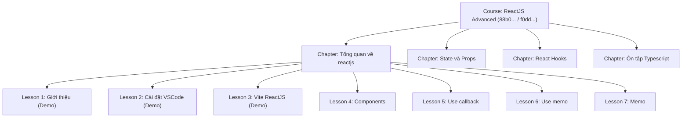

# Phase 3 Migration Report: Chapters + Lessons ONLY

> **Execution Date/Time**: 2026-09-30T14:56:37.765Z  
> **Duration**: 3913ms  
> **Final Verdict**: **PASS**  
> **Status**: Completed successfully with 100% data integrity, hierarchy validation, and isolation.

---

## 1. Executive Summary

| Metric | MongoDB (Source) | PostgreSQL (Target Before) | PostgreSQL (Target After) | Verification Status |
|:---|:---:|:---:|:---:|:---:|
| **chapters** | 12 | 0 | **12** | ✅ 100% MATCH |
| **lessons** | 7 | 0 | **7** | ✅ 100% MATCH |
| **users** (Phase 1) | 7 | 7 | **7** | ✅ UNCHANGED |
| **categories** (Phase 1) | 3 | 3 | **3** | ✅ UNCHANGED |
| **courses** (Phase 2) | 8 | 8 | **8** | ✅ UNCHANGED |
| **course_faqs** (Phase 2) | 8 | 8 | **8** | ✅ UNCHANGED |
| **All other 20 tables** | 75 | 0 | **0** | ✅ STRICTLY ISOLATED |
| **Total documents / rows** | **120** | **26** | **45** | ✅ VERIFIED |

---

## 2. Environment Information

- **MongoDB Source Database**: `e-learning` (MongoDB Atlas)
- **MongoDB Connection Mode**: `READ_ONLY` (Zero writes executed)
- **PostgreSQL Target Database**: `tmdemy` (localhost:5432)
- **PostgreSQL Schema Status**: Intact, unchanged, using Prisma Client with migrations applied
- **Transaction Scope**: Single atomic transaction covering `chapters` and `lessons` inserts

---

## 3. Entities Migrated

### 3.1. Entity: `chapters`
- **Source Count**: 12 documents
- **Migrated Count**: 12 rows
- **Foreign Key Resolutions**:
  - `course_id` $\rightarrow$ `courses.id`: 12/12 valid (trỏ chính xác đến các khóa học tương ứng tạo ở Phase 2)
  - Không có orphan chapter.
- **Fields Preserved**:
  - `title`, `order`, `isDestroyed`, `createdAt`, `updatedAt`

### 3.2. Entity: `lessons`
- **Source Count**: 7 documents
- **Migrated Count**: 7 rows
- **Foreign Key Resolutions**:
  - `chapter_id` $\rightarrow$ `chapters.id`: 7/7 valid (trỏ chính xác về Chapter cha "Tổng quan về reactjs")
  - `course_id` $\rightarrow$ `courses.id`: 7/7 valid (trỏ chính xác về Course "ReactJS Advanced - Update 2025")
  - `author_id` $\rightarrow$ `users.id`: 7/7 valid (trỏ chính xác về User "nguyen_anh_binh" / teacher)
  - Không có orphan lesson.
- **Fields & Semantics Preserved**:
  - `isDemo`: 3 lessons có `isDemo = true` và 4 lessons có `isDemo = false` được bảo toàn 100%
  - `videoUrl`: URL video Youtube thực tế được bảo toàn nguyên vẹn
  - `order`: Thứ tự 1 đến 7 được giữ nguyên
  - `duration`: Thời lượng từng bài học được bảo toàn
  - `type`: Chuyển đổi thành `LessonType.VIDEO` (enum)

---

## 4. Course $\rightarrow$ Chapter $\rightarrow$ Lesson Hierarchy Verification

- **Hierarchy Cross-Check Result**: **100% MATCH**
  - 12/12 Chapter $\rightarrow$ Course relationships correct.
  - 7/7 Lesson $\rightarrow$ Chapter relationships correct.
  - 7/7 Lesson $\rightarrow$ Course relationships matching parent chapter's course.
  - 7/7 Lesson $\rightarrow$ Author relationships matching course author.

---

## 5. Deterministic UUID Mapping Verification

### Chapters Mapping
| # | Title | MongoDB _id | PostgreSQL UUID v5 | Course UUID | Verification |
|:---:|:---|:---|:---|:---|:---:|
| 1 | Chương 2 : State và Props... | `68d74b3e31feaebba6d2e313` | `44408597-1975-5544-94a9-940bb1140c33` | `f0dde7bb-1bf6-5602-a489-cd324132c68a` | ✅ MATCH |
| 2 | Chương 1 : html css advanced | `68d74f24c6ea726291d68d8b` | `31a36620-ad74-5958-a3d7-57c7a892ab33` | `2d535d8f-0ac6-50a3-b86c-30fc54eeab8a` | ✅ MATCH |
| 3 | Chương 1 : Nodejs cơ bản | `68d74e36c6ea726291d68d5c` | `e62bd7d9-b430-54b6-beb8-9815f6abe42e` | `bf71781d-be81-527f-b0d0-2b585d3bffcb` | ✅ MATCH |
| 4 | Chương 1 : Ôn tập Typescript | `68d74e97c6ea726291d68d73` | `c02c5770-b10c-513c-b9cf-3662a427de5f` | `f0dde7bb-1bf6-5602-a489-cd324132c68a` | ✅ MATCH |
| 5 | Chương 2 : Cài đặt tailwind | `68d74f30c6ea726291d68d91` | `cd075674-fac1-5957-a4df-e2852971d454` | `2d535d8f-0ac6-50a3-b86c-30fc54eeab8a` | ✅ MATCH |
| 6 | Chương 2 : Router trong express | `68d74e45c6ea726291d68d62` | `4bde47b0-39fc-5dce-b0c2-a9452ad19783` | `bf71781d-be81-527f-b0d0-2b585d3bffcb` | ✅ MATCH |
| 7 | Chương 2 : Typescript | `68d74eecc6ea726291d68d7f` | `aac5f26d-5458-5ea3-b007-cf407a14a824` | `eea23666-7af0-5ec9-80c0-f30c54ee5a26` | ✅ MATCH |
| 8 | Chương 3 : Mô hình MVC | `68d74e52c6ea726291d68d68` | `7938f029-af29-55f0-8a11-7bc28bf91237` | `bf71781d-be81-527f-b0d0-2b585d3bffcb` | ✅ MATCH |
| 9 | Chương 1 : Tổng quan về reactjs | `68d74afb31feaebba6d2e30e` | `65ee7d4f-25cc-50e8-9d04-365883bc8560` | `f0dde7bb-1bf6-5602-a489-cd324132c68a` | ✅ MATCH |
| 10 | Chương 3 : Nodejs | `68d74f0cc6ea726291d68d85` | `39c374d4-578a-5010-8715-b9db02f2e6f5` | `eea23666-7af0-5ec9-80c0-f30c54ee5a26` | ✅ MATCH |
| 11 | Chương 3 : React Hooks... | `68d74b5931feaebba6d2e318` | `b21d99e4-2ea0-511b-bae7-2d5f71ad4be9` | `f0dde7bb-1bf6-5602-a489-cd324132c68a` | ✅ MATCH |
| 12 | Chương 1 : Javascript | `68d74ee3c6ea726291d68d79` | `5093037d-483f-5ba6-ae15-5d6d7b24a779` | `eea23666-7af0-5ec9-80c0-f30c54ee5a26` | ✅ MATCH |

### Lessons Mapping
| # | Title | Slug | MongoDB _id | PostgreSQL UUID v5 | isDemo | Verification |
|:---:|:---|:---|:---|:---|:---:|:---:|
| 1 | Giới thiệu về ReactJS | gioi-thieu-ve-reactjs | `68db37aab3c14b74c6d157e4` | `1b2e6643-0006-5e9a-a9f7-3d3078b83262` | true | ✅ MATCH |
| 2 | Bài 6 : Use memo trong reactjs | bai-6-use-memo-trong-reactjs | `68ea81fce927b2f14126d993` | `832a4406-9f45-5e54-9dc4-dc5b05bd10fa` | false | ✅ MATCH |
| 3 | Bài 7 : Memo trong react | bai-7-memo-trong-react | `68ebc1cde0a02fc17af9c33a` | `8ee197b0-7353-554b-9688-a0b8c1409dde` | false | ✅ MATCH |
| 4 | Bài 2 : Cài đặt VSCode... | bai-2-cai-djat-vscode-... | `68db38d7dd667efb615e2549` | `d7474c70-e5e6-5a54-8966-8e7e881f67ae` | true | ✅ MATCH |
| 5 | Bài 3 : Cài đặt ReactJS... | bai-3-cai-djat-reactjs... | `68db3957dd667efb615e2553` | `48e23490-db6e-5e74-adb4-d9294ab544eb` | true | ✅ MATCH |
| 6 | Bài 4 : Tạo Components... | bai-4-tao-components... | `68db3998dd667efb615e255b` | `e43dee5f-4e1d-5916-b840-8290765ff38f` | false | ✅ MATCH |
| 7 | Bài 5 : Use callback... | bai-5-use-callback... | `68ea3cc06ce77905b891a18a` | `b9bcc354-436a-574b-aee6-6a574f53d531` | false | ✅ MATCH |

---

## 6. PostgreSQL Isolation Verification (All 26 Business Tables)

| # | PostgreSQL Table Name | Row Count Before Phase 3 | Row Count After Phase 3 | Isolation Status |
|:---:|:---|:---:|:---:|:---:|
| 1 | `users` | 7 | **7** | ✅ Unchanged (Phase 1) |
| 2 | `categories` | 3 | **3** | ✅ Unchanged (Phase 1) |
| 3 | `courses` | 8 | **8** | ✅ Unchanged (Phase 2) |
| 4 | `course_faqs` | 8 | **8** | ✅ Unchanged (Phase 2) |
| 5 | `chapters` | 0 | **12** | ✅ Migrated (Phase 3) |
| 6 | `lessons` | 0 | **7** | ✅ Migrated (Phase 3) |
| 7 | `quizzes` | 0 | **0** | ✅ Isolated |
| 8 | `questions` | 0 | **0** | ✅ Isolated |
| 9 | `question_options` | 0 | **0** | ✅ Isolated |
| 10 | `quiz_submissions` | 0 | **0** | ✅ Isolated |
| 11 | `quiz_submission_answers` | 0 | **0** | ✅ Isolated |
| 12 | `orders` | 0 | **0** | ✅ Isolated |
| 13 | `coupons` | 0 | **0** | ✅ Isolated |
| 14 | `coupon_courses` | 0 | **0** | ✅ Isolated |
| 15 | `enrollments` | 0 | **0** | ✅ Isolated |
| 16 | `progress` | 0 | **0** | ✅ Isolated |
| 17 | `certificates` | 0 | **0** | ✅ Isolated |
| 18 | `ratings` | 0 | **0** | ✅ Isolated |
| 19 | `favorite_courses` | 0 | **0** | ✅ Isolated |
| 20 | `comments` | 0 | **0** | ✅ Isolated |
| 21 | `comment_reactions` | 0 | **0** | ✅ Isolated |
| 22 | `conversations` | 0 | **0** | ✅ Isolated |
| 23 | `conversation_participants` | 0 | **0** | ✅ Isolated |
| 24 | `messages` | 0 | **0** | ✅ Isolated |
| 25 | `message_reads` | 0 | **0** | ✅ Isolated |
| 26 | `notifications` | 0 | **0** | ✅ Isolated |

---

## 7. MongoDB Read-Only Verification

- **Total Collections**: 19 collections
- **Initial Document Count**: 120 documents
- **Final Document Count**: 120 documents
- **Chapters Document Count**: 12 documents (unchanged)
- **Lessons Document Count**: 7 documents (unchanged)
- **Writes Executed on MongoDB**: **0** (Strictly Read-Only)

---

## 8. Constraints & Data Integrity Verification

- **Primary Keys**: 19/19 UUID v5 values verified valid and collision-free.
- **Unique Constraints**:
  - `lessons(slug, course_id)`: 7/7 unique combinations verified.
- **Foreign Key Integrity**:
  - `chapters.course_id` $\rightarrow$ `courses.id`: 100% Valid.
  - `lessons.chapter_id` $\rightarrow$ `chapters.id`: 100% Valid.
  - `lessons.course_id` $\rightarrow$ `courses.id`: 100% Valid.
  - `lessons.author_id` $\rightarrow$ `users.id`: 100% Valid.
- **Nullability Checks**:
  - All NOT NULL columns in `chapters` and `lessons` are fully satisfied.

---

## 9. Errors & Warnings

- **Critical Errors**: 0
- **Warnings**: 0

---

## 10. Final Verdict

# **PASS**

Phase 3 Migration (Chapters + Lessons) is **100% COMPLETE and VERIFIED**.  
All requirements, isolation boundaries, safety rules, and deterministic mappings were strictly met.
