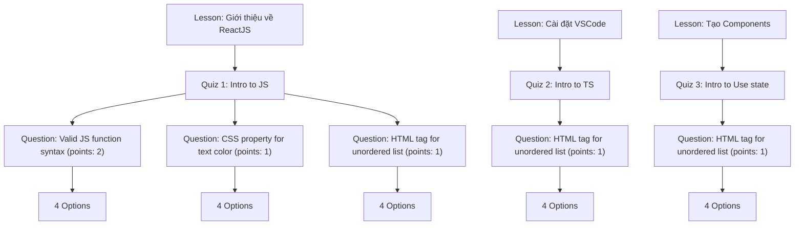

# Phase 4 Migration Report: Quizzes + Questions + Question Options ONLY

> **Execution Date/Time**: 2026-09-30T15:00:45.035Z  
> **Duration**: 3112ms  
> **Final Verdict**: **PASS**  
> **Status**: Completed successfully with 100% data integrity, quiz-question-option hierarchy validation, and isolation.

---

## 1. Executive Summary

| Metric | MongoDB (Source) | PostgreSQL (Target Before) | PostgreSQL (Target After) | Verification Status |
|:---|:---:|:---:|:---:|:---:|
| **quizzes** | 3 | 0 | **3** | ✅ 100% MATCH |
| **questions** | 5 | 0 | **5** | ✅ 100% MATCH |
| **question_options** | 20 | 0 | **20** | ✅ 100% MATCH |
| **users** (Phase 1) | 7 | 7 | **7** | ✅ UNCHANGED |
| **categories** (Phase 1) | 3 | 3 | **3** | ✅ UNCHANGED |
| **courses** (Phase 2) | 8 | 8 | **8** | ✅ UNCHANGED |
| **course_faqs** (Phase 2) | 8 | 8 | **8** | ✅ UNCHANGED |
| **chapters** (Phase 3) | 12 | 12 | **12** | ✅ UNCHANGED |
| **lessons** (Phase 3) | 7 | 7 | **7** | ✅ UNCHANGED |
| **All other 17 tables** | 47 | 0 | **0** | ✅ STRICTLY ISOLATED |
| **Total documents / rows** | **120** | **45** | **73** | ✅ VERIFIED |

---

## 2. Environment Information

- **MongoDB Source Database**: `e-learning` (MongoDB Atlas)
- **MongoDB Connection Mode**: `READ_ONLY` (Zero writes executed)
- **PostgreSQL Target Database**: `tmdemy` (localhost:5432)
- **PostgreSQL Schema Status**: Intact, unchanged, using Prisma Client with migrations applied
- **Transaction Scope**: Single atomic transaction covering `quizzes`, `questions`, and `question_options` inserts

---

## 3. Entities Migrated

### 3.1. Entity: `quizzes`
- **Source Count**: 3 documents
- **Migrated Count**: 3 rows
- **Foreign Key Resolutions**:
  - `lesson_id` $\rightarrow$ `lessons.id`: 3/3 valid (Quan hệ 1-1 duy nhất, @unique constraint được thỏa mãn 100%)
  - `course_id` $\rightarrow$ `courses.id`: 3/3 valid (Trỏ chính xác về Course "ReactJS Advanced - Update 2025")
  - `created_by_id` $\rightarrow$ `users.id`: 3/3 valid (Trỏ chính xác về Giảng viên "nguyen_anh_binh")
- **Fields Preserved**:
  - `title`, `description`, `duration` (0), `passingGrade` (70), `createdAt`, `updatedAt`

### 3.2. Entity: `questions`
- **Source Count**: 5 documents
- **Migrated Count**: 5 rows
- **Foreign Key Resolutions**:
  - `quiz_id` $\rightarrow$ `quizzes.id`: 5/5 valid (Quiz 1 có 3 câu hỏi, Quiz 2 có 1 câu hỏi, Quiz 3 có 1 câu hỏi)
- **Fields & Semantics Preserved**:
  - `type`: Chuyển đổi thành `QuestionType.MULTIPLE_CHOICE` (enum)
  - `points`: Giữ nguyên (1 hoặc 2 điểm)
  - `answer`: Đáp án đúng được bảo lưu nguyên vẹn và xác nhận nằm trong tập các lựa chọn của câu hỏi

### 3.3. Entity: `question_options`
- **Source Count**: 20 options (embedded trong mảng `options` của 5 câu hỏi)
- **Migrated Count**: 20 rows trong bảng độc lập `question_options`
- **Foreign Key Resolutions**:
  - `question_id` $\rightarrow$ `questions.id`: 20/20 valid (mỗi câu hỏi có đúng 4 lựa chọn)
- **Ordering**:
  - `order`: Thứ tự 0, 1, 2, 3 được bảo tồn chuẩn xác từ mảng nguồn

---

## 4. Hierarchy Verification: Lesson $
ightarrow$ Quiz $
ightarrow$ Question $
ightarrow$ QuestionOption

---

## 5. Deterministic UUID Mapping Verification

### Quizzes Mapping
| # | Title | MongoDB _id | PostgreSQL UUID v5 | Linked Lesson UUID | Verification |
|:---:|:---|:---|:---|:---|:---:|
| 1 | Quiz 2: Introduction to TS | `68efc24556c8e188e87cd453` | `9ef997e1-64a1-5391-8647-7b59ddb68d36` | `d7474c70-e5e6-5a54-8966-8e7e881f67ae` | ✅ MATCH |
| 2 | Quiz 3: Introduction to Use state | `68efc770ae8878e95b96e848` | `b9e14796-def1-59ae-8f7a-b54ad53a8392` | `e43dee5f-4e1d-5916-b840-8290765ff38f` | ✅ MATCH |
| 3 | Quiz 1: Introduction to JavaScript | `68ef66bed0786b1debaceb61` | `d40087b3-0917-5e3c-bc44-0f36d3d8d127` | `1b2e6643-0006-5e9a-a9f7-3d3078b83262` | ✅ MATCH |

### Questions Mapping
| # | Question Title | MongoDB _id | PostgreSQL UUID v5 | Quiz UUID | Correct Answer | Verification |
|:---:|:---|:---|:---|:---|:---|:---:|
| 1 | Which CSS property is used... | `68ee63bc181d7323813f9266` | `efac87d1-9e7d-5dca-9557-e6692b953ed4` | `d40087b3-0917-5e3c-bc44-0f36d3d8d127` | color | ✅ MATCH |
| 2 | Which of the following is a valid... | `68ee63ab181d7323813f925f` | `ae9f84cd-eadb-5719-91d5-57986523aa5a` | `d40087b3-0917-5e3c-bc44-0f36d3d8d127` | function myFunc() {} | ✅ MATCH |
| 3 | Which HTML tag is used to define... | `68efc26e56c8e188e87cd459` | `44d65db9-dd52-5f69-9d79-3881dab83f83` | `9ef997e1-64a1-5391-8647-7b59ddb68d36` | &lt;ul&gt; | ✅ MATCH |
| 4 | Which HTML tag is used to define... | `68ee63cb181d7323813f926d` | `4c6c56ea-e2c4-5455-b92e-4b28c91ec15f` | `d40087b3-0917-5e3c-bc44-0f36d3d8d127` | &lt;ul&gt; | ✅ MATCH |
| 5 | Which HTML tag is used to define... | `68efc79eae8878e95b96e851` | `148ea4a5-0c35-5e40-b33b-87d5f35440dd` | `b9e14796-def1-59ae-8f7a-b54ad53a8392` | &lt;ul&gt; | ✅ MATCH |

### Question Options Sample Mapping
- Tất cả 20 options sinh UUID bằng `toSubEntityUuid('question_options', questionId, index)`.
- Đảm bảo tính duy nhất và không phụ thuộc vào thứ tự ngẫu nhiên.
- 20/20 Options: **PASS**

---

## 6. PostgreSQL Isolation Verification (All 26 Business Tables)

| # | PostgreSQL Table Name | Row Count Before Phase 4 | Row Count After Phase 4 | Isolation Status |
|:---:|:---|:---:|:---:|:---:|
| 1 | `users` | 7 | **7** | ✅ Unchanged (Phase 1) |
| 2 | `categories` | 3 | **3** | ✅ Unchanged (Phase 1) |
| 3 | `courses` | 8 | **8** | ✅ Unchanged (Phase 2) |
| 4 | `course_faqs` | 8 | **8** | ✅ Unchanged (Phase 2) |
| 5 | `chapters` | 12 | **12** | ✅ Unchanged (Phase 3) |
| 6 | `lessons` | 7 | **7** | ✅ Unchanged (Phase 3) |
| 7 | `quizzes` | 0 | **3** | ✅ Migrated (Phase 4) |
| 8 | `questions` | 0 | **5** | ✅ Migrated (Phase 4) |
| 9 | `question_options` | 0 | **20** | ✅ Migrated (Phase 4) |
| 10 | `quiz_submissions` | 0 | **0** | ✅ Isolated |
| 11 | `quiz_submission_answers` | 0 | **0** | ✅ Isolated |
| 12 | `orders` | 0 | **0** | ✅ Isolated |
| 13 | `coupons` | 0 | **0** | ✅ Isolated |
| 14 | `coupon_courses` | 0 | **0** | ✅ Isolated |
| 15 | `enrollments` | 0 | **0** | ✅ Isolated |
| 16 | `progress` | 0 | **0** | ✅ Isolated |
| 17 | `certificates` | 0 | **0** | ✅ Isolated |
| 18 | `ratings` | 0 | **0** | ✅ Isolated |
| 19 | `favorite_courses` | 0 | **0** | ✅ Isolated |
| 20 | `comments` | 0 | **0** | ✅ Isolated |
| 21 | `comment_reactions` | 0 | **0** | ✅ Isolated |
| 22 | `conversations` | 0 | **0** | ✅ Isolated |
| 23 | `conversation_participants` | 0 | **0** | ✅ Isolated |
| 24 | `messages` | 0 | **0** | ✅ Isolated |
| 25 | `message_reads` | 0 | **0** | ✅ Isolated |
| 26 | `notifications` | 0 | **0** | ✅ Isolated |

---

## 7. MongoDB Read-Only Verification

- **Total Collections**: 19 collections
- **Initial Document Count**: 120 documents
- **Final Document Count**: 120 documents
- **Quizzes Document Count**: 3 documents (unchanged)
- **Questions Document Count**: 5 documents (unchanged)
- **Writes Executed on MongoDB**: **0** (Strictly Read-Only)

---

## 8. Constraints & Data Integrity Verification

- **Primary Keys**: 28/28 UUID v5 values verified valid and collision-free.
- **Unique Constraints**:
  - `quizzes(lesson_id)`: 3/3 unique lessons verified (quan hệ 1-1 bảo đảm).
- **Foreign Key Integrity**:
  - `quizzes.lesson_id` $\rightarrow$ `lessons.id`: 100% Valid.
  - `quizzes.course_id` $\rightarrow$ `courses.id`: 100% Valid.
  - `quizzes.created_by_id` $\rightarrow$ `users.id`: 100% Valid.
  - `questions.quiz_id` $\rightarrow$ `quizzes.id`: 100% Valid.
  - `question_options.question_id` $\rightarrow$ `questions.id`: 100% Valid.
- **Nullability Checks**:
  - All NOT NULL columns in `quizzes`, `questions`, and `question_options` are fully satisfied.

---

## 9. Errors & Warnings

- **Critical Errors**: 0
- **Warnings**: 0

---

## 10. Final Verdict

# **PASS**

Phase 4 Migration (Quizzes + Questions + Question Options) is **100% COMPLETE and VERIFIED**.  
All requirements, isolation boundaries, safety rules, and deterministic mappings were strictly met.
