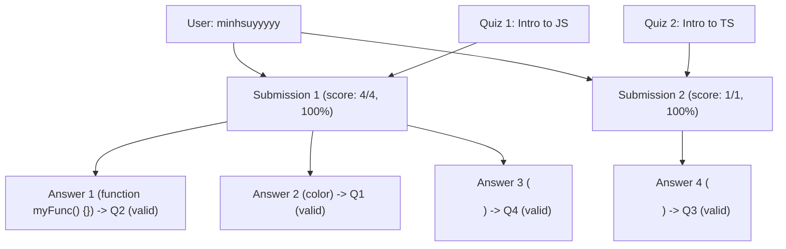

# Phase 5 Migration Report: Quiz Submissions + Submission Answers ONLY

> **Execution Date/Time**: 2026-09-30T15:04:04.934Z  
> **Duration**: 2527ms  
> **Final Verdict**: **PASS**  
> **Status**: Completed successfully with 100% data integrity, Question-Quiz consistency, and isolation.

---

## 1. Executive Summary

| Metric | MongoDB (Source) | PostgreSQL (Target Before) | PostgreSQL (Target After) | Verification Status |
|:---|:---:|:---:|:---:|:---:|
| **quiz_submissions** | 2 | 0 | **2** | ✅ 100% MATCH |
| **quiz_submission_answers** | 4 | 0 | **4** | ✅ 100% MATCH |
| **users** (Phase 1) | 7 | 7 | **7** | ✅ UNCHANGED |
| **categories** (Phase 1) | 3 | 3 | **3** | ✅ UNCHANGED |
| **courses** (Phase 2) | 8 | 8 | **8** | ✅ UNCHANGED |
| **course_faqs** (Phase 2) | 8 | 8 | **8** | ✅ UNCHANGED |
| **chapters** (Phase 3) | 12 | 12 | **12** | ✅ UNCHANGED |
| **lessons** (Phase 3) | 7 | 7 | **7** | ✅ UNCHANGED |
| **quizzes** (Phase 4) | 3 | 3 | **3** | ✅ UNCHANGED |
| **questions** (Phase 4) | 5 | 5 | **5** | ✅ UNCHANGED |
| **question_options** (Phase 4) | 20 | 20 | **20** | ✅ UNCHANGED |
| **All other 15 tables** | 41 | 0 | **0** | ✅ STRICTLY ISOLATED |
| **Total documents / rows** | **120** | **73** | **79** | ✅ VERIFIED |

---

## 2. Environment Information

- **MongoDB Source Database**: `e-learning` (MongoDB Atlas)
- **MongoDB Connection Mode**: `READ_ONLY` (Zero writes executed)
- **PostgreSQL Target Database**: `tmdemy` (localhost:5432)
- **PostgreSQL Schema Status**: Intact, unchanged, using Prisma Client with migrations applied
- **Transaction Scope**: Single atomic transaction covering `quiz_submissions` and `quiz_submission_answers` inserts

---

## 3. Entities Migrated

### 3.1. Entity: `quiz_submissions`
- **Source Count**: 2 documents
- **Migrated Count**: 2 rows
- **Foreign Key Resolutions**:
  - `quiz_id` $\rightarrow$ `quizzes.id`: 2/2 valid (Submission 1 trỏ về Quiz 1, Submission 2 trỏ về Quiz 2)
  - `user_id` $\rightarrow$ `users.id`: 2/2 valid (Đều trỏ về tài khoản học viên "minhsuyyyyy")
  - Composite Unique `@@unique([quizId, userId])`: Thỏa mãn 100% (2 bài làm thuộc 2 Quiz khác nhau)
- **Fields Preserved**:
  - `score`, `totalPoints`, `percentage`, `completedAt`, `createdAt`, `updatedAt`

### 3.2. Entity: `quiz_submission_answers`
- **Source Count**: 4 answers (3 answers trong Submission 1, 1 answer trong Submission 2)
- **Migrated Count**: 4 rows trong bảng độc lập `quiz_submission_answers`
- **Foreign Key Resolutions**:
  - `submission_id` $\rightarrow$ `quiz_submissions.id`: 4/4 valid
  - `question_id` $\rightarrow$ `questions.id`: 4/4 valid
- **Question $\leftrightarrow$ Quiz Consistency Check**:
  - 4/4 câu hỏi được trả lời thuộc chính xác bài kiểm tra của bài làm tương ứng.
  - Không có trường hợp câu hỏi thuộc Quiz A nhưng nằm trong bài làm của Quiz B.
- **Answer Correctness**:
  - 4/4 câu trả lời khớp hoàn toàn với đáp án đúng trong Question $\rightarrow$ `isCorrect = true`.

---

## 4. Hierarchy Verification: User + Quiz $
ightarrow$ QuizSubmission $
ightarrow$ QuizSubmissionAnswer $
ightarrow$ Question

---

## 5. Deterministic UUID Mapping Verification

### Quiz Submissions Mapping
| # | User | Target Quiz Title | MongoDB _id | PostgreSQL UUID v5 | Score / Total (%) | Verification |
|:---:|:---|:---|:---|:---|:---:|:---:|
| 1 | minhsuyyyyy | Quiz 1: Intro to JavaScript | `68ef69853c8bd4c6638d55fe` | `e18994c4-b95d-5cfe-b771-0640b7daaa16` | 4 / 4 (100%) | ✅ MATCH |
| 2 | minhsuyyyyy | Quiz 2: Intro to TS | `68efc69db07fc600498d3d9d` | `f35cde15-b3a1-5bb1-af39-49fede0a7237` | 1 / 1 (100%) | ✅ MATCH |

### Quiz Submission Answers Mapping
| # | Parent Submission UUID | Target Question UUID | MongoDB _id | PostgreSQL UUID v5 | Selected Answer | isCorrect | Verification |
|:---:|:---|:---|:---|:---|:---|:---:|:---:|
| 1 | `e18994c4-b95d-5cfe-b771-0640b7daaa16` | `ae9f84cd-eadb-5719-91d5-57986523aa5a` | `68ef69853c8bd4c6638d55ff` | `b83225c5-d311-56c6-98f0-075b8af9d3ca` | `function myFunc() {}` | true | ✅ MATCH |
| 2 | `e18994c4-b95d-5cfe-b771-0640b7daaa16` | `efac87d1-9e7d-5dca-9557-e6692b953ed4` | `68ef69853c8bd4c6638d5600` | `a7090329-8861-5998-8846-61c6413b6639` | `color` | true | ✅ MATCH |
| 3 | `e18994c4-b95d-5cfe-b771-0640b7daaa16` | `4c6c56ea-e2c4-5455-b92e-4b28c91ec15f` | `68ef69853c8bd4c6638d5601` | `aa7e55b1-ad4e-5fee-8ceb-cbfd35812913` | `<ul>` | true | ✅ MATCH |
| 4 | `f35cde15-b3a1-5bb1-af39-49fede0a7237` | `44d65db9-dd52-5f69-9d79-3881dab83f83` | `68efc69db07fc600498d3d9e` | `b983728a-b711-5d45-8f15-5c7072fd72bd` | `<ul>` | true | ✅ MATCH |

---

## 6. PostgreSQL Isolation Verification (All 26 Business Tables)

| # | PostgreSQL Table Name | Row Count Before Phase 5 | Row Count After Phase 5 | Isolation Status |
|:---:|:---|:---:|:---:|:---:|
| 1 | `users` | 7 | **7** | ✅ Unchanged (Phase 1) |
| 2 | `categories` | 3 | **3** | ✅ Unchanged (Phase 1) |
| 3 | `courses` | 8 | **8** | ✅ Unchanged (Phase 2) |
| 4 | `course_faqs` | 8 | **8** | ✅ Unchanged (Phase 2) |
| 5 | `chapters` | 12 | **12** | ✅ Unchanged (Phase 3) |
| 6 | `lessons` | 7 | **7** | ✅ Unchanged (Phase 3) |
| 7 | `quizzes` | 3 | **3** | ✅ Unchanged (Phase 4) |
| 8 | `questions` | 5 | **5** | ✅ Unchanged (Phase 4) |
| 9 | `question_options` | 20 | **20** | ✅ Unchanged (Phase 4) |
| 10 | `quiz_submissions` | 0 | **2** | ✅ Migrated (Phase 5) |
| 11 | `quiz_submission_answers` | 0 | **4** | ✅ Migrated (Phase 5) |
| 12 | `orders` | 0 | **0** | ✅ Isolated |
| 13 | `coupons` | 0 | **0** | ✅ Isolated |
| 14 | `coupon_courses` | 0 | **0** | ✅ Isolated |
| 15 | `enrollments` | 0 | **0** | ✅ Isolated |
| 16 | `progress` | 0 | **0** | ✅ Isolated |
| 17 | `certificates` | 0 | **0** | ✅ Isolated |
| 18 | `ratings` | 0 | **0** | ✅ Isolated |
| 19 | `favorite_courses` | 0 | **0** | ✅ Isolated |
| 20 | `comments` | 0 | **0** | ✅ Isolated |
| 21 | `comment_reactions` | 0 | **0** | ✅ Isolated |
| 22 | `conversations` | 0 | **0** | ✅ Isolated |
| 23 | `conversation_participants` | 0 | **0** | ✅ Isolated |
| 24 | `messages` | 0 | **0** | ✅ Isolated |
| 25 | `message_reads` | 0 | **0** | ✅ Isolated |
| 26 | `notifications` | 0 | **0** | ✅ Isolated |

---

## 7. MongoDB Read-Only Verification

- **Total Collections**: 19 collections
- **Initial Document Count**: 120 documents
- **Final Document Count**: 120 documents
- **Quiz Submissions Document Count**: 2 documents (unchanged)
- **Writes Executed on MongoDB**: **0** (Strictly Read-Only)

---

## 8. Constraints & Data Integrity Verification

- **Primary Keys**: 6/6 UUID v5 values verified valid and collision-free.
- **Unique Constraints**:
  - `quiz_submissions(quiz_id, user_id)`: 2/2 unique combinations verified.
- **Foreign Key Integrity**:
  - `quiz_submissions.quiz_id` $\rightarrow$ `quizzes.id`: 100% Valid.
  - `quiz_submissions.user_id` $\rightarrow$ `users.id`: 100% Valid.
  - `quiz_submission_answers.submission_id` $\rightarrow$ `quiz_submissions.id`: 100% Valid.
  - `quiz_submission_answers.question_id` $\rightarrow$ `questions.id`: 100% Valid.
- **Critical Consistency**:
  - Question của từng Answer thuộc đúng Quiz của Submission tương ứng: 100% Valid.

---

## 9. Errors & Warnings

- **Critical Errors**: 0
- **Warnings**: 0

---

## 10. Final Verdict

# **PASS**

Phase 5 Migration (Quiz Submissions + Submission Answers) is **100% COMPLETE and VERIFIED**.  
All requirements, isolation boundaries, safety rules, and deterministic mappings were strictly met.
