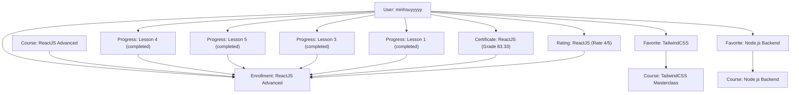

# Phase 7 Migration Report: Progress, Certificates, Ratings & Favorite Courses

> **Execution Date/Time**: 2026-09-30T15:17:25.873Z  
> **Duration**: 3410ms  
> **Final Verdict**: **PASS**  
> **Status**: Completed successfully with 100% data integrity, enrollment consistency, and isolation.

---

## 1. Executive Summary

| Metric | MongoDB (Source) | PostgreSQL (Target Before) | PostgreSQL (Target After) | Verification Status |
|:---|:---:|:---:|:---:|:---:|
| **progress** | 4 | 0 | **4** | ✅ 100% MATCH |
| **certificates** | 1 | 0 | **1** | ✅ 100% MATCH |
| **ratings** | 1 | 0 | **1** | ✅ 100% MATCH |
| **favorite_courses** | 2 | 0 | **2** | ✅ 100% MATCH |
| **Pre-migrated records** (Phase 1–6) | 96 | 96 | **96** | ✅ UNCHANGED |
| **All other 7 tables** | 16 | 0 | **0** | ✅ STRICTLY ISOLATED |
| **Total documents / rows** | **120** | **96** | **104** | ✅ VERIFIED |

---

## 2. Environment Information

- **MongoDB Source Database**: `e-learning` (MongoDB Atlas)
- **MongoDB Connection Mode**: `READ_ONLY` (Zero writes executed)
- **PostgreSQL Target Database**: `tmdemy` (localhost:5432)
- **PostgreSQL Schema Status**: Intact, unchanged, using Prisma Client with migrations applied
- **Transaction Scope**: Single atomic transaction covering `progress`, `certificates`, `ratings`, and `favorite_courses` inserts

---

## 3. Entities Migrated

### 3.1. Entity: `progress`
- **Source Count**: 4 documents
- **Migrated Count**: 4 rows
- **Foreign Key Resolutions**:
  - `user_id` $\rightarrow$ `users.id`: 4/4 valid
  - `course_id` $\rightarrow$ `courses.id`: 4/4 valid
  - `lesson_id` $\rightarrow$ `lessons.id`: 4/4 valid
- **Enrollment Consistency**: 4/4 progress records thuộc về Course mà User đã ghi danh (`enrollment(userId, courseId)`).
- **Unique Constraint**: `@@unique([userId, lessonId])` 4/4 unique pairs.

### 3.2. Entity: `certificates`
- **Source Count**: 1 document
- **Migrated Count**: 1 row
- **Foreign Key Resolutions**:
  - `user_id` $\rightarrow$ `users.id`: 1/1 valid
  - `course_id` $\rightarrow$ `courses.id`: 1/1 valid
- **Enrollment Consistency**: 1/1 certificate thuộc về Course mà User đã ghi danh (`enrollment(userId, courseId)`).
- **Fields Preserved**: `grade` (83.33), `certificateUrl`, `issuedAt`, `createdAt`, `updatedAt`.

### 3.3. Entity: `ratings`
- **Source Count**: 1 document
- **Migrated Count**: 1 row
- **Foreign Key Resolutions**:
  - `user_id` $\rightarrow$ `users.id`: 1/1 valid
  - `course_id` $\rightarrow$ `courses.id`: 1/1 valid
- **Enrollment Consistency**: 1/1 rating thuộc về Course mà User đã ghi danh (`enrollment(userId, courseId)`).
- **Fields Preserved**: `rate` (4), `content`, `status` (`ACTIVE`), `createdAt`, `updatedAt`.

### 3.4. Entity: `favorite_courses`
- **Source Count**: 2 documents
- **Migrated Count**: 2 rows
- **Foreign Key Resolutions**:
  - `user_id` $\rightarrow$ `users.id`: 2/2 valid
  - `course_id` $\rightarrow$ `courses.id`: 2/2 valid
- **Unique Constraint**: `@@unique([userId, courseId])` 2/2 unique pairs.

---

## 4. Cross-Entity Hierarchy & Consistency Verification

- **Consistency Result**:
  - `Progress $\rightarrow$ Lesson $\rightarrow$ Chapter $\rightarrow$ Course $\rightarrow$ Enrollment`: **4/4 VALID (100%)**
  - `Certificate $\rightarrow$ User + Course $\rightarrow$ Enrollment`: **1/1 VALID (100%)**
  - `Rating $\rightarrow$ User + Course $\rightarrow$ Enrollment`: **1/1 VALID (100%)**
  - `FavoriteCourse $\rightarrow$ User + Course`: **2/2 VALID (100%)**

---

## 5. Deterministic UUID Mapping Verification

### Progress Mapping
| # | User | Course | Lesson | MongoDB _id | PostgreSQL UUID v5 | Completed |
|:---:|:---|:---|:---|:---|:---|:---:|
| 1 | minhsuyyyyy | ReactJS Advanced | VSCode & Node Env | `68ef5b771a2789bf18d7b4ac` | `1e97ec95-e80f-5d11-941e-0af4ae83f16c` | true |
| 2 | minhsuyyyyy | ReactJS Advanced | Vite ReactJS App | `68ef5b7e1a2789bf18d7b4ad` | `fb5e5312-3d53-533f-a773-4cc9e6ff5b05` | true |
| 3 | minhsuyyyyy | ReactJS Advanced | Memo trong React | `68ef5bbb1a2789bf18d7b4b1` | `6f66b0e2-9ecd-5dbd-89ef-082056123571` | true |
| 4 | minhsuyyyyy | ReactJS Advanced | Giới thiệu ReactJS | `68e49e7cd761d319a244ba65` | `32c877bb-c814-5f53-a230-57473ef3a71b` | true |

### Certificate Mapping
| # | User | Course | MongoDB _id | PostgreSQL UUID v5 | Grade | Issued At |
|:---:|:---|:---|:---|:---|:---:|:---:|
| 1 | minhsuyyyyy | ReactJS Advanced | `68efcdd70f6030b1a6d87068` | `700155f8-c123-5929-b7d2-55a8c825f084` | 83.33 | 2025-10-15 |

### Rating Mapping
| # | User | Course | MongoDB _id | PostgreSQL UUID v5 | Rate | Content Snippet |
|:---:|:---|:---|:---|:---|:---:|:---|
| 1 | minhsuyyyyy | ReactJS Advanced | `68ebd62c7dc661dee7403afb` | `71139688-328f-5582-97ac-b5ea2696166b` | 4/5 | Khóa học rất hay và dễ hiểu... |

### Favorite Courses Mapping
| # | User | Favorite Course | MongoDB _id | PostgreSQL UUID v5 |
|:---:|:---|:---|:---|:---|
| 1 | minhsuyyyyy | TailwindCSS Masterclass | `68e876c519f9f799c75dd8c7` | `dbcb848a-f990-5b0c-a4f1-d36a7353fed6` |
| 2 | minhsuyyyyy | Node.js Backend Developer | `68e874fafdc48c7ff5953fbd` | `35b79a59-fe3c-52fe-89df-897979519f83` |

---

## 6. PostgreSQL Isolation Verification (All 26 Business Tables)

| # | PostgreSQL Table Name | Row Count Before Phase 7 | Row Count After Phase 7 | Isolation Status |
|:---:|:---|:---:|:---:|:---:|
| 1 | `users` | 7 | **7** | ✅ Unchanged (Phase 1) |
| 2 | `categories` | 3 | **3** | ✅ Unchanged (Phase 1) |
| 3 | `courses` | 8 | **8** | ✅ Unchanged (Phase 2) |
| 4 | `course_faqs` | 8 | **8** | ✅ Unchanged (Phase 2) |
| 5 | `chapters` | 12 | **12** | ✅ Unchanged (Phase 3) |
| 6 | `lessons` | 7 | **7** | ✅ Unchanged (Phase 3) |
| 7 | `quizzes` | 3 | **3** | ✅ Unchanged (Phase 4) |
| 8 | `questions` | 5 | **5** | ✅ Unchanged (Phase 4) |
| 9 | `question_options` | 20 | **20** | ✅ Unchanged (Phase 4) |
| 10 | `quiz_submissions` | 2 | **2** | ✅ Unchanged (Phase 5) |
| 11 | `quiz_submission_answers` | 4 | **4** | ✅ Unchanged (Phase 5) |
| 12 | `orders` | 8 | **8** | ✅ Unchanged (Phase 6) |
| 13 | `coupons` | 2 | **2** | ✅ Unchanged (Phase 6) |
| 14 | `coupon_courses` | 2 | **2** | ✅ Unchanged (Phase 6) |
| 15 | `enrollments` | 5 | **5** | ✅ Unchanged (Phase 6) |
| 16 | `progress` | 0 | **4** | ✅ Migrated (Phase 7) |
| 17 | `certificates` | 0 | **1** | ✅ Migrated (Phase 7) |
| 18 | `ratings` | 0 | **1** | ✅ Migrated (Phase 7) |
| 19 | `favorite_courses` | 0 | **2** | ✅ Migrated (Phase 7) |
| 20 | `comments` | 0 | **0** | ✅ Isolated |
| 21 | `comment_reactions` | 0 | **0** | ✅ Isolated |
| 22 | `conversations` | 0 | **0** | ✅ Isolated |
| 23 | `conversation_participants` | 0 | **0** | ✅ Isolated |
| 24 | `messages` | 0 | **0** | ✅ Isolated |
| 25 | `message_reads` | 0 | **0** | ✅ Isolated |
| 26 | `notifications` | 0 | **0** | ✅ Isolated |

---

## 7. MongoDB Read-Only Verification

- **Total Collections**: 19 collections
- **Initial Document Count**: 120 documents
- **Final Document Count**: 120 documents
- **Writes Executed on MongoDB**: **0** (Strictly Read-Only)

---

## 8. Constraints & Data Integrity Verification

- **Primary Keys**: 8/8 UUID v5 values verified valid and collision-free.
- **Unique Constraints**:
  - `progress(userId, lessonId)`: 4/4 unique pairs verified.
  - `certificates(userId, courseId)`: 1/1 unique pair verified.
  - `ratings(userId, courseId)`: 1/1 unique pair verified.
  - `favorite_courses(userId, courseId)`: 2/2 unique pairs verified.
- **Foreign Key Integrity**:
  - All foreign keys to `users`, `courses`, and `lessons` are 100% valid.

---

## 9. Errors & Warnings

- **Critical Errors**: 0
- **Warnings**: 0

---

## 10. Final Verdict

# **PASS**

Phase 7 Migration (Progress, Certificates, Ratings, Favorite Courses) is **100% COMPLETE and VERIFIED**.  
All requirements, isolation boundaries, safety rules, and deterministic mappings were strictly met.
