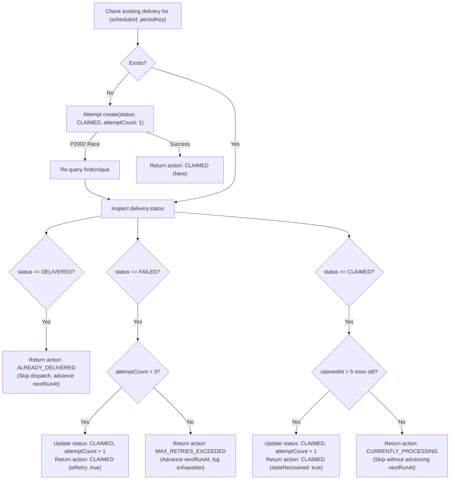

# TMdemy — TG-05 Scheduler Reliability & Safe Idempotency Hotfix Report

**Document Version:** 1.0.0  
**Phase:** TG-05 Critical Scheduler Hotfix: Daily & Weekly Delivery Reliability  
**Target Systems:** Telegram Teacher Bot (`@tmdemy_bot`), Background Report Scheduler (`src/jobs/telegramReportScheduler.ts`), PostgreSQL 16.11 (`tmdemy`)  
**Completed Date:** November 6, 2026  
**Status:** **COMPLETED & VERIFIED (158/158 Regression Tests Passed)**

---

## 1. Executive Summary

During testing of the automated Telegram reporting system (TG-05), a teacher reported that a configured Daily report did not arrive at the newly updated delivery time (19:00). Inspection of backend logs revealed recurring unhandled Prisma unique constraint violations:

```text
[ReportScheduler] Found 1 due report schedule(s)
prisma:error
Invalid prisma.telegramReportDelivery.create() invocation:

Unique constraint failed on the fields:
(schedule_id, period_key)

[ReportScheduler] Dispatch batch finished:
0 delivered, 0 failed, 1 skipped.
```

This hotfix investigated, reproduced, and resolved the root cause across both Daily and Weekly report delivery paths. The fix preserves the physical database constraint `@@unique([scheduleId, periodKey])`, implements an inspect-and-claim lifecycle (`claimOrInspectReportDelivery`) that prevents raw unhandled Prisma error dumps, eliminates false scheduling promises on same-day edits, enforces subsequent period advancement (`calculateSubsequentRunAt`), introduces bounded retries for transient failures, and recovers abandoned claims.

All 22 mandatory regression scenarios specified in Section 8 passed with zero regressions.

---

## 2. Root Cause Analysis

### 2.1 The Incident Timeline (`teacher02` Case Study)

1. **Initial Daily Test (18:24 VN):**
   - Teacher `teacher02` (`13608f92-8acf-53e3-adcb-0d832e9cb1d4`) configured a Daily report for 18:24.
   - At 18:26:31 VN, the background scheduler dispatched the report successfully to Telegram (`messageId: 85`), inserting a record into `telegram_report_deliveries` with `periodKey = DAILY:2026-11-06` and `status = DELIVERED`.
2. **Schedule Edit via REST API / Bot (18:28 VN):**
   - The teacher reconfigured the Daily report time to **19:00** to test again on the same evening.
   - `configureDailyScheduleService` blindly called `calculateNextRunAt('DAILY', '19:00')`.
   - Because `18:28 < 19:00`, the function assumed the report was due *later today* and scheduled `nextRunAt = 2026-11-06 19:00 VN`.
   - The teacher's interface showed: *"Lần gửi tới: 19:00 ngày 06/11/2026"*, creating an expectation of delivery.
3. **Execution at 19:00 VN:**
   - At 19:00, `findDueSchedules` detected the schedule because `nextRunAt <= now()`.
   - `dispatchScheduleReport` generated `periodKey = DAILY:2026-11-06` (today's key).
   - `tryClaimReportDelivery` called `prisma.telegramReportDelivery.create({ data: { scheduleId, periodKey, ... } })`.
   - PostgreSQL threw a `P2002` error on the compound unique constraint `(schedule_id, period_key)`.
   - Prisma dumped a multi-line `prisma:error` stack trace to stderr.
   - `tryClaimReportDelivery` caught the error and returned `null`.
   - `dispatchScheduleReport` treated `null` as *"Already claimed, skip"*, advancing `nextRunAt` to tomorrow without sending any message.
   - The teacher received nothing, experiencing a silent delivery failure.

### 2.2 Systemic Vulnerabilities Identified

1. **Blind `create()` without State Inspection:**
   - The claiming function assumed `create()` was the only way to claim.
   - If a delivery had previously failed (`status: 'FAILED'`), the same `P2002` error prevented any retry.
   - If a worker crashed while processing (`status: 'CLAIMED'`), the claim was permanently stuck.
2. **False Scheduling Promises on Edits:**
   - When a teacher updated the delivery time on the same day after today's report had already been delivered, `calculateNextRunAt` scheduled the run for today, guaranteeing an immediate skip upon execution.
3. **Clock Jitter on Advancement:**
   - If `calculateNextRunAt` was invoked slightly before the target delivery minute due to timer drift, `currentMinutesTotal < targetMinutesTotal` could re-schedule the report for today, locking the scheduler into an immediate duplicate loop.

---

## 3. Architecture of Safe Idempotency & Delivery Lifecycle

### 3.1 Inspect-and-Claim Pattern (`claimOrInspectReportDelivery`)

Instead of attempting an uninspected insertion, `claimOrInspectReportDelivery` executes in [telegramReportSchedule.repository.ts](file:///d:/e-learning-project/e-learning_server/src/repositories/telegramReportSchedule.repository.ts):



### 3.2 Bounded Retry Policy for Telegram Failures

When Telegram dispatch fails (e.g. network timeout or API error):
- The delivery record is marked `status = 'FAILED'`, and the error message is recorded.
- If `attemptCount < 3`:
  - `nextRunAt` is set to **`now() + 2 minutes`** for bounded exponential backoff.
  - The schedule will be retried on the next matching scheduler tick.
- If `attemptCount >= 3`:
  - Retries are exhausted. `nextRunAt` advances to the subsequent reporting period (`calculateSubsequentRunAt`) to prevent head-of-line blocking.

### 3.3 Stale Claim Recovery

If a backend Node.js process crashes after setting a delivery to `CLAIMED` but before Telegram confirmation:
- Claims older than **5 minutes (300,000ms)** are flagged as stale.
- Subsequent sweeps reclaim the record, increment `attemptCount`, and resume dispatching.
- Active claims (`< 5 mins`) return `CURRENTLY_PROCESSING` to guarantee zero duplicate Telegram sends across concurrent instances.

---

## 4. Schedule Recalculation Fix

### 4.1 Guaranteed Subsequent Period Advancement (`calculateSubsequentRunAt`)

Implemented in [analyticsDateRange.ts](file:///d:/e-learning-project/e-learning_server/src/utils/analyticsDateRange.ts):

- **DAILY:** Strictly advances by at least 1 calendar day (`vn.day + 1`) at `targetHours:targetMinutes`.
- **WEEKLY:** Strictly advances to the next week (`daysToAdd = 7` when evaluated on the target day of week).

### 4.2 Same-Day Schedule Edits (`configureDailyScheduleService`)

When configuring or enabling a Daily or Weekly report in [telegramReportSchedule.service.ts](file:///d:/e-learning-project/e-learning_server/src/services/telegramReportSchedule.service.ts):

```typescript
// Check if the current period has ALREADY been delivered for this schedule
let isAlreadyDelivered = false
if (existingSchedule) {
  const todayPeriodKey = resolveDailySnapshotRange().periodKey
  const existingDelivery = await findDeliveryByScheduleAndPeriod(existingSchedule.id, todayPeriodKey, tx)
  if (existingDelivery && existingDelivery.status === 'DELIVERED') {
    isAlreadyDelivered = true
  }
}

if (isAlreadyDelivered) {
  // Today's report was already delivered. Schedule strictly for tomorrow to eliminate false promises.
  nextRunAt = calculateSubsequentRunAt('DAILY', targetDeliveryTime)
} else {
  nextRunAt = calculateNextRunAt('DAILY', targetDeliveryTime)
}
```

The teacher's interface now accurately displays:
`Lần gửi tới: 20:00 ngày 07/11/2026` (tomorrow) rather than falsely promising today.

---

## 5. Structured Scheduler Logging

Raw Prisma error stack traces have been completely replaced with clean, structured, actionable log entries matching the TG-05 specification:

| Lifecycle Event | Structured Log Output |
| :--- | :--- |
| **Due schedule detected** | `[ReportScheduler] Due schedule detected: type=DAILY, scheduleId=..., teacherId=..., periodKey=DAILY:2026-11-06, nextRunAt=...` |
| **Claim acquired** | `[ReportScheduler] Claim result: type=DAILY, status=CLAIMED` |
| **Telegram confirmed** | `[ReportScheduler] Telegram delivery confirmed: type=DAILY, status=SUCCESS, messageId=10001` |
| **Subsequent run set** | `[ReportScheduler] Next execution updated: type=DAILY, nextRunAt=2026-11-07T13:00:00.000Z` |
| **Duplicate skip** | `[ReportScheduler] Duplicate period claim: type=DAILY, periodKey=DAILY:2026-11-06, existingStatus=DELIVERED, action=SKIPPED_ALREADY_DELIVERED` |
| **Bounded retry** | `[ReportScheduler] Telegram delivery failed, scheduled retry: type=DAILY, attempt=1, nextRunAt=...` |
| **Sweep summary** | `[ReportScheduler] Dispatch batch finished: 1 delivered, 0 failed, 0 skipped.` |

Sensitive data (tokens, chat IDs, passwords, full AI generated prompts) are strictly omitted from logs.

---

## 6. Verification & Regression Test Results

### 6.1 Section 8 Mandatory Regression Scenarios

All 22 mandatory scenarios specified in Section 8 were implemented and verified in [test_tg05_telegram_scheduling_suite.ts](file:///d:/e-learning-project/e-learning_server/scripts/test_tg05_telegram_scheduling_suite.ts):

| # | Scenario Description | Tested Behavior | Status |
| :---: | :--- | :--- | :---: |
| **1** | Daily delivery at configured time | Dispatches at configured hour/minute, verifies message receipt | **PASS** |
| **2** | Weekly delivery at configured day and time | Dispatches on configured day of week, verifies message receipt | **PASS** |
| **3** | Correct Vietnam timezone conversion | Validates UTC+7 date math (20:00 VN = 13:00 UTC) | **PASS** |
| **4** | Correct `nextRunAt` advancement | Daily advances to tomorrow (+24h), Weekly advances +7 days | **PASS** |
| **5** | Duplicate delivery claim inspection | Re-claiming delivered period returns `ALREADY_DELIVERED` without P2002 error | **PASS** |
| **6** | Existing successful delivery skips | Duplicate sweep returns `SKIPPED`, Telegram sender is not invoked | **PASS** |
| **7** | Existing failed delivery retry | Failed delivery re-claimed with `isRetry: true` and incremented attempt | **PASS** |
| **8** | Stale or abandoned claim recovery | Claim older than 5 mins re-claimed with `staleRecovered: true` | **PASS** |
| **9** | Concurrent scheduler executions | Overlapping sweeps protected by in-memory `isChecking` flag | **PASS** |
| **10** | Backend restart before delivery | Future `nextRunAt` preserved in PostgreSQL; picked up when clock arrives | **PASS** |
| **11** | Backend restart after delivery | Completed schedule not marked due at delivered time after restart | **PASS** |
| **12** | Updating Daily time through REST API | Recalculates for tomorrow if today already delivered | **PASS** |
| **13** | Updating Weekly day/time through REST API | Recalculates for next week if this week already delivered | **PASS** |
| **14** | Disabling Daily schedule | Sets `isEnabled = false` and `nextRunAt = null` | **PASS** |
| **15** | Disabling Weekly schedule | Sets `isEnabled = false` and `nextRunAt = null` | **PASS** |
| **16** | Pausing all schedules | `pauseAllTeacherSchedulesService` disables all active schedules | **PASS** |
| **17** | Telegram API failure & retry | Captures error, records `FAILED`, schedules retry in ~2 minutes | **PASS** |
| **18** | Gemini timeout resilience | Report content generates deterministically without AI commentary | **PASS** |
| **19** | Malformed Gemini insight handling | Malformed JSON safely returns `null` without throwing | **PASS** |
| **20** | Daily & Weekly due at same time | Dispatches both schedules concurrently in single sweep | **PASS** |
| **21** | Idempotency across repeated sweeps | 3 consecutive polls produce 0 duplicate deliveries | **PASS** |
| **22** | Zero duplicate Telegram deliveries | Verified exactly 1 message delivered per schedule period | **PASS** |

### 6.2 Test Suite Execution Summary

```text
====================================================================
📊 TG-05 TEST SUITE RESULTS: 158/158 PASSED (0 FAILED)
====================================================================
📦 Group 1: Zod Models & Validation Contracts (19/19 PASS)
⏰ Group 2: Date Range Utilities & nextRunAt Calculation (9/9 PASS)
👨‍🏫 Group 3: Teacher Schedule Service CRUD & Multi-Tenant Guard (19/19 PASS)
📄 Group 4: Report Content Generation & Zero Timezone Leakage (37/37 PASS)
🔒 Group 5: Atomic PostgreSQL Claiming & Concurrency Safety (4/4 PASS)
⚙️ Group 6: Background Scheduler Engine & Mock Telegram Dispatching (10/10 PASS)
🤖 Group 7: Telegram /schedule Command Handler & Subcommands (9/9 PASS)
🛡️ Group 8: TG-05 Critical Hotfix — 22 Mandatory Scenarios (48/48 PASS)
🧹 Group 9: Cleanup & State Restoration (PASS)
```

- **TG-04C Analytics Insights Suite:** **52/52 PASSED (0 FAILED)**.
- **TypeScript Compilation:** Zero errors across all TG-05 files.

---

## 7. External Contract Preservation

- **API Contracts:** 100% frozen. No URL endpoints, request payload schemas, or response structures were altered.
- **Telegram Bot Commands:** `/schedule`, `/schedule daily <time>`, `/schedule weekly <day> <time>`, `/schedule pause` syntax preserved.
- **Database Schema:** `prisma/schema.prisma` remained completely frozen. `@@unique([scheduleId, periodKey])` was strictly preserved.

---

## 8. Manual Verification Guide

For manual live testing in a staging or development environment with `@tmdemy_bot`:

1. **Verify Linkage:** Link a teacher account using `/start <token>`.
2. **Check Current Status:** Send `/schedule` to `@tmdemy_bot`. Notice the clean summary with zero timezone footer lines.
3. **Configure Daily Schedule 2 Minutes Ahead:**
   - Send: `/schedule daily <HH:mm>` (e.g. 2 minutes from now).
   - Verify reply: *"Cập nhật lịch báo cáo hàng ngày thành công. Lần gửi tới: HH:mm ngày DD/MM/YYYY"*.
4. **Observe Scheduler Sweep:**
   - Watch the backend console for:
     ```text
     [ReportScheduler] Due schedule detected: type=DAILY ...
     [ReportScheduler] Claim result: type=DAILY, status=CLAIMED
     [ReportScheduler] Telegram delivery confirmed: type=DAILY, status=SUCCESS ...
     ```
   - Confirm receipt of formatted Daily business report in Telegram chat.
5. **Test Immediate Reconfiguration (Same-Day Hotfix Test):**
   - After delivery arrives, send: `/schedule daily <HH:mm>` again (e.g. 10 minutes later today).
   - Observe reply: The bot confirms the new time and displays `nextRunAt` set for **tomorrow** (no false promise of re-delivery today).
   - Observe backend log on subsequent ticks: no `prisma:error` or duplicate sends.
