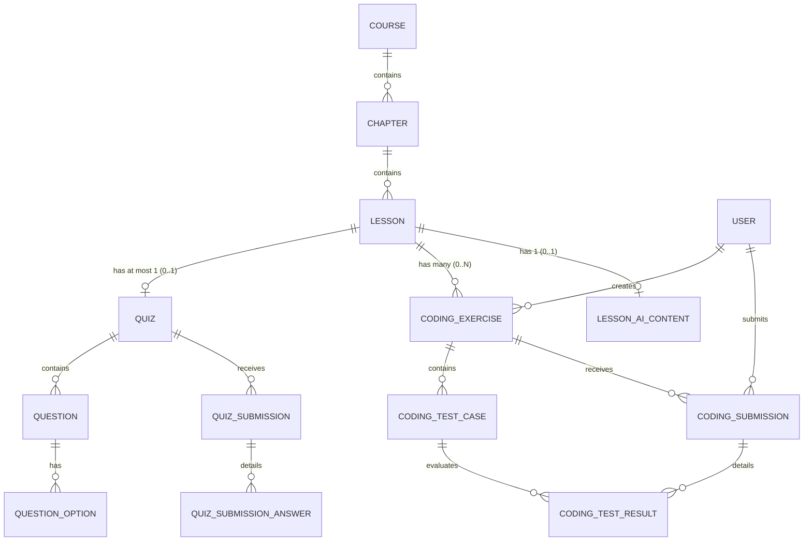

# TMDEMY — BÁO CÁO AUDIT BACKEND & THIẾT KẾ KIẾN TRÚC CODING EXERCISE

> **Tài liệu kiểm toán kỹ thuật & Thiết kế kiến trúc (Read-Only Audit & System Design)**  
> **Dự án**: TMDEMY E-Learning Backend  
> **Phân hệ**: Coding Exercise & AI Generation Pipeline (Chuẩn bị cho Phase 04.5)  
> **Trạng thái**: Read-Only Audit Completed — Chờ phê duyệt thiết kế (Pending Architecture Review)  
> **Mục tiêu**: Cung cấp cơ sở lý thuyết, mô hình dữ liệu, hợp đồng thực thi code và API contract chuẩn mực để triển khai Coding Exercise mà không gây xung đột hay regression trên hệ thống hiện hành.

---

## 1. CURRENT BACKEND FINDINGS (HIỆN TRẠNG BACKEND)

Sau khi kiểm tra toàn bộ [schema.prisma](file:///d:/e-learning_server/prisma/schema.prisma) (683 dòng), cấu trúc mã nguồn tại `src/` và tài liệu hệ thống, kết quả kiểm toán hiện trạng như sau:

### 1.1. Quan hệ Course, Chapter, Lesson
* **Mô hình Course**:
  * Định nghĩa tại [schema.prisma:204-250](file:///d:/e-learning_server/prisma/schema.prisma#L204-L250) (bảng `courses`).
  * Khóa chính `id` kiểu `UUID`. Trường `authorId` trỏ tới bảng `users(id)` (`UserRole.TEACHER` hoặc `ADMIN`).
  * Quan hệ 1-N tới `Chapter` (`chapters Chapter[]`) và `Lesson` (`lessons Lesson[]`).
* **Mô hình Chapter**:
  * Định nghĩa tại [schema.prisma:266-280](file:///d:/e-learning_server/prisma/schema.prisma#L266-L280) (bảng `chapters`).
  * Khóa ngoại `courseId` trỏ tới `courses(id)` với hành động xóa `onDelete: Cascade`.
  * Quan hệ 1-N tới `Lesson` (`lessons Lesson[]`).
* **Mô hình Lesson**:
  * Định nghĩa tại [schema.prisma:282-311](file:///d:/e-learning_server/prisma/schema.prisma#L282-L311) (bảng `lessons`).
  * Khóa ngoại `chapterId` trỏ tới `chapters(id)` với `onDelete: Cascade`.
  * Khóa ngoại `courseId` trỏ tới `courses(id)` với `onDelete: Cascade`.
  * Khóa ngoại `authorId` trỏ tới `users(id)` với `onDelete: Restrict`.
  * Ràng buộc duy nhất `@@unique([slug, courseId])`.
  * Quan hệ 1-1 với Quiz: `quiz Quiz?` (tại dòng 303).
  * Các trường video hiện tại: `videoUrl`, `bunnyVideoId` (@unique), `videoStatus` (`READY`, `PROCESSING`, `FAILED`).
  * Tầng Repository: [lesson.repository.ts](file:///d:/e-learning_server/src/repositories/lesson.repository.ts).
  * Tầng Service: [lesson.service.ts](file:///d:/e-learning_server/src/services/lesson.service.ts) (các hàm `createLessonService`, `updateLessonService`, `deleteLessonService`, `getLessonsByChapterService`).

### 1.2. Phân hệ Quiz và Question hiện có
* **Mô hình Quiz**:
  * Định nghĩa tại [schema.prisma:335-355](file:///d:/e-learning_server/prisma/schema.prisma#L335-L355) (bảng `quizzes`).
  * `lessonId String @unique @map("lesson_id") @db.Uuid`: Ràng buộc bắt buộc 1 Lesson chỉ có tối đa 1 Quiz.
  * `duration Int`: Thời lượng làm bài (phút).
  * `passingGrade Int`: Điểm qua môn (%).
  * Quan hệ 1-N tới `Question` (`questions Question[]`) và `QuizSubmission` (`submissions QuizSubmission[]`).
* **Mô hình Question & QuestionOption**:
  * Định nghĩa tại [schema.prisma:357-385](file:///d:/e-learning_server/prisma/schema.prisma#L357-L385) (bảng `questions` và `question_options`).
  * `QuestionType`: Enum gồm `MULTIPLE_CHOICE` và `FILL_IN_BLANK`.
  * `title String @db.Text`, `answer String @db.Text`, `points Int @default(1)`.
  * `QuestionOption`: bảng lưu danh sách các phương án lựa chọn (`optionText`, `order`).
* **Mô hình QuizSubmission & QuizSubmissionAnswer**:
  * Định nghĩa tại [schema.prisma:387-420](file:///d:/e-learning_server/prisma/schema.prisma#L387-L420) (bảng `quiz_submissions` và `quiz_submission_answers`).
  * Ràng buộc duy nhất `@@unique([quizId, userId])`: **Mỗi học viên chỉ được nộp bài 1 lần duy nhất** cho mỗi Quiz.
  * Tự động chấm điểm trực tiếp tại Service: [quizSubmission.service.ts:113-136](file:///d:/e-learning_server/src/services/quizSubmission.service.ts#L113-L136) qua so sánh chuỗi `question.answer === selectedAnswer`.
  * Tích hợp Gamification trong cùng Prisma Transaction: Cộng XP bài quiz (`awardQuizCompletionXP`) và ghi nhận chuỗi hoạt động học tập (`recordLearningActivityStreak`).

### 1.3. Mô hình Coding Exercise & Assignment trong codebase
* **Kiểm tra**: Tìm kiếm các từ khóa `CodingExercise`, `ProgrammingExercise`, `Assignment`, `Challenge`, `Judge`, `Sandbox`, `CodeRunner` trong toàn bộ `prisma/schema.prisma`, `src/models/`, `src/repositories/`, `src/services/`, `src/routes/`.
* **Kết luận**: **`NOT IMPLEMENTED`** (Hoàn toàn chưa tồn tại trong hệ thống hiện tại).

### 1.4. API tạo bài tập, nộp bài, chấm bài
* **Hiện tại**: Chỉ có API cho Quiz trắc nghiệm:
  * `POST /api/quiz`: Tạo quiz ([quiz.route.ts:20](file:///d:/e-learning_server/src/routes/quiz.route.ts#L20)).
  * `POST /api/submissions`: Nộp bài quiz trắc nghiệm ([quizSubmission.route.ts:16](file:///d:/e-learning_server/src/routes/quizSubmission.route.ts#L16)).
  * `GET /api/submissions/:quizId`: Xem kết quả quiz của học viên ([quizSubmission.route.ts:40](file:///d:/e-learning_server/src/routes/quizSubmission.route.ts#L40)).
* **Coding Exercise API**: **`NOT IMPLEMENTED`**.

### 1.5. Các trường hỗ trợ AI Generation
* **Kiểm tra**: Bảng `lessons`, `courses`, `video_uploads` trong [schema.prisma](file:///d:/e-learning_server/prisma/schema.prisma).
* **Kết luận**: **`NOT IMPLEMENTED`**. Chưa có bất kỳ trường hoặc bảng nào lưu trữ `transcript`, `summary`, `aiJobId`, trạng thái job xử lý AI của FastAPI hoặc log lỗi AI.

### 1.6. Xác thực & Phân quyền (Authentication & Authorization)
* **Xác thực JWT**: Triển khai tại [verifyToken.ts:16-41](file:///d:/e-learning_server/src/middlewares/verifyToken.ts#L16-L41) qua middleware `verifyAccessToken`. Trích xuất Bearer token từ header `Authorization`, giải mã thông tin user vào `req.user` (`{ userId: string, role: string, email: string }`).
* **Phân quyền Role**: Triển khai tại [verifyRole.ts:5-61](file:///d:/e-learning_server/src/middlewares/verifyRole.ts#L5-L61) qua các middleware:
  * `isAdmin`: Bắt buộc `req.user.role === UserRole.ADMIN`.
  * `isTeacher`: Bắt buộc `req.user.role === UserRole.TEACHER`.
  * `isTeacherOrAdmin`: Cho phép `ADMIN` hoặc `TEACHER`.

### 1.7. Kiểm tra quyền sở hữu của Giảng viên (Ownership Validation)
* **Quy tắc kiến trúc**: Ownership không được kiểm tra ở Middleware mà được kiểm tra triệt để tại **Tầng Service** dựa trên quan hệ dữ liệu:
  * [lesson.service.ts:109-111](file:///d:/e-learning_server/src/services/lesson.service.ts#L109-L111): Truy vấn `courseDoc = await findCourseById(course)`. Nếu `role === UserRole.TEACHER && courseDoc.authorId !== userId`, trả về mã lỗi `403 Forbidden` ("You are not the owner of this course").
  * [quiz.service.ts:74-76](file:///d:/e-learning_server/src/services/quiz.service.ts#L74-L76): Tương tự, kiểm tra tác giả của khóa học trước khi cho phép tạo/sửa/xóa Quiz.

### 1.8. Quản lý Prisma Transaction
* **Triển khai**: Thông qua `prisma.$transaction(async (tx) => ...)` và type `PrismaTransactionClient` tại [prisma.ts](file:///d:/e-learning_server/src/config/prisma.ts).
* Mọi hàm Repository đều chấp nhận tham số tùy chọn `tx?: PrismaTransactionClient`.
* Minh chứng thực tế: [quizSubmission.service.ts:141-169](file:///d:/e-learning_server/src/services/quizSubmission.service.ts#L141-L169) thực hiện ghi kết quả submission, ghi nhận từng câu trả lời, cộng XP và update Streak trong một giao dịch nguyên tử duy nhất.

### 1.9. Cơ chế Background Jobs, Queue & Redis hiện có
* **Kiểm tra**: File [package.json](file:///d:/e-learning_server/package.json) và toàn bộ `src/`.
* Không có package `redis`, `ioredis`, `bull`, `bullmq` nào được cài đặt.
* Tác vụ định kỳ hiện có: Chỉ có `node-cron` tại [deleteUnverifiedUsers.ts](file:///d:/e-learning_server/src/cronJobs/deleteUnverifiedUsers.ts) chạy dọn dẹp tài khoản chưa kích hoạt.
* Các tác vụ bất đồng bộ khác (như gửi email, push notification qua Socket.IO) hiện đang chạy theo cơ chế **In-Process Fire-and-Forget Promises** (ví dụ: `pushNotificationService(...)` không await chặn HTTP request).
* **Kết luận**: Hàng đợi phân tán (Distributed Queue/Redis): **`NOT IMPLEMENTED`**.

### 1.10. Dịch vụ thực thi mã hoặc gọi External Judge
* **Kiểm tra**: Toàn bộ codebase không có bất kỳ Docker client, Judge0 API adapter, VM2, isolated-vm hay execution sandbox nào.
* **Kết luận**: **`NOT IMPLEMENTED`**.

---

## 2. MISSING CODING EXERCISE COMPONENTS (CÁC THÀNH PHẦN CẦN PHÁT TRIỂN)

| Thành phần | Hiện trạng | Yêu cầu khi phát triển |
| :--- | :---: | :--- |
| **Prisma Models** | `NOT IMPLEMENTED` | Cần bổ sung `CodingExercise`, `CodingTestCase`, `CodingSubmission`, `CodingTestResult`, `LessonAIContent`. |
| **Zod Application Models** | `NOT IMPLEMENTED` | Cần tạo `src/models/codingExercise.model.ts`, `codingSubmission.model.ts`. |
| **Functional Repositories** | `NOT IMPLEMENTED` | Cần tạo `codingExercise.repository.ts`, `codingSubmission.repository.ts`. |
| **Service Layer** | `NOT IMPLEMENTED` | Cần tạo `codingExercise.service.ts`, `codingExecution.service.ts`, `codingSubmission.service.ts`. |
| **Express Middleware & Validators** | `NOT IMPLEMENTED` | Cần tạo `codingExercise.middleware.ts`, `codingSubmission.middleware.ts`. |
| **Controllers & Routes** | `NOT IMPLEMENTED` | Cần tạo `codingExercise.controller.ts`, `codingExercise.route.ts`, `codingSubmission.route.ts`. |
| **Judge Adapter Service** | `NOT IMPLEMENTED` | Module giao tiếp bảo mật với Judge Service (Judge0 CE / Isolated Runner). |
| **Code Execution Harness** | `NOT IMPLEMENTED` | Driver script đóng gói mã nguồn người dùng và test cases dạng JSON. |
| **AI Ingestion Gateway** | `NOT IMPLEMENTED` | Endpoint hoặc webhook tiếp nhận exercise JSON từ Python AI Microservice. |

---

## 3. RECOMMENDED PRISMA DATA MODEL (PROPOSED)

Dưới đây là thiết kế chi tiết các Enum và Model Prisma đề xuất bổ sung vào `prisma/schema.prisma` cho Phase 04.5. Thiết kế này tuân thủ 100% quy chuẩn PostgreSQL của TMDEMY:

```prisma
// ==========================================
// PROPOSED ENUMS FOR CODING EXERCISES
// ==========================================

enum ExerciseDifficulty {
  EASY   @map("easy")
  MEDIUM @map("medium")
  HARD   @map("hard")
}

enum ExerciseStatus {
  DRAFT     @map("draft")
  PUBLISHED @map("published")
  ARCHIVED  @map("archived")
}

enum ExerciseSource {
  MANUAL @map("manual")
  AI     @map("ai")
}

enum SubmissionStatus {
  PENDING               @map("pending")
  RUNNING               @map("running")
  ACCEPTED              @map("accepted")               // Vượt qua 100% test cases
  WRONG_ANSWER          @map("wrong_answer")           // Sai kết quả đầu ra
  TIME_LIMIT_EXCEEDED   @map("time_limit_exceeded")   // Chạy quá thời gian cho phép
  MEMORY_LIMIT_EXCEEDED @map("memory_limit_exceeded") // Vượt ngưỡng RAM cho phép
  RUNTIME_ERROR         @map("runtime_error")          // Lỗi crash/ngoại lệ khi chạy
  COMPILATION_ERROR     @map("compilation_error")      // Lỗi cú pháp
  INTERNAL_ERROR        @map("internal_error")         // Lỗi hệ thống Judge
}

enum TestCaseStatus {
  PASSED                @map("passed")
  FAILED                @map("failed")
  TIME_LIMIT_EXCEEDED   @map("time_limit_exceeded")
  MEMORY_LIMIT_EXCEEDED @map("memory_limit_exceeded")
  RUNTIME_ERROR         @map("runtime_error")
}

enum AIContentStatus {
  NOT_STARTED @map("not_started")
  PROCESSING  @map("processing")
  COMPLETED   @map("completed")
  FAILED      @map("failed")
}

// ==========================================
// PROPOSED MODELS
// ==========================================

model CodingExercise {
  id                  String             @id @default(uuid()) @db.Uuid
  lessonId            String             @map("lesson_id") @db.Uuid
  courseId            String             @map("course_id") @db.Uuid
  title               String             @db.VarChar(255)
  slug                String             @db.VarChar(255)
  description         String             @db.Text
  programmingLanguage String             @default("javascript") @map("programming_language") @db.VarChar(50)
  difficulty          ExerciseDifficulty @default(EASY)
  starterCode         String             @map("starter_code") @db.Text
  referenceSolution   String             @map("reference_solution") @db.Text
  executionContract   Json               @map("execution_contract") // { functionName, parameters: [{name, type}], returnType }
  timeLimit           Int                @default(2000) @map("time_limit") // Milliseconds (500 - 5000ms)
  memoryLimit         Int                @default(128000) @map("memory_limit") // Kilobytes (128 MB)
  status              ExerciseStatus     @default(DRAFT)
  source              ExerciseSource     @default(MANUAL)
  order               Int                @default(0)
  version             Int                @default(1)
  createdById         String             @map("created_by_id") @db.Uuid
  createdAt           DateTime           @default(now()) @map("created_at")
  updatedAt           DateTime           @updatedAt @map("updated_at")

  // Relations
  lesson      Lesson             @relation(fields: [lessonId], references: [id], onDelete: Cascade)
  course      Course             @relation(fields: [courseId], references: [id], onDelete: Cascade)
  createdBy   User               @relation("CodingExerciseCreatedBy", fields: [createdById], references: [id], onDelete: Restrict)
  testCases   CodingTestCase[]
  submissions CodingSubmission[]

  @@unique([lessonId, slug])
  @@index([lessonId, status])
  @@index([courseId])
  @@index([createdById])
  @@map("coding_exercises")
}

model CodingTestCase {
  id             String   @id @default(uuid()) @db.Uuid
  exerciseId     String   @map("exercise_id") @db.Uuid
  input          Json     @map("input")           // Mảng tham số: e.g. [[2, 7, 11, 15], 9]
  expectedOutput Json     @map("expected_output") // Giá trị kỳ vọng: e.g. [0, 1]
  isHidden       Boolean  @default(false) @map("is_hidden") // true: test bí mật chấm điểm
  order          Int      @default(0)
  weight         Int      @default(1)             // Trọng số điểm (ví dụ: 10, 20)
  explanation    String?  @db.Text                // Giải thích cho test case (nếu có)
  createdAt      DateTime @default(now()) @map("created_at")
  updatedAt      DateTime @updatedAt @map("updated_at")

  // Relations
  exercise    CodingExercise     @relation(fields: [exerciseId], references: [id], onDelete: Cascade)
  testResults CodingTestResult[]

  @@index([exerciseId, order])
  @@index([exerciseId, isHidden])
  @@map("coding_test_cases")
}

model CodingSubmission {
  id                String           @id @default(uuid()) @db.Uuid
  exerciseId        String           @map("exercise_id") @db.Uuid
  userId            String           @map("user_id") @db.Uuid
  sourceCode        String           @map("source_code") @db.Text
  language          String           @default("javascript") @db.VarChar(50)
  status            SubmissionStatus @default(PENDING)
  score             Int              @default(0)
  maxScore          Int              @default(100) @map("max_score")
  passedTests       Int              @default(0) @map("passed_tests")
  totalTests        Int              @default(0) @map("total_tests")
  judgeSubmissionId String?          @map("judge_submission_id") @db.VarChar(100)
  executionTime     Int?             @map("execution_time") // Max execution time (ms)
  memoryUsage       Int?             @map("memory_usage")   // Peak memory (KB)
  exerciseVersion   Int              @default(1) @map("exercise_version")
  errorMessage      String?          @map("error_message") @db.Text
  createdAt         DateTime         @default(now()) @map("created_at")
  completedAt       DateTime?        @map("completed_at")

  // Relations
  exercise CodingExercise     @relation(fields: [exerciseId], references: [id], onDelete: Cascade)
  user     User               @relation(fields: [userId], references: [id], onDelete: Restrict)
  results  CodingTestResult[]

  @@index([userId, exerciseId, createdAt])
  @@index([exerciseId, status])
  @@index([userId, status])
  @@map("coding_submissions")
}

model CodingTestResult {
  id            String         @id @default(uuid()) @db.Uuid
  submissionId  String         @map("submission_id") @db.Uuid
  testCaseId    String         @map("test_case_id") @db.Uuid
  status        TestCaseStatus
  actualOutput  Json?          @map("actual_output") // Giá trị thực tế trả về từ hàm
  executionTime Int?           @map("execution_time") // Thời gian thực thi test case (ms)
  memoryUsage   Int?           @map("memory_usage")   // RAM sử dụng (KB)
  errorMessage  String?        @map("error_message") @db.Text
  stdout        String?        @db.Text              // Nhật ký console.log (nếu có, tối đa 4KB)

  // Relations
  submission CodingSubmission @relation(fields: [submissionId], references: [id], onDelete: Cascade)
  testCase   CodingTestCase   @relation(fields: [testCaseId], references: [id], onDelete: Restrict)

  @@unique([submissionId, testCaseId])
  @@index([submissionId])
  @@map("coding_test_results")
}

model LessonAIContent {
  id                     String          @id @default(uuid()) @db.Uuid
  lessonId               String          @unique @map("lesson_id") @db.Uuid
  courseId               String          @map("course_id") @db.Uuid
  transcript             String?         @db.Text
  transcriptSegments     Json?           @map("transcript_segments") // Timestamps [{start, end, text}]
  summary                String?         @db.Text
  aiJobId                String?         @map("ai_job_id") @db.VarChar(100)
  status                 AIContentStatus @default(NOT_STARTED)
  errorMessage           String?         @map("error_message") @db.Text
  generatedQuizzesCount  Int             @default(0) @map("generated_quizzes_count")
  generatedExercisesCount Int            @default(0) @map("generated_exercises_count")
  processedAt            DateTime?       @map("processed_at")
  createdAt              DateTime        @default(now()) @map("created_at")
  updatedAt              DateTime        @updatedAt @map("updated_at")

  // Relations
  lesson Lesson @relation(fields: [lessonId], references: [id], onDelete: Cascade)
  course Course @relation(fields: [courseId], references: [id], onDelete: Cascade)

  @@map("lesson_ai_contents")
}
```

### 3.1. Phân định phạm vi hiển thị trường dữ liệu (Field Visibility Scoping)

Để bảo vệ bí mật đề thi và chống gian lận (Anti-Cheat), các trường dữ liệu được phân định phạm vi truy cập nghiêm ngặt:

| Model | Public / Student View | Teacher View | Internal / Judge Only |
| :--- | :--- | :--- | :--- |
| **CodingExercise** | `id`, `lessonId`, `courseId`, `title`, `description`, `programmingLanguage`, `difficulty`, `starterCode`, `executionContract`, `timeLimit`, `memoryLimit`, `order` | Toàn bộ các trường của Student + `referenceSolution`, `status`, `source`, `version`, `createdById`, `createdAt`, `updatedAt` | Tất cả |
| **CodingTestCase** | Chỉ hiển thị các test case có `isHidden = false`: `id`, `input`, `expectedOutput`, `order`, `weight`, `explanation` | Toàn bộ test case (cả `isHidden = true` và `false`), bao gồm đầy đủ `input` và `expectedOutput` | Tất cả |
| **CodingSubmission**| `id`, `exerciseId`, `status`, `score`, `maxScore`, `passedTests`, `totalTests`, `executionTime`, `memoryUsage`, `createdAt`, `completedAt` | Toàn bộ trường của Student + `sourceCode`, `judgeSubmissionId`, `userId` | Tất cả |
| **CodingTestResult**| Với Public Test: hiển thị `status`, `actualOutput`, `executionTime`, `memoryUsage`, `stdout`, `errorMessage`.<br>**Với Hidden Test: TUYỆT ĐỐI KHÔNG hiển thị `actualOutput`, `stdout`, `errorMessage`** (chỉ trả về `status` là `PASSED` hoặc `FAILED`) | Toàn bộ chi tiết | Tất cả |

### 3.2. Đánh giá lưu trữ Input / Output: Json vs Text
* **Quyết định**: Sử dụng kiểu **`Json`** (`jsonb` trong PostgreSQL).
* **Lý do kỹ thuật**:
  1. Bài tập lập trình trên TMDEMY theo mô hình **Function Execution** (như LeetCode/CodeSignal), nơi đầu vào là danh sách đối số typed: `function twoSum(nums, target)`. Kiểu `Json` cho phép lưu mảng đối số: `[[2, 7, 11, 15], 9]`.
  2. Bảo toàn chính xác kiểu dữ liệu (Data Type Fidelity): Phân biệt rõ `42` (number) với `"42"` (string), `true` (boolean) với `"true"`, `null` với `"null"`, cũng như các mảng lồng nhau hoặc object phức tạp.
  3. Text truyền thống buộc phải tự viết serializer/parser bằng regex hoặc delimiter (ví dụ dấu phẩy, xuống dòng), dễ gây lỗi nghiêm trọng khi chuỗi đầu vào chứa ký tự đặc biệt, dấu xuống dòng hoặc escape sequences.

### 3.3. Đánh giá lưu trữ nội dung AI: PostgreSQL vs Object Storage
* **Transcript & Summary**:
  * Một video bài giảng dài 15 phút thường có bản transcript khoảng 2.000 – 4.000 từ (kích thước text ~15KB - 30KB).
  * PostgreSQL lưu trữ text lên tới 1GB nhờ cơ chế TOAST (The Oversized-Attribute Storage Technique). Các trường lớn hơn 2KB sẽ được nén tự động và lưu ngoài bảng chính, không gây suy giảm hiệu năng khi query các trường metadata khác.
  * **Đề xuất**: Lưu trữ `transcript`, `transcriptSegments` (JSON có timestamp) và `summary` **trực tiếp trong bảng `lesson_ai_contents` của PostgreSQL**. Cách này giúp việc tìm kiếm full-text search, liên kết khóa ngoại và ACID transaction với Lesson diễn ra nhất quán và đơn giản nhất.
  * Đối với các file âm thanh thô (`.mp3`, `.wav`) trích xuất từ video để đưa vào Whisper, lưu trên Object Storage (Cloudflare R2 / AWS S3) và xóa sau khi hoàn tất phiên dịch để tiết kiệm dung lượng.

---

## 4. ENTITY RELATIONSHIP DESIGN (SƠ ĐỒ QUAN HỆ THỰC THỂ)



### So sánh Cardinality: Quiz vs CodingExercise
1. **Lesson → Quiz (1-to-1 / 0..1)**: Ràng buộc `lessonId @unique` trên bảng `quizzes` được bảo toàn nguyên vẹn. Một bài học chỉ có 1 bài kiểm tra lý thuyết trắc nghiệm tổng hợp.
2. **Lesson → CodingExercise (1-to-Many / 0..N)**: Không đặt `@unique` trên `lessonId`. Một bài học kỹ thuật (ví dụ "Mảng và Con trỏ trong JavaScript") có thể bao gồm từ 1 đến 5 bài tập lập trình thực hành nhỏ xếp theo thứ tự `order` từ dễ đến khó.
3. **User → QuizSubmission (Unique 1-to-1)**: `@@unique([quizId, userId])` — Học viên làm quiz 1 lần duy nhất để tính điểm qua bài.
4. **User → CodingSubmission (1-to-Many)**: Không có unique constraint giữa `userId` và `exerciseId`. Lập trình là quá trình lặp (Iterative Problem Solving): Học sinh nộp bài lần 1 sai test case → debug → nộp bài lần 2 → vượt qua 100% test case. Hệ thống lưu lại toàn bộ lịch sử nộp bài của học viên.

---

## 5. CODE EXECUTION CONTRACT (HỢP ĐỒNG THỰC THI MÃ NGUỒN)

### 5.1. Execution Mode: Harness / Driver Wrapper
Hệ thống **không chạy file script thô** từ client mà sử dụng kỹ thuật **Test Runner Harness Wrapping**:
1. Học viên chỉ viết phần thân của hàm theo `executionContract`:
   ```javascript
   function twoSum(nums, target) {
     const map = new Map();
     for (let i = 0; i < nums.length; i++) {
       const complement = target - nums[i];
       if (map.has(complement)) return [map.get(complement), i];
       map.set(nums[i], i);
     }
     return [];
   }
   ```
2. Judge Adapter Service sẽ tự động ghép mã của học viên vào một **Execution Harness Template** chuẩn trước khi gửi sang Sandbox:
   ```javascript
   // === INJECTED HARNESS SCRIPT ===
   const fs = require('fs');

   // 1. Chèn code của học viên
   {{USER_SOURCE_CODE}}

   // 2. Nạp test cases từ file hoặc stdin
   const testCases = {{TEST_CASES_JSON}};
   const results = [];

   // 3. Chạy từng test case và ghi nhận chỉ số
   for (const tc of testCases) {
     const logs = [];
     const originalLog = console.log;
     console.log = (...args) => {
       if (logs.length < 50) logs.push(args.map(a => typeof a === 'object' ? JSON.stringify(a) : String(a)).join(' '));
     };

     const startTime = process.hrtime.bigint();
     const startMemory = process.memoryUsage().heapUsed;
     let status = 'PASSED';
     let actual = null;
     let errorMessage = null;

     try {
       // Gọi hàm học viên với tham số unpack
       actual = {{FUNCTION_NAME}}(...tc.input);
       if (!deepEqual(actual, tc.expectedOutput)) {
         status = 'FAILED';
       }
     } catch (err) {
       status = 'RUNTIME_ERROR';
       errorMessage = err.name + ': ' + err.message;
     } finally {
       console.log = originalLog;
     }

     const endTime = process.hrtime.bigint();
     const endMemory = process.memoryUsage().heapUsed;
     const execTimeMs = Number((endTime - startTime) / 1000000n);
     const memUsageKb = Math.max(0, Math.round((endMemory - startMemory) / 1024));

     results.push({
       testCaseId: tc.id,
       status,
       actual,
       executionTime: execTimeMs,
       memoryUsage: memUsageKb,
       errorMessage,
       stdout: logs.join('\n').slice(0, 4096)
     });
   }

   // 4. In kết quả chuẩn ra stdout
   process.stdout.write(JSON.stringify(results));
   ```

### 5.2. Chuẩn Function Signature (`executionContract`)
Cấu trúc JSON lưu trữ đặc tả hàm:
```json
{
  "functionName": "findFirstUniqueChar",
  "parameters": [
    {
      "name": "s",
      "type": "string"
    }
  ],
  "returnType": "number"
}
```

### 5.3. Cách truyền Test Case Input
* Mọi input đều được biểu diễn dưới dạng **Mảng các đối số** (JSON Array).
* Ví dụ hàm `calculateDiscount(price, couponCode, isVip)`:
  * Input JSON: `[100000, "DISCOUNT50", true]`
  * Driver Harness unpack tham số: `calculateDiscount(...input)` $\rightarrow$ tương đương `calculateDiscount(100000, "DISCOUNT50", true)`.

### 5.4. Thuật toán so sánh Expected Output (Deep Equality)
1. **Kiểu Primitive (string, boolean, null, undefined)**: So sánh bằng toán tử nghiêm ngặt `===`.
2. **Kiểu Number (Số thực)**:
   * Do sai số dấu phẩy động (Floating point arithmetic: `0.1 + 0.2 !== 0.3`), áp dụng sai số epsilon:
     $$|actual - expected| \le 10^{-6}$$
3. **Kiểu Array**:
   * Kiểm tra độ dài `actual.length === expected.length`.
   * So sánh đệ quy từng phần tử theo thứ tự index (trừ khi bài tập chỉ định `unorderedArray: true` thì sort cả hai trước khi so sánh).
4. **Kiểu Object**:
   * Kiểm tra tập keys giống nhau.
   * So sánh đệ quy giá trị của từng key sau khi đã canonical sort keys.

### 5.5. Xử lý Stdout, Stderr và Runtime Error
* **Stdout**: Ghi đè `console.log`, thu thập tối đa 4KB text để tránh học viên in vô tận làm tràn RAM hoặc tắc output stream.
* **Stderr**: Sandbox bắt toàn bộ exception chưa xử lý (như `ReferenceError: x is not defined`, `TypeError`).
* **Lặp vô tận (Infinite Loop)**: Sandbox tự động ngắt tiến trình bằng `SIGKILL` khi vượt quá thời gian `timeLimit + 1000ms`, trả về trạng thái `TIME_LIMIT_EXCEEDED`.

### 5.6. Quy tắc tính điểm từ nhiều Test Cases
* Mỗi test case có trọng số `weight` (mặc định 1).
* Điểm tổng kết:
  $$\text{score} = \left\lfloor \frac{\sum_{\text{test cases đạt}} \text{weight}_i}{\sum_{\text{tất cả test cases}} \text{weight}_j} \times \text{maxScore} \right\rfloor$$
* **Trạng thái bài nộp**:
  * Đạt $100\%$ test cases (cả Public lẫn Hidden): `ACCEPTED` $\rightarrow$ Đạt điểm tối đa, hoàn thành bài tập, kích hoạt cộng XP.
  * Nếu có ít nhất 1 test case sai output: `WRONG_ANSWER`.
  * Nếu có lỗi cú pháp: `COMPILATION_ERROR`.
  * Nếu bị timeout: `TIME_LIMIT_EXCEEDED`.

### 5.7. Giới hạn tài nguyên (Resource Limits)
* **Thời gian thực thi (Time Limit)**: Mặc định $2.000\text{ ms}$ (cho phép cấu hình từ $500\text{ ms}$ đến $5.000\text{ ms}$).
* **Bộ nhớ RAM (Memory Limit)**: Mặc định $128\text{ MB}$ ($128.000\text{ KB}$).
* **Kích thước mã nguồn**: Giới hạn tối đa $64\text{ KB}$ text để chống buffer overflow.

### 5.8. Chiến lược mở rộng ngôn ngữ lập trình
* **MVP**: Hỗ trợ duy nhất **JavaScript** chạy trên Node.js 22 LTS.
* **Phase tiếp theo**:
  * **TypeScript**: Sử dụng `esbuild` hoặc `tsc` để transpile sang JS trong bộ nhớ (<50ms) trước khi thực thi.
  * **Python 3**: Sử dụng Python Harness unpack `*tc['input']` với cùng format JSON output.

### 5.9. Đánh giá lựa chọn Sandbox: Judge0 vs Custom Runner
* **Judge0 (Community Edition - Self-Hosted)**:
  * Đã tích hợp sẵn tiện ích sandboxing `isolate` của Linux (dùng trong Olympic Tin học quốc tế IOI).
  * Hỗ trợ sẵn 60+ ngôn ngữ lập trình.
  * Hạn chế: Kiến trúc tương đối nặng nề (cần Redis + PostgreSQL riêng của Judge0).
* **Custom Docker Runner Container**:
  * Nhẹ, dễ tích hợp trực tiếp, hoàn toàn kiểm soát harness JavaScript.
* **Khuyến nghị kiến trúc**: Tận dụng **Self-Hosted Judge0 CE** triển khai trên cụm container nội bộ cách ly hoặc custom runner trên Docker isolated network. **TUYỆT ĐỐI KHÔNG DÙNG JUDGE0 PUBLIC INSTANCE** vì lý do rò rỉ đề bài và giới hạn rate limit.

---

## 6. PROPOSED REST API CONTRACT (ĐẶC TẢ API)

> Chi tiết các request/response schemas và raw HTTP requests được tài liệu hóa riêng tại [docs/api/CODING_EXERCISE_API.md](file:///d:/e-learning_server/docs/api/CODING_EXERCISE_API.md).

### 6.1. Danh mục Endpoint Express

```text
TEACHER ENDPOINTS:
  POST   /api/coding-exercises                      -> Tạo bài tập mới (Status: DRAFT)
  GET    /api/coding-exercises/lesson/:lessonId     -> Danh sách bài tập thuộc bài học (kèm hidden test)
  PUT    /api/coding-exercises/:exerciseId          -> Cập nhật bài tập & test cases
  DELETE /api/coding-exercises/:exerciseId          -> Xóa bài tập
  POST   /api/coding-exercises/:exerciseId/publish  -> Xuất bản bài tập (DRAFT -> PUBLISHED)

STUDENT ENDPOINTS:
  GET    /api/coding-exercises/:exerciseId          -> Lấy chi tiết bài tập (Ẩn solution & hidden test)
  POST   /api/coding-exercises/:exerciseId/run      -> Chạy thử mã với public test cases (Không lưu DB)
  POST   /api/coding-exercises/:exerciseId/submit   -> Nộp bài chính thức (Chấm toàn bộ test, lưu DB)
  GET    /api/coding-submissions/:submissionId      -> Xem chi tiết kết quả một bài nộp
  GET    /api/coding-exercises/:exerciseId/submissions/me -> Xem lịch sử các lần nộp của học viên
```

### 6.2. Phân biệt DTOs (Request / Response Contracts)
1. **Teacher Exercise DTO**: Chứa đầy đủ `referenceSolution`, danh sách toàn bộ `testCases` (cả `isHidden = true`), trường `status` và `source`.
2. **Student Exercise DTO**:
   * **Loại bỏ hoàn toàn**: `referenceSolution`, các `testCases` có `isHidden = true`.
   * Đối với `testCases` công khai: Chỉ trả về `input`, `expectedOutput`, `order`.
3. **Student Submission Result DTO**:
   * Với Public Test Case: Trả về `actualOutput`, `stdout`, `executionTime`, `status`.
   * **Với Hidden Test Case**: **CHỈ TRẢ VỀ `status` (`PASSED` hoặc `FAILED`)**, tuyệt đối không trả về `actualOutput`, `expectedOutput` hay `stdout` để ngăn học viên dump kết quả bài toán.
4. **Zero-Trust Security**:
   * Client **KHÔNG ĐƯỢC PHÉP** gửi `userId`, `createdById`, `courseId` trong request body.
   * Mọi định danh tác giả đều được trích xuất an toàn từ JWT context (`req.user.userId`).

---

## 7. JUDGE INTEGRATION ARCHITECTURE (KIẾN TRÚC TÍCH HỢP JUDGE)

### 7.1. Luồng dữ liệu (Data Flow)

```text
┌─────────────────┐       ┌──────────────────────┐       ┌────────────────────────┐
│  React Client   │  ──>  │ Express Backend API  │  ──>  │ Isolated Judge Service │
│ (Monaco Editor) │  <──  │  (Gateway & Auth)    │  <──  │ (Judge0 / Sandbox)     │
└─────────────────┘       └──────────┬───────────┘       └────────────────────────┘
                                     │
                                     ▼
                          ┌──────────────────────┐
                          │ PostgreSQL (tmdemy)  │
                          └──────────────────────┘
```

1. **Express là Gateway duy nhất**: Express chịu trách nhiệm xác thực token, kiểm tra ghi danh khóa học (Enrollment check), validate UUID và rate limiting trước khi gọi Judge.
2. **Bảo mật Credentials**: Mọi Judge API keys, địa chỉ mạng nội bộ (`http://judge-internal:2358`) đều được lưu trong biến môi trường của Express, không bao giờ lộ ra trình duyệt.
3. **Cấm thực thi mã không an toàn trong Express & Python AI**: Express và FastAPI chỉ đóng vai trò điều phối dữ liệu (Orchestrator). Toàn bộ mã nguồn do học viên nhập phải chạy trong container cô lập hoàn toàn (cgroups, namespaces, seccomp).

### 7.2. Phân biệt giữa "Run" và "Submit"
* **Run (Chạy thử)**:
  * Mục đích: Phục vụ trải nghiệm học viên kiểm tra tính đúng đắn trước khi nộp.
  * Test cases: **Chỉ chạy trên các Public Test Cases** (hoặc Custom Input do học viên tự nhập).
  * Cơ chế: Thực thi đồng bộ (Synchronous short-polling, phản hồi trong 1–3 giây).
  * Database: **KHÔNG ghi vào bảng `coding_submissions`**, không làm rác cơ sở dữ liệu.
* **Submit (Nộp bài chính thức)**:
  * Mục đích: Đánh giá năng lực, chấm điểm và tính tiến độ học tập.
  * Test cases: **Chạy trên TOÀN BỘ Test Cases (cả Public và Hidden)**.
  * Cơ chế: Ghi nhận bài nộp `PENDING`, gửi sang Judge chấm, nhận kết quả và lưu vĩnh viễn vào `coding_submissions` + `coding_test_results`.
  * Nếu đạt 100%: Kích hoạt Gamification cộng XP và tính chuỗi streak.

### 7.3. Cách ly bảo mật Sandbox (Defense-in-Depth)
* **Network Isolation**: Sandbox khởi chạy với cờ `--net=none` (vô hiệu hóa 100% kết nối mạng). Học viên không thể thực hiện tấn công SSRF vào hệ thống nội bộ, không thể quét cổng, không thể tải mã độc hoặc mở reverse shell.
* **Filesystem Isolation**: Hệ thống tệp gốc (Root Filesystem) ở chế độ Read-Only. Chỉ cho phép ghi tạm vào thư mục `tmpfs` trong RAM với dung lượng tối đa 10MB và tự động hủy sau khi thực thi.
* **Syscall Filtering (Seccomp)**: Chặn toàn bộ các lời gọi hệ thống nguy hiểm như `fork`, `execve`, `clone`, `reboot`, `socket`.
* **Process Limit**: Giới hạn tối đa 30 tiến trình con/threads để chống fork bomb làm treo server.

### 7.4. Quản lý phiên bản đề bài (Exercise Versioning)
* Khi Giảng viên sửa đổi `starterCode`, `executionContract` hoặc thêm bớt `testCases`, trường `version` trong `CodingExercise` sẽ tự động tăng lên $N + 1$.
* Mỗi bản ghi `CodingSubmission` đều lưu lại `exerciseVersion` tại thời điểm nộp. Nhờ đó, việc giáo viên cập nhật bộ test sau này **không làm sai lệch hoặc vô hiệu hóa kết quả chấm điểm trong quá khứ** của học viên.

---

## 8. AI EXERCISE JSON CONTRACT (HỢP ĐỒNG DỮ LIỆU GEMINI)

### 8.1. Cấu trúc JSON Schema chuẩn cho Python AI Microservice

Dưới đây là format JSON chuẩn bắt buộc Python FastAPI Microservice (sử dụng Google Gemini 2.5/3 Flash) phải tuân thủ khi trả về kết quả sinh bài tập:

```json
{
  "title": "Tìm Ký Tự Đầu Tiên Không Lặp Lại",
  "description": "Cho một chuỗi ký tự `s`, hãy tìm và trả về chỉ số (index) của ký tự đầu tiên không bị lặp lại trong chuỗi. Nếu tất cả các ký tự đều bị lặp lại, hãy trả về `-1`.\n\n### Ví dụ 1:\n- **Đầu vào:** `s = \"tmdemy\"`\n- **Đầu ra:** `0` (Ký tự 't' xuất hiện 1 lần duy nhất đầu tiên)\n\n### Ví dụ 2:\n- **Đầu vào:** `s = \"lovelearning\"`\n- **Đầu ra:** `2` (Ký tự 'v' không lặp lại)\n\n### Ràng buộc:\n- `1 <= s.length <= 10^5`\n- Chuỗi `s` chỉ chứa các ký tự chữ cái tiếng Anh in thường.",
  "language": "javascript",
  "difficulty": "EASY",
  "starter_code": "/**\n * @param {string} s\n * @return {number}\n */\nfunction firstUniqChar(s) {\n  // Viết mã nguồn của bạn tại đây\n}",
  "execution_contract": {
    "functionName": "firstUniqChar",
    "parameters": [
      {
        "name": "s",
        "type": "string"
      }
    ],
    "returnType": "number"
  },
  "reference_solution": "function firstUniqChar(s) {\n  const charCounts = {};\n  for (let i = 0; i < s.length; i++) {\n    charCounts[s[i]] = (charCounts[s[i]] || 0) + 1;\n  }\n  for (let i = 0; i < s.length; i++) {\n    if (charCounts[s[i]] === 1) return i;\n  }\n  return -1;\n}",
  "test_cases": [
    {
      "input": ["tmdemy"],
      "expected_output": 0,
      "is_hidden": false,
      "weight": 20,
      "explanation": "Ký tự 't' tại vị trí 0 là ký tự đầu tiên không bị lặp lại."
    },
    {
      "input": ["lovelearning"],
      "expected_output": 2,
      "is_hidden": false,
      "weight": 20,
      "explanation": "Ký tự 'l' và 'o' bị lặp lại, ký tự 'v' tại index 2 là không lặp."
    },
    {
      "input": ["aabbcc"],
      "expected_output": -1,
      "is_hidden": true,
      "weight": 30,
      "explanation": "Tất cả các ký tự đều lặp lại chính xác 2 lần."
    },
    {
      "input": ["z"],
      "expected_output": 0,
      "is_hidden": true,
      "weight": 30,
      "explanation": "Chuỗi đơn ký tự thì chính ký tự đó là duy nhất."
    }
  ],
  "hints": [
    "Hãy nghĩ đến việc đếm tần suất xuất hiện của từng ký tự trước.",
    "Bạn có thể dùng một bảng băm (Hash Map / Object) để lưu trữ số lần xuất hiện trong lượt duyệt đầu tiên."
  ],
  "explanation": "Thuật toán tối ưu sử dụng mảng tần suất hoặc Hash Map với 2 lần duyệt. Độ phức tạp thời gian là O(N) và không gian O(1) do bảng chữ cái tiếng Anh chỉ có 26 ký tự."
}
```

### 8.2. Quy tắc nghiêm ngặt bảo đảm an toàn dữ liệu AI
1. **Đồng nhất Signature**: `starter_code` và `reference_solution` **phải sử dụng chính xác cùng một tên hàm và danh sách tham số** như đã định nghĩa trong `execution_contract`.
2. **Khớp kiểu dữ liệu Test Case**: Mỗi phần tử trong mảng `test_cases[i].input` phải tương ứng đúng kiểu dữ liệu của `parameters` trong `execution_contract`.
3. **Cấm AI sinh Database ID & Quyền hạn**: AI tuyệt đối không sinh `id`, `userId`, `createdById`, `lessonId` hoặc `status`. Mọi bài tập do AI tạo ra mặc định có `source = "AI"` và `status = "DRAFT"`.
4. **Quy trình Xác minh Tự động (Automated Pre-Verification Pipeline)**:
   * Trước khi đưa bài tập AI vào danh sách chờ duyệt, hệ thống backend sẽ tự động nạp `reference_solution` và chạy thử với toàn bộ `test_cases` trong Sandbox.
   * Nếu `reference_solution` **không vượt qua 100% test cases**, bài tập bị gắn cờ `FAILED_VERIFICATION` và loại bỏ, yêu cầu Gemini sinh lại.
5. **Cơ chế Human-In-The-Loop**: Không có bất kỳ bài tập nào do AI sinh ra được tự động xuất bản (Published) cho học viên. Giảng viên bắt buộc phải vào giao diện Teacher Review để kiểm tra đề bài, chạy thử và bấm **Publish**.

---

## 9. SECURITY & DATA EXPOSURE RISKS (RỦI RO BẢO MẬT & ĐỐI SÁCH)

| Nguy cơ bảo mật | Mức độ | Hậu quả tiềm tàng | Giải pháp phòng chống bắt buộc |
| :--- | :---: | :--- | :--- |
| **Remote Code Execution (RCE)** | Cực kỳ nghiêm trọng | Mã độc chiếm quyền điều khiển server, xóa cơ sở dữ liệu. | **Không bao giờ chạy code trên host Express**. Toàn bộ mã chạy trong container Linux cách ly, gỡ bỏ toàn bộ capabilities (`--cap-drop=ALL`). |
| **Server-Side Request Forgery (SSRF)** | Nghiêm trọng | Học viên gửi request từ sandbox tấn công DB nội bộ TMDEMY. | Bật chế độ cách ly mạng hoàn toàn `--net=none` cho container thực thi. |
| **Denial of Service (DoS / Infinite Loops)** | Nghiêm trọng | Học viên viết `while(true)` làm cạn kiệt CPU của hệ thống. | Thiết lập cứng `timeLimit = 2000ms`, cgroups CPU quota, tự động `SIGKILL` tiến trình quá hạn. |
| **Memory Exhaustion (RAM Crash)** | Nghiêm trọng | Cấp phát mảng vô hạn làm tràn RAM máy chủ. | Cgroups giới hạn cứng RAM 128MB. Tiến trình bị kernel OOM-killer lập tức khi chạm ngưỡng. |
| **Leak Hidden Test Cases** | Cao | Học viên xem DevTools đọc được input/output của test bí mật. | Lọc bỏ toàn bộ hidden test cases ở tầng Service trước khi gửi response cho học viên. |
| **Prompt Injection trong AI** | Trung bình | Video có chứa văn bản lừa Gemini sinh ra mã độc. | Kiểm duyệt JSON đầu ra bằng Pydantic và Zod trước khi lưu DB; chạy sandbox kiểm chứng reference solution. |
| **Submission Flooding (Spam nộp bài)** | Trung bình | Học viên viết bot spam API nộp bài liên tục làm nghẽn Judge. | Áp dụng Rate Limiting: tối đa 5 lần Run / phút và 2 lần Submit / phút trên mỗi tài khoản. |

---

## 10. COMPATIBILITY WITH EXISTING QUIZ SYSTEM (TÍNH TƯƠNG THÍCH VỚI QUIZ)

### 10.1. Độc lập hoàn toàn giữa Quiz và Coding Exercise
* Hiện tại hệ thống Quiz đang vận hành ổn định với cơ chế chấm điểm trắc nghiệm nhanh gọn, đồng bộ trực tiếp trong database transaction.
* **Quyết định kiến trúc**: **Tuyệt đối không gộp CodingExercise vào bảng `questions` hoặc thêm enum `CODING` vào `QuestionType`**.
* **Lý do**:
  * Trắc nghiệm chấm điểm trong thời gian $< 5\text{ ms}$ bằng phép so sánh chuỗi đơn giản.
  * Coding exercise cần từ $1.000\text{ ms}$ đến $5.000\text{ ms}$ để đóng gói, chạy qua sandbox, theo dõi tiến trình và tài nguyên.
  * Quiz có ràng buộc 1 lần nộp duy nhất (`@@unique([quizId, userId])`), trong khi bài tập code cần hỗ trợ học viên nộp và sửa sai nhiều lần.
  * Việc tách riêng thành các thực thể độc lập giúp bảo toàn $100\%$ API contract cũ, không gây rủi ro regression cho các phân hệ đã hoàn thành trong các Phase trước.

### 10.2. Tương thích Gamification (XP & Streak)
* Khi học viên đạt `ACCEPTED` (100% test cases) trên một bài Coding Exercise, Service sẽ gọi lại các helper dùng chung đã được chuẩn hóa tại Phase 1 & 2:
  * `awardLearningActivityXP({ userId, amount: 50, type: ... })`.
  * `recordLearningActivityStreak({ userId })` tại [streak.service.ts](file:///d:/e-learning_server/src/services/streak.service.ts).
* Đảm bảo tính nhất quán về phần thưởng học tập xuyên suốt toàn bộ nền tảng TMDEMY.

---

## 11. STEP-BY-STEP IMPLEMENTATION PLAN (KẾ HOẠCH TRIỂN KHAI THEO GIAI ĐOẠN)

### Phase A: Database Schema & Migrations
* **Mục tiêu**: Chuẩn bị nền tảng lưu trữ trong PostgreSQL.
* **Mô hình Prisma**: `CodingExercise`, `CodingTestCase`, `CodingSubmission`, `CodingTestResult`, `LessonAIContent` cùng 6 Enums.
* **Phân loại**: **`MUST HAVE`**.
* **Tiêu chuẩn nghiệm thu**: Chạy migration an toàn không làm mất dữ liệu hiện có; sinh Prisma Client 6.4.1 thành công.

### Phase B: Coding Exercise CRUD + Teacher Review Workflow
* **Mục tiêu**: Cung cấp API quản lý bài tập cho Giảng viên.
* **Files tạo mới**:
  * `src/models/codingExercise.model.ts` (Zod schemas, input/output mappers).
  * `src/repositories/codingExercise.repository.ts` (Functional CRUD với Prisma).
  * `src/services/codingExercise.service.ts` (Kiểm tra quyền sở hữu, logic Draft/Publish).
  * `src/middlewares/codingExercise.middleware.ts` (Express Validator kiểm tra UUID và body).
  * `src/controller/codingExercise.controller.ts`.
  * `src/routes/codingExercise.route.ts`.
* **Phân loại**: **`MUST HAVE`**.

### Phase C: Judge Adapter & Sandbox Execution
* **Mục tiêu**: Xây dựng module kết nối và thực thi mã an toàn.
* **Files tạo mới**:
  * `src/services/judge/judgeAdapter.service.ts` (Giao tiếp với Judge Service).
  * `src/services/judge/harnessBuilder.ts` (Đóng gói mã JS và test cases).
* **Phân loại**: **`MUST HAVE`**.

### Phase D: Run / Submit & Auto-Grading Engine
* **Mục tiêu**: Cho phép học viên chạy thử và nộp bài tự động chấm.
* **Files tạo mới**:
  * `src/models/codingSubmission.model.ts`.
  * `src/repositories/codingSubmission.repository.ts`.
  * `src/services/codingSubmission.service.ts` (Đánh giá PASS/FAIL, tính điểm, ghi log kết quả).
  * `src/controller/codingSubmission.controller.ts`.
  * `src/routes/codingSubmission.route.ts`.
* **Phân loại**: **`MUST HAVE`**.

### Phase E: AI Generated Exercise Ingestion
* **Mục tiêu**: Tích hợp với Python AI Microservice để tự động sinh đề bài từ video transcript/summary.
* **Files tạo mới**:
  * `src/services/aiExerciseIngestion.service.ts` (Tiếp nhận payload JSON, xác thực tự động bằng reference solution).
  * `src/routes/aiContent.route.ts`.
* **Phân loại**: **`NICE TO HAVE`** (Kích hoạt sau khi hoàn thành Phase D).

### Phase F: Frontend Code Editor Integration
* **Mục tiêu**: Tích hợp giao diện làm bài trên Next.js client (Monaco Editor, console log panel, danh sách test cases, modal kết quả).
* **Phân loại**: **`NICE TO HAVE`** (Nhiệm vụ của Frontend team).

---

## 12. DECISIONS REQUIRED BEFORE CODING (CÁC QUYẾT ĐỊNH CẦN PHÊ DUYỆT)

Trước khi tiến hành viết code, cần có sự thống nhất và phê duyệt bằng văn bản từ Chủ dự án đối với 4 quyết định kỹ thuật sau:

1. **Hạ tầng Judge Service**:
   * *Lựa chọn 1*: Tự dựng cụm **Self-Hosted Judge0 CE** qua Docker Compose trên cùng máy chủ nội bộ hoặc VPS riêng.
   * *Lựa chọn 2*: Xây dựng **Custom Lightweight Node.js Docker Runner** chuyên biệt cho JavaScript.
   * *Khuyến nghị*: Lựa chọn 1 (chuẩn hóa lâu dài cho nhiều ngôn ngữ).
2. **Cơ chế xử lý bất đồng bộ (Queue)**:
   * Có phê duyệt cài đặt thêm **Redis + BullMQ** vào backend Express để quản lý hàng đợi chấm bài khi có lượng học viên nộp bài đông, hay tạm thời sử dụng cơ chế **HTTP Short-Polling / In-Process Worker** cho MVP?
   * *Khuyến nghị*: MVP dùng Short-Polling với rate limit; Phase 05 nâng cấp lên BullMQ.
3. **Phê duyệt sửa đổi Prisma Schema**:
   * Cần phê duyệt chính thức việc bổ sung 5 model mới vào `prisma/schema.prisma` theo đúng nguyên tắc đóng băng schema tại [AGENTS.md](file:///d:/e-learning_server/AGENTS.md).
4. **Ngôn ngữ hỗ trợ trong MVP**:
   * Xác nhận chỉ triển khai duy nhất **JavaScript** trong giai đoạn đầu trước khi mở rộng TypeScript/Python.
