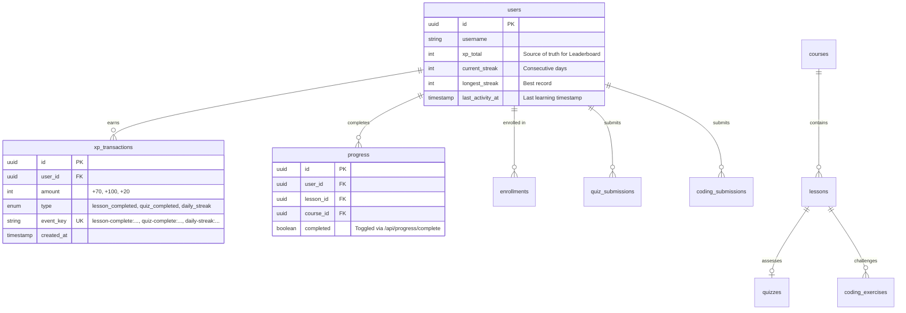

# TMDEMY — GAMIFICATION & ENGAGEMENT ENGINE AUDIT
**Deep-Dive Architectural Analysis: Streak, Leaderboard, XP, Ranks & Learning Progress**

> **Document Type**: Gamification Subsystem Technical Audit & Integration Blueprint  
> **Date**: October 24, 2026  
> **Target Audience**: Senior Backend Architects, Gamification Designers, AI Integration Engineers  
> **Source Files Audited**:
> - `src/models/xp.model.ts`
> - `src/services/streak.service.ts`
> - `src/services/xp.service.ts`
> - `src/services/leaderboard.service.ts`
> - `src/services/progress.service.ts`
> - `src/services/quizSubmission.service.ts`
> - `src/repositories/xp.repository.ts`
> - `src/repositories/leaderboard.repository.ts`
> - `src/repositories/progress.repository.ts`
> - `prisma/schema.prisma`
> - `scripts/test_gamification_apis.ts`

---

## 1. EXECUTIVE SUMMARY

The TMdemy gamification subsystem is an enterprise-grade engagement engine built natively on PostgreSQL. It encompasses:
1. **Dynamic Rank & XP System**: Point accumulation stored immutably in `xp_transactions`, tied to `User.xpTotal`, and mapped dynamically into a 7-tier rank hierarchy (Beginner to Master).
2. **Daily Activity & Streak Tracker**: Daily learning habit tracker with strict timezone boundaries (`Asia/Ho_Chi_Minh`, UTC+7) that automatically rewards +20 XP on the first learning activity of every calendar day.
3. **Global Competition Leaderboard**: Standard Competition Ranking (`RANK()` 1224) computed dynamically in PostgreSQL, supporting pagination, authenticated self-rank resolution, and strict privacy redaction.
4. **Learning Progress**: Lesson-level completion tracking that calculates course progress percentages, triggers enrollment completion at 100%, and coordinates milestone XP awards.

**Key Step 5 Finding**: While Lesson completion and Quiz submission are fully wired to Streak and XP rewards, **Coding Exercise submissions are currently completely disconnected from Gamification, Streak, and Course Progress**.

---

## 2. STREAK ARCHITECTURE DEEP DIVE

### 2.1 Prisma Storage
Streak data is stored directly on the `User` (`users`) table:
```prisma
model User {
  // ...
  xpTotal        Int       @default(0) @map("xp_total")
  currentStreak  Int       @default(0) @map("current_streak")
  longestStreak  Int       @default(0) @map("longest_streak")
  lastActivityAt DateTime? @map("last_activity_at")
  // ...
}
```
There is no separate `streaks` table. All streak updates modify the user record atomically.

### 2.2 Timezone & Day Difference Calculations
All calendar date calculations are anchored to **`Asia/Ho_Chi_Minh` (UTC+7)**, defined in [src/models/xp.model.ts:22](file:///d:/e-learning_server/src/models/xp.model.ts#L22):
- `getHoChiMinhDateString(date)` uses `Intl.DateTimeFormat('en-CA', { timeZone: 'Asia/Ho_Chi_Minh' })` producing an ISO-compatible `YYYY-MM-DD` string regardless of host server timezone.
- `getDayDifference(fromYmd, toYmd)` computes calendar day differences via UTC day boundaries (`Date.UTC(y, m-1, d)` divided by `86,400,000 ms`).

### 2.3 Streak State Transitions
The pure transition function `calculateStreakTransition` in [src/services/streak.service.ts:56-115](file:///d:/e-learning_server/src/services/streak.service.ts#L56-L115) enforces four deterministic rules:

| Condition | `diffInDays` | `currentStreak` | `longestStreak` | `isFirstActivityToday` | Daily XP Awarded |
| :--- | :---: | :---: | :---: | :---: | :---: |
| **First Activity Ever** | `lastActivityAt == null` | `1` | `max(longest, 1)` | `true` | **+20 XP** |
| **Same Calendar Day** | `diffInDays === 0` | Unchanged | Unchanged | `false` | **0 XP** (Idempotent) |
| **Consecutive Day** | `diffInDays === 1` | `currentStreak + 1` | `max(longest, newCurrent)` | `true` | **+20 XP** |
| **Broken Streak** | `diffInDays > 1` | `1` (Reset) | Preserved (`longestStreak`) | `true` | **+20 XP** |
| **Past Timestamp** | `diffInDays < 0` | Unchanged | Unchanged | `false` | **0 XP** |

### 2.4 Atomic Daily XP Award & Idempotency
When `isFirstActivityToday === true`, `recordLearningActivityStreak` generates a deterministic idempotency key:
$$\text{eventKey} = \text{daily-streak:\{userId\}:\{YYYY-MM-DD\}}$$
Inside an atomic transaction (`tx` or `prisma.$transaction`):
1. Pre-checks `xp_transactions` for existing `eventKey`.
2. Inserts `XPTransaction` (+20 XP, `DAILY_STREAK`).
3. Updates `User` with `currentStreak`, `longestStreak`, `lastActivityAt = activityDate`, and `xpTotal += 20`.
4. If a concurrent race condition occurs, PostgreSQL throws `P2002` on `event_key`, which is caught and gracefully handled by retrying the streak update with `skipDailyXpAttempt = true`.

### 2.5 Current Streak Triggers
Currently, only two actions trigger streak recording:
1. `markLessonCompleteService` in [src/services/progress.service.ts:81](file:///d:/e-learning_server/src/services/progress.service.ts#L81).
2. `submitQuizService` in [src/services/quizSubmission.service.ts:158](file:///d:/e-learning_server/src/services/quizSubmission.service.ts#L158).

---

## 3. LEADERBOARD ARCHITECTURE DEEP DIVE

### 3.1 Ranking Metric & Scope
- **Metric**: Solely driven by **`User.xp_total`**.
- **Scope**: **Global only**. All active users across the platform are ranked on a single board. Course-specific leaderboards do not currently exist.
- **Dynamic vs Persisted**: Ranks are **never stored statically** in the database. Ranking is computed on-the-fly during read queries to ensure real-time accuracy without stale cache lag.

### 3.2 Standard Competition Ranking Algorithm (1224)
Implemented in [src/repositories/leaderboard.repository.ts:42-58](file:///d:/e-learning_server/src/repositories/leaderboard.repository.ts#L42-L58):
```sql
SELECT * FROM (
  SELECT
    id,
    username,
    avatar,
    xp_total AS "xpTotal",
    current_streak AS "currentStreak",
    RANK() OVER (ORDER BY xp_total DESC)::int AS rank
  FROM users
) ranked
ORDER BY "xpTotal" DESC, id ASC
LIMIT ${limit} OFFSET ${skip}
```
- **Tie Handling**: Uses PostgreSQL native `RANK()`. If two users tie with 5,000 XP at Rank #2, both receive Rank #2, and the next user receives Rank #4.
- **Deterministic Pagination**: Ordered by `"xpTotal" DESC, id ASC` ensuring stable pagination without duplicate or skipped users across page boundaries.

### 3.3 Security & Anti-Leakage Policy
The query strictly projects only public fields (`id`, `username`, `avatar`, `xpTotal`, `currentStreak`, `rank`). Fields such as `password`, `email`, `phone`, `refreshToken`, `otpCode`, and `resetPasswordToken` are completely omitted at the database query level. Verified in live test `scripts/test_gamification_apis.ts`: **PASS (PROTECTED)**.

---

## 4. XP & DYNAMIC RANK ARCHITECTURE DEEP DIVE

### 4.1 Sources of Truth & Rewards Reference
1. Cumulative XP: `User.xpTotal` (`users.xp_total`).
2. Audit Log: `xp_transactions` (`XPTransaction` model).

| Event Type (Enum / App) | Reward | Trigger Condition | Deterministic Event Key Pattern |
| :--- | :---: | :--- | :--- |
| `LESSON_COMPLETED`<br>`lesson_completed` | **+70 XP** | Enrolled student marks lesson complete for the first time | `lesson-complete:{userId}:{lessonId}` |
| `QUIZ_COMPLETED`<br>`quiz_completed` | **+100 XP** | Enrolled student submits quiz attempt for the first time | `quiz-complete:{userId}:{quizId}` |
| `DAILY_STREAK`<br>`daily_streak` | **+20 XP** | First learning activity recorded in a calendar day (Asia/Ho_Chi_Minh) | `daily-streak:{userId}:{YYYY-MM-DD}` |

### 4.2 Dynamic Rank Hierarchy
Ranks are defined in [src/models/xp.model.ts:37-45](file:///d:/e-learning_server/src/models/xp.model.ts#L37-L45) and derived on demand via `getRankFromXp(xpTotal)`:

| Level | Rank Name | Min XP | Max XP | Persona / Description |
| :---: | :--- | :---: | :---: | :--- |
| **1** | **Beginner** | 0 | 499 | New student; completing first 1–4 lessons |
| **2** | **Explorer** | 500 | 1,499 | Active explorer; taking quizzes and building streaks |
| **3** | **Learner** | 1,500 | 2,999 | Diligent learner; studying regularly |
| **4** | **Skilled** | 3,000 | 5,999 | Experienced practitioner; completing extensive modules |
| **5** | **Advanced** | 6,000 | 9,999 | High achiever; finishing advanced courses |
| **6** | **Expert** | 10,000 | 19,999 | Mastery level; high streak count, multiple courses |
| **7** | **Master** | 20,000 | $\infty$ | Top-tier champion; platform leader |

---

## 5. LEARNING PROGRESS & COMPLETION CRITERIA

### 5.1 Progress Mechanism
- Progress records reside in `progress` (`Progress` model), unique per `(userId, lessonId)`.
- When `POST /api/progress/complete` is called:
  1. Verifies student enrollment.
  2. Upserts `Progress { userId, courseId, lessonId, completed: true }`.
  3. Counts `totalLessons = countLessons({ courseId })`.
  4. Counts `completedLessons = countCompletedLessons(userId, courseId)`.
  5. Calculates percentage: $\text{percent} = \text{round}\left(\frac{\text{completedLessons}}{\text{totalLessons}} \times 100\right)$.
  6. Updates `Enrollment.progress = percent`. If `percent === 100`, sets `Enrollment.status = COMPLETED` and `completedAt = now()`.
  7. If lesson was not previously completed, awards `awardLessonCompletionXP` (+70 XP) and `recordLearningActivityStreak`.

### 5.2 Current Assessment Decoupling
- **Quizzes**: Completing a quiz does **not** update the `Progress` table or change `Enrollment.progress`.
- **Coding Exercises**: Completing or receiving `ACCEPTED` on a coding exercise does **not** update `Progress` or `Enrollment.progress`.
- **Certificates**: Require `progress >= 70%` (lessons) AND `quizCompletionPercentage >= 60%` AND combined final score $\frac{\text{progress} + \text{quizPercentage}}{2} \ge 50\%$. Coding Exercises are completely absent from certificate evaluation formulas.

---

## 6. GAMIFICATION DATA MODEL & FLOW (MERMAID)



---

## 7. REUSABLE GAMIFICATION SERVICES & FUNCTIONS

The following functions are audited, tested, and immediately available for import:

| Function Name | Location | Signature | Purpose & Reusability |
| :--- | :--- | :--- | :--- |
| `recordLearningActivityStreak` | `src/services/streak.service.ts` | `({ userId, activityDate? }, tx?) => Promise<RecordStreakResult>` | Updates streak, awards +20 XP on 1st daily activity. Transaction-safe. |
| `getUserStreakService` | `src/services/streak.service.ts` | `(userId, tx?) => Promise<ServiceResponse>` | Fetches user streak metrics with timezone info. |
| `awardLessonCompletionXP` | `src/services/xp.service.ts` | `({ userId, lessonId }, tx?) => Promise<AwardLessonXpResult>` | Awards +70 XP with `eventKey` idempotency. |
| `awardQuizCompletionXP` | `src/services/xp.service.ts` | `({ userId, quizId }, tx?) => Promise<AwardQuizXpResult>` | Awards +100 XP with `eventKey` idempotency. |
| `awardDailyStreakXP` | `src/services/xp.service.ts` | `({ userId, dateStr }, tx?) => Promise<AwardDailyStreakXpResult>` | Awards +20 XP with `eventKey` idempotency. |
| `getUserXpSummaryService` | `src/services/xp.service.ts` | `(userId, tx?) => Promise<ServiceResponse>` | Dynamic rank, current XP, XP to next rank. |
| `getUserXpHistoryService` | `src/services/xp.service.ts` | `({ userId, page, limit, type }, tx?) => Promise<ServiceResponse>` | Paginated transaction history. |
| `getLeaderboardService` | `src/services/leaderboard.service.ts` | `({ page, limit, currentUserId }, tx?) => Promise<ServiceResponse>` | Public leaderboard with RANK() 1224. |
| `getUserLeaderboardPositionService`| `src/services/leaderboard.service.ts`| `(userId, tx?) => Promise<ServiceResponse>` | User's exact global rank on the board. |

---

## 8. CODING EXERCISE INTEGRATION OPPORTUNITIES & GAPS

### 8.1 Opportunity 1: Daily Streak Trigger on Code Submission
- **Mechanism**: When a student receives `ACCEPTED` (or meets passing threshold) in `submitCodeService`, invoke:
  ```typescript
  await recordLearningActivityStreak({ userId }, tx)
  ```
- **Feasibility**: **IMMEDIATELY FEASIBLE**. `recordLearningActivityStreak` is transaction-safe and internally deduplicates daily rewards.

### 8.2 Opportunity 2: Coding Exercise XP Award
- **Barrier**: The physical enum `XPTransactionType` in PostgreSQL and Prisma schema only has:
  ```prisma
  enum XPTransactionType {
    LESSON_COMPLETED @map("lesson_completed")
    QUIZ_COMPLETED   @map("quiz_completed")
    DAILY_STREAK     @map("daily_streak")
  }
  ```
- **Schema Freeze Rule**: `AGENTS.md` strictly prohibits modifying `prisma/schema.prisma` without approval.
- **Integration Options**:
  - **Option A (Requires Approval)**: Run migration to add `CODING_EXERCISE_COMPLETED` (`coding_exercise_completed`) to `XPTransactionType`. Recommended award: **+100 XP** (equivalent to quiz).
  - **Option B (Zero Schema Change)**: Trigger XP through Lesson Completion if the exercise belongs to a lesson, OR map Coding Exercise completion to automatically mark the parent Lesson complete via `markLessonCompleteService`, which naturally awards +70 XP under `LESSON_COMPLETED`.

### 8.3 Opportunity 3: Course Progress Integration
- If a lesson contains one or more coding exercises, can the lesson be automatically marked complete when all exercises reach `ACCEPTED` status?
- This directly bridges Coding Exercises to `Progress`, `Enrollment.progress`, and Certificate eligibility without requiring schema alterations.

### 8.4 Duplicate-Reward & Anti-Cheating Risks
1. **Repeated Submissions**: A student can submit multiple correct solutions to the same exercise. If XP is awarded on every submission, students can farm infinite XP.
   - **Protection Required**: Must use a deterministic event key: `coding-complete:{userId}:{exerciseId}`.
2. **Cheating / Premature Submissions**: XP and Streak must **never** be awarded on `runCodeService` (practice run) or on submissions that return `WRONG_ANSWER`, `COMPILATION_ERROR`, or `INTERNAL_ERROR`. Only verified `status === 'ACCEPTED'` with 100% test pass rate may trigger completion.

---
*Report generated and signed by Antigravity Senior Backend Architect.*
