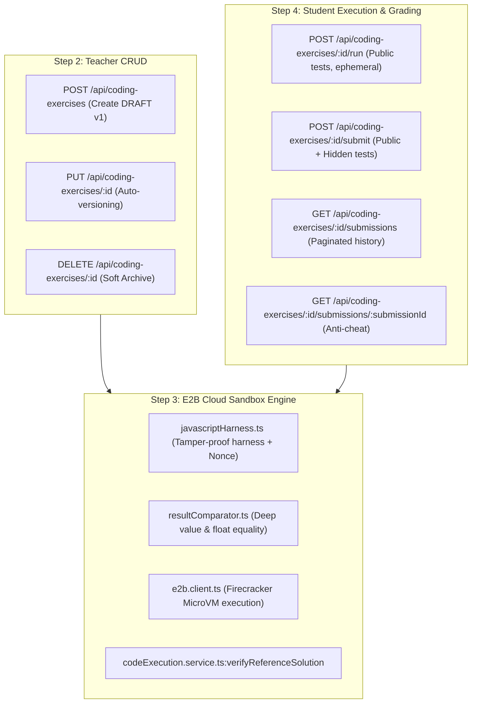

# TMDEMY — STEP 5 READINESS ASSESSMENT
**Coding Exercise Publish Workflow, Security Hardening & Gamification Integration**

> **Document Type**: Step 5 Technical Readiness Audit, Gap Analysis & Execution Roadmap  
> **Date**: October 24, 2026  
> **Status**: **AUDIT-ONLY (READY FOR PLANNING; IMPLEMENTATION PENDING APPROVAL)**  
> **Target Subsystems**: Coding Exercise (Steps 1–4 completed) → Gamification, Course Progress & Teacher Publishing

---

## 1. CURRENT CODING EXERCISE ARCHITECTURE (STEPS 1–4 RECAP)

The Coding Exercise subsystem provides an end-to-end cloud-sandboxed programming assessment platform. The completed steps represent a hardened, cheat-resistant foundation:



### 1.1 Step 1 — Database Foundation
- Physical Prisma models: `CodingExercise`, `CodingExerciseRevision`, `CodingTestCase`, `CodingSubmission`, `CodingTestResult`.
- Migration: `20261023113802_add_coding_exercise_models` cleanly applied to PostgreSQL.
- Foreign keys, composite uniques (`[lessonId, slug]`, `[exerciseId, version]`, `[submissionId, testCaseId]`), and cascade delete rules fully verified.

### 1.2 Step 2 — Teacher CRUD & Versioning
- Teachers create exercises in `status: DRAFT` with initial revision v1 (`isPublished: false`).
- Implements strict version preservation: updating a published exercise preserves the active revision and spawns a new unpublished draft revision v(N+1).
- Soft archive (`status = ARCHIVED`) removes exercises from student visibility without cascading deletion of historical submissions.

### 1.3 Step 3 — E2B Cloud Sandbox Engine
- Executes code inside isolated Firecracker microVMs using the official E2B SDK (`@e2b/code-interpreter`).
- Employs 128-bit cryptographic nonces to protect stdout grading markers from student code spoofing.
- Normalizes execution limits: maximum 10s timeout, maximum 512MB RAM, maximum 50 test cases.
- Includes audited helper `verifyReferenceSolution` in `codeExecution.service.ts` to validate teacher solutions against 100% of test cases.

### 1.4 Step 4 — Student Execution & Auto-Grading
- **RUN Endpoint**: Evaluates student code exclusively against public test cases. Ephemeral (0 database writes). Rate limited at 10 requests/minute.
- **SUBMIT Endpoint**: Evaluates public and hidden test cases. Implements a decoupled execution pattern: sandbox execution occurs completely outside PostgreSQL transactions, followed by a short atomic transaction (<5ms) to persist the submission verdict and test results. Rate limited at 5 requests/minute.
- **Server-Side Anti-Cheat Redaction**: Strips all hidden test inputs, expected outputs, actual outputs, stdout, and error messages from responses sent to students.

---

## 2. STEP 5 READINESS AUDIT TABLE

Each requirement proposed for Step 5 is classified below:

| # | Step 5 Proposed Requirement | Status | Current Evidence / Code Reference | Missing Elements / Blockers |
| :-: | :--- | :---: | :--- | :--- |
| 1 | **Reference Solution Verification before Publish** | **PARTIALLY IMPLEMENTED** | `verifyReferenceSolution` implemented in `src/services/codeExecution.service.ts:495-530` and verified in tests | Missing API endpoint to trigger verification and gate publishing |
| 2 | **Teacher Publish API** | **MISSING** | No route, controller, or service function exists for publishing | Exercises currently set to `PUBLISHED` only via direct database updates in test scripts |
| 3 | **Teacher Unpublish API** | **MISSING** | No route or service exists to revert published exercise to draft | Need ability to temporarily unpublish without archiving |
| 4 | **Safe Published Revision Management** | **ALREADY IMPLEMENTED** | Implemented in `src/services/codingExercise.service.ts:420-470` | Draft updates create v(N+1); student submissions bind to active published revision |
| 5 | **E2B Concurrency & Cost Protection** | **PARTIALLY IMPLEMENTED** | In-memory token bucket per student (`src/middlewares/codingExerciseRateLimit.middleware.ts`) | Global concurrent VM semaphore missing; in-memory limiter not distributed across instances |
| 6 | **Stale PENDING Submission Recovery** | **MISSING** | `createCodingSubmission` sets `PENDING`; updated after cloud call | If process crashes during E2B execution, row stays `PENDING` indefinitely |
| 7 | **Coding Exercise Streak Integration** | **MISSING** | `recordLearningActivityStreak` exists in `src/services/streak.service.ts` | Not invoked anywhere inside `src/services/codingSubmission.service.ts` |
| 8 | **Coding Exercise Leaderboard Impact** | **MISSING** | Leaderboard driven by `User.xp_total` | Since Coding Exercise awards 0 XP, it has zero impact on rankings |
| 9 | **Coding Exercise XP / Rewards** | **BLOCKED** | `XPTransactionType` enum has only `LESSON_COMPLETED`, `QUIZ_COMPLETED`, `DAILY_STREAK` | Adding `CODING_EXERCISE_COMPLETED` requires schema migration (Schema Freeze rule) |
| 10| **Coding Exercise Course Progress** | **MISSING** | Course progress strictly driven by `POST /api/progress/complete` | Coding exercise `ACCEPTED` does not mark lesson complete or update progress |
| 11| **Demo Lesson RUN/SUBMIT Policy** | **ALREADY IMPLEMENTED** | `verifyStudentExerciseAccess` in `codingSubmission.service.ts:98-112` | Un-enrolled students can access exercises in lessons with `isDemo = true` |
| 12| **Duplicate Completion / Reward Prevention** | **NEEDS DECISION** | Unique eventKey pattern used for Quizzes/Lessons | Needs design: should students receive XP once per exercise, or can they farm XP? |

---

## 3. CRITICAL SECURITY & RELIABILITY GAPS IN STEP 5

### 3.1 Gap 1: Teachers Can Publish Broken Exercises (Missing Publish Gate)
- **Problem**: There is currently no publishing endpoint, and when an exercise status is modified, no verification is enforced. A teacher could publish an exercise with an incorrect reference solution, an impossible time limit, or broken test cases, causing all student submissions to fail.
- **Required Solution**: Create `POST /api/coding-exercises/:id/publish` that automatically runs `verifyReferenceSolution(revision)` inside E2B Sandbox. The exercise and revision can only transition to `PUBLISHED` / `isPublished = true` if the reference solution achieves **100% pass rate** (`isValid === true` and `score === 100`).

### 3.2 Gap 2: Submissions Stuck Permanently in PENDING
- **Problem**: In [src/services/codingSubmission.service.ts:273-284](file:///d:/e-learning_server/src/services/codingSubmission.service.ts#L273-L284), a `CodingSubmission` is inserted with `status = PENDING`. Then `await executeTestSuite(...)` executes over the network for 1.5–4.0s. If the Express process crashes, restarts, or runs out of memory during this window, the submission remains `PENDING` forever.
- **Required Solution**:
  1. Add a background task or scheduled sweep query: identify submissions with `status = PENDING` older than 5 minutes and transition them to `INTERNAL_ERROR` with message `Execution timed out or worker restarted`.
  2. Alternatively, on fetching submission detail or history, check if `PENDING` age exceeds threshold and auto-finalize to `INTERNAL_ERROR`.

### 3.3 Gap 3: Unbounded Global E2B Concurrency
- **Problem**: The current rate limiter limits individual students to 10 RUN/min and 5 SUBMIT/min. However, if 50 students in a classroom submit at the exact same second, the server will request 50 concurrent Firecracker microVMs from E2B. Depending on the E2B account tier, this will exceed concurrent VM quotas and result in `429 Too Many Requests` or connection failures.
- **Required Solution**: Implement a lightweight in-process semaphore (e.g. max 10 concurrent active E2B microVMs) to queue execution requests smoothly.

### 3.4 Gap 4: Duplicate XP / Gamification Farming Risk
- **Problem**: In student coding platforms, students frequently resubmit code to optimize execution time, test variations, or practice.
- **Required Solution**: If XP is awarded on submission, it must be awarded **only on the first `ACCEPTED` verdict** for a given `(userId, exerciseId)`. This can be guaranteed via deterministic idempotency keys:
  $$\text{eventKey} = \text{coding-complete:\{userId\}:\{exerciseId\}}$$

---

## 4. ARCHITECTURAL DECISIONS REQUIRED BEFORE STEP 5 IMPLEMENTATION

### Decision 1: Resolving the Prisma Schema Freeze on XP
- **Context**: `AGENTS.md` strictly freezes `prisma/schema.prisma`. PostgreSQL enum `XPTransactionType` currently does not contain `CODING_EXERCISE_COMPLETED`.
- **Option 1A (Recommended - Request Schema Approval)**: Request explicit approval to create a lightweight migration adding `CODING_EXERCISE_COMPLETED` (`coding_exercise_completed`) to enum `XPTransactionType`. Recommended reward: **+100 XP** (commensurate with quiz completion).
- **Option 1B (Zero Schema Change)**: When a student passes all coding exercises in a lesson, automatically call the existing `awardLessonCompletionXP` (+70 XP, `LESSON_COMPLETED`), keeping the database schema 100% frozen.

### Decision 2: Progress & Course Completion Integration Strategy
- **Option 2A (Direct Lesson Completion)**: Receiving `ACCEPTED` on a coding exercise automatically marks the parent lesson as completed via `markLessonCompleteService`. This instantly updates `Enrollment.progress`, awards streak, and unlocks certificates.
- **Option 2B (Independent Progress Gate)**: Keep Coding Exercise progress independent. Lessons require both video viewing (manual toggle) AND coding exercise acceptance to reach 100%.

### Decision 3: Teacher Publish API Route Design
- Recommended routes:
  - `POST /api/coding-exercises/:id/publish`: Runs `verifyReferenceSolution`, publishes active revision, sets `status = PUBLISHED`.
  - `POST /api/coding-exercises/:id/unpublish`: Reverts exercise to `status = DRAFT`.

---

## 5. SUGGESTED IMPLEMENTATION ORDER FOR STEP 5

```
[Phase 5.1: Teacher Publishing Pipeline]
├── Implement POST /api/coding-exercises/:id/publish
├── Wire verifyReferenceSolution gate (100% pass required)
├── Implement POST /api/coding-exercises/:id/unpublish
└── Add unit & integration tests

[Phase 5.2: Gamification & Streak Integration]
├── On submission ACCEPTED: invoke recordLearningActivityStreak({ userId }, tx)
├── Resolve Decision 1 (XP Reward & Idempotency key coding-complete:{userId}:{exerciseId})
└── Verify streak and leaderboard updates

[Phase 5.3: Course Progress Integration]
├── Wire exercise completion to Lesson Progress
└── Verify enrollment completion percentage calculation

[Phase 5.4: Reliability & Concurrency Hardening]
├── Implement stale PENDING submission recovery
├── Add global E2B microVM concurrency queue/semaphore
└── Full regression test execution
```

---
*Report generated and signed by Antigravity Senior Backend Architect.*
