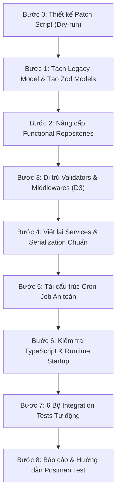

# KẾ HOẠCH TRIỂN KHAI HOÀN THIỆN (FINAL IMPLEMENTATION PLAN)
## PHASE 2: USER, CATEGORY & AUTHENTICATION MIGRATION
**Dự án**: TMDEMY E-Learning Backend  
**Database**: PostgreSQL 16.11 (`tmdemy`) qua Prisma ORM 6.4.1  
**Mục tiêu**: Chuyển đổi toàn diện User, Category, Authentication sang PostgreSQL/Prisma, duy trì 100% API Contract, cô lập Legacy Models an toàn.

---

## 1. QUY TẮC PHÂN ĐỊNH TRÁCH NHIỆM & QUYỀN HẠN TRONG IMPLEMENTATION

Để bảo đảm tính an toàn tuyệt đối cho hệ thống và dữ liệu, toàn bộ các bước trong kế hoạch được phân định rõ 4 trường thông tin bắt buộc:
1. **Preconditions**: Điều kiện kỹ thuật và dữ liệu bắt buộc phải thỏa mãn trước khi bắt đầu bước đó.
2. **Requires Owner Confirmation**: Các thao tác nhạy cảm (ghi database, chạy script execute) **BẮT BUỘC PHẢI CÓ SỰ PHÊ DUYỆT BẰNG VĂN BẢN RIÊNG TỪ CHỦ DỰ ÁN**.
3. **Autonomous / Permitted Actions**: Các thao tác kỹ thuật được phép tự động triển khai sau khi bước trước đã nghiệm thu (tạo file, viết repository, cập nhật middleware, viết unit/integration tests).
4. **Acceptance Criteria & Verification**: Tiêu chí kiểm thử và nghiệm thu cụ thể để hoàn tất bước.

---

## 2. QUY TRÌNH TRIỂN KHAI CHI TIẾT (8 BƯỚC)



---

### BƯỚC 0: THIẾT KẾ PATCH SCRIPT XỬ LÝ TÀI KHOẢN LỊCH SỬ (`isVerified`)

* **Preconditions**:
  * Đã xác định chính xác danh sách 5 tài khoản Trusted Historical Accounts và 2 tài khoản giữ `isVerified = false` trong `decisions-register.md`.
  * Database PostgreSQL `tmdemy` đang kết nối ổn định.
* **Requires Owner Confirmation**:
  * **CẤM TỰ ĐỘNG CHẠY `--execute`**. Script chỉ được chạy ở chế độ `--dry-run` để xuất báo cáo. Thao tác ghi database thực sự chỉ được phép thực hiện khi Chủ dự án trực tiếp xem xét kết quả dry-run và phê duyệt riêng.
* **Autonomous / Permitted Actions**:
  * Tạo file kịch bản `scripts/migration-utils/patch-phase2-users.ts`.
  * Thiết kế logic:
    * Chế độ mặc định là `--dry-run`.
    * Đưa 5 ID của tài khoản Trusted Historical Accounts vào danh sách xử lý:
      - `8eb5b1cb-9b46-5ce8-b7c2-9d0d86c893e8` (`new_username123`)
      - `13608f92-8acf-53e3-adcb-0d832e9cb1d4` (`nguyen_anh_binh`)
      - `6dd1ccd9-420b-5c6d-8322-75223e67e549` (`teacher_cntt`)
      - `c55de839-f059-519c-8820-b16aa17fb9c3` (`minhsuyyyyy`)
      - `02e8e13a-dab2-5fb6-a14f-933ac125edca` (`thaiminh`)
    * 2 tài khoản còn lại (`773e6719-...` và `6b760425-...`) được giữ nguyên trạng thái `isVerified = false`.
    * Cơ chế Sanity Pre-checks: Trước khi cập nhật, kiểm tra trong DB đúng 5 ID này, kiểm tra email tương ứng, và kiểm tra trạng thái hiện tại là `isVerified === false`. Nếu có bất kỳ điều kiện nào không khớp $\rightarrow$ **ABORT** ngay lập tức.
    * Khi chạy với `--execute`, bọc trong `prisma.$transaction`.
* **Acceptance Criteria & Verification**:
  * Chạy lệnh `npx ts-node scripts/migration-utils/patch-phase2-users.ts` (mặc định dry-run) xuất ra bảng tổng hợp gồm chính xác 5 tài khoản sẽ cập nhật và 2 tài khoản giữ nguyên.
  * Không có bất kỳ thay đổi nào trong PostgreSQL khi chưa truyền `--execute`.

---

### BƯỚC 1: TÁCH BIỆT LEGACY MODEL & XÂY DỰNG ZOD APPLICATION MODELS

* **Preconditions**:
  * Bước 0 đã hoàn thành thiết kế và kiểm toán.
  * Thư mục `src/models/legacy/` được tạo mới.
* **Requires Owner Confirmation**:
  * Không (thao tác refactor mã nguồn theo đúng Quyết định D2 đã phê duyệt).
* **Autonomous / Permitted Actions**:
  1. Tạo file `src/models/legacy/user.legacy.model.ts`:
     * Di chuyển toàn bộ Mongoose Schema, Interface và Model của User sang file này.
     * Áp dụng singleton an toàn: `mongoose.models.User || mongoose.model<User>('User', userSchema)` để phòng ngừa lỗi `OverwriteModelError`.
  2. Cập nhật import trong 7 services phụ thuộc:
     * `src/services/course.service.ts`
     * `src/services/quiz.service.ts`
     * `src/services/quizSubmission.service.ts`
     * `src/services/order.service.ts`
     * `src/services/enrollment.service.ts`
     * `src/services/rating.service.ts`
     * `src/services/comment.service.ts`
     * Chuyển từ `import UserModel from '~/models/user.model'` sang `import UserModel from '~/models/legacy/user.legacy.model'`.
  3. Viết lại `src/models/user.model.ts` thành Zod Application Model thuần túy:
     * Export Zod Schemas: `userSchema`, `userPublicSchema`, `userCompactSchema`, `userInternalSchema`, `socialLinksSchema`.
     * Export types: `User`, `UserPublic`, `UserCompact`, `UserInternal`, `SocialLinks`.
     * Tuyệt đối không import Mongoose.
  4. Viết lại `src/models/category.model.ts` thành Zod Application Model thuần túy:
     * Export: `categorySchema`, `categoryPublicSchema`, `categoryAdminSchema`.
     * Export types: `Category`, `CategoryPublic`, `CategoryAdmin`.
* **Acceptance Criteria & Verification**:
  * Cả `user.model.ts` và `category.model.ts` không còn bất kỳ tham chiếu nào tới thư viện `mongoose`.
  * Kiểm tra module resolution: TypeScript nhận diện đúng alias `~/models/legacy/user.legacy.model`.

---

### BƯỚC 2: NÂNG CẤP FUNCTIONAL REPOSITORIES

* **Preconditions**:
  * Bước 1 đã hoàn thành, Zod models đã sẵn sàng.
* **Requires Owner Confirmation**:
  * Không.
* **Autonomous / Permitted Actions**:
  1. Nâng cấp `src/repositories/user.repository.ts`:
     * Bổ sung `findUserWithCredentials(email: string)` (select password, role, isVerified, status).
     * Bổ sung `findUserByResetToken(hashedToken: string)`.
     * Bổ sung `findTeachersWithPagination({ skip, limit, search })`.
     * Bổ sung `countAdminsExcluding(id: string)`.
     * Bổ sung `deleteUnverifiedUsersBeforeCutoff(params)`.
     * Chuẩn hóa select projections: `USER_PUBLIC_SELECT`, `USER_ADMIN_SELECT`, `TEACHER_PUBLIC_SELECT`.
  2. Nâng cấp `src/repositories/category.repository.ts`:
     * Bổ sung `findCategoryByName(name: string)`.
     * Bổ sung `isCategoryNameTaken(name: string, excludeId?: string)`.
     * Bổ sung `isCategorySlugTaken(slug: string, excludeId?: string)`.
     * Bổ sung `softDeleteCategory(id: string)`.
     * Chuẩn hóa select projections: `CATEGORY_PUBLIC_SELECT`, `CATEGORY_ADMIN_SELECT`.
  3. Re-export sạch sẽ qua `src/repositories/index.ts`.
* **Acceptance Criteria & Verification**:
  * Repositories 100% Functional (không dùng class, không dùng BaseRepository).
  * Hỗ trợ nhận tham số `tx?: Prisma.TransactionClient` cho mọi hàm mutation.

---

### BƯỚC 3: DI TRÚ VALIDATORS & MIDDLEWARES (BAO GỒM QUYẾT ĐỊNH D3)

* **Preconditions**:
  * Repositories của Bước 2 đã hoàn thành.
* **Requires Owner Confirmation**:
  * Không.
* **Autonomous / Permitted Actions**:
  1. Trong `src/middlewares/user.middleware.ts`:
     * Giữ nguyên toàn bộ Express-validator rules kiểm tra cú pháp (email, độ dài password, format OTP, phone, URL).
     * Loại bỏ toàn bộ các câu lệnh query `UserModel` trực tiếp bên trong middleware.
     * Cập nhật `userIdValidator` sử dụng `isValidUUID` từ `src/utils/uuid.ts`.
  2. Trong `src/middlewares/admin.middleware.ts`:
     * Chuyển đổi `getUserDetailValidator`, `updateUserByAdminValidator` sang kiểm tra UUID bằng `isValidUUID`.
  3. Trong `src/middlewares/category.middleware.ts`:
     * Chuyển đổi `categoryIdValidator` sang kiểm tra UUID.
     * Loại bỏ các câu truy vấn Mongoose trong validator.
  4. Trong `src/routes/admin.route.ts` (Thực thi Quyết định D3):
     * Tại dòng 160, thay thế `courseIdValidator` bằng `categoryIdValidator`.
* **Acceptance Criteria & Verification**:
  * Route `DELETE /api/admin/categories/:id` kiểm tra đúng UUID của Category.
  * Không có validator nào trong 3 file trên import Mongoose Model hay Prisma Client.

---

### BƯỚC 4: VIẾT LẠI SERVICES & CHUẨN HÓA SERIALIZATION

* **Preconditions**:
  * Bước 2 và Bước 3 đã hoàn thành.
* **Requires Owner Confirmation**:
  * Không.
* **Autonomous / Permitted Actions**:
  1. Viết lại `src/services/user.service.ts`:
     * `registerUserService`: Mã hóa mật khẩu, tạo OTP 6 số ngẫu nhiên, lưu PostgreSQL qua `createUser`, gửi welcome email.
     * `verifyOtpService`: Kiểm tra user, kiểm tra OTP, kiểm tra hết hạn, cập nhật `isVerified: true`.
     * `loginUserService`: Kiểm tra email, so khớp mật khẩu bcrypt, kiểm tra `isVerified`, tạo access token và refresh token. **Giữ nguyên role lowercase trong JWT payload (`'admin'`, `'teacher'`, `'user'`)**.
     * `getMeService`: Lấy thông tin user hiện tại, serialize object `socialLinks` chuẩn, strip sạch các trường nhạy cảm.
     * `forgotPasswordService`, `resetPasswordService`, `changePasswordService`, `logoutUserService`, `getAccessTokenService`, `getListTeachersService`.
  2. Viết lại `src/services/category.service.ts`:
     * `createCategoryService`, `updateCategoryService`, `deleteCategoryService` (xóa mềm `isDeleted = true`), `getCategoriesService`, `getCategoryDetailService`.
  3. Chuyển đổi các hàm User trong `src/services/admin.service.ts`:
     * `getAllUsersService`, `getUserDetailService`, `updateUserByAdminService`, `deleteUserByAdminService` (chặn xóa chính mình, chặn xóa admin cuối cùng), `createTeacherService`.
  4. **Quy chuẩn Serialization (Khắc phục việc áp dụng mù quáng `withCompatId`)**:
     * Đối chiếu từng endpoint theo bảng tra cứu trong `api-contract-audit.md`.
     * Chỉ map thêm `_id` (bằng giá trị `id` UUID) cho các entity object của User và Category mà Next.js Frontend cần.
     * Không thêm `_id` hay `id` vào các response thông báo thuần túy (`register`, `verify-otp`, `logout`, v.v.).
     * Đảm bảo `socialLinks` luôn là object `{ facebook, instagram, github }`.
* **Acceptance Criteria & Verification**:
  * Toàn bộ 22 endpoints trả về đúng cấu trúc JSON, đúng HTTP status codes theo Postman Contract.
  * Tuyệt đối không rò rỉ password, OTP, refresh token, reset token trong bất kỳ response nào.

---

### BƯỚC 5: TÁI CẤU TRÚC CRON JOB DỌN DẸP AN TOÀN

* **Preconditions**:
  * `user.repository.ts` có hàm truy vấn dọn dẹp theo điều kiện an toàn.
* **Requires Owner Confirmation**:
  * Không (triển khai theo đúng đặc tả an toàn đã được phê duyệt trong D1).
* **Autonomous / Permitted Actions**:
  1. Viết lại `src/cronJobs/deleteUnverifiedUsers.ts`:
     * Thiết lập hằng số cố định:
       ```ts
       const MIGRATION_CUTOFF_DATE = new Date('2026-10-01T00:00:00.000Z')
       ```
     * Truy vấn dọn dẹp qua `userRepository.deleteExpiredUnverifiedUsers(...)`:
       ```ts
       where: {
         isVerified: false,
         role: { notIn: [UserRole.ADMIN, UserRole.TEACHER] },
         createdAt: {
           gt: MIGRATION_CUTOFF_DATE,
           lt: new Date(Date.now() - 24 * 60 * 60 * 1000)
         }
       }
       ```
     * Bổ sung log chi tiết số lượng tài khoản bị xóa mỗi khi cron kích hoạt.
* **Acceptance Criteria & Verification**:
  * Chạy thử hàm cron job trong môi trường kiểm thử: Xác nhận 100% cả 7 tài khoản lịch sử trong PostgreSQL không bị đụng tới (kể cả 2 tài khoản có `isVerified = false`).

---

### BƯỚC 6: KIỂM TRA BIÊN DỊCH TYPESCRIPT & RUNTIME STARTUP

* **Preconditions**:
  * Hoàn thành xong Bước 1 đến Bước 5.
* **Requires Owner Confirmation**:
  * Không.
* **Autonomous / Permitted Actions**:
  1. Chạy kiểm tra tĩnh TypeScript:
     `npx tsc --noEmit`
     * Yêu cầu bắt buộc: Đạt **0 lỗi biên dịch** (Zero Type Errors).
  2. Kiểm tra Runtime Startup:
     * Khởi động server ở chế độ dev hoặc chạy lệnh node kiểm tra khởi tạo kết nối Prisma Client và load các model legacy.
     * Đảm bảo không xảy ra lỗi `OverwriteModelError` hay lỗi thiếu alias module.
* **Acceptance Criteria & Verification**:
  * `npx tsc --noEmit` thoát với exit code 0.
  * Server khởi động thành công, nhận diện đầy đủ các routes của Phase 2.

---

### BƯỚC 7: XÂY DỰNG VÀ CHẠY 6 BỘ INTEGRATION TESTS TỰ ĐỘNG

* **Preconditions**:
  * Bước 6 đã pass 0 lỗi.
  * Chuẩn bị test suite `scripts/test-phase2-auth-user.ts`.
* **Requires Owner Confirmation**:
  * Không (test chỉ sử dụng tài khoản test độc lập có tiền tố `test_phase2_*`, tự dọn dẹp sau khi chạy).
* **Autonomous / Permitted Actions**:
  * Chia test thành 6 nhóm chức năng độc lập:
    1. **Authentication Suite**:
       * Đăng ký tài khoản mới $\rightarrow$ Verify OTP $\rightarrow$ Login (thành công, mật khẩu sai, chưa verify) $\rightarrow$ Refresh token $\rightarrow$ Logout.
    2. **User Profile Suite**:
       * Lấy thông tin cá nhân (`/me`), cập nhật profile (`/update-me`), xem profile công khai (`/profile/:id`).
    3. **Password Recovery Suite**:
       * Yêu cầu reset mật khẩu $\rightarrow$ Đổi mật khẩu qua token $\rightarrow$ Đổi mật khẩu trực tiếp (`/change-password`).
    4. **Teacher Suite**:
       * Lấy danh sách giảng viên có phân trang (`/teachers`).
    5. **Category Suite**:
       * Admin tạo Category mới $\rightarrow$ Lấy danh sách Category $\rightarrow$ Xem chi tiết bằng Slug $\rightarrow$ Cập nhật Category $\rightarrow$ Admin xóa Category (Test cả UUID hợp lệ và UUID sai định dạng theo D3).
    6. **Admin User Suite**:
       * Lấy danh sách toàn bộ User có lọc role/status $\rightarrow$ Xem chi tiết User $\rightarrow$ Cập nhật User bởi Admin $\rightarrow$ Chặn tự xóa chính mình $\rightarrow$ Chặn xóa admin cuối cùng.
  * **Nguyên tắc đánh giá test**: Cả trường hợp thành công (200, 201) và trường hợp bắt lỗi theo hợp đồng (400, 401, 403, 404, 409) đều được tính là **PASS** nếu đúng mã lỗi và cấu trúc JSON.
* **Acceptance Criteria & Verification**:
  * Toàn bộ 6 test suites đạt tỷ lệ thành công 100%.

---

### BƯỚC 8: BÁO CÁO NGHIỆM THU & HƯỚNG DẪN POSTMAN VERIFICATION

* **Preconditions**:
  * Bước 7 đã hoàn thành 100% tests pass.
* **Requires Owner Confirmation**:
  * Báo cáo Chủ dự án để nghiệm thu Phase 2 và chuẩn bị tiền đề cho Phase 3 (Course Management).
* **Autonomous / Permitted Actions**:
  * Lập tài liệu báo cáo hoàn thành Phase 2 (`PHASE_2_COMPLETION_REPORT.md`).
  * Soạn tài liệu hướng dẫn kiểm thử thủ công qua Postman cho Chủ dự án.
* **Acceptance Criteria & Verification**:
  * Chủ dự án nghiệm thu và phê duyệt đóng Phase 2.
