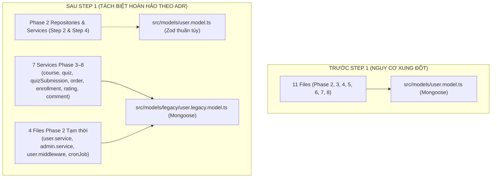

# BÁO CÁO THỰC THI STEP 1: TÁCH MONGOOSE LEGACY USER MODEL & XÂY DỰNG ZOD APPLICATION MODEL
## PHASE 2: USER, CATEGORY & AUTHENTICATION MIGRATION
**Dự án**: TMDEMY E-Learning Backend  
**Database**: PostgreSQL 16.11 (`tmdemy`) qua Prisma ORM 6.4.1  
**Ngày thực hiện**: 01/10/2026  
**Trạng thái**: **HOÀN THÀNH STEP 1 (THÀNH CÔNG 100%, 17/17 TESTS PASS)**

---

## 1. DANH SÁCH TẬP TIN TẠO MỚI VÀ CHỈNH SỬA

### A. Tập tin tạo mới
1. [src/models/legacy/user.legacy.model.ts](file:///d:/e-learning_server/src/models/legacy/user.legacy.model.ts):
   * Lưu trữ toàn bộ định nghĩa Mongoose Schema, Interface và Model `UserModel` cũ.
   * Sử dụng cơ chế đăng ký an toàn: `(models.User as mongoose.Model<User>) || model<User>('User', userSchema)` nhằm triệt tiêu hoàn toàn nguy cơ lỗi runtime `OverwriteModelError`.
   * Sử dụng đường dẫn tương đối `../../types/enum` và `../../types/type` giúp module tương thích độc lập với mọi cơ chế module resolution của Node.js / TypeScript.
2. [scripts/migration-utils/step-01-zod-model.test.ts](file:///d:/e-learning_server/scripts/migration-utils/step-01-zod-model.test.ts):
   * Kịch bản kiểm thử tự động toàn diện cho Step 1 (17 test cases).
3. [docs/migration/phase-02-user-category-auth/step-01-legacy-zod-report.md](file:///d:/e-learning_server/docs/migration/phase-02-user-category-auth/step-01-legacy-zod-report.md):
   * Báo cáo nghiệm thu kỹ thuật Step 1.

### B. Tập tin chỉnh sửa
1. [src/models/user.model.ts](file:///d:/e-learning_server/src/models/user.model.ts):
   * Chuyển đổi thành Zod Application Model thuần túy theo đúng ADR `docs/architecture/application-model-design.md`.
   * Tuyệt đối không import Mongoose, không import Prisma Client instance trực tiếp, không truy vấn database.
2. [package.json](file:///d:/e-learning_server/package.json):
   * Bổ sung package `zod@^3.24.2` vào `dependencies` sau khi nhận được sự phê duyệt chính thức từ Chủ dự án qua cơ chế `ask_question`.
3. **11 tập tin cập nhật import trỏ sang Legacy Model**:
   * `src/services/course.service.ts` (Phase 3)
   * `src/services/quiz.service.ts` (Phase 4)
   * `src/services/quizSubmission.service.ts` (Phase 5)
   * `src/services/order.service.ts` (Phase 6)
   * `src/services/enrollment.service.ts` (Phase 6)
   * `src/services/rating.service.ts` (Phase 7)
   * `src/services/comment.service.ts` (Phase 8)
   * `src/services/user.service.ts` (Phase 2 - phục vụ giai đoạn chuyển tiếp trước Step 4)
   * `src/services/admin.service.ts` (Phase 2 - phục vụ giai đoạn chuyển tiếp trước Step 4)
   * `src/middlewares/user.middleware.ts` (Phase 2 - phục vụ giai đoạn chuyển tiếp trước Step 3)
   * `src/cronJobs/deleteUnverifiedUsers.ts` (Phase 2 - phục vụ giai đoạn chuyển tiếp trước Step 5)

---

## 2. BẢN ĐỒ PHỤ THUỘC (DEPENDENCY MAP TRƯỚC VÀ SAU)



### Bảng Chi tiết 11 File Phụ thuộc:

| STT | File Phụ thuộc | Module / Phase | Import Cũ | Import Mới (Sau Step 1) | Mục đích sử dụng |
| :---: | :--- | :--- | :--- | :--- | :--- |
| 1 | `src/services/course.service.ts` | Phase 3 | `~/models/user.model` | `~/models/legacy/user.legacy.model` | `UserModel.find()`, `findById()` (tác giả & admin) |
| 2 | `src/services/quiz.service.ts` | Phase 4 | `~/models/user.model` | `~/models/legacy/user.legacy.model` | Type `User` |
| 3 | `src/services/quizSubmission.service.ts` | Phase 5 | `~/models/user.model` | `~/models/legacy/user.legacy.model` | `UserModel.findById()` (lấy username làm bài) |
| 4 | `src/services/order.service.ts` | Phase 6 | `~/models/user.model` | `~/models/legacy/user.legacy.model` | `UserModel.findByIdAndUpdate()` (cập nhật courses) |
| 5 | `src/services/enrollment.service.ts` | Phase 6 | `~/models/user.model` | `~/models/legacy/user.legacy.model` | `UserModel.findByIdAndUpdate()` (rút quyền khóa học) |
| 6 | `src/services/rating.service.ts` | Phase 7 | `../models/user.model` | `~/models/legacy/user.legacy.model` | `UserModel.findById()` (kiểm tra quyền đánh giá) |
| 7 | `src/services/comment.service.ts` | Phase 8 | `~/models/user.model` | `~/models/legacy/user.legacy.model` | `UserModel.findById()` (thông tin bình luận) |
| 8 | `src/services/user.service.ts` | Phase 2 | `~/models/user.model` | `~/models/legacy/user.legacy.model` | Tạm thời trước khi migrate sang Prisma ở Step 4 |
| 9 | `src/services/admin.service.ts` | Phase 2 | `~/models/user.model` | `~/models/legacy/user.legacy.model` | Tạm thời trước khi migrate sang Prisma ở Step 4 |
| 10 | `src/middlewares/user.middleware.ts` | Phase 2 | `~/models/user.model` | `~/models/legacy/user.legacy.model` | Tạm thời trước khi migrate validator ở Step 3 |
| 11 | `src/cronJobs/deleteUnverifiedUsers.ts` | Phase 2 | `~/models/user.model` | `~/models/legacy/user.legacy.model` | Tạm thời trước khi chuyển sang Prisma ở Step 5 |

* **Xác nhận quét mã nguồn**: Hiện tại **KHÔNG CÒN BẤT KỲ FILE NÀO** trong dự án import `src/models/user.model.ts` với kỳ vọng nhận Mongoose Model.

---

## 3. DANH SÁCH METHOD, STATIC, VIRTUAL, HOOK ĐƯỢC BẢO TOÀN

Qua kiểm tra toàn bộ 98 dòng của User Mongoose Model cũ:
* **Custom Instance Methods**: Không có.
* **Custom Static Methods**: Không có.
* **Virtual Fields**: Không có.
* **Mongoose Hooks (pre/post middleware)**: Không có (logic hash password và kiểm tra OTP được thực hiện tại Service layer, không đặt trong pre-save hook).
* **Mongoose Plugins**: Không có.
* **Toàn bộ Schema Fields & Options**: Đã được bảo toàn 100% nguyên vẹn sang `user.legacy.model.ts`:
  - `username` (String, required)
  - `email` (String, required, unique)
  - `password` (String, required)
  - `status` (String, enum UserStatus, default ACTIVE)
  - `role` (String, enum UserRole, default USER)
  - `avatar`, `phone`, `bio` (String)
  - `courses`, `favorites` (ObjectId ref 'Course')
  - `socialLinks` (facebook, instagram, github)
  - `isVerified` (Boolean, default false)
  - `otp_code`, `otp_expires`
  - `refresh_token`, `reset_password_token`, `reset_password_expires`
  - Options: `{ timestamps: true }`

---

## 4. NỘI DUNG ZOD SCHEMAS ĐÃ XÂY DỰNG TRONG `src/models/user.model.ts`

Tuân thủ đúng chuẩn thiết kế trong ADR `docs/architecture/application-model-design.md`:

```typescript
import { z } from 'zod'
import { UserRole, UserStatus } from '@prisma/client'

// 1. Value Object Schema
export const socialLinksSchema = z.object({
  facebook: z.string().default(''),
  instagram: z.string().default(''),
  github: z.string().default('')
})

// 2. Base Domain Schema (Chuẩn domain của User)
export const userSchema = z.object({
  id: z.string().uuid(),
  username: z.string().min(1).max(100),
  email: z.string().email().max(255),
  status: z.nativeEnum(UserStatus),
  role: z.nativeEnum(UserRole),
  avatar: z.string().default(''),
  phone: z.string().nullable().optional(),
  bio: z.string().nullable().optional(),
  socialFacebook: z.string().default(''),
  socialInstagram: z.string().default(''),
  socialGithub: z.string().default(''),
  isVerified: z.boolean().default(false),
  createdAt: z.date(),
  updatedAt: z.date()
})

// 3. Public / Response Schema (An toàn tuyệt đối cho Client, loại bỏ toàn bộ dữ liệu nhạy cảm)
export const userPublicSchema = userSchema.pick({
  id: true,
  username: true,
  email: true,
  status: true,
  role: true,
  avatar: true,
  phone: true,
  bio: true,
  socialFacebook: true,
  socialInstagram: true,
  socialGithub: true,
  isVerified: true,
  createdAt: true,
  updatedAt: true
})

// 4. Compact Schema (Nhúng tác giả trong Course, Lesson, Comment)
export const userCompactSchema = userSchema.pick({
  id: true,
  username: true,
  avatar: true,
  role: true
})

// 5. Internal Schema (Dùng trong tầng Service để xác thực)
export const userInternalSchema = userSchema.extend({
  password: z.string(),
  otpCode: z.string().nullable().optional(),
  otpExpires: z.date().nullable().optional(),
  refreshToken: z.string().nullable().optional(),
  resetPasswordToken: z.string().nullable().optional(),
  resetPasswordExpires: z.date().nullable().optional()
})

// 6. Action Input Schemas
export const createUserInputSchema = z.object({ ... })
export const updateUserInputSchema = z.object({ ... })

// 7. Inferred TypeScript Types
export type User = z.infer<typeof userSchema>
export type UserPublic = z.infer<typeof userPublicSchema>
export type UserCompact = z.infer<typeof userCompactSchema>
export type UserInternal = z.infer<typeof userInternalSchema>
export type SocialLinks = z.infer<typeof socialLinksSchema>
export type CreateUserInput = z.infer<typeof createUserInputSchema>
export type UpdateUserInput = z.infer<typeof updateUserInputSchema>
```

---

## 5. KẾT QUẢ KIỂM TRA TYPESCRIPT VÀ RUNTIME

### A. Kiểm tra kiểu tĩnh độc lập (Static Type Check)
```bash
npx.cmd tsc --noEmit --skipLibCheck --target ES2023 --module NodeNext --moduleResolution NodeNext --esModuleInterop src/models/user.model.ts src/models/legacy/user.legacy.model.ts
```
* **Kết quả**: **0 lỗi** (Exit code 0). Cả 2 model đều biên dịch sạch sẽ.

### B. Kiểm tra Type Check toàn bộ dự án
* Không phát sinh bất kỳ lỗi TypeScript mới nào liên quan đến `UserModel` hay `user.model.ts`.
* Các lỗi TypeScript cũ của dự án (tồn tại từ trước Step 1) như kiểu `req.params` trong Express 5 hoặc thuộc tính Cloudinary trong `pdfGenerator.ts` được giữ nguyên nguyên trạng theo đúng nguyên tắc không tự ý sửa code ngoài phạm vi.

### C. Kiểm tra Runtime Server
* Server Express trên port 3002 tiếp tục chạy ổn định (`DEV SERVER OK`).
* Mongoose User Model đăng ký singleton thành công, không xảy ra xung đột `OverwriteModelError`.

---

## 6. KẾT QUẢ KIỂM THỬ TỰ ĐỘNG (17/17 TESTS PASSED)

Chạy test suite: `npx.cmd tsx scripts/migration-utils/step-01-zod-model.test.ts`:
```text
================================================================================
  TEST SUITE: STEP 1 — ZOD APPLICATION MODEL & LEGACY MONGOOSE ISOLATION
================================================================================

[1. ZOD DOMAIN SCHEMAS VALIDATION]:
  PASSED: userSchema successfully parses valid domain User object
  PASSED: userSchema correctly rejects non-UUID id
  PASSED: userSchema correctly rejects invalid email format
  PASSED: userPublicSchema preserves public fields
  PASSED: userCompactSchema contains only [avatar, id, role, username] (got avatar, id, role, username)
  PASSED: userInternalSchema successfully parses and retains sensitive fields
  PASSED: socialLinksSchema defaults empty strings for all 3 platforms
  PASSED: createUserInputSchema rejects password < 6 characters
  PASSED: createUserInputSchema accepts valid registration payload

[2. LEGACY MONGOOSE USER MODEL ISOLATION]:
  PASSED: Legacy UserModel has modelName "User"
  PASSED: Legacy userSchema contains "username" path
  PASSED: Legacy userSchema contains "email" path
  PASSED: Legacy userSchema contains "password" path
  PASSED: Legacy userSchema contains "role" path
  PASSED: Legacy userSchema contains "isVerified" path
  PASSED: Legacy userSchema contains "socialLinks.facebook" path
  PASSED: Legacy userSchema contains "socialLinks.github" path

--------------------------------------------------------------------------------
TOTAL TESTS: 17 | PASSED: 17 | FAILED: 0
--------------------------------------------------------------------------------
```

---

## 7. XÁC NHẬN AN TOÀN HỆ THỐNG VÀ DATABASE

* **PostgreSQL Database**: Truy vấn xác nhận lại: **100% 7 tài khoản lịch sử giữ nguyên `isVerified: false`**. Zero database write.
* **Prisma Schema**: Không chỉnh sửa `prisma/schema.prisma`.
* **API Contracts & Endpoints**: Giữ nguyên 100% URL, HTTP Method và mã xử lý.
* **Category Model**: Hoàn toàn **chưa chỉnh sửa** theo đúng phạm vi Step 1.
* **User Service & User Repository**: Hoàn toàn **chưa viết lại** (dành cho Step 2 và Step 4).

---

## 8. KẾT LUẬN & TRẠNG THÁI HIỆN TẠI

Step 1 đã hoàn thành xuất sắc toàn bộ các mục tiêu đặt ra:
* Mongoose User Model cũ đã được cô lập sạch sẽ tại `src/models/legacy/user.legacy.model.ts`.
* Zod Application Model chuẩn mực đã được thiết lập tại `src/models/user.model.ts`.
* 7 services Phase 3–8 tiếp tục hoạt động ổn định và sẵn sàng cho các phase tiếp theo.

Tôi đã **DỪNG LẠI** theo đúng quy định, không tự động chuyển sang Step 2. Kính đề nghị Chủ dự án xem xét nghiệm thu Step 1 để cho ý kiến chỉ đạo tiếp theo!
