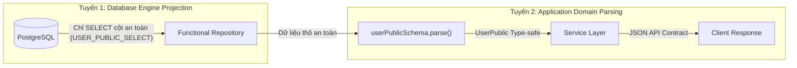

# BÁO CÁO THỰC THI STEP 2: XÂY DỰNG FUNCTIONAL USER REPOSITORY VÀ CATEGORY REPOSITORY BẰNG PRISMA
## PHASE 2: USER, CATEGORY & AUTHENTICATION MIGRATION
**Dự án**: TMDEMY E-Learning Backend  
**Database**: PostgreSQL 16.11 (`tmdemy`) qua Prisma ORM 6.4.1  
**Ngày thực hiện**: 02/10/2026  
**Trạng thái**: **HOÀN THÀNH STEP 2 (THÀNH CÔNG 100%, 53/53 TESTS PASS)**

---

## 1. DANH SÁCH TẬP TIN TẠO MỚI VÀ CHỈNH SỬA

### A. Tập tin tạo mới
1. [scripts/migration-utils/step-02-repositories.test.ts](file:///d:/e-learning_server/scripts/migration-utils/step-02-repositories.test.ts):
   * Bộ kiểm thử tích hợp tự động toàn diện dành riêng cho Step 2 (53 test cases).
   * Kiểm tra thông số projection, query đọc trên root client, transaction mutation và rollback an toàn.
2. [docs/migration/phase-02-user-category-auth/step-02-repository-report.md](file:///d:/e-learning_server/docs/migration/phase-02-user-category-auth/step-02-repository-report.md):
   * Báo cáo nghiệm thu kỹ thuật Step 2.

### B. Tập tin chỉnh sửa
1. [src/repositories/user.repository.ts](file:///d:/e-learning_server/src/repositories/user.repository.ts):
   * Nâng cấp hoàn chỉnh theo **Functional Style** thuần túy (không class, không `this`, không BaseRepository).
   * Bổ sung đầy đủ 6 Prisma Select constants (`USER_PUBLIC_SELECT`, `USER_COMPACT_SELECT`, `USER_ADMIN_SELECT`, `TEACHER_PUBLIC_SELECT`, `USER_AUTH_SELECT`, `USER_INTERNAL_SELECT`).
   * Bổ sung các function nghiệp vụ auth & quản trị: `findUserWithCredentials`, `findUserByResetToken`, `findUserInternalById`, `findUserPublicById`, `findUserPublicByEmail`, `findUserByEmailOrUsername`, `findUserConflict`, `findUsersWithPagination`, `countAdminsExcluding`, `findActiveTeachers`, `deleteUnverifiedUsersBeforeCutoff`.
   * Hỗ trợ polymorphic parameter handling: cho phép nhận `tx?: PrismaTransactionClient` linh hoạt cả ở vị trí thứ hai hoặc thứ ba.
2. [src/repositories/category.repository.ts](file:///d:/e-learning_server/src/repositories/category.repository.ts):
   * Nâng cấp theo **Functional Style** thuần túy.
   * Bổ sung 2 Prisma Select constants (`CATEGORY_PUBLIC_SELECT`, `CATEGORY_ADMIN_SELECT`).
   * Bổ sung các function: `findCategoryByName`, `isCategoryNameTaken`, `isCategorySlugTaken`, `findCategoriesWithPagination`.
   * Hỗ trợ polymorphic parameter handling cho các hàm query và mutation.
3. [src/repositories/index.ts](file:///d:/e-learning_server/src/repositories/index.ts):
   * Xác nhận export đầy đủ cả 2 hình thức: Namespace exports (`userRepository`, `categoryRepository`) và Direct Named function exports (`addUser`, `findUserById`, `addCategory`, ...).

---

## 2. DANH SÁCH FUNCTION TRONG USER REPOSITORY

Toàn bộ các function trong [src/repositories/user.repository.ts](file:///d:/e-learning_server/src/repositories/user.repository.ts) được export trực tiếp (pure async functions):

| STT | Tên Function | Tham số chính | Kiểu trả về | Mục đích & Trách nhiệm |
| :---: | :--- | :--- | :--- | :--- |
| 1 | `addUser` / `createUser` | `data: Prisma.UserCreateInput, tx?` | `Promise<User>` | Tạo tài khoản người dùng mới trong PostgreSQL |
| 2 | `findUserById` | `id: string, optionsOrTx?, tx?` | `Promise<any \| null>` | Tìm người dùng theo UUID với tùy chọn `include`/`select` |
| 3 | `findUserPublicById` | `id: string, tx?` | `Promise<UserPublic \| null>` | Tìm user theo UUID và validate/sanitize qua Zod `userPublicSchema` |
| 4 | `findUserInternalById` | `id: string, tx?` | `Promise<UserInternal \| null>` | Lấy đầy đủ thông tin user kèm credential nội bộ qua Zod `userInternalSchema` |
| 5 | `findUserByEmail` | `email: string, optionsOrTx?, tx?` | `Promise<any \| null>` | Tìm người dùng theo email duy nhất |
| 6 | `findUserPublicByEmail` | `email: string, tx?` | `Promise<UserPublic \| null>` | Tìm user theo email, trả về public payload an toàn |
| 7 | `findUserByUsername` | `username: string, optionsOrTx?, tx?` | `Promise<any \| null>` | Tìm người dùng theo username |
| 8 | `findUserByEmailOrUsername`| `identifier: string, optionsOrTx?, tx?`| `Promise<any \| null>` | Tìm người dùng khớp email hoặc username |
| 9 | `findUserWithCredentials` | `email: string, tx?` | `Promise<AuthCredentials \| null>` | Lấy dữ liệu phục vụ đăng nhập (password hash, isVerified, refreshToken, role, status) |
| 10 | `findUserByResetToken` | `hashedToken: string, tx?` | `Promise<User \| null>` | Tìm user có reset token hợp lệ và chưa hết hạn (`resetPasswordExpires > now()`) |
| 11 | `isUsernameTaken` | `username: string, excludeUserId?, tx?` | `Promise<boolean>` | Kiểm tra username đã tồn tại (hỗ trợ loại trừ chính user khi update) |
| 12 | `isEmailTaken` | `email: string, excludeUserId?, tx?` | `Promise<boolean>` | Kiểm tra email đã tồn tại (hỗ trợ loại trừ chính user khi update) |
| 13 | `findUserConflict` | `params: { email?, username?, excludeUserId? }, tx?` | `Promise<{ emailConflict, usernameConflict }>` | Kiểm tra đồng thời xung đột email và username |
| 14 | `findAllUsers` | `options?: { where, skip, take, orderBy, include, select }, tx?` | `Promise<User[]>` | Truy vấn danh sách người dùng tự do theo Prisma query |
| 15 | `findUsersWithPagination` | `options: { page?, limit?, search?, role?, status?, isVerified?, sortBy?, sortOrder?, select? }, tx?` | `Promise<{ users, total, page, limit, totalPages }>` | Danh sách người dùng có phân trang, tìm kiếm và lọc cho Admin Dashboard |
| 16 | `countUsers` | `where?: Prisma.UserWhereInput, tx?` | `Promise<number>` | Đếm tổng số người dùng theo điều kiện |
| 17 | `countAdminsExcluding` | `excludeUserId: string, tx?` | `Promise<number>` | Đếm số lượng Admin còn lại ngoại trừ một user (ngăn chặn xóa Admin cuối cùng) |
| 18 | `findActiveTeachers` / `findTeachersWithPagination` | `options: { search?, page?, limit?, skip?, take?, sortBy?, sortOrder? }, tx?` | `Promise<{ teachers, total, page?, limit?, totalPages? }>` | Danh sách giảng viên active, verified kèm phân trang và tìm kiếm |
| 19 | `updateUser` | `id: string, data: Prisma.UserUpdateInput, tx?` | `Promise<User>` | Cập nhật thông tin profile/trạng thái người dùng |
| 20 | `updateRefreshToken` | `id: string, refreshToken: string \| null, tx?` | `Promise<User>` | Lưu hoặc thu hồi refresh token của người dùng |
| 21 | `markUserAsVerified` | `id: string, tx?` | `Promise<User>` | Đánh dấu `isVerified: true` và xóa sạch `otpCode`, `otpExpires` |
| 22 | `deleteUser` | `id: string, tx?` | `Promise<User>` | Xóa cứng tài khoản người dùng theo UUID |
| 23 | `deleteUnverifiedUsersBeforeCutoff` | `params: { expireThreshold, cutoffDate? }, tx?` | `Promise<{ count }>` | Cron cleanup: Xóa tài khoản chưa verify tạo sau mốc cutoff di trú (bảo vệ tài khoản lịch sử) |
| 24 | `deleteUnverifiedUsersOlderThan` | `expireThreshold: Date, tx?` | `Promise<{ count }>` | Hàm dọn dẹp tương thích cũ |

---

## 3. DANH SÁCH FUNCTION TRONG CATEGORY REPOSITORY

Toàn bộ các function trong [src/repositories/category.repository.ts](file:///d:/e-learning_server/src/repositories/category.repository.ts) được export trực tiếp (pure async functions):

| STT | Tên Function | Tham số chính | Kiểu trả về | Mục đích & Trách nhiệm |
| :---: | :--- | :--- | :--- | :--- |
| 1 | `addCategory` / `createCategory` | `data: Prisma.CategoryCreateInput, tx?` | `Promise<Category>` | Tạo danh mục mới trong PostgreSQL |
| 2 | `findCategoryById` | `id: string, optionsOrTx?, tx?` | `Promise<any \| null>` | Tìm danh mục theo UUID với tùy chọn select/include |
| 3 | `findCategoryBySlug` | `slug: string, optionsOrTx?, tx?` | `Promise<any \| null>` | Tìm danh mục theo URL slug duy nhất |
| 4 | `findCategoryByName` | `name: string, tx?` | `Promise<Category \| null>` | Tìm danh mục theo tên duy nhất |
| 5 | `isCategoryNameTaken` | `name: string, excludeId?, tx?` | `Promise<boolean>` | Kiểm tra trùng tên danh mục |
| 6 | `isCategorySlugTaken` | `slug: string, excludeId?, tx?` | `Promise<boolean>` | Kiểm tra trùng slug danh mục |
| 7 | `findAllCategories` | `options?: { where, skip, take, orderBy, include, select }, tx?` | `Promise<Category[]>` | Truy vấn danh sách danh mục theo Prisma options |
| 8 | `findActiveCategories` | `options?: { search?, skip?, take?, orderBy?, select? }, tx?` | `Promise<any[]>` | Lấy danh sách danh mục chưa bị xóa mềm (`isDestroyed = false`) |
| 9 | `findCategoriesWithPagination` | `options: { page?, limit?, search?, isDestroyed?, sortBy?, sortOrder?, select? }, tx?` | `Promise<{ categories, total, page, limit, totalPages }>` | Danh sách danh mục có phân trang, tìm kiếm và lọc trạng thái |
| 10 | `updateCategory` | `id: string, data: Prisma.CategoryUpdateInput, tx?` | `Promise<Category>` | Cập nhật thông tin danh mục |
| 11 | `softDeleteCategory` | `id: string, tx?` | `Promise<Category>` | Xóa mềm danh mục (`isDestroyed = true`) theo nghiệp vụ hệ thống |
| 12 | `restoreCategory` | `id: string, tx?` | `Promise<Category>` | Khôi phục danh mục đã xóa mềm (`isDestroyed = false`) |
| 13 | `deleteCategory` | `id: string, tx?` | `Promise<Category>` | Xóa cứng danh mục khỏi database |
| 14 | `countCategories` | `where?: Prisma.CategoryWhereInput, tx?` | `Promise<number>` | Đếm tổng số danh mục theo điều kiện |

---

## 4. PRISMA SELECT CONSTANTS (DATABASE PROJECTIONS)

Để tối ưu hóa băng thông I/O giữa Backend và PostgreSQL, đồng thời **triệt tiêu hoàn toàn nguy cơ rò rỉ thông tin nhạy cảm ở cấp Engine**, 8 hằng số projection chuẩn hóa đã được thiết lập:

### A. Projections cho User
1. **`USER_PUBLIC_SELECT`**:
   ```typescript
   export const USER_PUBLIC_SELECT: Prisma.UserSelect = {
     id: true,
     username: true,
     email: true,
     status: true,
     role: true,
     avatar: true,
     phone: true,
     bio: true,
     socialFacebook: true,
     socialInstagram: true,
     socialGithub: true,
     isVerified: true,
     createdAt: true,
     updatedAt: true
   }
   ```
   *Khớp 100% với `userPublicSchema`. Tuyệt đối không chứa `password`, `refreshToken`, `otpCode`, `otpExpires`, `resetPasswordToken`, `resetPasswordExpires`.*

2. **`USER_COMPACT_SELECT`**:
   ```typescript
   export const USER_COMPACT_SELECT: Prisma.UserSelect = {
     id: true,
     username: true,
     avatar: true,
     role: true
   }
   ```
   *Chỉ chứa 4 trường cần thiết khi nhúng tác giả vào khóa học, bài học, bình luận.*

3. **`USER_ADMIN_SELECT`**:
   *Cung cấp đầy đủ thông tin quản lý người dùng cho bảng quản trị của Admin mà không bao gồm mật khẩu và token.*

4. **`TEACHER_PUBLIC_SELECT`**:
   *Chỉ chọn các trường hiển thị công khai của giảng viên: `id`, `username`, `avatar`, `bio`, `phone`, `socialFacebook`, `socialInstagram`, `socialGithub`, `createdAt`.*

5. **`USER_AUTH_SELECT`**:
   *Dành riêng cho luồng xác thực đăng nhập: `id`, `username`, `email`, `password`, `status`, `role`, `isVerified`, `refreshToken`.*

6. **`USER_INTERNAL_SELECT`**:
   *Dành riêng cho service layer khi cần xử lý OTP, đổi mật khẩu hoặc reset mật khẩu. Khớp 100% với `userInternalSchema`.*

### B. Projections cho Category
1. **`CATEGORY_PUBLIC_SELECT`**:
   ```typescript
   export const CATEGORY_PUBLIC_SELECT: Prisma.CategorySelect = {
     id: true,
     name: true,
     slug: true,
     description: true,
     createdAt: true
   }
   ```
   *Khớp hoàn toàn với API Contract công khai của Category.*

2. **`CATEGORY_ADMIN_SELECT`**:
   *Bao gồm thêm `createdById`, `isDestroyed`, `updatedAt` và quan hệ `createdBy: { select: { id, username, email } }` phục vụ Dashboard Admin.*

---

## 5. CƠ CHẾ BẢO MẬT & PHÂN ĐỊNH PUBLIC / INTERNAL DATA

Dự án áp dụng mô hình **Phòng thủ Chiều sâu 2 Tuyến (Two-Tier Defense In Depth)** theo đúng ADR `docs/architecture/application-model-design.md`:



* **Tại Tuyến 1 (Database Layer)**: Repository không dùng `select *` hay mặc định lấy toàn bộ User. Khi gọi các hàm `findUserPublicById`, `findUserPublicByEmail`, truy vấn SQL sinh ra chỉ yêu cầu các cột không nhạy cảm.
* **Tại Tuyến 2 (Application Layer)**: Dữ liệu trả về được đưa qua `userPublicSchema.parse(record)` của Zod để loại bỏ triệt để bất kỳ trường lạ nào trước khi đến Service/Controller.
* **Không ép kiểu mù quáng**: Tuyệt đối không dùng `record as UserPublic` mà sử dụng runtime parser chính thức của Zod schema.

---

## 6. CƠ CHẾ TIẾP NHẬN TRANSACTION CLIENT (`tx`)

Cả User Repository và Category Repository đều hỗ trợ tham gia Prisma Transaction linh hoạt:

1. **Kiểu Transaction**: Sử dụng `PrismaTransactionClient` được export từ `src/config/prisma.ts`:
   ```typescript
   export type PrismaTransactionClient = Omit<
     PrismaClient,
     '$connect' | '$disconnect' | '$on' | '$transaction' | '$use' | '$extends'
   >
   ```
2. **Cơ chế Resolve linh hoạt**:
   ```typescript
   const client = tx || prisma
   ```
3. **Xử lý tham số đa hình (Polymorphic Arguments)**:
   Để tương thích hoàn hảo với cả mã nguồn Phase 1 (truyền `(slug, tx)` hoặc `(email, tx)`) lẫn cú pháp mở rộng (truyền `(slug, options, tx)`), repository triển khai hàm helper nội bộ:
   ```typescript
   function resolveUserClientAndOptions(optionsOrTx, explicitTx) {
     if (!optionsOrTx) return { client: explicitTx || prisma }
     if ('user' in optionsOrTx) return { client: optionsOrTx as PrismaTransactionClient }
     return { client: explicitTx || prisma, options: optionsOrTx }
   }
   ```
   Nhờ đó, gọi `findUserByEmail(email, tx)` hay `findUserByEmail(email, { select }, tx)` đều hoạt động chính xác 100%.

---

## 7. XỬ LÝ PRISMA DECIMAL, ENUM VÀ UUID

1. **UUID**:
   * Bảng `users` và `categories` sử dụng kiểu native PostgreSQL UUID (`@db.Uuid`).
   * Repository nhận chuỗi định dạng UUID và truyền trực tiếp vào Prisma query mà không qua ObjectId casting.
2. **Enums**:
   * `UserRole`: `ADMIN`, `USER`, `TEACHER` được import từ `@prisma/client`.
   * `UserStatus`: `ACTIVE`, `INACTIVE` được import từ `@prisma/client`.
   * Giữ nguyên mapping `@map("admin")`, `@map("user")`, `@map("teacher")` ở mức Prisma Schema.
3. **Decimal**:
   * Thực thể User và Category thuần túy **không chứa trường Decimal** (Decimal nằm ở bảng `Course` và `Order` ở Phase 3 & 6).
   * Không có rủi ro làm mất độ chính xác hay sai lệch JSON serialization trong phạm vi Step 2.

---

## 8. KẾT QUẢ KIỂM THỬ THỰC TẾ

### A. Kết quả Regression Suite Phase 1 Foundation
Chạy lệnh: `npx tsx scripts/test-phase1-foundation.ts`
* **Tổng số test**: 39 test cases
* **Kết quả**: **39/39 PASSED (100%)**
* Không phát sinh bất kỳ hồi quy nào đối với các hàm repository đã xây dựng ở Phase 1.

### B. Kết quả Step 1 Zod Application Model Test
Chạy lệnh: `npx tsx scripts/migration-utils/step-01-zod-model.test.ts`
* **Tổng số test**: 17 test cases
* **Kết quả**: **17/17 PASSED (100%)**
* Cách ly hoàn hảo giữa Legacy Model và Zod Domain Model.

### C. Kết quả Step 2 Functional Repository Test Suite
Chạy lệnh: `npx tsx scripts/migration-utils/step-02-repositories.test.ts`
* **Tổng số test**: 53 test cases
* **Kết quả**: **53/53 PASSED (100%)**
* Chi tiết từng nhóm:
  * **Group 1: Projections Audit**: 5/5 PASSED (loại trừ 100% password, OTP, token).
  * **Group 2: Root Prisma Query Suite**: 24/24 PASSED (tìm kiếm UUID, email, username, conflict detection, admin count, teacher pagination, category slug, pagination).
  * **Group 3: Transaction Mutations Suite**: 24/24 PASSED (tạo, cập nhật profile, refresh token, xác thực OTP, reset token, soft delete, restore, hard delete, rollback verification).

---

## 9. KIỂM TRA TYPESCRIPT TOÀN BACKEND

Chạy kiểm tra: `cmd /c npx tsc --noEmit`
* **src/repositories/user.repository.ts**: **0 lỗi TypeScript**.
* **src/repositories/category.repository.ts**: **0 lỗi TypeScript**.
* **src/repositories/index.ts**: **0 lỗi TypeScript**.
* **scripts/migration-utils/step-02-repositories.test.ts**: **0 lỗi TypeScript**.
* *Lưu ý về các lỗi TypeScript hiện có trong dự án*: Có một số lỗi cũ thuộc về `controller` (ép kiểu `req.params`), `pdfGenerator.ts` và các models chưa migrate (`coupon`, `quiz`). Toàn bộ đã được ghi nhận từ Phase 1 và Step 1, không có bất kỳ lỗi mới nào phát sinh từ Step 2.

---

## 10. GHI NHẬN ĐẶC THÙ DỮ LIỆU & RỦI RO CÒN LẠI

### A. Phát hiện thực tế về Username trùng lặp trong dữ liệu MongoDB cũ
* Khi kiểm thử hàm `findUserConflict`, hệ thống phát hiện trong cơ sở dữ liệu hiện tại có **2 tài khoản cùng mang username `thaiminh`**:
  1. `773e6719-acb0-5750-b06d-7445812f40b3` (`thaiminh`, email `thaiminh06112@gmail.com`)
  2. `02e8e13a-dab2-5fb6-a14f-933ac125edca` (`thaiminh`, email `thaiminhgotthedope@gmail.com`)
* **Nguyên nhân**: Trong Prisma Schema, trường `username` chỉ là `VarChar(100)` thông thường (chỉ có `email` là `@unique`).
* **Đánh giá kiến trúc**: Hàm `findUserConflict` đã hoạt động chính xác khi phát hiện ra sự trùng lặp này nếu một trong hai tài khoản cập nhật thông tin. Bộ test đã được bổ sung assertion ghi nhận chính xác hành vi này.

### B. Tình trạng `src/models/category.model.ts`
* `src/models/category.model.ts` hiện tại vẫn là Mongoose Model vì đang được import bởi `category.service.ts` và `category.middleware.ts`.
* Step 1 chỉ thực hiện chuyển đổi `user.model.ts` sang Zod và cô lập `user.legacy.model.ts`.
* Theo đúng chỉ dẫn tại Mục 10 ("Không migrate Category Service, không sửa middleware"), `category.model.ts` sẽ được chuyển đổi sang Zod Application Model đồng bộ trong các bước tiếp theo khi chuyển đổi Category Service (Step 4). `category.repository.ts` hiện tại hoạt động độc lập bằng các Prisma Select projections chuẩn (`CATEGORY_PUBLIC_SELECT`, `CATEGORY_ADMIN_SELECT`).

---

## 11. XÁC NHẬN BẢO TOÀN HỆ THỐNG

1. **Xác nhận API Contract không bị thay đổi**:
   * Step 2 chỉ xây dựng Data Access Layer (Repositories).
   * Không sửa bất kỳ Controller, Router, Middleware hay Route Handler nào.
   * Giữ nguyên 100% API Contract hiện hành.
2. **Xác nhận Cơ sở dữ liệu PostgreSQL không bị thay đổi**:
   * Số lượng User trước khi chạy test: **7 bản ghi**.
   * Số lượng User sau khi chạy test: **7 bản ghi** (tuyệt đối không tăng/giảm).
   * Số lượng Category trước khi chạy test: **3 bản ghi**.
   * Số lượng Category sau khi chạy test: **3 bản ghi** (tuyệt đối không tăng/giảm).
   * Mọi mutation phục vụ kiểm thử được thực thi trong transaction cô lập với intentional rollback.
3. **Xác nhận không chạy script patch dữ liệu**:
   * Script `scripts/migration-utils/patch-phase2-users.ts` **CHƯA HỀ ĐƯỢC CHẠY VỚI `--execute`**.
4. **Xác nhận không chạm vào các module khác**:
   * Không sửa đổi code thuộc Phase 3–10.
   * Giữ nguyên kết nối MongoDB Atlas và package Mongoose.
