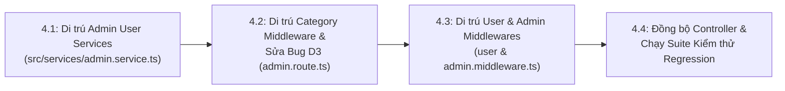

# BÁO CÁO KIỂM TOÁN TIỀN THỰC THI (PRE-IMPLEMENTATION AUDIT REPORT)
## PHASE 2 — STEP 4: AUTHENTICATION, VALIDATORS & MIDDLEWARES MIGRATION
**Dự án**: TMDEMY E-Learning Backend  
**Database Đích**: PostgreSQL 16.11 (`tmdemy`) qua Prisma ORM 6.4.1  
**Database Cũ**: MongoDB Atlas (`e-learning`)  
**Ngày thực hiện**: 02/10/2026  
**Chế độ thực thi**: **READ-ONLY AUDIT (Không sửa đổi source code, không can thiệp database)**  
**Kết luận thẩm định**: **READY WITH CONDITIONS — SẴN SÀNG THỰC THI VỚI CÁC ĐIỀU KIỆN RÀNG BUỘC PHÊ DUYỆT**

---

## 1. TỔNG QUAN VÀ KẾT LUẬN THẨM ĐỊNH

### 1.1. Mục đích kiểm toán
Kiểm toán độc lập toàn diện kiến trúc, các phụ thuộc Mongoose còn sót lại, sự phân định ranh giới giữa tầng HTTP Request Validation và Business Logic, cũng như đối chiếu hợp đồng API 22 endpoints của Phase 2 trước khi bước vào **Phase 2 — Step 4**.

### 1.2. Kết luận chung: READY WITH CONDITIONS
Hệ thống **đã sẵn sàng về mặt hạ tầng** để triển khai Step 4 vì:
* Phase 1 Foundation: Hoàn thành 100% (39/39 tests PASS).
* Phase 2 Step 1 (Model Separation): Hoàn thành 100% (17/17 tests PASS).
* Phase 2 Step 2 & 2.1 (Functional Repositories): Hoàn thành 100% (53/53 tests PASS, kết luận `READY FOR STEP 3`).
* Phase 2 Step 3 (User & Category Services): Hoàn thành 100% (66/66 tests PASS, zero database mutations).

**Tuy nhiên**, quá trình kiểm toán phát hiện **3 điểm ràng buộc kỹ thuật cốt lõi** cần được thống nhất phương án trước khi viết code Step 4:
1. **Sự phụ thuộc liên tầng giữa `admin.middleware.ts` và `admin.service.ts`**:
   `getUserDetailValidator` (hiện dùng `isMongoId`) được chia sẻ giữa `GET /api/users/profile/:id` và `GET /api/admin/users/:id`. Cả hai đều gọi `getUserDetailService` trong `src/services/admin.service.ts`. Nếu chuyển validator sang UUID mà không di trú 5 hàm quản trị User trong `admin.service.ts`, các endpoint này sẽ lập tức gãy vỡ do `admin.service.ts` vẫn dùng `!Types.ObjectId.isValid(id)` và query Mongoose.
2. **Khác biệt HTTP Status Code khi rút DB lookup khỏi `loginValidator`**:
   Hiện tại, `loginValidator` trong middleware kiểm tra `UserModel.findOne({ email })` và `!user.isVerified`. Khi lỗi, `handleValidationErrors` trả về **HTTP 400** `{ errors: { email: "..." } }`. Nếu chuyển kiểm tra sang `loginUserService` theo nguyên tắc kiến trúc `AGENTS.md`, `loginController` hiện tại trả về **HTTP 401** `{ success: false, message: "..." }`. Cần phê duyệt phương án giữ tương thích hợp đồng.
3. **Lỗ hổng leo thang đặc quyền (Privilege Escalation) tại Public Registration**:
   `registerValidator` hiện cho phép trường `role` tùy chọn (`isIn(Object.values(UserRole))`). Người dùng công khai có thể gửi `role: "admin"` hoặc `"teacher"` khi đăng ký. Cần chốt phương án bảo vệ.

---

## 2. XÁC MINH LỘ TRÌNH CHÍNH THỨC (ROADMAP & ADR VERIFICATION)

### 2.1. Đối chiếu Kế hoạch ban đầu và Thực tế triển khai

| Bước | Tên trong `implementation-plan.md` | Thực tế đã triển khai | Trạng thái hiện tại |
| :---: | :--- | :--- | :---: |
| **Step 0** | Thiết kế Patch Script `patch-phase2-users.ts` | Hoàn thành kịch bản dry-run, chưa chạy `--execute` | **HOÀN THÀNH** |
| **Step 1** | Tách Legacy Model & Xây dựng Zod Models | Tách `user.legacy.model.ts`, cô lập `user.model.ts` | **HOÀN THÀNH** |
| **Step 2** | Nâng cấp Functional Repositories | Xây dựng `user.repository.ts` và `category.repository.ts` | **HOÀN THÀNH** |
| **Step 2.1**| *(Bổ sung)* Read-only Repository Audit | Báo cáo kiểm toán độc lập kết luận `READY FOR STEP 3` | **HOÀN THÀNH** |
| **Step 3** | *Ban đầu là "Di trú Validators & Middlewares"* | **Đã thực hiện: "User & Category Service Migration"** | **HOÀN THÀNH (66/66 Tests PASS)** |
| **Step 4** | *Ban đầu là "Viết lại Services & Serialization"* | **Chính thức xác định phạm vi: Xem mục 2.2 bên dưới** | **BƯỚC TIẾP THEO (Cần thẩm định)** |
| **Step 5** | Tái cấu trúc Cron Job an toàn | Chưa triển khai | Chờ sau Step 4 |
| **Step 6** | Kiểm tra TypeScript & Runtime Startup | Chưa triển khai | Chờ sau Step 5 |
| **Step 7** | 6 Bộ Integration Tests Tự động | Chưa triển khai | Chờ sau Step 6 |
| **Step 8** | Báo cáo nghiệm thu Phase 2 | Chưa triển khai | Đóng Phase 2 |

### 2.2. Tên gọi và Phạm vi chính thức của Step 4
Từ sự hoán đổi có chủ đích tại Step 3 (khi Chủ dự án yêu cầu di trú `user.service.ts` và `category.service.ts` trước để làm nền tảng nghiệp vụ), phạm vi chính thức của Step 4 được xác định là:

> **PHASE 2 — STEP 4: AUTHENTICATION, VALIDATORS & ADMIN USER SERVICES MIGRATION**

**Phạm vi công việc của Step 4:**
1. **Di trú Validators & Middlewares của Phase 2**:
   * `src/middlewares/user.middleware.ts`
   * `src/middlewares/category.middleware.ts`
   * `src/middlewares/admin.middleware.ts` (các validator thuộc User: `getUserDetailValidator`, `updateUserByAdminValidator`, `createTeacherValidator`, `getAllUsersValidator`)
   * Sửa lỗi route `DELETE /api/admin/categories/:id` tại `src/routes/admin.route.ts` dòng 160 theo đúng **Quyết định Kiến trúc D3**.
   * Rà soát `src/middlewares/verifyToken.ts` và `src/middlewares/verifyRole.ts`.
2. **Rút toàn bộ Database Lookups ra khỏi Express Validator `.custom()`**:
   * Chuyển giao các kiểm tra email/name uniqueness, existence, và `isVerified` sang Service Layer điều phối Functional Repositories theo đúng quy tắc tại `AGENTS.md`.
3. **Di trú 5 hàm quản trị User trong `src/services/admin.service.ts`**:
   * `getAllUsersService`, `getUserDetailService`, `updateUserByAdminService`, `deleteUserByAdminService`, `createTeacherService`.
   * Chuyển các hàm này sang gọi `user.repository.ts`, loại bỏ `user.legacy.model.ts` khỏi `admin.service.ts`.
   * *(Lưu ý: Các hàm Course Admin từ dòng 200 trở đi trong `admin.service.ts` thuộc Phase 3, tuyệt đối giữ nguyên)*.

---

## 3. KIỂM TOÁN TỪNG MIDDLEWARE (MIDDLEWARE-BY-MIDDLEWARE AUDIT)

### 3.1. Bảng Kiểm toán Chi tiết Từng Middleware File

| Middleware File | Validator / Hàm | Phân loại kiểm tra | Phụ thuộc Mongoose hiện tại | Hướng xử lý tại Step 4 |
| :--- | :--- | :--- | :--- | :--- |
| **`user.middleware.ts`** | `registerValidator` | • Cú pháp username, pass, confirm, phone, bio, role: **HTTP Validation**<br>• `email.custom()`: **Database Lookup** | `UserModel.findOne({ email })` | • Giữ nguyên kiểm tra cú pháp.<br>• Rút `UserModel.findOne` ra khỏi validator; chuyển kiểm tra email trùng vào Service/Repository. |
| **`user.middleware.ts`** | `verifyOtpValidator` | • Email, OTP (6 số, numeric): **HTTP Validation** | Không có | Giữ nguyên 100% Express Validator rules. |
| **`user.middleware.ts`** | `loginValidator` | • Email format, pass length: **HTTP Validation**<br>• `email.custom()` (user tồn tại, `isVerified`): **DB & Business State** | `UserModel.findOne({ email })` | • Giữ cú pháp email & password.<br>• Chuyển kiểm tra tồn tại và `isVerified` sang `loginUserService`. |
| **`user.middleware.ts`** | `forgotPasswordValidator` | • Email format: **HTTP Validation**<br>• `email.custom()`: **DB Lookup** | `UserModel.findOne({ email })` | • Giữ cú pháp email.<br>• Bỏ custom DB check (đã có trong `forgotPasswordService`). |
| **`user.middleware.ts`** | `resetPasswordValidator` | • Password & Confirm password: **HTTP Validation** | Không có | Giữ nguyên 100% Express Validator rules. |
| **`user.middleware.ts`** | `changePasswordValidator`| • Old password, password, confirm: **HTTP Validation** | Không có | Giữ nguyên 100% Express Validator rules. |
| **`user.middleware.ts`** | `updateMeValidator` | • Username, phone, bio, avatar, socialLinks URLs: **HTTP Validation** | Không có | Giữ nguyên 100% Express Validator rules. |
| **`user.middleware.ts`** | `listTeachersValidator` | • Pagination (page, limit), search: **HTTP Validation** | Không có | Giữ nguyên 100% Express Validator rules. |
| **`user.middleware.ts`** | `userIdValidator` | • `param('userId')`: **ID Syntax Check** | `mongoose.Types.ObjectId.isValid` | Thay bằng `isValidUUID(value)` từ `src/utils/uuid.ts`. Giữ message `'Invalid User ID'`. |
| **`user.middleware.ts`** | `refreshTokenValidator`| • `refreshToken` (string, required): **HTTP Validation** | Không có | Giữ nguyên 100% Express Validator rules. |
| **`category.middleware.ts`** | `createCategoryValidator`| • Name, slug, description: **HTTP Validation**<br>• `name.custom()`: **Database Lookup** | `CategoryModel.findOne({ name })` | • Giữ cú pháp name, slug, description.<br>• Rút DB check (đã có `isCategoryNameTaken` trong Service). |
| **`category.middleware.ts`** | `updateCategoryValidator`| • `param('id')`: **ID Syntax Check**<br>• `name.custom()`: **Database Lookup**<br>• Fields: **HTTP Validation** | • `mongoose.Types.ObjectId.isValid`<br>• `CategoryModel.findOne({ name })` | • Thay `param('id')` bằng `isValidUUID` từ `src/utils/uuid.ts`.<br>• Bỏ `name.custom()`, Service đã xử lý `isCategoryNameTaken(name, id)`. |
| **`category.middleware.ts`** | `listCategoriesValidator`| • Pagination (page, limit), search: **HTTP Validation** | Không có | Giữ nguyên 100% Express Validator rules. |
| **`category.middleware.ts`** | `getCategoryDetailValidator`| • `param('slug')` notEmpty: **HTTP Validation** | Không có | Giữ nguyên 100% Express Validator rules. |
| **`admin.middleware.ts`** | `getAllUsersValidator` | • Page, limit, role enum, status enum, sortBy: **HTTP Validation** | Không có | Giữ nguyên 100% Express Validator rules. |
| **`admin.middleware.ts`** | `getUserDetailValidator`| • `param('id')`: **ID Syntax Check** | `.isMongoId()` | Thay bằng `isValidUUID` từ `src/utils/uuid.ts`. Giữ message `'Invalid user id'`. |
| **`admin.middleware.ts`** | `updateUserByAdminValidator`| • `param('id')`: **ID Syntax Check**<br>• Blacklist & Whitelist fields: **HTTP Validation** | `.isMongoId()` | Thay `param('id')` bằng `isValidUUID`. Giữ nguyên toàn bộ blacklist/whitelist rules. |
| **`admin.middleware.ts`** | `createTeacherValidator`| • Role blocked, username, email, pass, confirm, socialLinks: **HTTP Validation** | Không có | Giữ nguyên 100% Express Validator rules. |
| **`admin.route.ts` (dòng 160)** | Route `DELETE /categories/:id` | • Sai validator `courseIdValidator` | Phụ thuộc `course.middleware.ts` | **Thực thi Quyết định D3**: Thay bằng `categoryIdValidator` chuẩn UUID. |
| **`verifyToken.ts`** | `verifyAccessToken`, `verifyRefreshToken` | • JWT Token Signature & Expiry: **HTTP Pipeline Authentication** | Không có Mongoose | Giữ nguyên 100%. Đã hoạt động tốt. |
| **`verifyRole.ts`** | `isAdmin`, `isTeacher`, `isTeacherOrAdmin` | • JWT Role matching lowercase: **HTTP Pipeline Authorization** | Không có Mongoose | Giữ nguyên 100% theo đúng **Quyết định D4**. |
| **`validate.ts`** | `handleValidationErrors` | • Formatting errors mapped: **HTTP Error Handling** | Không có | Giữ nguyên 100%. |

---

## 4. PHÂN ĐỊNH TRÁCH NHIỆM THEO NGUYÊN TẮC KIẾN TRÚC `AGENTS.MD`

```
┌────────────────────────────────────────────────────────────────────────┐
│                      TẦNG HTTP MIDDLEWARE PIPELINE                     │
│  (src/middlewares/user.middleware.ts, category.middleware.ts, ...)    │
├────────────────────────────────────────────────────────────────────────┤
│  ✔ Kiểm tra cú pháp (Required, String, Min, Max, Email, Phone, URL)    │
│  ✔ Kiểm tra format UUID (isValidUUID từ src/utils/uuid.ts)             │
│  ✔ Kiểm tra enum đầu vào (UserRole, UserStatus)                        │
│  ✔ So khớp mật khẩu xác nhận (confirm_password === password)           │
│  ✔ Xác minh tính hợp lệ của JWT Token (verifyToken.ts)                 │
│  ✔ Kiểm tra role cơ bản từ token đã giải mã (verifyRole.ts)           │
│  ❌ KHÔNG gọi Mongoose Model / Prisma Client                           │
│  ❌ KHÔNG truy vấn Database trong Express-validator .custom()           │
│  ❌ KHÔNG kiểm tra quyền sở hữu hoặc trạng thái nghiệp vụ phức tạp    │
└────────────────────────────────────┬───────────────────────────────────┘
                                     │
                                     ▼
┌────────────────────────────────────────────────────────────────────────┐
│                        TẦNG APPLICATION SERVICE                        │
│      (src/services/user.service.ts, category.service.ts, ...)          │
├────────────────────────────────────────────────────────────────────────┤
│  ✔ Kiểm tra trùng lặp email, username, category slug, category name   │
│  ✔ Kiểm tra trạng thái tài khoản (isVerified, status ACTIVE/BLOCKED)   │
│  ✔ Kiểm tra quy tắc nghiệp vụ (chặn tự xóa mình, chặn xóa admin cuối)  │
│  ✔ Mã hóa mật khẩu (bcrypt), sinh OTP, sinh reset token               │
│  ✔ Điều phối Functional Repositories & Prisma Transactions             │
│  ✔ Chuẩn hóa DTO (withCompatId, lowercase role, socialLinks object)   │
└────────────────────────────────────┬───────────────────────────────────┘
                                     │
                                     ▼
┌────────────────────────────────────────────────────────────────────────┐
│                       TẦNG FUNCTIONAL REPOSITORY                       │
│    (src/repositories/user.repository.ts, category.repository.ts)      │
├────────────────────────────────────────────────────────────────────────┤
│  ✔ Data Access thuần túy qua Prisma Singleton                          │
│  ✔ Áp dụng Prisma Select Projections an toàn                           │
│  ✔ Nhận tx?: PrismaTransactionClient                                   │
└────────────────────────────────────────────────────────────────────────┘
```

---

## 5. RANH GIỚI PHẠM VI (SCOPE BOUNDARIES)

### 5.1. Danh sách tập tin trong phạm vi Step 4 (In-Scope)
1. [src/middlewares/user.middleware.ts](file:///d:/e-learning_server/src/middlewares/user.middleware.ts): Chuyển ObjectId sang UUID, loại bỏ Mongoose queries trong custom validators.
2. [src/middlewares/category.middleware.ts](file:///d:/e-learning_server/src/middlewares/category.middleware.ts): Chuyển ObjectId sang UUID, loại bỏ Mongoose queries trong custom validators.
3. [src/middlewares/admin.middleware.ts](file:///d:/e-learning_server/src/middlewares/admin.middleware.ts): Chuyển `isMongoId()` sang UUID cho các route User/Category Admin.
4. [src/routes/admin.route.ts](file:///d:/e-learning_server/src/routes/admin.route.ts): Thay `courseIdValidator` bằng `categoryIdValidator` tại dòng 160 (Quyết định D3).
5. [src/services/admin.service.ts](file:///d:/e-learning_server/src/services/admin.service.ts) (phần User, dòng 1–198): Di trú `getAllUsersService`, `getUserDetailService`, `updateUserByAdminService`, `deleteUserByAdminService`, `createTeacherService` sang dùng `user.repository.ts`.
6. [src/services/user.service.ts](file:///d:/e-learning_server/src/services/user.service.ts): Bổ sung kiểm tra `isVerified` và email tồn tại trong `loginUserService` để tiếp nhận trách nhiệm từ `loginValidator`.

### 5.2. Danh sách tập tin tuyệt đối ngoài phạm vi Step 4 (Explicitly Out-of-Scope)
1. **Các Middleware thuộc Phase 3–10**:
   * `course.middleware.ts`, `chapter.middleware.ts`, `lesson.middleware.ts`, `quiz.middleware.ts`, `question.middleware.ts`, `quizSubmission.middleware.ts`, `order.middleware.ts`, `coupon.middleware.ts`, `progress.middleware.ts`, `rating.middleware.ts`, `comment.middleware.ts`, `notification.middleware.ts`.
   * **Lý do**: Chưa tới Phase di trú, phải giữ nguyên để bảo vệ các module đang chạy.
2. **Các Service thuộc Phase 3–10**:
   * `course.service.ts`, `quiz.service.ts`, `order.service.ts`, `comment.service.ts`,...
   * Phần Course Admin trong `admin.service.ts` (từ dòng 199 đến 378).
3. **Mô hình Dữ liệu**:
   * `prisma/schema.prisma`: Tuyệt đối không sửa schema, không chạy prisma migration.
   * `src/models/category.model.ts`: Giữ nguyên Mongoose model để phục vụ Course service chưa migrate.
   * `src/models/legacy/user.legacy.model.ts`: Giữ nguyên cho các module Phase 3–8.
4. **Dữ liệu**:
   * Không chạy `patch-phase2-users.ts` với cờ `--execute`.
   * Không sửa đổi MongoDB database.

---

## 6. PHÂN TÍCH RỦI RO KỸ THUẬT VÀ QUY TẮC NGHIỆP VỤ

### Rủi ro 1: Lệch mã lỗi và cấu trúc Response khi di chuyển DB checks ra khỏi Validator
* **Hiện trạng**:
  * Khi `loginValidator` bắt lỗi chưa verify, `handleValidationErrors` trả về:
    `HTTP 400 Bad Request` $\rightarrow$ `{ "errors": { "email": "Vui lòng xác thực email trước khi đăng nhập" } }`.
  * Nếu đưa vào `loginUserService`, `loginController` hiện tại xử lý:
    `if (!result.success) return res.status(401).json({ success: false, message: result.message })`.
    Nghĩa là trả về `HTTP 401 Unauthorized` $\rightarrow$ `{ "success": false, "message": "Vui lòng xác thực email trước khi đăng nhập" }`.
* **Phân tích**:
  * Theo chuẩn RESTful, `401 Unauthorized` là mã lỗi chính xác cho hành vi đăng nhập thất bại.
  * Tuy nhiên, nếu Frontend Next.js hoặc Postman test suite đang chờ `400` với envelope `{ errors: { email: "..." } }`, việc đổi sang `401` sẽ làm gãy test.
* **Đề xuất giải pháp**:
  Trong `loginController`, nếu `result.statusCode` được Service chỉ định (ví dụ `400` cho tài khoản chưa xác thực), Controller sẽ trả đúng status code đó:
  `res.status(result.statusCode || 401).json(...)`.

### Rủi ro 2: Kiểm tra Role tùy chọn tại Public Registration (`registerValidator`)
* **Hiện trạng**:
  * `body('role').optional().isIn(Object.values(UserRole)).withMessage('Invalid role')`.
  * `UserRole` gồm: `['admin', 'teacher', 'user']`.
  * Kẻ tấn công có thể gửi `POST /api/users/register` với `role: "admin"` và tự thăng quyền thành Admin hệ thống ngay khi đăng ký tài khoản!
* **Khuyến nghị an toàn**:
  * Trong `registerValidator`, loại bỏ trường `role` khỏi danh mục cho phép đăng ký công khai, hoặc ép buộc `role` trong `registerUserService` luôn mặc định là `UserRole.USER`.
  * API tạo Teacher riêng biệt đã tồn tại tại `POST /api/admin/users` (`createTeacherController`).

### Rủi ro 3: Tài khoản Duplicate Username lịch sử `thaiminh`
* **Hiện trạng**:
  * Trong PostgreSQL hiện có 2 tài khoản cùng mang username `thaiminh`.
* **Quy tắc an toàn**:
  * Tuyệt đối không thêm `@unique` vào `username` trong Prisma Schema.
  * Tại `updateUserByAdminService`: Chỉ kiểm tra `isUsernameTaken(username, id)` khi `username !== user.username` hiện tại.
  * Giữ nguyên cơ chế đã hoàn thiện tại Step 3.

### Rủi ro 4: UUID Validation Utility Usage
* **Hiện trạng**:
  * Đã kiểm tra trực tiếp file [src/utils/uuid.ts](file:///d:/e-learning_server/src/utils/uuid.ts).
  * Các hàm export thực tế là:
    - `isValidUUID(value: unknown): boolean`
    - `validateUUIDParam: CustomValidator`
    - `validateRouteUUIDParam(paramName = 'id')`
    - `withCompatId<T>(...)`
* **Quy tắc**:
  * Tái sử dụng trực tiếp các hàm này. Tuyệt đối không tự định nghĩa lại regex UUID hoặc hàm validate mới.
  * Khi validate `param('id')`, có thể dùng `param('id').custom(validateUUIDParam).withMessage('Invalid ... id')` hoặc `validateRouteUUIDParam('id')`.

---

## 7. TRÌNH TỰ TRIỂN KHAI ĐỀ XUẤT CHO STEP 4

Để bảo đảm không có thời điểm nào hệ thống rơi vào trạng thái không nhất quán giữa Middleware và Service, Step 4 nên được thực hiện theo 4 giai đoạn tuần tự:



### Chi tiết từng giai đoạn:
* **Giai đoạn 4.1: Di trú 5 hàm User trong `src/services/admin.service.ts`**:
  * Chuyển `getAllUsersService`, `getUserDetailService`, `updateUserByAdminService`, `deleteUserByAdminService`, `createTeacherService` sang gọi `user.repository.ts`.
  * Thay thế kiểm tra `Types.ObjectId.isValid` bằng `isValidUUID`.
  * Áp dụng `countAdminsExcluding` để bảo vệ tài khoản admin cuối cùng.
  * Áp dụng `findUserConflict` khi tạo teacher.
* **Giai đoạn 4.2: Di trú Category Middleware & Quyết định D3**:
  * `category.middleware.ts`: Bỏ `CategoryModel` imports, chuyển `param('id')` sang `isValidUUID`, rút các custom validator DB checks.
  * `admin.route.ts`: Thay thế `courseIdValidator` tại dòng 160 bằng `categoryIdValidator`.
* **Giai đoạn 4.3: Di trú User Middleware & Admin Middleware**:
  * `user.middleware.ts`: Bỏ `UserModel` imports, chuyển `param('userId')` sang `isValidUUID`, rút DB checks khỏi `registerValidator`, `loginValidator`, `forgotPasswordValidator`.
  * `admin.middleware.ts`: Chuyển `getUserDetailValidator`, `updateUserByAdminValidator` từ `.isMongoId()` sang `isValidUUID`.
  * `user.service.ts`: Cập nhật `loginUserService` để kiểm tra `isVerified` và email tồn tại.
* **Giai đoạn 4.4: Kiểm thử toàn diện**:
  * Chạy `cmd /c npx tsc --noEmit`.
  * Chạy test Step 1, Step 2, Step 3.
  * Xây dựng bộ test mới `step-04-middleware-auth.test.ts` kiểm thử toàn bộ các validator và authentication pipeline.

---

## 8. CÁC CÂU HỎI VÀ ĐIỀU KIỆN CẦN CHỦ DỰ ÁN PHÊ DUYỆT

Trước khi bắt đầu viết mã cho Step 4, kính trình Chủ dự án xem xét và phê duyệt 3 điểm sau:

1. **Phê duyệt phạm vi kết hợp của Step 4**:
   * Đồng ý thực hiện đồng bộ việc di trú Middlewares/Validators cùng với 5 hàm User trong `src/services/admin.service.ts` để tránh gãy vỡ do xung đột UUID/ObjectId.
2. **Quyết định về trường `role` trong `registerValidator`**:
   * *Phương án A (Khuyến nghị an toàn)*: Khóa trường `role` tại đăng ký công khai (luôn mặc định tạo role `user`).
   * *Phương án B (Bảo toàn nguyên trạng)*: Tiếp tục cho phép gửi `role` tùy chọn qua API đăng ký.
3. **Quyết định về HTTP Status Code khi tài khoản chưa xác thực đăng nhập**:
   * *Phương án A (Chuẩn REST)*: Trả về `401 Unauthorized` `{ success: false, message: "Vui lòng xác thực email trước khi đăng nhập" }`.
   * *Phương án B (Bảo toàn lỗi Validator cũ)*: Trả về `400 Bad Request` `{ success: false, message: "Vui lòng xác thực email trước khi đăng nhập" }`.

---

## 9. KẾT LUẬN CUỐI CÙNG

* Báo cáo tiền kiểm toán Step 4 hoàn thành ở chế độ **READ-ONLY 100%**.
* Không có bất kỳ dòng code nguồn, schema, package hay dữ liệu database nào bị chỉnh sửa.
* Hệ thống đã ở trạng thái **READY WITH CONDITIONS**. 
* **Dừng lại tại đây và chờ chỉ đạo/phê duyệt chính thức từ Chủ dự án trước khi thực hiện Step 4.**
