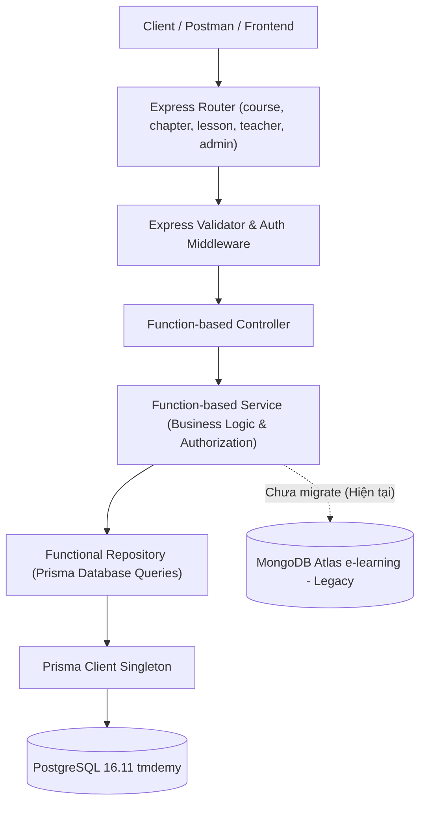
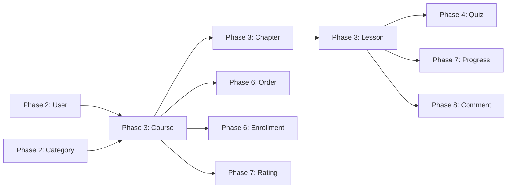
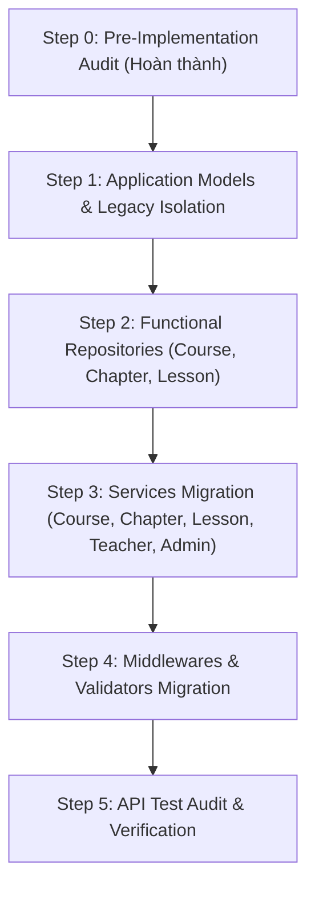

# PHASE 3 — PRE-IMPLEMENTATION AUDIT REPORT
## COURSE, CHAPTER & LESSON APPLICATION LAYER MIGRATION

> **Status:** READ-ONLY AUDIT COMPLETED  
> **Phase:** Phase 3 — Step 0  
> **Target Database:** PostgreSQL 16.11 (`tmdemy`) via Prisma ORM 6.4.1  
> **Source Database:** MongoDB Atlas (`e-learning`)  
> **Target Date:** 2026-10-02  
> **Author:** Antigravity AI Assistant & Engineering Team  

---

## 1. EXECUTIVE SUMMARY

Sau khi hoàn thành xuất sắc Phase 2 (User, Category & Authentication Migration với 220/220 test cases PASS và 34/34 HTTP API tests PASS), dự án TMDEMY bước vào **Phase 3: Course, Chapter & Lesson Migration**.

Báo cáo này tiến hành khảo sát và kiểm toán toàn diện (Read-Only Audit) cấu trúc cơ sở dữ liệu, các Mongoose models hiện hữu, tầng Service, Controller, Router, Middleware và các hợp đồng API (API Contracts) liên quan đến 3 thực thể cốt lõi của nền tảng: **Khóa học (Course)**, **Chương học (Chapter)** và **Bài học (Lesson)**.

### Kết quả khảo sát chính:
1. **Dữ liệu lịch sử đã được di trú hoàn tất vào PostgreSQL:** 
   - `courses`: 8 bản ghi (Status: 7 `APPROVED`, 1 `PENDING`).
   - `course_faqs`: 8 bản ghi (Tách ra từ `Course.info.qa` của MongoDB).
   - `chapters`: 12 bản ghi (100% foreign key khớp chính xác về Course).
   - `lessons`: 7 bản ghi (100% foreign key khớp về Chapter, Course và Author).
   - Khóa chính sử dụng UUID v5 xác định theo chuẩn RFC 4122.
2. **Kiến trúc Application Layer hiện tại hoàn toàn chạy trên MongoDB/Mongoose:**
   - Cả 5 services (`course.service.ts`, `chapter.service.ts`, `lesson.service.ts`, `teacher.service.ts`, và phần quản trị khóa học trong `admin.service.ts`) vẫn đang import và gọi trực tiếp các Mongoose model `CourseModel`, `ChapterModel`, `LessonModel`.
   - Chưa có các Functional Repository tương ứng cho Course, Chapter và Lesson.
3. **Phát hiện các lỗi Validator / Router nghiêm trọng trong codebase cũ:**
   - `DELETE /api/chapters/:id`: Sử dụng nhầm `courseIdValidator` để kiểm tra `chapterId`.
   - `DELETE /api/lessons/:id`: Sử dụng `chapterIdValidator` (vốn kiểm tra `param('chapterId')`) trong khi route param là `:id`, dẫn đến lỗi validation sai lệch.
   - `PATCH /api/admin/courses/teacher/:id`: Sử dụng `listPublicCoursesValidator` thay vì validator kiểm tra ID khóa học.
   - Các validator trong `course.middleware.ts`, `chapter.middleware.ts`, `lesson.middleware.ts` vẫn dùng `isMongoId()` và `mongoose.Types.ObjectId.isValid()`, dẫn đến việc từ chối các UUID hợp lệ của Category và User đã migrate ở Phase 2.
4. **Vấn đề Kiểu dữ liệu Decimal & Nested Structure:**
   - Trong PostgreSQL/Prisma, `price` và `oldPrice` là kiểu `Decimal(12, 2)`. Cần cơ chế serialize chuẩn hóa sang `Number` để bảo toàn API contract cũ.
   - Cấu trúc `info` trong MongoDB (`requirements`, `benefits`, `techniques`, `documents`, `qa`) đã được chuẩn hóa thành các mảng chuỗi `String[]` và bảng quan hệ `course_faqs`. Service layer cần adapter mapping để trả về cấu trúc JSON đúng hợp đồng cũ.

---

## 2. CURRENT ARCHITECTURE

Hệ thống tuân thủ kiến trúc phân tầng Function-based:



### Nguyên tắc kiến trúc bắt buộc:
* **Functional Style:** Tuyệt đối không dùng Class-based Repository, không generic `BaseRepository`, không `this`.
* **Prisma Client Singleton:** Sử dụng instance duy nhất tại `src/config/prisma.ts`.
* **Phân định rõ trách nhiệm:**
  - Express Validator: Chỉ kiểm tra cú pháp, format, string length, regex, UUID format.
  - Service: Kiểm tra nghiệp vụ, teacher ownership, slug uniqueness, business state.
  - Repository: Chỉ truy vấn database qua Prisma, trả về raw / typed domain data.

---

## 3. PRISMA SCHEMA AUDIT

Cấu trúc trong [prisma/schema.prisma](file:///d:/e-learning_server/prisma/schema.prisma):

### 3.1. Model `Course` (Table `courses`)
- `id`: `String @id @default(uuid()) @db.Uuid` (Khóa chính UUID)
- `title`: `String @db.VarChar(255)`
- `slug`: `String @unique @db.VarChar(255)` (Ràng buộc Unique cấp DB)
- `image`: `String @default("")`
- `introUrl`: `String @default("") @map("intro_url")`
- `description`: `String @default("") @db.Text`
- `price`: `Decimal @default(0) @db.Decimal(12, 2)` ⚠️ *Cần serialize Number*
- `oldPrice`: `Decimal @default(0) @map("old_price") @db.Decimal(12, 2)` ⚠️ *Cần serialize Number*
- `type`: `CourseType @default(PAID)` (Enum: `PAID`, `FREE`)
- `status`: `CourseStatus @default(PENDING)` (Enum: `APPROVED`, `PENDING`, `REJECTED`)
- `level`: `CourseLevel @default(BEGINNER)` (Enum: `BEGINNER`, `INTERMEDIATE`, `ADVANCED`)
- `view`: `Int @default(0)`
- `sold`: `Int @default(0)`
- `requirements`: `String[] @default([])`
- `benefits`: `String[] @default([])`
- `techniques`: `String[] @default([])`
- `documents`: `String[] @default([])`
- `categoryId`: `String? @map("category_id") @db.Uuid` (FK `categories.id`, `onDelete: SetNull`)
- `authorId`: `String @map("author_id") @db.Uuid` (FK `users.id`, `onDelete: Restrict`)
- `isDestroyed`: `Boolean @default(false) @map("is_destroyed")`
- `createdAt`: `DateTime @default(now()) @map("created_at")`
- `updatedAt`: `DateTime @updatedAt @map("updated_at")`
- **Indexes:** `[authorId]`, `[categoryId]`, `[status, isDestroyed]`, `[slug] (unique)`.

### 3.2. Model `CourseFaq` (Table `course_faqs`)
- `id`: `String @id @default(uuid()) @db.Uuid`
- `courseId`: `String @map("course_id") @db.Uuid` (FK `courses.id`, `onDelete: Cascade`)
- `question`: `String @db.Text`
- `answer`: `String @db.Text`
- `order`: `Int @default(0)`
- `createdAt`: `DateTime @default(now()) @map("created_at")`
- **Indexes:** `[courseId, order]`.

### 3.3. Model `Chapter` (Table `chapters`)
- `id`: `String @id @default(uuid()) @db.Uuid`
- `title`: `String @db.VarChar(255)`
- `courseId`: `String @map("course_id") @db.Uuid` (FK `courses.id`, `onDelete: Cascade`)
- `order`: `Int @default(0)`
- `isDestroyed`: `Boolean @default(false) @map("is_destroyed")`
- `createdAt`: `DateTime @default(now()) @map("created_at")`
- `updatedAt`: `DateTime @updatedAt @map("updated_at")`
- **Indexes:** `[courseId, order]`.

### 3.4. Model `Lesson` (Table `lessons`)
- `id`: `String @id @default(uuid()) @db.Uuid`
- `title`: `String @db.VarChar(255)`
- `slug`: `String @db.VarChar(255)`
- `chapterId`: `String @map("chapter_id") @db.Uuid` (FK `chapters.id`, `onDelete: Cascade`)
- `courseId`: `String @map("course_id") @db.Uuid` (FK `courses.id`, `onDelete: Cascade`)
- `authorId`: `String @map("author_id") @db.Uuid` (FK `users.id`, `onDelete: Restrict`)
- `order`: `Int @default(0)`
- `duration`: `Int @default(0)` (Đơn vị: giây)
- `type`: `LessonType @default(VIDEO)` (Enum: `VIDEO`, `TEXT`)
- `content`: `String @default("") @db.Text`
- `isDemo`: `Boolean @default(false) @map("is_demo")`
- `videoUrl`: `String @default("") @map("video_url")`
- `createdAt`: `DateTime @default(now()) @map("created_at")`
- `updatedAt`: `DateTime @updatedAt @map("updated_at")`
- **Ràng buộc:** `@@unique([slug, courseId])` (Slug là duy nhất trong cùng 1 khóa học).
- **Indexes:** `[chapterId, order]`, `[courseId]`.

---

## 4. LEGACY MONGOOSE MODELS AUDIT

So sánh chi tiết giữa Mongoose Model cũ và Prisma Schema mới:

| Khía cạnh | Mongoose Model cũ | Prisma Schema / PostgreSQL | Chiến lược xử lý Migration |
| :--- | :--- | :--- | :--- |
| **Course ID** | `_id: ObjectId` | `id: String (UUID v5)` | Trả về cả `id` và `_id` qua `withCompatId()` |
| **Giá tiền (`price`, `old_price`)** | `Number` | `Decimal(12, 2)` | Dùng `Number(course.price)` khi serialize response |
| **Cấu trúc `info`** | Nested Object `{ requirements, benefits, techniques, documents, qa: [{ question, answer }] }` | 4 cột mảng `String[]` + bảng quan hệ `course_faqs` | Đóng gói ngược thành `info` object khi trả về public API detail |
| **Chapters / Lessons Relation** | Mảng ObjectId `course.chapters = [id1, id2]`, `chapter.lessons = [id1, id2]` | Bảng quan hệ khóa ngoại `chapter.courseId`, `lesson.chapterId` | Thay thế việc `.push()` vào mảng Mongoose bằng nested relation query Prisma |
| **Ratings Relation** | Mảng ObjectId `course.rating = [id1, id2]` | Quan hệ 1:N với bảng `ratings` (`rating.courseId`) | Không lưu mảng rating trong Course; truy vấn quan hệ khi cần |
| **Soft Delete** | `_destroy: Boolean` | `isDestroyed: Boolean` | Giữ tương thích: `_destroy: course.isDestroyed` |
| **Lesson Slug Uniqueness** | `slug: { unique: true }` (Unique toàn cục) | `@@unique([slug, courseId])` (Unique theo Course) | Logic sinh slug ở Service kiểm tra unique theo Course |

---

## 5. SERVICES & REPOSITORIES AUDIT

### 5.1. Khảo sát 5 Service có liên quan trực tiếp

1. **`src/services/course.service.ts`**:
   - `createCourseService`: Kiểm tra quyền tác giả, chuẩn hóa slug bằng `toBaseSlug()`, kiểm tra trùng slug, tạo Course, gửi notification đến Admins nếu do Teacher tạo.
   - `getCourseDetailPublicService`: Tăng `view` tự động (`$inc: { view: 1 }`), populate `author`, `chapters`, và nested `lessons` (`title`, `duration`, `isDemo`).
   - `getListCoursesService`: Lọc theo `status: APPROVED`, `_destroy: false`, tìm kiếm regex theo `title`, lọc theo `category`, `level`, `type`, khoảng giá `priceMin`/`priceMax`, populate `author`, phân trang.
2. **`src/services/chapter.service.ts`**:
   - `createChapterService`: Kiểm tra quyền sở hữu Teacher (`course.author === userId`), tự động tính `order = lastChapter.order + 1` nếu không truyền, cập nhật mảng chapters của Course.
   - `updateChapterService`: Kiểm tra quyền sở hữu, cập nhật `title`, `order`, `_destroy`.
   - `deleteChapterService`: Kiểm tra quyền sở hữu, soft-delete chapter (`_destroy = true`).
   - `getChaptersByCourseService`: Lấy danh sách chapters chưa bị xóa (`_destroy: false`) sắp xếp theo `order: 1`.
3. **`src/services/lesson.service.ts`**:
   - `createLessonService`: Kiểm tra quyền sở hữu khóa học, sinh slug bằng `slugify()`, tự động thêm timestamp hex suffix nếu trùng, tính `order = lastLesson.order + 1`, đẩy lesson vào `chapter.lessons`, gửi notification tới toàn bộ học viên đã ghi danh (`EnrollmentModel.find({ course, status: 'active' })`).
   - `updateLessonService`: Kiểm tra quyền sở hữu, cập nhật nội dung bài học.
   - `deleteLessonService`: Gỡ bài học khỏi mảng `chapter.lessons`, hard-delete bài học.
   - `getLessonsByChapterService`: Lấy danh sách bài học thuộc chapter sắp xếp theo `order: 1`.
4. **`src/services/teacher.service.ts`**:
   - `updateCourseByTeacherService`: Kiểm tra quyền sở hữu của Teacher, cập nhật các trường khóa học.
   - `deleteCoursesByTeacherService`: **Quy tắc nghiệp vụ quan trọng**: Chỉ cho phép xóa khóa học khi trạng thái là `PENDING` (`if (course.status !== CourseStatus.PENDING) -> 403`). Thực hiện xóa hard-delete.
   - `getCoursesByTeacherService`: Lấy danh sách khóa học của riêng giáo viên (`author = teacherId`), hỗ trợ lọc và phân trang.
5. **`src/services/admin.service.ts` (Phần Course Admin từ dòng 299+)**:
   - `updateCourseByAdminService`: Admin có quyền cập nhật mọi trường của khóa học, bao gồm `status` và `_destroy`.
   - `deleteCourseByAdminService`: Admin soft-delete khóa học (`_destroy = true`).
   - `getCoursesByAdminService`: Lấy tất cả khóa học trên hệ thống không phân biệt tác giả, lọc theo status, author, destroy flag.
   - `updateCourseStatusForTeacherService`: Cập nhật `status`. Nếu chuyển thành `APPROVED`, tự động bắn thông báo cho giáo viên tác giả.

### 5.2. Các Service khác đang phụ thuộc vào Course/Chapter/Lesson
- `order.service.ts`: Kiểm tra giá khóa học, tăng/giảm trường `sold` khi đặt hàng / hoàn tiền.
- `enrollment.service.ts`: Kiểm tra khóa học khi ghi danh.
- `rating.service.ts`: Đánh giá khóa học.
- `comment.service.ts`: Bình luận theo `courseId` và `lessonId`.
- `favoriteCourse.service.ts`: Yêu thích khóa học.
- `coupon.service.ts`: Áp dụng mã giảm giá cho khóa học.
- `progress.service.ts`: Theo dõi tiến độ hoàn thành các bài học trong khóa học.
- `quiz.service.ts` & `question.service.ts`: Gắn Quiz vào Lesson.

---

## 6. API ENDPOINT INVENTORY (19 ENDPOINTS)

Dưới đây là danh mục chi tiết 19 endpoint thuộc phạm vi Phase 3:

### 6.1. Nhóm Khóa học Công khai (`/api/courses` - 2 Endpoints)

| Method | Endpoint URL | Middleware & Validator | Controller | Service | Quyền |
| :---: | :--- | :--- | :--- | :--- | :---: |
| `GET` | `/api/courses` | `listPublicCoursesValidator` | `getListCoursesController` | `getListCoursesService` | Public |
| `GET` | `/api/courses/:slug` | (None) | `getCourseDetailPublicController` | `getCourseDetailPublicService` | Public |

### 6.2. Nhóm Khóa học của Giáo viên (`/api/teacher/courses` - 4 Endpoints)

| Method | Endpoint URL | Middleware & Validator | Controller | Service | Quyền |
| :---: | :--- | :--- | :--- | :--- | :---: |
| `POST` | `/api/teacher/courses/` | `verifyAccessToken`, `isTeacher`, `createCourseValidator` | `createCourseByTeacherController` | `createCourseService` | TEACHER |
| `PUT` | `/api/teacher/courses/:id`| `verifyAccessToken`, `isTeacher`, `updateCourseValidator` | `updateCourseByTeacherController` | `updateCourseByTeacherService`| TEACHER |
| `DELETE`| `/api/teacher/courses/:id`| `verifyAccessToken`, `isTeacher`, `courseIdValidator` | `deleteCourseByTeacherController` | `deleteCoursesByTeacherService`| TEACHER |
| `GET` | `/api/teacher/courses/` | `verifyAccessToken`, `isTeacher`, `listPublicCoursesValidator` | `getCoursesByTeacherController` | `getCoursesByTeacherService` | TEACHER |

### 6.3. Nhóm Quản trị Khóa học Admin (`/api/admin/courses` - 5 Endpoints)

| Method | Endpoint URL | Middleware & Validator | Controller | Service | Quyền |
| :---: | :--- | :--- | :--- | :--- | :---: |
| `POST` | `/api/admin/courses` | `verifyAccessToken`, `isAdmin`, `createCourseValidator` | `createCourseByAdminController` | `createCourseService` | ADMIN |
| `PUT` | `/api/admin/courses/:id` | `verifyAccessToken`, `isAdmin`, `updateCourseByAdminValidator` | `updateCourseByAdminController` | `updateCourseByAdminService` | ADMIN |
| `DELETE`| `/api/admin/courses/:id` | `verifyAccessToken`, `isAdmin`, `courseIdValidator` | `deleteCourseByAdminController` | `deleteCourseByAdminService` | ADMIN |
| `GET` | `/api/admin/courses` | `verifyAccessToken`, `isAdmin`, `listPublicCoursesValidator` | `getCoursesByAdminController` | `getCoursesByAdminService` | ADMIN |
| `PATCH` | `/api/admin/courses/teacher/:id`| `verifyAccessToken`, `isAdmin`, `listPublicCoursesValidator` ⚠️ | `updateCourseStatusForTeacherController` | `updateCourseStatusForTeacherService`| ADMIN |

### 6.4. Nhóm Quản lý Chương học (`/api/chapters` - 4 Endpoints)

| Method | Endpoint URL | Middleware & Validator | Controller | Service | Quyền |
| :---: | :--- | :--- | :--- | :--- | :---: |
| `POST` | `/api/chapters/:courseId` | `verifyAccessToken`, `isTeacherOrAdmin`, `createChapterValidator` | `createChapterController` | `createChapterService` | TEACHER / ADMIN |
| `PUT` | `/api/chapters/:id` | `verifyAccessToken`, `isTeacherOrAdmin`, `updateChapterValidator` | `updateChapterController` | `updateChapterService` | TEACHER / ADMIN |
| `DELETE`| `/api/chapters/:id` | `verifyAccessToken`, `isTeacherOrAdmin`, `courseIdValidator` ⚠️ | `deleteChapterController` | `deleteChapterService` | TEACHER / ADMIN |
| `GET` | `/api/chapters/course/:id`| `verifyAccessToken`, `isTeacherOrAdmin`, `courseIdValidator` | `getChaptersByCourseController` | `getChaptersByCourseService` | TEACHER / ADMIN |

### 6.5. Nhóm Quản lý Bài học (`/api/lessons` - 4 Endpoints)

| Method | Endpoint URL | Middleware & Validator | Controller | Service | Quyền |
| :---: | :--- | :--- | :--- | :--- | :---: |
| `POST` | `/api/lessons` | `verifyAccessToken`, `isTeacherOrAdmin`, `createLessonValidator` | `createLessonController` | `createLessonService` | TEACHER / ADMIN |
| `PUT` | `/api/lessons/:id` | `verifyAccessToken`, `isTeacherOrAdmin`, `updateLessonValidator` | `updateLessonController` | `updateLessonService` | TEACHER / ADMIN |
| `DELETE`| `/api/lessons/:id` | `verifyAccessToken`, `isTeacherOrAdmin`, `chapterIdValidator` ⚠️ | `deleteLessonController` | `deleteLessonService` | TEACHER / ADMIN |
| `GET` | `/api/lessons/chapter/:chapterId` | `chapterIdValidator` | `getLessonsByChapterController` | `getLessonsByChapterService` | Public |

---

## 7. API CONTRACT COMPATIBILITY

Để bảo toàn 100% hợp đồng API của hệ thống:

1. **Khóa Định danh (`id` vs `_id`):**
   - Tất cả các thực thể Course, Chapter, Lesson khi trả về client phải luôn có cả `id` và `_id` (sử dụng tiện ích `withCompatId()`).
2. **Kiểu số thực của Giá (`price`, `old_price`):**
   - Trong PostgreSQL, giá trị lưu trữ là `Decimal(12, 2)`.
   - Khi trả về client, phải ép kiểu thành `Number` (ví dụ: `price: Number(course.price)`), tuyệt đối không để nguyên đối tượng `Decimal` của Prisma trong JSON response.
3. **Cấu trúc `info` trong Chi tiết Khóa học:**
   - Client mong đợi cấu trúc lồng nhau:
     ```json
     "info": {
       "requirements": ["..."],
       "benefits": ["..."],
       "techniques": ["..."],
       "documents": ["..."],
       "qa": [
         { "question": "...", "answer": "..." }
       ]
     }
     ```
   - Serializer của `course.service.ts` phải tổng hợp từ các cột mảng và relation `course_faqs`.
4. **Cấu trúc phân trang (Pagination):**
   - Định dạng chuẩn:
     ```json
     "pagination": {
       "page": 1,
       "limit": 10,
       "total": 8,
       "totalPages": 1
     }
     ```

---

## 8. MIDDLEWARE & VALIDATION AUDIT

### 8.1. Các vấn đề nghiêm trọng phát hiện trong Middleware

1. **Vấn đề ObjectId vs UUID:**
   - Trong [course.middleware.ts](file:///d:/e-learning_server/src/middlewares/course.middleware.ts), các trường `category` và `author` đang dùng `.isMongoId()`.
   - **Tác động**: Vì Category và User đã được migrate sang UUID ở Phase 2, nếu client truyền Category UUID hợp lệ thì validator hiện tại sẽ báo lỗi `Invalid category id`!
   - **Giải pháp**: Thay thế `.isMongoId()` bằng `isValidUUID()` từ `src/utils/uuid.ts`.
2. **Lỗi Router Mismatch trên Chapter & Lesson:**
   - `DELETE /api/chapters/:id`: Gắn `courseIdValidator`.
   - `DELETE /api/lessons/:id`: Gắn `chapterIdValidator` (kiểm tra `param('chapterId')` trong khi route param là `:id`).
   - `PATCH /api/admin/courses/teacher/:id`: Gắn `listPublicCoursesValidator` thay vì validator kiểm tra param `:id`.
   - **Giải pháp**: Xây dựng các validator chuẩn xác (`chapterIdValidator`, `lessonIdValidator`) kiểm tra đúng tên parameter tương ứng.

---

## 9. BUSINESS LOGIC INVENTORY

Danh mục các quy tắc nghiệp vụ bắt buộc phải bảo toàn:

1. **Quy trình Duyệt Khóa học (Approval Workflow):**
   - Teacher tạo khóa học: `status = PENDING`.
   - Admin tạo khóa học: `status = APPROVED`.
   - Khóa học chỉ xuất hiện trên storefront công khai (`/api/courses`) khi: `status = APPROVED` và `isDestroyed = false`.
2. **Quyền sở hữu của Giáo viên (Teacher Ownership):**
   - Teacher chỉ được phép cập nhật (`PUT`) hoặc xóa (`DELETE`) khóa học do chính mình tạo (`course.author === userId`).
   - Teacher chỉ được phép thêm Chapter, Lesson vào khóa học của chính mình.
3. **Ràng buộc Xóa Khóa học của Teacher:**
   - Teacher chỉ được phép xóa khóa học khi khóa học đang ở trạng thái `PENDING`. Nếu đã `APPROVED`, Teacher không được tự ý xóa (HTTP 403 `Only pending courses can be deleted by teacher`).
4. **Tính toán Tự động Thứ tự (Auto-increment Order):**
   - Khi tạo Chapter mới mà không truyền `order`, hệ thống tự động gán `order = max(order) + 1`.
   - Khi tạo Lesson mới mà không truyền `order`, hệ thống tự động gán `order = max(order) + 1`.
5. **Logic Giá Khóa học Miễn phí (Free Course Rule):**
   - Nếu `type === CourseType.FREE`, giá `price` và `old_price` luôn bị cưỡng chế về `0`.
6. **Hệ thống Thông báo Tự động (Push Notifications):**
   - Khi Teacher tạo khóa học mới -> Bắn notification cho toàn bộ Admin.
   - Khi Admin duyệt khóa học (`PENDING` -> `APPROVED`) -> Bắn notification cho Teacher tác giả.
   - Khi tạo Lesson mới -> Bắn notification cho toàn bộ học viên có enrollment `active` trong khóa học.
7. **Tăng lượt xem (View Increment):**
   - Khi gọi `GET /api/courses/:slug` thành công, tự động tăng `view = view + 1`.

---

## 10. MONGODB → POSTGRESQL DATA MAPPING

Dữ liệu thực tế 8 Khóa học, 12 Chương học và 7 Bài học đã được di trú từ MongoDB sang PostgreSQL theo bảng ánh xạ chuẩn sau:

### 10.1. Course Mapping Sample

| Trường MongoDB | Trường PostgreSQL | Quy tắc chuyển đổi | Ghi chú |
| :--- | :--- | :--- | :--- |
| `_id` (ObjectId) | `id` (UUID v5) | Deterministic UUID v5 | Đã ánh xạ trong Phase 2 Data Migration |
| `title` | `title` | Giữ nguyên | VarChar(255) |
| `slug` | `slug` | Giữ nguyên, lowercase | Unique index |
| `price` | `price` | Chuyển thành `Decimal(12, 2)` | Decimal trong DB, serialize thành Number |
| `old_price` | `old_price` | Chuyển thành `Decimal(12, 2)` | Decimal trong DB, serialize thành Number |
| `type` | `type` | Enum: `PAID` / `FREE` | Uppercase enum mapping |
| `status` | `status` | Enum: `APPROVED` / `PENDING` / `REJECTED` | Uppercase enum mapping |
| `category` | `category_id` | Foreign Key sang `categories.id` | 100% khớp danh mục |
| `author` | `author_id` | Foreign Key sang `users.id` | 100% khớp Admin/Teacher |
| `info.requirements` | `requirements` | PostgreSQL String Array (`String[]`) | Trích xuất từ object `info` |
| `info.qa` | Table `course_faqs` | Tách thành các dòng riêng biệt | Quan hệ 1:N với Course |
| `_destroy` | `is_destroyed` | Boolean | Ánh xạ cờ soft-delete |

### 10.2. Chapter & Lesson Mapping Sample

| Trường MongoDB | Trường PostgreSQL | Quy tắc chuyển đổi | Ghi chú |
| :--- | :--- | :--- | :--- |
| `chapter._id` | `chapters.id` | Deterministic UUID v5 | 12 chapters đã có sẵn trong DB |
| `chapter.course` | `chapters.course_id`| Foreign Key sang `courses.id` | Cascade Delete |
| `chapter.order` | `chapters.order` | Integer | Sắp xếp tăng dần |
| `lesson._id` | `lessons.id` | Deterministic UUID v5 | 7 lessons đã có sẵn trong DB |
| `lesson.chapter` | `lessons.chapter_id`| Foreign Key sang `chapters.id` | Cascade Delete |
| `lesson.course` | `lessons.course_id` | Foreign Key sang `courses.id` | Cascade Delete |
| `lesson.isDemo` | `lessons.is_demo` | Boolean | Giữ nguyên cờ học thử |
| `lesson.videoUrl` | `lessons.video_url` | String | URL bài giảng |

---

## 11. FOREIGN KEY & REFERENTIAL INTEGRITY RISKS

1. **Quan hệ Course $\rightarrow$ Category (`onDelete: SetNull`):**
   - Khi xóa danh mục, khóa học không bị xóa mà `categoryId` chuyển thành `null`.
2. **Quan hệ Course $\rightarrow$ Author User (`onDelete: Restrict`):**
   - Không thể xóa tài khoản User/Teacher nếu họ đang sở hữu khóa học trong hệ thống.
3. **Quan hệ Course $\rightarrow$ Chapters / Lessons / CourseFaqs (`onDelete: Cascade`):**
   - Khi xóa cứng khóa học, toàn bộ chương học, bài học và FAQs liên quan sẽ bị xóa theo (áp dụng cho luồng teacher xóa khóa học pending).
4. **Quan hệ Lesson $\rightarrow$ Quizzes, Progress, Comments:**
   - Cần chú ý khi xóa bài học: các bảng phụ thuộc Phase 4, 7, 8 có thể bị ảnh hưởng nếu bài học đã có dữ liệu tương tác.

---

## 12. DEPENDENCY ANALYSIS



* **Module phía trước (Đã hoàn thành):** `User` và `Category` đã sẵn sàng 100% với UUID và Functional Repositories.
* **Module phía sau (Chưa migrate):** `Quiz`, `Order`, `Enrollment`, `Progress`, `Rating`, `Comment` vẫn đang dùng Mongoose.
* **Quy tắc cô lập:** Khi migrate Phase 3, các module phía sau vẫn có thể đọc `CourseModel` từ MongoDB hoặc cần adapter tương thích nếu có tương tác chéo.

---

## 13. RISKS & POTENTIAL BREAKING CHANGES

| Rủi ro | Mức độ | Nguyên nhân tiềm ẩn | Giải pháp phòng ngừa |
| :--- | :---: | :--- | :--- |
| **Gãy định dạng JSON do Prisma Decimal** | **CAO** | Prisma trả về `Decimal` object thay vì `number`, khiến Frontend Next.js không tính toán hoặc render được giá trị giá tiền | Bắt buộc ép kiểu sang `Number(course.price)` tại Service / Serializer Layer |
| **Gãy cấu trúc `info` của Course Detail** | **CAO** | Frontend đọc `course.info.requirements`, trong khi PostgreSQL lưu ở cột `requirements` ngoài root | Service serialize đóng gói lại trường `info` theo đúng hợp đồng cũ |
| **Lỗi 400 Validation do Category/User UUID** | **CAO** | Validator cũ dùng `.isMongoId()` sẽ từ chối chuỗi UUID 36 ký tự | Thay thế toàn bộ bằng `isValidUUID` từ `src/utils/uuid.ts` |
| **Lỗi route param trên Chapter / Lesson delete** | **TRUNG BÌNH** | Route dùng nhầm tên parameter validator | Chuẩn hóa validator param khớp với router definition |
| **Độ trễ khi tạo bài học do bắn Notification hàng loạt** | **THẤP** | Vòng lặp `for...of` bắn notification cho toàn bộ học viên ghi danh | Giữ nguyên logic cũ hoặc xử lý asynchronous không block request |

---

## 14. RECOMMENDED IMPLEMENTATION PLAN

Để đảm bảo tính nguyên tử, an toàn và có thể kiểm thử độc lập, Phase 3 được chia thành **5 Bước tuần tự**:



### Chi tiết từng bước đề xuất:
* **Step 1: Application Models & Legacy Isolation**
  - Tách `course.model.ts`, `chapter.model.ts`, `lesson.model.ts` cũ sang `src/models/legacy/`.
  - Tạo Zod Application Models: `course.model.ts`, `chapter.model.ts`, `lesson.model.ts` định nghĩa schemas và types theo chuẩn ADR.
* **Step 2: Functional Repositories Construction**
  - Xây dựng `src/repositories/course.repository.ts`.
  - Xây dựng `src/repositories/chapter.repository.ts`.
  - Xây dựng `src/repositories/lesson.repository.ts`.
  - Viết bộ kiểm thử repository độc lập với giao dịch rollback tự động.
* **Step 3: Services Migration**
  - Di trú `src/services/course.service.ts` sang Functional Repositories.
  - Di trú `src/services/chapter.service.ts`.
  - Di trú `src/services/lesson.service.ts`.
  - Di trú `src/services/teacher.service.ts`.
  - Di trú 4 hàm quản trị Course trong `src/services/admin.service.ts`.
* **Step 4: Middlewares & Validators Migration**
  - Di trú `course.middleware.ts`, `chapter.middleware.ts`, `lesson.middleware.ts`.
  - Thay thế toàn bộ `.isMongoId()` bằng `isValidUUID`.
  - Sửa các lỗi router mismatch tại `chapter.route.ts`, `lesson.route.ts`, `admin.route.ts`.
* **Step 5: API Test Audit & Verification**
  - Kiểm thử toàn bộ 19 endpoints trên backend thực tế.
  - Chạy regression suites từ Phase 1 đến Phase 3.
  - Lập báo cáo nghiệm thu Phase 3.

---

## 15. FILES EXPECTED TO CHANGE

### Files tạo mới:
- `src/models/legacy/course.legacy.model.ts`
- `src/models/legacy/chapter.legacy.model.ts`
- `src/models/legacy/lesson.legacy.model.ts`
- `src/repositories/course.repository.ts`
- `src/repositories/chapter.repository.ts`
- `src/repositories/lesson.repository.ts`
- Các file test suites trong `scripts/migration-utils/`.

### Files chỉnh sửa:
- `src/models/course.model.ts` (Chuyển thành Zod Application Model)
- `src/models/chapter.model.ts` (Chuyển thành Zod Application Model)
- `src/models/lesson.model.ts` (Chuyển thành Zod Application Model)
- `src/services/course.service.ts`
- `src/services/chapter.service.ts`
- `src/services/lesson.service.ts`
- `src/services/teacher.service.ts`
- `src/services/admin.service.ts` (Dòng 299+)
- `src/middlewares/course.middleware.ts`
- `src/middlewares/chapter.middleware.ts`
- `src/middlewares/lesson.middleware.ts`
- `src/routes/chapter.route.ts`
- `src/routes/lesson.route.ts`
- `src/routes/admin.route.ts`
- `src/repositories/index.ts`

---

## 16. FILES EXPLICITLY OUT OF SCOPE

Tuyệt đối **KHÔNG** chỉnh sửa các file thuộc các Phase khác:
- `prisma/schema.prisma` (Đã bị đóng băng)
- `src/services/quiz.service.ts`, `question.service.ts`, `quizSubmission.service.ts` (Phase 4 & 5)
- `src/services/order.service.ts`, `coupon.service.ts`, `enrollment.service.ts` (Phase 6)
- `src/services/progress.service.ts`, `certificate.service.ts`, `rating.service.ts`, `favoriteCourse.service.ts` (Phase 7)
- `src/services/comment.service.ts` (Phase 8)
- `src/services/conversation.service.ts`, `message.service.ts` (Phase 9)
- `src/services/notification.service.ts` (Phase 10)
- `src/services/user.service.ts`, `category.service.ts` (Phase 2 - Đã hoàn thành)

---

## 17. TEST STRATEGY

Chiến lược kiểm thử bảo vệ tính toàn vẹn 100%:
1. **Repository Unit & Integration Tests:**
   - Kiểm tra mọi hàm Repository với Prisma Transaction rollback: đảm bảo không làm thay đổi số lượng bản ghi thực tế trong PostgreSQL (hiện tại: 8 courses, 12 chapters, 7 lessons).
2. **Service Isolation Tests:**
   - Kiểm tra logic duyệt khóa học, quyền sở hữu Teacher, ràng buộc xóa khóa học pending, tính toán order tự động.
3. **HTTP API Contract Regression Tests:**
   - Kiểm thử thực tế toàn bộ 19 endpoints qua HTTP request.
   - Kiểm tra cấu trúc envelope, thông báo lỗi, mã trạng thái HTTP, trường tương thích `_id`, và tính toàn vẹn của `Decimal` sang `Number`.
4. **Zero Database Mutation Assertion:**
   - Số lượng bản ghi trước và sau khi chạy test phải được bảo toàn tuyệt đối.

---

## 18. FINAL VERDICT

> **VERDICT: READY FOR IMPLEMENTATION**

### Đánh giá:
- Dữ liệu cơ sở dữ liệu PostgreSQL cho Course, CourseFaq, Chapter và Lesson đã được chuẩn bị đầy đủ và toàn vẹn từ trước.
- Ranh giới kiến trúc, danh mục 19 endpoint, các rủi ro kỹ thuật (Decimal, nested info, validator mismatch) đã được nhận diện và lập phương án giải quyết cụ thể.
- Hệ thống đã sẵn sàng để bước vào **Phase 3 — Step 1: Application Models & Legacy Isolation** ngay sau khi được Chủ dự án phê duyệt.

---

*Báo cáo được hoàn thành vào lúc 2026-10-02 19:50:00 (Local Time).*  
*Tất cả mã nguồn, Prisma Schema và Database được bảo toàn nguyên vẹn 100% trong quá trình audit này.*
