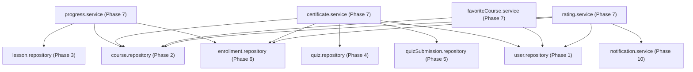

# PHASE 7: PROGRESS, CERTIFICATE, FAVORITE & RATING
# STEP 1: READ-ONLY AUDIT & MIGRATION PLANNING REPORT

**Project:** TMDEMY E-Learning Backend  
**Phase:** 7 — Progress, Certificate, Favorite & Rating Migration  
**Target Database:** PostgreSQL 16.11 (`tmdemy`)  
**ORM:** Prisma 6.4.1  
**Source Database:** MongoDB Atlas (`e-learning`)  
**Mode:** READ-ONLY AUDIT & IMPLEMENTATION PLANNING (Step 1)  
**Date:** 2026-10-04  
**Audit Status:** `READY FOR STEP 2`

---

## A. CURRENT ARCHITECTURE (HIỆN TRẠNG KIẾN TRÚC)

Hiện tại, 4 phân hệ nghiệp vụ thuộc Phase 7 đang vận hành chủ yếu dựa trên Mongoose và MongoDB, nhưng đã có các liên kết chéo tới những phân hệ đã migration sang PostgreSQL (User, Course, Lesson, Quiz, QuizSubmission, Enrollment).

### 1. Phân tầng kiến trúc của từng Module

```text
HTTP Request
     │
     ▼
[Router] ──► src/routes/
     │       ├── progress.route.ts       (/api/progress)
     │       ├── certificate.route.ts    (/api/certificates)
     │       ├── favoriteCourse.route.ts (/api/favorites)
     │       └── rating.route.ts         (/api/ratings)
     │
     ▼
[Middleware & Validator] ──► src/middlewares/
     │       ├── progress.middleware.ts   (ObjectId validation)
     │       ├── course.middleware.ts     (courseIdValidator)
     │       ├── rating.middleware.ts     (isMongoId, ObjectId validation)
     │       └── verifyToken.ts / verifyRole.ts
     │
     ▼
[Controller] ──► src/controller/
     │       ├── progress.controller.ts
     │       ├── certificate.controller.ts
     │       ├── favoriteCourse.controller.ts
     │       └── raing.controller.ts     [Lưu ý typo tên file: raing thay vì rating]
     │
     ▼
[Service (Business Logic)] ──► src/services/
     │       ├── progress.service.ts
     │       ├── certificate.service.ts
     │       ├── favoriteCourse.service.ts
     │       └── rating.service.ts
     │
     ▼
[Data Access Layer]
     ├── [HIỆN TẠI]: Trực tiếp gọi Mongoose Models (Chưa có Functional Repositories)
     │       ├── src/models/progress.model.ts (Mongoose)
     │       ├── src/models/certificate.model.ts (Mongoose)
     │       ├── src/models/favoriteCourse.model.ts (Mongoose)
     │       ├── src/models/rating.model.ts (Mongoose)
     │       └── Legacy Models (Course, User, Lesson, Quiz, QuizSubmission, Enrollment)
     │
     ▼
[MỤC TIÊU STEP 2]: Chuyển sang Functional Repositories + Prisma Singleton
             ├── src/repositories/progress.repository.ts
             ├── src/repositories/certificate.repository.ts
             ├── src/repositories/favoriteCourse.repository.ts
             ├── src/repositories/rating.repository.ts
             └── PostgreSQL (Database: tmdemy)
```

---

## B. LEGACY MONGODB DEPENDENCIES (DANH SÁCH PHỤ THUỘC MONGOOSE)

Dưới đây là chi tiết các vị trí hiện đang đọc/ghi trực tiếp vào MongoDB qua Mongoose trong 4 module:

### 1. Module Progress
* **[src/services/progress.service.ts](file:///d:/e-learning_server/src/services/progress.service.ts)**:
  * `LessonModel.findOne({ _id: lessonId, course: courseId })` (MongoDB read - Mongoose legacy lesson model).
  * `LessonModel.countDocuments({ course: courseId })` (MongoDB read).
  * `ProgressModel.findOneAndUpdate({ user: userId, course: courseId, lesson: lessonId }, ...)` (MongoDB write).
  * `ProgressModel.countDocuments({ user: userId, course: courseId, completed: true })` (MongoDB read).
  * `ProgressModel.find({ user: userId, course: courseId, completed: true })` (MongoDB read).
  * `EnrollmentModel.findOneAndUpdate({ user: userId, course: courseId }, { progress: percent }, ...)` (MongoDB write - cập nhật progress lên MongoDB Enrollment thay vì PostgreSQL Enrollment).
* **[src/middlewares/progress.middleware.ts](file:///d:/e-learning_server/src/middlewares/progress.middleware.ts)**:
  * `mongoose.Types.ObjectId.isValid(value)` cho cả `courseId` và `lessonId`.
* **[src/models/progress.model.ts](file:///d:/e-learning_server/src/models/progress.model.ts)**:
  * Khai báo schema Mongoose `progressSchema` và `ProgressModel`.

### 2. Module Certificate
* **[src/services/certificate.service.ts](file:///d:/e-learning_server/src/services/certificate.service.ts)**:
  * `EnrollmentModel.findOne({ user: userId, course: courseId })` (MongoDB read - đọc enrollment từ MongoDB thay vì PostgreSQL).
  * `CertificateModel.findOne({ user: userId, course: courseId })` (MongoDB read).
  * `QuizModel.find({ courseId })` (MongoDB read - đọc Quiz từ MongoDB thay vì PostgreSQL).
  * `QuizSubmissionModel.find({ user: userId, quiz: { $in: quizzes.map(...) } })` (MongoDB read - đọc submission từ MongoDB thay vì PostgreSQL).
  * `CertificateModel.create({ user, course, grade, issuedAt, certificateUrl })` (MongoDB write).
* **[src/models/certificate.model.ts](file:///d:/e-learning_server/src/models/certificate.model.ts)**:
  * Khai báo schema Mongoose `CertificateSchema` và `CertificateModel`.

### 3. Module FavoriteCourse
* **[src/services/favoriteCourse.service.ts](file:///d:/e-learning_server/src/services/favoriteCourse.service.ts)**:
  * `CourseModel.findById(courseId)` (MongoDB read).
  * `FavoriteCourseModel.findOne({ user: userId, course: courseId })` (MongoDB read).
  * `FavoriteCourseModel.create({ user: new Types.ObjectId(userId), course: new Types.ObjectId(courseId) })` (MongoDB write).
  * `FavoriteCourseModel.findByIdAndDelete(existing._id)` (MongoDB write).
  * `FavoriteCourseModel.find({ user: userId }).populate('course', ...).sort(...).skip(...).limit(...)` (MongoDB read).
  * `FavoriteCourseModel.countDocuments({ user: userId })` (MongoDB read).
* **[src/models/favoriteCourse.model.ts](file:///d:/e-learning_server/src/models/favoriteCourse.model.ts)**:
  * Khai báo schema Mongoose `FavoriteCourseSchema` và `FavoriteCourseModel`.

### 4. Module Rating
* **[src/services/rating.service.ts](file:///d:/e-learning_server/src/services/rating.service.ts)**:
  * `CourseModel.findById(courseId)` (MongoDB read).
  * `UserModel.findById(userId).select('courses username')` (MongoDB read).
  * `user.courses.some((c) => c.toString() === courseId)` (Kiểm tra quyền ghi danh qua mảng nhúng `courses` trên MongoDB UserModel).
  * `RatingModel.findOne({ user: userId, course: courseId })` (MongoDB read).
  * `RatingModel.create({ rate, content, user, course, status })` (MongoDB write).
  * `course.rating.push(rating._id); await course.save()` (MongoDB write - nhúng rating ID vào mảng của CourseModel).
  * `RatingModel.find({ course: courseId, status: ERatingStatus.ACTIVE }).populate('user', ...)` (MongoDB read).
  * `CourseModel.find({ author: userId })` (MongoDB read).
  * `RatingModel.find(filter).populate(...).skip(...).limit(...)` và `RatingModel.countDocuments(filter)` (MongoDB read).
  * `RatingModel.findById(ratingId)` và `RatingModel.findByIdAndDelete(ratingId)` (MongoDB write).
  * `CourseModel.findByIdAndUpdate(rating.course, { $pull: { rating: rating._id } })` (MongoDB write).
  * `rating.save()` (MongoDB write).
* **[src/middlewares/rating.middleware.ts](file:///d:/e-learning_server/src/middlewares/rating.middleware.ts)**:
  * `isMongoId()` trên trường `courseId`.
  * `mongoose.Types.ObjectId.isValid(value)` trên query `courseId` và param `id`.
* **[src/models/rating.model.ts](file:///d:/e-learning_server/src/models/rating.model.ts)**:
  * Khai báo schema Mongoose `ratingSchema` và `RatingModel`.

---

## C. POSTGRESQL SCHEMA MAPPING (ĐỐI CHIẾU SCHEMA POSTGRESQL)

Cả 4 bảng vật lý đã được thiết kế sẵn và validate hợp lệ trong [prisma/schema.prisma](file:///d:/e-learning_server/prisma/schema.prisma):

| Thực thể | Tên bảng PostgreSQL | Khóa chính | Khóa ngoại & Quan hệ | Ràng buộc Unique | Indexes | onDelete Behavior |
| :--- | :--- | :--- | :--- | :--- | :--- | :--- |
| **Progress** | `progress` | `id` (UUIDv4) | `user_id` -> `users.id`<br>`course_id` -> `courses.id`<br>`lesson_id` -> `lessons.id` | `@@unique([userId, lessonId])` | `@@index([courseId])` | `Cascade` trên cả 3 khóa ngoại |
| **Certificate** | `certificates` | `id` (UUIDv4) | `user_id` -> `users.id`<br>`course_id` -> `courses.id` | `@@unique([userId, courseId])` | (Unique constraint index) | `Restrict` trên cả User và Course (Bảo vệ tính pháp lý chứng chỉ) |
| **Rating** | `ratings` | `id` (UUIDv4) | `user_id` -> `users.id`<br>`course_id` -> `courses.id` | `@@unique([userId, courseId])` | `@@index([courseId, status])` | `Cascade` trên cả User và Course |
| **FavoriteCourse** | `favorite_courses` | `id` (UUIDv4) | `user_id` -> `users.id`<br>`course_id` -> `courses.id` | `@@unique([userId, courseId])` | (Unique constraint index) | `Cascade` trên cả User và Course |

### Chi tiết các trường đặc thù trong Prisma Schema
1. **`Progress`**:
   * `completed`: `Boolean @default(false)`
   * Không có trường `course_id` trong MongoDB model gốc (MongoDB chỉ lưu `course`, `lesson`, `user`), nhưng trong PostgreSQL `course_id` là trường quan hệ trực tiếp có index để tối ưu query danh sách progress theo khóa học.
2. **`Certificate`**:
   * `grade`: `Decimal @db.Decimal(5, 2)` (Lưu ý: Phải serialize bằng `Number(grade)` khi trả JSON response).
   * `certificateUrl`: `String @map("certificate_url") @db.Text`.
   * `issuedAt`: `DateTime @default(now()) @map("issued_at")`.
3. **`Rating`**:
   * `rate`: `Int @db.SmallInt` (Giá trị 1 đến 5).
   * `content`: `String @db.VarChar(255)` (MongoDB validator quy định max 100).
   * `status`: `ERatingStatus @default(INACTIVE)` (Enum gồm `ACTIVE`, `INACTIVE`).
4. **`FavoriteCourse`**:
   * Junction Table N:N thuần túy giữa `user_id` và `course_id`.

---

## D. CHI TIẾT NGHIỆP VỤ (BUSINESS LOGIC AUDIT)

### 1. Nghiệp vụ Tiến độ học tập (Progress)
* **Quyền thực thi**: Người dùng đã đăng nhập (`verifyAccessToken`).
* **Thời điểm tạo/cập nhật**:
  * Khi người dùng xem xong hoặc đánh dấu bài học hoàn thành: `POST /api/progress/complete` -> Upsert record `(userId, lessonId)` với `completed: true`.
  * Khi bỏ đánh dấu: `POST /api/progress/uncomplete` -> Cập nhật `completed: false`.
* **Cách tính phần trăm hoàn thành**:
  * `totalLessons`: Tổng số lesson của khóa học.
  * `completedLessons`: Số lesson có `completed: true` của user trong khóa học.
  * `percent = Math.round((completedLessons / totalLessons) * 100)`.
* **Ràng buộc Enrollment**:
  * Hiện tại ở code legacy, `progress.service.ts` cập nhật thẳng `EnrollmentModel.findOneAndUpdate({ user: userId, course: courseId }, { progress: percent })`.
  * **Chuẩn hóa Phase 7**: User bắt buộc phải có bản ghi ghi danh hợp lệ (`Enrollment` trong PostgreSQL). Khi cập nhật tiến độ, đồng thời cập nhật trường `progress` của `Enrollment` trong PostgreSQL. Nếu `percent === 100`, cập nhật `Enrollment.status = COMPLETED` và `completedAt = now()`.
* **Kiểm tra bài học thuộc khóa học**:
  * Phải kiểm tra bài học `lessonId` thực sự thuộc về `courseId`. Nếu không, trả lỗi `404 Lesson not found in this course`.

### 2. Nghiệp vụ Cấp chứng chỉ (Certificate)
* **Điều kiện đủ để cấp chứng chỉ**:
  1. Học viên phải ghi danh khóa học (`Enrollment` tồn tại trong PostgreSQL) -> Nếu không: `404 You are not enrolled in this course!`.
  2. Chưa từng được cấp chứng chỉ cho khóa học này (`Certificate` chưa tồn tại) -> Nếu đã có: `400 You already have a certificate for this course!`.
  3. Tiến độ học bài giảng `enrollment.progress >= 70%` -> Nếu < 70%: `400 Progress is less than 70%`.
  4. Khóa học phải có bài thi (`quizzes.length > 0`) -> Nếu không: `400 No quizzes found for this course!`.
  5. Học viên phải có bài nộp cho quiz (`quizSubmissions.length > 0`) -> Nếu không: `400 No quiz submissions found for this user!`.
  6. Tỷ lệ hoàn thành quiz: `quizCompletionPercentage = (totalQuizzesSubmitted / totalQuizzesAvailable) * 100 >= 60%` -> Nếu < 60%: `400 Quiz submission percentage is less than 60%`.
  7. Điểm tổng kết: `finalScore = (progress + quizCompletionPercentage) / 2 >= 50%` -> Nếu < 50%: `400 Total score is less than 50%`.
* **Tạo và lưu trữ PDF**:
  * Gọi `generateCertificatePDF` từ `src/utils/pdfGenerator.ts` để vẽ chứng chỉ bằng `pdfkit` và upload stream lên Cloudinary dưới dạng raw PDF.
  * Nhận URL Cloudinary an toàn (`secure_url`) và lưu vào `Certificate.certificateUrl`.
  * **Phát hiện Bug trong mã nguồn legacy**: Trong `src/services/certificate.service.ts` dòng 72, hàm gọi `generateCertificatePDF(userId, courseId, finalScore)` (3 positional arguments), trong khi định nghĩa hàm tại `src/utils/pdfGenerator.ts` yêu cầu một object `{ courseId, grade, userId }`. Cần chuẩn hóa lại cách truyền tham số trong Step 2.

### 3. Nghiệp vụ Khóa học yêu thích (FavoriteCourse)
* **Quyền thực thi**: Người dùng đã đăng nhập (`verifyAccessToken`).
* **Thao tác**:
  * Thêm: `POST /api/favorites/:id` -> Kiểm tra khóa học tồn tại; kiểm tra chưa yêu thích (`@@unique([userId, courseId])`). Tạo bản ghi mới.
  * Xóa: `DELETE /api/favorites/:id` -> Kiểm tra tồn tại và xóa bản ghi.
  * Lấy danh sách: `GET /api/favorites` -> Lấy danh sách phân trang kèm thông tin khóa học (`title, slug, image, price, level, type, sold, view`), sắp xếp theo `createdAt desc`.
* **Phân biệt với Enrollment**: Khóa học yêu thích hoàn toàn độc lập với việc đăng ký/mua khóa học (không tạo Order, không sinh Enrollment).

### 4. Nghiệp vụ Đánh giá khóa học (Rating)
* **Điều kiện đánh giá**:
  * Học viên phải ghi danh khóa học. Legacy code kiểm tra mảng `user.courses` trên MongoDB; trong PostgreSQL phải kiểm tra qua `findEnrollmentByUserAndCourse(userId, courseId)` từ `enrollment.repository.ts` -> Nếu không ghi danh: `403 You are not enrolled in this course`.
  * Mỗi học viên chỉ được đánh giá 1 lần duy nhất cho mỗi khóa học (`@@unique([userId, courseId])`) -> Nếu đã đánh giá: `400 You have already rated this course`.
  * Điểm đánh giá: Số nguyên từ 1 đến 5 sao.
  * Nội dung đánh giá: Tối thiểu 5 ký tự, tối đa 255 ký tự.
* **Cách tính điểm trung bình và thống kê**:
  * `getCourseRatingsService`: Chỉ lấy các rating có `status = ACTIVE`.
  * Tính `totalRatings = ratings.length`.
  * Tính `averageRating = ratings.reduce((sum, r) => sum + r.rate, 0) / totalRatings` (Làm tròn 2 chữ số thập phân).
* **Phân quyền Giáo viên và Quản trị viên**:
  * Giáo viên (`TEACHER`): Chỉ được xem, cập nhật trạng thái (`ACTIVE`/`INACTIVE`), hoặc xóa đánh giá của các khóa học do chính mình tạo (`course.authorId === userId`).
  * Quản trị viên (`ADMIN`): Có toàn quyền xem, duyệt trạng thái và xóa mọi đánh giá trong hệ thống.
* **Thông báo**: Khi có đánh giá mới, tự động gửi notification tới tác giả khóa học (nếu người đánh giá không phải tác giả).

---

## E. API COMPATIBILITY MATRIX (MA TRẬN API CONTRACT)

Toàn bộ 12 endpoints thuộc 4 module phải được bảo toàn 100% URL, HTTP Method, HTTP Status Code và Response Body Format:

| # | Phân hệ | Endpoint URL | Method | Auth / Role | Request Params / Body | Expected Status | Response Data Schema |
| :---: | :--- | :--- | :---: | :--- | :--- | :---: | :--- |
| 1 | **Progress** | `/api/progress/complete` | `POST` | `USER` (Token) | Body: `{ courseId: UUID, lessonId: UUID }` | `200 OK`<br>`400/404` | `{ success: true, message: 'Lesson marked as completed', data: { progress: number } }` |
| 2 | **Progress** | `/api/progress/uncomplete` | `POST` | `USER` (Token) | Body: `{ courseId: UUID, lessonId: UUID }` | `200 OK`<br>`400/404` | `{ success: true, message: 'Lesson unmarked as completed', data: { progress: number } }` |
| 3 | **Progress** | `/api/progress/:courseId` | `GET` | `USER` (Token) | Param: `:courseId` (UUID) | `200 OK`<br>`404` | `{ success: true, message: 'Fetched course progress successfully', data: { totalLessons, completedLessons, percent, lessons: [...] } }` |
| 4 | **Certificate** | `/api/certificates` | `POST` | `USER` (Token) | Body: `{ courseId: UUID }` | `200 OK`<br>`400/404` | `{ success: true, message: 'Certificate created successfully', data: CertificateObject }` |
| 5 | **Favorite** | `/api/favorites/:id` | `POST` | `USER` (Token) | Param: `:id` (Course UUID) | `200 OK`<br>`400/404` | `{ success: true, message: 'Course added to favorites', data: FavoriteObject }` |
| 6 | **Favorite** | `/api/favorites/:id` | `DELETE` | `USER` (Token) | Param: `:id` (Course UUID) | `200 OK`<br>`404` | `{ success: true, message: 'Course removed from favorites' }` |
| 7 | **Favorite** | `/api/favorites` | `GET` | `USER` (Token) | Query: `page`, `limit` | `200 OK` | `{ success: true, message: 'Fetched favorites successfully', data: { favorites: [...], pagination: {...} } }` |
| 8 | **Rating** | `/api/ratings` | `POST` | `USER` (Token) | Body: `{ courseId: UUID, rate: 1-5, content: string }` | `200 OK`<br>`400/403/404` | `{ success: true, message: 'Rating created successfully', data: RatingObject }` |
| 9 | **Rating** | `/api/ratings/course/:id` | `GET` | Public | Param: `:id` (Course UUID) | `200 OK`<br>`404` | `{ success: true, message: 'Fetched course ratings successfully', data: { averageRating, totalRatings, ratings: [...] } }` |
| 10 | **Rating** | `/api/ratings/manage` | `GET` | `ADMIN` / `TEACHER` | Query: `courseId?`, `status?`, `page`, `limit` | `200 OK`<br>`403/404` | `{ success: true, message: 'Fetched ratings successfully', data: { ratings: [...], pagination: {...} } }` |
| 11 | **Rating** | `/api/ratings/manage/:id` | `DELETE` | `ADMIN` / `TEACHER` | Param: `:id` (Rating UUID) | `200 OK`<br>`403/404` | `{ success: true, message: 'Rating deleted successfully' }` |
| 12 | **Rating** | `/api/ratings/manage/:id` | `PUT` | `ADMIN` / `TEACHER` | Param: `:id` (Rating UUID)<br>Body: `{ status: ACTIVE/INACTIVE }` | `200 OK`<br>`403/404` | `{ success: true, message: 'Rating status updated successfully', data: RatingObject }` |

---

## F. DATA STATUS & AUDIT (THỐNG KÊ DỮ LIỆU)

Kết quả đối soát thực tế cơ sở dữ liệu vật lý PostgreSQL (`tmdemy`) và lịch sử migration từ MongoDB Atlas (`e-learning`):

| Thực thể | MongoDB Source Docs | PostgreSQL Rows Hiện có | Tình trạng khớp dữ liệu | Ghi chú toàn vẹn |
| :--- | :---: | :---: | :---: | :--- |
| **Progress** | 4 | **4** | ✅ 100% MATCH | 4 record thuộc về học viên `thaiminh061204@gmail.com` trên khóa học ReactJS Advanced (`f0dde7bb-1bf6...`) |
| **Certificate** | 1 | **1** | ✅ 100% MATCH | Chứng chỉ điểm 83.33 của học viên `thaiminh061204@gmail.com` trên ReactJS Advanced |
| **Rating** | 1 | **1** | ✅ 100% MATCH | Đánh giá 4 sao của học viên `thaiminh061204@gmail.com` trên ReactJS Advanced |
| **FavoriteCourse** | 2 | **2** | ✅ 100% MATCH | 2 khóa học yêu thích: TailwindCSS Masterclass & Node.js Backend Developer |
| **User (Pre-migrated)** | 11 | **11** | ✅ 100% MATCH | Khóa chính UUIDv5 mapping chính xác 100% |
| **Course (Pre-migrated)** | 10 | **10** | ✅ 100% MATCH | Khóa chính UUIDv5 mapping chính xác 100% |
| **Lesson (Pre-migrated)** | 8 | **8** | ✅ 100% MATCH | Khóa chính UUIDv5 mapping chính xác 100% |
| **Quiz (Pre-migrated)** | 4 | **4** | ✅ 100% MATCH | Khóa chính UUIDv5 mapping chính xác 100% |
| **QuizSubmission** | 3 | **3** | ✅ 100% MATCH | Khóa chính UUIDv5 mapping chính xác 100% |
| **Enrollment** | 8 | **8** | ✅ 100% MATCH | Khóa chính UUIDv5 mapping chính xác 100% |

> [!NOTE]
> Toàn bộ 4 bảng mục tiêu của Phase 7 trong PostgreSQL (`progress`, `certificates`, `ratings`, `favorite_courses`) đã có dữ liệu ban đầu hoàn chỉnh từ Data Migration. Không cần và không được chạy lại migration dữ liệu.

---

## G. CROSS-MODULE DEPENDENCIES (QUAN HỆ LIÊN MODULE)



### Phân loại xử lý liên module:
1. **Chuyển hoàn toàn sang PostgreSQL trong Phase 7**:
   * Kiểm tra bài học: dùng `findLessonById` từ `lesson.repository.ts`.
   * Kiểm tra khóa học: dùng `findCourseById` từ `course.repository.ts`.
   * Kiểm tra ghi danh: dùng `findEnrollmentByUserAndCourse` từ `enrollment.repository.ts`.
   * Cập nhật tiến độ khóa học: cập nhật trực tiếp `Enrollment.progress` trong PostgreSQL.
   * Kiểm tra điều kiện bài thi cấp chứng chỉ: dùng `findQuizzesByCourseIdWithPublicQuestions` từ `quiz.repository.ts` và `findSubmissionsByQuizId` từ `quizSubmission.repository.ts`.
2. **Tiếp tục hỗ trợ MongoDB tạm thời**:
   * Notification push: `pushNotificationService` vẫn gửi socket và lưu vào MongoDB Notification tạm thời (chờ Phase 10).
3. **Loại bỏ phụ thuộc anti-pattern MongoDB**:
   * Bỏ hoàn toàn việc đọc mảng `user.courses` từ MongoDB UserModel khi validate rating.
   * Bỏ hoàn toàn việc gọi `course.rating.push(rating._id)` và `$pull: { rating: rating._id }` trên MongoDB CourseModel vì PostgreSQL quan hệ qua khóa ngoại một chiều `Rating.courseId`.

---

## H. IMPLEMENTATION PLAN (KẾ HOẠCH TRIỂN KHAI STEP 2)

Step 2 sẽ được thực hiện tuần tự và kỷ luật cao theo đúng AGENTS.md:

### Bước 1: Chuẩn hóa Model & Lưu trữ Legacy Models
1. Di chuyển các model Mongoose hiện tại sang thư mục `src/models/legacy/`:
   * `src/models/progress.model.ts` $\rightarrow$ `src/models/legacy/progress.legacy.model.ts`
   * `src/models/certificate.model.ts` $\rightarrow$ `src/models/legacy/certificate.legacy.model.ts`
   * `src/models/favoriteCourse.model.ts` $\rightarrow$ `src/models/legacy/favoriteCourse.legacy.model.ts`
   * `src/models/rating.model.ts` $\rightarrow$ `src/models/legacy/rating.legacy.model.ts`
2. Tạo các Zod Application Models chuẩn mực tại `src/models/`:
   * `src/models/progress.model.ts` (Zod schemas: `ProgressSchema`, `ProgressInputSchema`, types suy luận qua `z.infer`).
   * `src/models/certificate.model.ts` (Zod schemas: `CertificateSchema`, `CertificateInputSchema`).
   * `src/models/favoriteCourse.model.ts` (Zod schemas: `FavoriteCourseSchema`).
   * `src/models/rating.model.ts` (Zod schemas: `RatingSchema`, `RatingInputSchema`, `RatingQuerySchema`).

### Bước 2: Xây dựng Functional Repositories
Tạo mới 4 Functional Repositories thuần túy tại `src/repositories/`:
1. **`src/repositories/progress.repository.ts`**:
   * `findProgress(userId, lessonId, tx?)`
   * `upsertProgress({ userId, courseId, lessonId, completed }, tx?)`
   * `countCompletedLessons(userId, courseId, tx?)`
   * `findCompletedLessonsByUserAndCourse(userId, courseId, tx?)`
   * `findProgressByCourse(userId, courseId, tx?)`
2. **`src/repositories/certificate.repository.ts`**:
   * `findCertificateByUserAndCourse(userId, courseId, tx?)`
   * `findCertificateById(id, tx?)`
   * `createCertificate(data, tx?)`
   * `findCertificatesByUserId(userId, tx?)`
3. **`src/repositories/favoriteCourse.repository.ts`**:
   * `findFavorite(userId, courseId, tx?)`
   * `createFavorite(userId, courseId, tx?)`
   * `deleteFavorite(userId, courseId, tx?)`
   * `findFavoritesByUserId(userId, page, limit, tx?)`
   * `countFavoritesByUserId(userId, tx?)`
4. **`src/repositories/rating.repository.ts`**:
   * `findRatingByUserAndCourse(userId, courseId, tx?)`
   * `findRatingById(id, tx?)`
   * `createRating(data, tx?)`
   * `findRatingsByCourseId(courseId, status?, tx?)`
   * `findRatingsWithFilter(filter, page, limit, tx?)`
   * `countRatingsWithFilter(filter, tx?)`
   * `updateRatingStatus(id, status, tx?)`
   * `deleteRating(id, tx?)`
5. Xuất các repository functions này qua [src/repositories/index.ts](file:///d:/e-learning_server/src/repositories/index.ts).

### Bước 3: Migration Services Layer
1. **`src/services/progress.service.ts`**:
   * Thay thế toàn bộ Mongoose bằng `lesson.repository`, `progress.repository`, và `enrollment.repository`.
   * Cập nhật `Enrollment.progress` trong PostgreSQL; tự động đánh dấu hoàn thành nếu 100%.
2. **`src/services/certificate.service.ts`**:
   * Thay thế Mongoose bằng `enrollment.repository`, `certificate.repository`, `quiz.repository`, và `quizSubmission.repository`.
   * Chuẩn hóa lời gọi `generateCertificatePDF({ userId, courseId, grade })`.
   * Xử lý serialization cho trường `grade` (Decimal -> Number).
3. **`src/services/favoriteCourse.service.ts`**:
   * Thay thế Mongoose bằng `course.repository` và `favoriteCourse.repository`.
   * Sử dụng `withCompatId` để đảm bảo response trả về tương thích ngược `_id = id`.
4. **`src/services/rating.service.ts`**:
   * Thay thế `user.courses` bằng `findEnrollmentByUserAndCourse(userId, courseId)` từ `enrollment.repository`.
   * Sử dụng `rating.repository` cho mọi thao tác CRUD và thống kê đánh giá.

### Bước 4: Migration Validators, Middlewares & Controllers
1. **`src/middlewares/progress.middleware.ts`**:
   * Thay `mongoose.Types.ObjectId.isValid` bằng `validateUUIDParam` / `isValidUUID`.
2. **`src/middlewares/rating.middleware.ts`**:
   * Thay `isMongoId()` và `mongoose.Types.ObjectId.isValid` bằng `validateUUIDParam` / `isValidUUID`.
3. **`src/controller/`**:
   * Xử lý file `raing.controller.ts`: Đổi tên hoặc tạo re-export `rating.controller.ts` để sửa lỗi typo mà không gây đứt gãy route import.
   * Đảm bảo mọi controller serialize HTTP status code và payload chuẩn xác.

---

## I. RISK ASSESSMENT & MITIGATIONS (RỦI RO VÀ BIỆN PHÁP)

| Rủi ro kỹ thuật | Mức độ | Biện pháp phòng ngừa & Xử lý |
| :--- | :---: | :--- |
| **Lỗi gọi hàm `generateCertificatePDF`** | **CAO** | Trong code cũ, tham số truyền vào là 3 positional args `(userId, courseId, finalScore)` trong khi định nghĩa hàm nhận object `{ courseId, grade, userId }`. Nếu không sửa, các trường trong PDF sẽ bị `undefined`. **Khắc phục**: Đồng bộ chữ ký hàm ở `src/services/certificate.service.ts` và `src/utils/pdfGenerator.ts`. |
| **Prisma Decimal Serialization** | **TRUNG BÌNH** | Trường `grade` trong `Certificate` là `Decimal(5, 2)`. Nếu trả thẳng về JSON, client có thể nhận đối tượng Decimal thay vì `number`. **Khắc phục**: Serialize qua `Number(cert.grade)`. |
| **Mất đồng bộ giữa MongoDB `user.courses` và PostgreSQL `Enrollment`** | **TRUNG BÌNH** | Đánh giá khóa học cũ đọc mảng `user.courses`. Nếu user mua khóa học ở Phase 6, bản ghi nằm ở PostgreSQL `Enrollment`. **Khắc phục**: Chuyển logic kiểm tra điều kiện sang `findEnrollmentByUserAndCourse` từ PostgreSQL, đồng thời hỗ trợ tra cứu kép nếu cần thiết. |
| **Typo tên file `raing.controller.ts`** | **THẤP** | File controller hiện tại thiếu chữ 't'. **Khắc phục**: Giữ nguyên route import hoặc tạo alias sạch để tránh break Git history và import resolution. |
| **Enum ERatingStatus mapping** | **THẤP** | Trong schema, mặc định là `INACTIVE`, nhưng khi học viên tạo mới đánh giá, service set `ACTIVE`. **Khắc phục**: Giữ nguyên hành vi nghiệp vụ hiện tại (`ERatingStatus.ACTIVE`). |

---

## J. SCHEMA ISSUES (VẤN ĐỀ SCHEMA PRISMA)

* **Trạng thái kiểm tra Schema vật lý**:
  * Đã kiểm tra chi tiết [prisma/schema.prisma](file:///d:/e-learning_server/prisma/schema.prisma).
  * Lệnh `npx prisma validate` hoàn toàn hợp lệ (`PASS`).
  * Tất cả các bảng `progress`, `certificates`, `ratings`, `favorite_courses` cùng các quan hệ Foreign Key, Unique Constraints và Indexes đều được thiết kế đầy đủ, chính xác.
* **Kết luận Schema**: **KHÔNG CẦN BẤT KỲ THAY ĐỔI SCHEMA NÀO**. Prisma Schema vật lý được đóng băng tuyệt đối theo quy tắc của dự án.

---

## K. REGRESSION TEST PLAN (KẾ HOẠCH KIỂM THỬ HỒI QUY)

Sau khi hoàn thành Step 2, bộ kiểm thử sẽ bao gồm:
1. **Kiểm thử chuyên biệt Phase 7 (`scripts/test_phase7_suite.ts`)**:
   * **Progress Tests**:
     * Đánh dấu hoàn thành bài học, kiểm tra % tiến độ và cập nhật lên Enrollment.
     * Bỏ đánh dấu hoàn thành bài học, kiểm tra tính toán lại %.
     * Kiểm tra bài học không thuộc khóa học $\rightarrow$ 404.
     * Lấy danh sách tiến độ theo khóa học.
   * **Certificate Tests**:
     * Kiểm tra các điều kiện từ chối (chưa ghi danh $\rightarrow$ 404, tiến độ < 70% $\rightarrow$ 400, quiz < 60% $\rightarrow$ 400, điểm < 50% $\rightarrow$ 400).
     * Kiểm tra cấp chứng chỉ thành công khi đủ điều kiện.
     * Kiểm tra chống cấp chứng chỉ trùng lặp $\rightarrow$ 400.
   * **Favorite Tests**:
     * Thêm khóa học vào yêu thích.
     * Kiểm tra chống thêm trùng lặp $\rightarrow$ 400.
     * Xóa khóa học khỏi yêu thích.
     * Lấy danh sách yêu thích có phân trang.
   * **Rating Tests**:
     * Học viên chưa ghi danh đánh giá $\rightarrow$ 403.
     * Đánh giá hợp lệ, kiểm tra cập nhật điểm trung bình.
     * Đánh giá lần 2 trên cùng khóa học $\rightarrow$ 400.
     * Giáo viên quản lý đánh giá của khóa học mình tạo; không được can thiệp khóa học của giáo viên khác $\rightarrow$ 403.
     * Quản trị viên cập nhật trạng thái và xóa đánh giá.
2. **Kiểm thử hồi quy toàn hệ thống**:
   * Foundation Phase 1 suite: `scripts/test-phase1-foundation.ts` (39/39 tests PASS).
   * Order & Enrollment Phase 6 suite: `scratch/test_phase6_suite.ts` (53/53 tests PASS).
   * Kiểm tra tính toàn vẹn dữ liệu PostgreSQL baseline (không suy suyển số lượng bản ghi gốc).

---

## 14. FINAL AUDIT STATUS

Sau khi hoàn thành rà soát toàn diện mã nguồn, mô hình dữ liệu, cơ sở dữ liệu vật lý và các ràng buộc liên module, Phase 7 đủ điều kiện để triển khai Step 2.

# **FINAL STATUS: `READY FOR STEP 2`**

> **Ghi chú tuân thủ**: Báo cáo này hoàn toàn là Read-Only Audit. Chưa có bất kỳ dòng code logic nào bị thay đổi. Trợ lý AI dừng lại tại đây và chờ Project Owner xem xét, phê duyệt trước khi chuyển sang Step 2.
