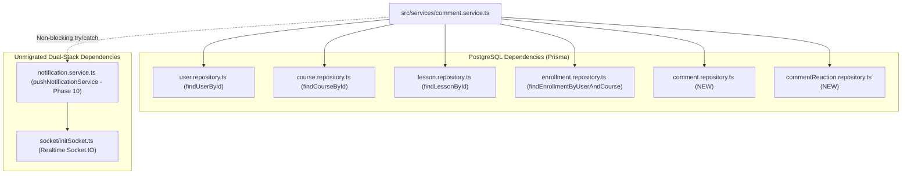

# PHASE 8 — COMMENT & COMMENT REACTION
# PRE-IMPLEMENTATION AUDIT REPORT

**Project:** TMDEMY E-Learning Backend  
**Phase:** Phase 8 — Comment & Comment Reaction Migration  
**Step:** Step 1 — Pre-Implementation Audit  
**Author:** AI Engineering Assistant  
**Date:** 2026-10-04  
**Target Database:** PostgreSQL 16.11 (`tmdemy`) via Prisma ORM 6.4.1  
**Legacy Database:** MongoDB Atlas (`e-learning`) via Mongoose 8.18.1  
**Audit Status:** AUDIT COMPLETE — PENDING PROJECT OWNER APPROVAL  

---

## 1. TỔNG QUAN KIẾN TRÚC COMMENT HIỆN TẠI

Hệ thống bình luận (Comment) của TMDEMY phục vụ học viên, giảng viên và quản trị viên trao đổi nội dung tại từng bài học (Lesson) trong các khóa học (Course).

### 1.1. Luồng xử lý HTTP Request
```text
HTTP Request
  └── Router: src/routes/comment.route.ts (Mount: /api/comments)
        └── Middlewares & Validators: src/middlewares/comment.middleware.ts
              └── Controller: src/controller/comment.controller.ts
                    └── Service: src/services/comment.service.ts
                          └── Legacy Model: src/models/comment.model.ts (Mongoose)
                                └── MongoDB Atlas
```

### 1.2. Hiện trạng các phân hệ
1. **Phân cấp bình luận (Threaded Comments)**:
   - Bình luận hỗ trợ cấu trúc cây phân cấp (cha/con) thông qua trường `parentId` và độ sâu `level` (`level = 0` cho comment gốc, `level = parent.level + 1` cho reply).
   - Khi tạo reply, hệ thống kiểm tra sự tồn tại của `parentId` và gửi thông báo `COMMENT_REPLY` tới tác giả của comment cha.
2. **Quy tắc tạo bình luận (`POST /api/comments`)**:
   - Nếu người dùng có vai trò `TEACHER`: Bắt buộc phải là giảng viên sở hữu khóa học (`course.author === userId`). Nếu không, trả về HTTP `403` (*"You are not the owner of this course"*).
   - Nếu người dùng có vai trò khác (`USER`): Bắt buộc phải đã ghi danh khóa học (`isEnrolled`). Hiện tại mã nguồn cũ kiểm tra qua mảng embedded `user.courses` trên MongoDB. Nếu chưa ghi danh, trả về HTTP `403` (*"You are not enrolled in this course"*).
   - Nếu là bình luận gốc mới: Gửi thông báo `COMMENT` tới giảng viên sở hữu khóa học.
3. **Quy tắc cập nhật bình luận (`PUT /api/comments/:id`)**:
   - Chỉ chính chủ comment (`comment.user === userId`) hoặc `ADMIN` mới có quyền chỉnh sửa nội dung.
   - Nội dung tối thiểu 3 ký tự.
4. **Quy tắc xóa bình luận**:
   - `DELETE /api/comments/:id`: Học viên chỉ được xóa comment do chính mình tạo (`comment.user === userId`).
   - `DELETE /api/comments/admin/:id`: Admin có quyền xóa bất kỳ comment nào.
   - `DELETE /api/comments/teacher/:id`: Giảng viên chỉ được xóa comment thuộc các khóa học do chính mình làm tác giả (`course.author === userId`).
5. **Truy vấn danh sách bình luận**:
   - `GET /api/comments/lesson/:lessonId`: Lấy toàn bộ comment được duyệt (`status = 'approved'`) thuộc bài học, kèm thông tin người tạo (`username`, `avatar`), sắp xếp theo `createdAt DESC`.
   - `GET /api/comments`: Dành cho Admin/Teacher, hỗ trợ phân trang (`page`, `limit`), tìm kiếm regex theo `content`, `course.title`, `user.username`, lọc theo `status` và `courseId`. Nếu là `TEACHER`, tự động giới hạn chỉ lấy comment trong các khóa học của giảng viên đó.

---

## 2. TỔNG QUAN KIẾN TRÚC COMMENT REACTION HIỆN TẠI

Hệ thống hỗ trợ 2 loại tương tác: **LIKE** và **DISLIKE**.

### 2.1. Kiến trúc lưu trữ Legacy trên MongoDB
- Trên MongoDB Document `Comment`, tương tác được lưu dạng **mảng ObjectId nhúng (embedded arrays)**:
  - `likes: [Schema.Types.ObjectId]` (danh sách `userId` đã like).
  - `dislikes: [Schema.Types.ObjectId]` (danh sách `userId` đã dislike).

### 2.2. Quy tắc nghiệp vụ Toggle / Switch Reaction
1. **Like bình luận (`POST /api/comments/like/:commentId`)**:
   - Kiểm tra `comment.likes.includes(userId)`: Nếu đã like, trả về HTTP `400` (*"You have already liked this comment"*).
   - Nếu `comment.dislikes.includes(userId)`: Loại bỏ `userId` khỏi mảng `dislikes`.
   - Thêm `userId` vào mảng `likes`.
   - Lưu document và trả về thông tin comment đã cập nhật.
2. **Dislike bình luận (`POST /api/comments/dislike/:commentId`)**:
   - Kiểm tra `comment.dislikes.includes(userId)`: Nếu đã dislike, trả về HTTP `400` (*"You have already disliked this comment"*).
   - Nếu `comment.likes.includes(userId)`: Loại bỏ `userId` khỏi mảng `likes`.
   - Thêm `userId` vào mảng `dislikes`.
   - Lưu document và trả về thông tin comment đã cập nhật.

### 2.3. Sự chuyển dịch kiến trúc sang PostgreSQL (Prisma)
- Trong Prisma/PostgreSQL, bảng `comment_reactions` đã được **chuẩn hóa (normalized)** thành một bảng quan hệ riêng biệt:
  - Khóa ngoại `comment_id` và `user_id`.
  - Cột enum `type` nhận giá trị `'LIKE'` hoặc `'DISLIKE'`.
  - Ràng buộc duy nhất `@@unique([commentId, userId])` ngăn chặn 1 user có nhiều reaction trên cùng 1 comment ở cấp độ vật lý.
- **Giải pháp chuyển tiếp**: Tầng Service/Repository sẽ xử lý `upsert` hoặc `update` trên bảng `comment_reactions`, sau đó serialize dữ liệu trả về cho client theo đúng định dạng `likes` và `dislikes` (mảng string user IDs) để bảo toàn 100% hợp đồng API và tính tương thích ngược với Frontend Next.js.

---

## 3. MONGODB MODELS VÀ CẤU TRÚC DỮ LIỆU

### 3.1. File `src/models/comment.model.ts` (Mongoose)
```typescript
export interface Comment extends Document {
  _id: Schema.Types.ObjectId
  content: string
  lesson: Schema.Types.ObjectId
  user: Schema.Types.ObjectId
  status: CommentStatus // 'approved' | 'pending' | 'rejected'
  parentId?: Schema.Types.ObjectId
  level: number
  course: Schema.Types.ObjectId
  likes: Types.ObjectId[]
  dislikes: Types.ObjectId[]
  createdAt: Date
  updatedAt: Date
}
```

### 3.2. Đánh giá phụ thuộc Mongoose cần loại bỏ
1. Import `CommentModel` trực tiếp trong `comment.service.ts` và `comment.middleware.ts`.
2. Kiểm tra `parentId` bằng truy vấn trực tiếp `CommentModel.findById(value)` bên trong validator Express.
3. Truy vấn `CourseModel` và `UserModel` (legacy) trong `comment.service.ts`.
4. Ép kiểu `new Types.ObjectId(...)` và kiểm tra `isValid(value)` của Mongoose.

---

## 4. PRISMA SCHEMA VÀ POSTGRESQL HIỆN TẠI

Cấu trúc trong `prisma/schema.prisma` đã được phê duyệt và đóng băng:

### 4.1. Bảng `comments`
```prisma
model Comment {
  id        String        @id @default(uuid()) @db.Uuid
  content   String        @db.Text
  lessonId  String        @map("lesson_id") @db.Uuid
  courseId  String        @map("course_id") @db.Uuid
  userId    String        @map("user_id") @db.Uuid
  parentId  String?       @map("parent_id") @db.Uuid
  level     Int           @default(0)
  status    CommentStatus @default(APPROVED)
  createdAt DateTime      @default(now()) @map("created_at")
  updatedAt DateTime      @updatedAt @map("updated_at")

  lesson    Lesson            @relation(fields: [lessonId], references: [id], onDelete: Cascade)
  course    Course            @relation(fields: [courseId], references: [id], onDelete: Cascade)
  user      User              @relation(fields: [userId], references: [id], onDelete: Cascade)
  parent    Comment?          @relation("CommentReplies", fields: [parentId], references: [id], onDelete: Cascade)
  replies   Comment[]         @relation("CommentReplies")
  reactions CommentReaction[]

  @@index([lessonId, status])
  @@index([courseId])
  @@index([parentId])
  @@map("comments")
}
```

### 4.2. Bảng `comment_reactions`
```prisma
model CommentReaction {
  id        String              @id @default(uuid()) @db.Uuid
  commentId String              @map("comment_id") @db.Uuid
  userId    String              @map("user_id") @db.Uuid
  type      CommentReactionType
  createdAt DateTime            @default(now()) @map("created_at")

  comment Comment @relation(fields: [commentId], references: [id], onDelete: Cascade)
  user    User    @relation(fields: [userId], references: [id], onDelete: Cascade)

  @@unique([commentId, userId])
  @@map("comment_reactions")
}
```

### 4.3. Các Enums liên quan
```prisma
enum CommentStatus {
  APPROVED @map("approved")
  PENDING  @map("pending")
  REJECTED @map("rejected")
}

enum CommentReactionType {
  LIKE    @map("like")
  DISLIKE @map("dislike")
}
```

### 4.4. Hiện trạng dữ liệu thực tế tại PostgreSQL (`tmdemy`)
- **Tổng số bản ghi `comments`**: **8 bản ghi**.
  - 7 bình luận cấp gốc (`parentId: null, level: 0`).
  - 1 bình luận trả lời (`parentId: 'fd6ded83-54e0-5807-b5af-244551274a22', level: 1`).
  - Toàn bộ `lessonId`, `courseId`, `userId` đều khớp khóa ngoại toàn vẹn với các bảng `lessons`, `courses`, `users`.
- **Tổng số bản ghi `comment_reactions`**: **1 bản ghi**.
  - `id`: `b6f32a83-5844-56e9-a4c0-faba0c4a1331`
  - `commentId`: `d4b53631-ecf4-5507-9a6a-2bf9fe6dc2f9`
  - `userId`: `c55de839-f059-519c-8820-b16aa17fb9c3` (`minhsuyyyyy`)
  - `type`: `LIKE`
- **Kết luận**: Dữ liệu lịch sử đã được migrate chuẩn xác từ các Phase trước. Không cần can thiệp hay sửa đổi schema.

---

## 5. DANH SÁCH TOÀN BỘ API

Toàn bộ các endpoint liên quan đến Comment được mount tại tiền tố `/api/comments`:

| STT | HTTP Method | Endpoint | Handler Controller | Mô tả tóm tắt |
|:---:|:---:|:---|:---|:---|
| 1 | `POST` | `/api/comments` | `createCommentController` | Tạo bình luận hoặc trả lời bình luận |
| 2 | `GET` | `/api/comments/lesson/:lessonId` | `getCommentsByLessonController` | Lấy danh sách bình luận đã duyệt của bài học |
| 3 | `DELETE` | `/api/comments/:id` | `deleteCommentController` | Học viên xóa bình luận của chính mình |
| 4 | `PUT` | `/api/comments/:id` | `updateCommentController` | Chỉnh sửa nội dung bình luận (Chính chủ hoặc Admin) |
| 5 | `POST` | `/api/comments/like/:commentId` | `likeCommentController` | Like bình luận |
| 6 | `POST` | `/api/comments/dislike/:commentId` | `dislikeCommentController` | Dislike bình luận |
| 7 | `GET` | `/api/comments` | `getCommentsByAdminOrTeacherController` | Quản trị viên / Giảng viên tra cứu và lọc bình luận |
| 8 | `DELETE` | `/api/comments/admin/:id` | `deleteCommentByAdminOrTeacherController` | Admin xóa bình luận bất kỳ |
| 9 | `DELETE` | `/api/comments/teacher/:id` | `deleteCommentByAdminOrTeacherController` | Giảng viên xóa bình luận thuộc khóa học của mình |

---

## 6. API CONTRACT MATRIX

Bảng chi tiết hợp đồng API (API Contract Matrix) bảo toàn 100% Postman Baseline:

| Method | Endpoint | Authentication | Role | Request Parameters / Body | HTTP Status | Response Contract | Business Logic / Error Handling |
|:---|:---|:---|:---|:---|:---:|:---|:---|
| `POST` | `/api/comments` | Bearer Token | `USER`, `TEACHER`, `ADMIN` | **Body:**<br>`{ content: string, lesson: string (UUID), course: string (UUID), parentId?: string (UUID) }` | `200`<br>`400`<br>`403`<br>`404` | `{ success: true, message: "Comment created successfully", data: <Comment> }` | 1. Check Course exists (404).<br>2. If Teacher: must own course (403).<br>3. If User: must be enrolled via `findEnrollmentByUserAndCourse` (403).<br>4. If parentId: verify parent exists (404), compute `level = parent.level + 1`.<br>5. Insert into `comments`.<br>6. Non-blocking Notification push. |
| `GET` | `/api/comments/lesson/:lessonId` | Public | Anyone | **Param:** `lessonId` (UUID) | `200`<br>`400` | `{ success: true, message: "Fetched comments successfully", data: [<Comment>] }` | Lấy comment `status = 'APPROVED'`, populate user (`username`, `avatar`), reactions (`likes`, `dislikes`), sort `createdAt DESC`. |
| `DELETE` | `/api/comments/:id` | Bearer Token | `USER` | **Param:** `id` (UUID) | `200`<br>`400`<br>`403`<br>`404` | `{ success: true, message: "Comment deleted successfully" }` | 1. Find comment by id (404).<br>2. Check `comment.userId === userId` (403: *"You are not allowed to delete this comment"*).<br>3. Delete comment (Cascade delete replies & reactions). |
| `PUT` | `/api/comments/:id` | Bearer Token | `USER`, `ADMIN` | **Param:** `id` (UUID)<br>**Body:** `{ content: string }` | `200`<br>`400`<br>`403`<br>`404` | `{ success: true, message: "Comment updated successfully", data: <Comment> }` | 1. Find comment (404).<br>2. Check `comment.userId === userId || role === 'ADMIN'` (403: *"You are not allowed to edit this comment"*).<br>3. Update `content` & `updatedAt`. |
| `POST` | `/api/comments/like/:commentId` | Bearer Token | `USER`, `TEACHER`, `ADMIN` | **Param:** `commentId` (UUID) | `200`<br>`400`<br>`404` | `{ success: true, message: "Comment liked successfully", data: <Comment> }` | 1. Find comment (404).<br>2. If already liked: 400 (*"You have already liked this comment"*).<br>3. If disliked: remove dislike and set like.<br>4. Return updated comment. |
| `POST` | `/api/comments/dislike/:commentId` | Bearer Token | `USER`, `TEACHER`, `ADMIN` | **Param:** `commentId` (UUID) | `200`<br>`400`<br>`404` | `{ success: true, message: "Comment disliked successfully", data: <Comment> }` | 1. Find comment (404).<br>2. If already disliked: 400 (*"You have already disliked this comment"*).<br>3. If liked: remove like and set dislike.<br>4. Return updated comment. |
| `GET` | `/api/comments` | Bearer Token | `TEACHER`, `ADMIN` | **Query:** `page`, `limit`, `search`, `status`, `courseId` | `200`<br>`400`<br>`403` | `{ success: true, message: "Fetched comments successfully!", data: { comments: [...], pagination: { page, limit, total, totalPages } } }` | 1. If Teacher: if `courseId` provided, check author ownership (403). Else, restrict to teacher's courses.<br>2. If Admin: can filter all courses.<br>3. Filter content, user, course title via ILIKE.<br>4. Paginate with `skip`, `limit`. |
| `DELETE` | `/api/comments/admin/:id` | Bearer Token | `ADMIN` | **Param:** `id` (UUID) | `200`<br>`400`<br>`403`<br>`404` | `{ success: true, message: "Comment deleted successfully" }` | 1. Role must be `ADMIN` (403 via `isAdmin`).<br>2. Find comment (404).<br>3. Delete comment and its cascade children. |
| `DELETE` | `/api/comments/teacher/:id` | Bearer Token | `TEACHER`, `ADMIN` | **Param:** `id` (UUID) | `200`<br>`400`<br>`403`<br>`404` | `{ success: true, message: "Comment deleted successfully" }` | 1. Role `isTeacherOrAdmin`.<br>2. If Teacher: verify comment's course `authorId === userId` (403: *"You are not allowed to delete this comment"*).<br>3. Delete comment. |

---

## 7. DEPENDENCY MAP



### 7.1. Phân loại Module
1. **Module đã migrate sang PostgreSQL**:
   - `User`: Đã migrate ở Phase 2 (`findUserById`).
   - `Course`: Đã migrate ở Phase 3 (`findCourseById`).
   - `Lesson`: Đã migrate ở Phase 3 (`findLessonById`).
   - `Enrollment`: Đã migrate ở Phase 6 (`findEnrollmentByUserAndCourse`).
2. **Module chưa migrate (Dual-Stack Boundary)**:
   - `Notification` (Phase 10): `pushNotificationService` vẫn lưu vào MongoDB `NotificationModel` và broadcast qua Socket.IO.
   - **Quy tắc an toàn**: Lời gọi `pushNotificationService` trong `comment.service.ts` bắt buộc bọc trong block `try { ... } catch (notifErr) { ... }` (non-blocking) để đảm bảo nếu MongoDB gặp sự cố kết nối hoặc offline, nghiệp vụ tạo Comment trên PostgreSQL **tuyệt đối không bị gián đoạn hay rollback**.

---

## 8. DANH SÁCH FILE DỰ KIẾN TẠO / SỬA / CHUYỂN LEGACY

```text
src/
├── models/
│   ├── legacy/
│   │   └── comment.legacy.model.ts      [TẠO MỚI - Chuyển Mongoose Model cũ sang legacy]
│   ├── comment.model.ts                 [TẠO MỚI - Zod Application Model cho Comment]
│   └── commentReaction.model.ts         [TẠO MỚI - Zod Application Model cho CommentReaction]
│
├── repositories/
│   ├── comment.repository.ts            [TẠO MỚI - Functional Repository cho Comment (Prisma)]
│   ├── commentReaction.repository.ts    [TẠO MỚI - Functional Repository cho Reaction (Prisma)]
│   └── index.ts                         [CẬP NHẬT - Export các repositories mới]
│
├── services/
│   └── comment.service.ts               [CẬP NHẬT - Refactor 100% sang Prisma Repositories]
│
├── middlewares/
│   └── comment.middleware.ts            [CẬP NHẬT - Thay thế ObjectId validator bằng UUID validator]
│
├── controller/
│   └── comment.controller.ts            [GIỮ NGUYÊN / TỐI ƯU TYPE - Contract giữ nguyên 100%]
│
└── routes/
    └── comment.route.ts                 [CẬP NHẬT - Bổ sung UUID validator cho like/dislike]
```

---

## 9. KẾ HOẠCH REPOSITORY, SERVICE, MIDDLEWARE VÀ CONTROLLER

### 9.1. Kế hoạch `src/repositories/comment.repository.ts`
Xây dựng Functional Repository tuân thủ nghiêm ngặt tiêu chuẩn dự án:
- `findCommentById(id: string, tx?: PrismaTransactionClient): Promise<Comment | null>`
- `findCommentsByLessonId(lessonId: string, status?: CommentStatus, tx?: PrismaTransactionClient)`
- `findCommentsWithFilter(params: { courseId?: string; courseIds?: string[]; status?: CommentStatus; search?: string; skip: number; take: number }, tx?: PrismaTransactionClient)`
- `countCommentsWithFilter(params: { courseId?: string; courseIds?: string[]; status?: CommentStatus; search?: string }, tx?: PrismaTransactionClient)`
- `createComment(data: Prisma.CommentUncheckedCreateInput, tx?: PrismaTransactionClient)`
- `updateCommentContent(id: string, content: string, tx?: PrismaTransactionClient)`
- `deleteCommentById(id: string, tx?: PrismaTransactionClient)`

### 9.2. Kế hoạch `src/repositories/commentReaction.repository.ts`
- `findReaction(commentId: string, userId: string, tx?: PrismaTransactionClient): Promise<CommentReaction | null>`
- `upsertReaction(commentId: string, userId: string, type: CommentReactionType, tx?: PrismaTransactionClient)`
- `deleteReaction(commentId: string, userId: string, tx?: PrismaTransactionClient)`
- `findReactionsByCommentId(commentId: string, tx?: PrismaTransactionClient)`
- `countReactionsByCommentId(commentId: string, type?: CommentReactionType, tx?: PrismaTransactionClient)`

### 9.3. Kế hoạch `src/services/comment.service.ts`
- Loại bỏ hoàn toàn `Mongoose`, `CommentModel`, `CourseModel`, `UserModel`.
- Tích hợp `findEnrollmentByUserAndCourse(userId, courseId)` thay thế cho việc đọc `user.courses`.
- Chuẩn hóa format phản hồi: Mỗi comment khi trả về cho client sẽ được serialize trường `likes: string[]` (danh sách user ID) và `dislikes: string[]` để giữ nguyên tương thích cho client Next.js hiện tại.
- Tự động gắn kèm alias `_id = id` thông qua `withCompatId()`.

### 9.4. Kế hoạch `src/middlewares/comment.middleware.ts`
- Thay thế `mongoose.Types.ObjectId.isValid` bằng `validateUUIDParam` hoặc regex UUID v4 RFC 4122.
- Loại bỏ câu truy vấn database trực tiếp `await CommentModel.findById(value)` trong validator Express; chuyển việc xác thực tồn tại cha vào tầng Service (hoặc sử dụng `findCommentById` của Functional Repository).

---

## 10. KẾ HOẠCH KIỂM THỬ (TEST PLAN)

### 10.1. Kiểm thử chức năng Comment
1. **Tạo comment hợp lệ**: Học viên đã ghi danh tạo comment thành công (`200 OK`, `status = APPROVED`).
2. **Tạo comment khi chưa ghi danh**: Trả về `403 Forbidden` (*"You are not enrolled in this course"*).
3. **Giảng viên tạo comment trên khóa học của mình**: Thành công (`200 OK`).
4. **Giảng viên tạo comment trên khóa học của người khác**: Bị từ chối (`403 Forbidden`).
5. **Tạo phản hồi (Reply)**: `parentId` hợp lệ, `level` tự động tăng 1, thông báo được gửi tới chủ comment cha.
6. **Tạo phản hồi với parentId không tồn tại**: Bị từ chối (`404 Not Found`).
7. **Lấy danh sách comment theo bài học**: Chỉ trả về comment `APPROVED`, có kèm avatar, username, mảng like/dislike, sắp xếp theo thời gian mới nhất.
8. **Chỉnh sửa comment chính chủ**: Cập nhật thành công nội dung.
9. **Chỉnh sửa comment người khác (User)**: Bị từ chối (`403 Forbidden`).
10. **Chỉnh sửa comment người khác (Admin)**: Chỉnh sửa thành công (`200 OK`).
11. **Xóa comment chính chủ**: Xóa thành công.
12. **Xóa comment người khác (User)**: Bị từ chối (`403 Forbidden`).
13. **Xóa comment bởi Admin**: Thành công trên mọi comment.
14. **Giảng viên xóa comment trên khóa học của mình**: Thành công.
15. **Giảng viên xóa comment trên khóa học khác**: Bị từ chối (`403 Forbidden`).

### 10.2. Kiểm thử tương tác Comment Reaction
1. **Like lần đầu**: Thêm reaction `LIKE` thành công (`200 OK`).
2. **Like lần hai (Trùng lặp)**: Bị từ chối (`400 Bad Request`, *"You have already liked this comment"*).
3. **Dislike sau khi đã like**: Chuyển đổi trạng thái từ `LIKE` sang `DISLIKE` thành công.
4. **Dislike lần hai (Trùng lặp)**: Bị từ chối (`400 Bad Request`, *"You have already disliked this comment"*).
5. **Tương tác trên comment không tồn tại**: Trả về `404 Not Found`.

### 10.3. Kiểm thử phân trang & tìm kiếm (Admin / Teacher)
1. **Lọc theo status**: Hoạt động chính xác.
2. **Tìm kiếm từ khóa**: Hoạt động trên content, username, course title.
3. **Phân trang**: Trả về đầy đủ metadata `page`, `limit`, `total`, `totalPages`.

### 10.4. Kiểm thử hồi quy hệ thống (Regression Test)
1. **Các Phase 1–7 không bị ảnh hưởng**: Chạy lại kiểm thử của các phase trước (Course, Enrollment, Rating, Quiz).
2. **Không có Mongoose leak**: Quét mã nguồn các module Phase 8, đảm bảo 0 dòng import Mongoose trong `comment.service.ts` và `comment.repository.ts`.
3. **Kiểm thử trực tiếp qua HTTP Client**: Sử dụng kịch bản HTTP test độc lập kiểm tra trực tiếp server đang chạy.

---

## 11. RISK REGISTER (QUẢN TRỊ RỦI RO)

| Mã Rủi Ro | Nội dung Rủi Ro | Mức độ | Biện pháp Phòng ngừa & Xử lý |
|:---:|:---|:---:|:---|
| **R-01** | Client Next.js phụ thuộc mảng `likes` và `dislikes` dạng danh sách ID người dùng | **CAO** | Trong tầng Service / Serializer, tổng hợp các bản ghi từ bảng `comment_reactions` thành 2 mảng `likes: string[]` và `dislikes: string[]` chứa danh sách UUID người dùng trước khi trả về. |
| **R-02** | Dịch vụ thông báo (`NotificationService`) gặp sự cố kết nối làm treo hoặc lỗi luồng tạo comment | **TRUNG BÌNH** | Bọc lệnh gọi `pushNotificationService` trong khối `try / catch` riêng biệt (non-blocking). Sự cố push notification chỉ log warning và không được làm fail response tạo comment. |
| **R-03** | Khác biệt định dạng ID giữa MongoDB ObjectId và PostgreSQL UUID | **CAO** | Cập nhật toàn bộ validator trong `comment.middleware.ts` sang kiểm tra UUID RFC 4122. Bổ sung `withCompatId()` để đồng thời cung cấp `id` và `_id` cho client. |
| **R-04** | Tràn bộ nhớ hoặc vòng lặp khi xóa comment cha có nhiều comment con | **THẤP** | Trong Prisma schema, quan hệ tự tham chiếu `CommentReplies` đã được cấu hình `onDelete: Cascade`. PostgreSQL database engine sẽ tự động dọn dẹp toàn bộ comment con và reactions ở mức vật lý cực kỳ an toàn và hiệu năng cao. |
| **R-05** | Truy vấn kiểm tra quyền ghi danh học viên (`isEnrolled`) bị chậm | **THẤP** | Sử dụng index duy nhất `@@unique([userId, courseId])` trên bảng `enrollments` thông qua hàm `findEnrollmentByUserAndCourse` đã được kiểm chứng ở Phase 6 và 7. |

---

## 12. CÁC VẤN ĐỀ CẦN CHỦ DỰ ÁN QUYẾT ĐỊNH (DECISION GATE)

Kính trình **Chủ dự án (Project Owner)** xem xét và phê duyệt các điểm kiến trúc trước khi bước vào Step 2 (Full Implementation):

1. **Serialization của Reactions**:
   - *Đề xuất*: Trả về đồng thời mảng `likes: string[]`, `dislikes: string[]` (chứa danh sách userId) kèm số lượng tổng `reactionCounts: { likes: number, dislikes: number }` để vừa tương thích 100% code cũ, vừa sẵn sàng cho giao diện tối ưu mới.
2. **Xác thực UUID Route Param `:commentId`**:
   - *Hiện trạng*: Trong router cũ, 2 route `/like/:commentId` và `/dislike/:commentId` không gắn middleware kiểm tra ID hợp lệ.
   - *Đề xuất*: Bổ sung middleware `commentIdParamValidator` (kiểm tra UUID) cho 2 endpoint này để bảo vệ database PostgreSQL không nhận các chuỗi không phải UUID gây lỗi runtime P2023.
3. **Cơ chế Fail-Safe cho Notification**:
   - *Đề xuất*: Giữ nguyên mô hình Non-blocking try/catch đã áp dụng thành công tại Phase 7 (Rating Service) cho lời gọi `pushNotificationService`.

---

## 13. KẾT LUẬN & TRẠNG THÁI APPROVAL GATE

Báo cáo Pre-Implementation Audit cho **PHASE 8: COMMENT & COMMENT REACTION** đã hoàn thành toàn diện 100% mục tiêu khảo sát theo quy chuẩn kỹ thuật của `AGENTS.md`.

* Không có mã nguồn nào bị sửa đổi.
* Không có schema nào bị can thiệp.
* Không có dữ liệu database nào bị thay đổi.
* Trạng thái hiện tại: **DỪNG LẠI HOÀN TOÀN — CHỜ PHÊ DUYỆT CỦA CHỦ DỰ ÁN TRƯỚC KHI THỰC HIỆN STEP 2**.
