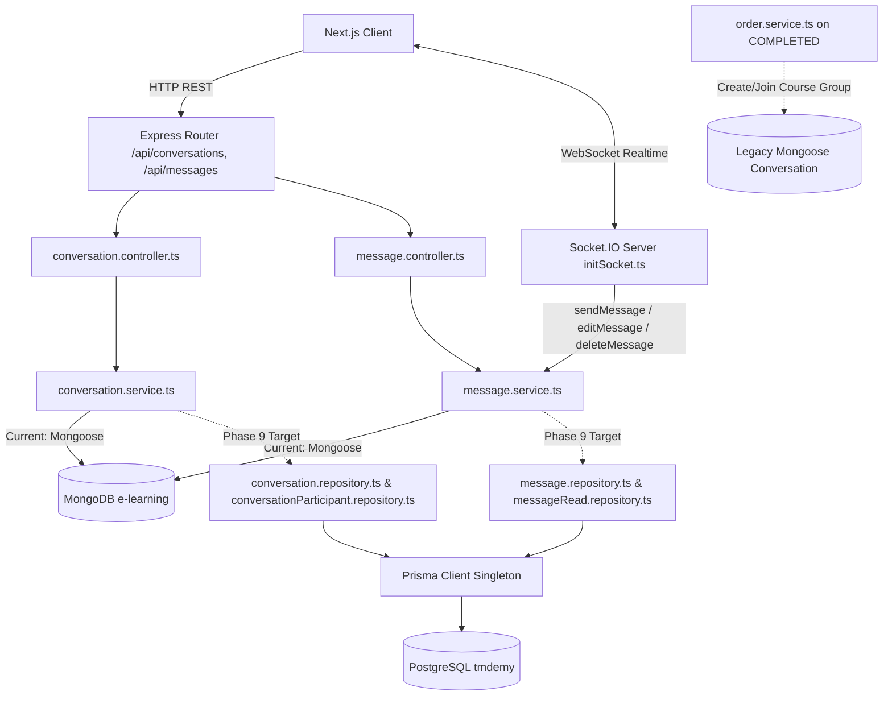
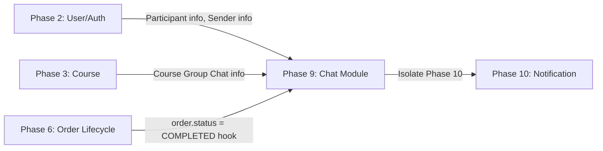

# PHASE 9: CHAT MIGRATION — PRE-IMPLEMENTATION AUDIT REPORT

**Project:** TMDEMY E-Learning Backend  
**Phase:** 9 — Chat (Conversation, Participant, Message, MessageRead, Socket.IO)  
**Step:** 1 — Pre-Implementation Read-Only Audit  
**Target Database:** PostgreSQL 16.11 (`tmdemy`) via Prisma ORM 6.4.1  
**Legacy Database:** MongoDB Atlas (`e-learning`) via Mongoose  
**Status:** AUDIT COMPLETED — PENDING OWNER APPROVAL (GATE STEP 1)  
**Date:** 2026-10-04  

---

## 1. TỔNG QUAN KIẾN TRÚC CHAT HIỆN TẠI

Hệ thống Chat trong TMDEMY là kiến trúc **lai ghép (Hybrid HTTP + Socket.IO Realtime)**:
1. **HTTP REST API Layer**:
   - `POST /api/conversations`: Tạo cuộc hội thoại mới (1-on-1 private chat hoặc group chat theo khóa học).
   - `GET /api/conversations`: Lấy danh sách cuộc hội thoại của user hiện tại kèm thông tin participant, avatar, display name và `lastMessage`.
   - `GET /api/messages/:conversationId`: Lấy toàn bộ lịch sử tin nhắn trong một cuộc hội thoại.
2. **Socket.IO Realtime Layer (`src/socket/initSocket.ts`)**:
   - Quản lý kết nối WebSocket cho client (`io.on('connection')`).
   - Quản lý User Room (`socket.join(userId)`) và Conversation Rooms (`socket.on('join')`).
   - Xử lý gửi tin nhắn realtime (`socket.on('sendMessage')`) -> gọi trực tiếp `createMessageService` -> broadcast `receiveMessage` tới conversation room.
   - Xử lý sửa tin nhắn (`socket.on('editMessage')`) -> gọi trực tiếp `updateMessageService` -> broadcast `messageUpdated` tới conversation room.
   - Xử lý xóa tin nhắn (`socket.on('deleteMessage')`) -> gọi trực tiếp `deleteMessageService` -> broadcast `messageDeleted` tới conversation room.
   - Quản lý các sự kiện đàm thoại WebRTC (Audio / Video Call): `callUser`, `answerCall`, `webrtc-offer`, `webrtc-answer`, `webrtc-ice-candidate` (chỉ relay tín hiệu ngang hàng qua Socket, không ghi database).
3. **Domain Event Integration (Order Lifecycle Hook)**:
   - Tại `src/services/order.service.ts` (dòng 449-478), khi một Order hoàn tất thanh toán (`status = COMPLETED`), hệ thống tự động tìm hoặc tạo Conversation nhóm cho Course tương ứng và tự động add sinh viên vừa mua khóa học vào danh sách `participants`.



---

## 2. AUDIT MONGOOSE MODELS & FIELDS

### 2.1. Model `Conversation` (`src/models/conversation.model.ts`)
| Field | Type | Options / Constraints | Ghi chú & Logic hiện tại |
| :--- | :--- | :--- | :--- |
| `participants` | `ObjectId[]` | `ref: 'User'`, default `[]` | Mảng embedded chứa danh sách ObjectId của User tham gia |
| `isGroup` | `Boolean` | default `false` | Phân biệt chat riêng tư (`false`) và chat nhóm (`true`) |
| `name` | `String` | optional | Tên nhóm chat (đối với group chat của khóa học) |
| `lastMessage` | `ObjectId` | `ref: 'Message'`, optional | Trỏ tới tin nhắn mới nhất để hiển thị preview và sort |
| `course` | `ObjectId` | `ref: 'Course'`, optional | Liên kết với Course khi là group chat thảo luận khóa học |
| `createdAt` / `updatedAt` | `Date` | timestamps `true` | Thời gian tạo và cập nhật |

### 2.2. Model `Message` (`src/models/message.model.ts`)
| Field | Type | Options / Constraints | Ghi chú & Logic hiện tại |
| :--- | :--- | :--- | :--- |
| `conversation` | `ObjectId` | `ref: 'Conversation'`, required | Thuộc cuộc hội thoại nào |
| `sender` | `ObjectId` | `ref: 'User'`, required | Ai là người gửi tin |
| `content` | `String` | required, trim | Nội dung văn bản của tin nhắn |
| `type` | `String` | enum: `['text', 'image', 'file']`, default `'text'` | Định dạng tin nhắn (`EMessageType`) |
| `readBy` | `ObjectId[]` | `ref: 'User'`, default `[]` | Mảng chứa User IDs đã đọc tin nhắn |
| `isEdited` | `Boolean` | default `false` | Đánh dấu tin nhắn đã từng bị chỉnh sửa |
| `createdAt` / `updatedAt` | `Date` | timestamps `true` | Thời gian tạo và cập nhật |

---

## 3. PRISMA SCHEMA COMPATIBILITY & DATABASE STRUCTURE

Trong `prisma/schema.prisma` (lines 544 - 602), cấu trúc Chat đã được thiết kế sẵn theo chuẩn quan hệ (Relational 3NF) và đã đóng băng (`FROZEN`):

```prisma
enum EMessageType {
  TEXT
  IMAGE
  FILE

  @@map("message_type")
}

model Conversation {
  id            String    @id @default(dbgenerated("gen_random_uuid()")) @db.Uuid
  isGroup       Boolean   @default(false) @map("is_group")
  name          String?   @db.VarChar(255)
  courseId      String?   @map("course_id") @db.Uuid
  lastMessageId String?   @map("last_message_id") @db.Uuid
  createdAt     DateTime  @default(now()) @map("created_at") @db.Timestamptz(6)
  updatedAt     DateTime  @default(now()) @updatedAt @map("updated_at") @db.Timestamptz(6)

  course        Course?   @relation(fields: [courseId], references: [id], onDelete: SetNull)
  participants  ConversationParticipant[]
  messages      Message[]

  @@index([courseId])
  @@map("conversations")
}

model ConversationParticipant {
  conversationId String       @map("conversation_id") @db.Uuid
  userId         String       @map("user_id") @db.Uuid
  joinedAt       DateTime     @default(now()) @map("joined_at") @db.Timestamptz(6)

  conversation   Conversation @relation(fields: [conversationId], references: [id], onDelete: Cascade)
  user           User         @relation(fields: [userId], references: [id], onDelete: Cascade)

  @@id([conversationId, userId])
  @@index([userId])
  @@map("conversation_participants")
}

model Message {
  id             String        @id @default(dbgenerated("gen_random_uuid()")) @db.Uuid
  conversationId String        @map("conversation_id") @db.Uuid
  senderId       String        @map("sender_id") @db.Uuid
  content        String        @db.Text
  type           EMessageType  @default(TEXT)
  isEdited       Boolean       @default(false) @map("is_edited")
  createdAt      DateTime      @default(now()) @map("created_at") @db.Timestamptz(6)
  updatedAt      DateTime      @default(now()) @updatedAt @map("updated_at") @db.Timestamptz(6)

  conversation   Conversation  @relation(fields: [conversationId], references: [id], onDelete: Cascade)
  sender         User          @relation(fields: [senderId], references: [id], onDelete: Cascade)
  reads          MessageRead[]

  @@index([conversationId, createdAt])
  @@map("messages")
}

model MessageRead {
  messageId String   @map("message_id") @db.Uuid
  userId    String   @map("user_id") @db.Uuid
  readAt    DateTime @default(now()) @map("read_at") @db.Timestamptz(6)

  message   Message  @relation(fields: [messageId], references: [id], onDelete: Cascade)
  user      User     @relation(fields: [userId], references: [id], onDelete: Cascade)

  @@id([messageId, userId])
  @@map("message_reads")
}
```

### So sánh & Đối chiếu Schema Mapping:
1. **Khóa chính & Khóa ngoại**:
   - `Conversation`: UUID PK. Khóa ngoại `courseId` trỏ tới `courses(id)` với `onDelete: SetNull`. `lastMessageId` lưu UUID của tin nhắn cuối cùng (không đặt FK cứng để tránh vòng lặp circular dependency giữa `conversations` và `messages`).
   - `ConversationParticipant`: Bảng nối chuẩn hóa (Junction table) thay thế cho mảng embedded `participants: ObjectId[]`. Khóa chính phức hợp `@@id([conversationId, userId])`, cascade on delete.
   - `Message`: UUID PK, FK `conversationId` (cascade), FK `senderId` (cascade). Index tối ưu `@@index([conversationId, createdAt])` phục vụ truy vấn tin nhắn theo thời gian.
   - `MessageRead`: Bảng nối chuẩn hóa thay thế cho mảng embedded `readBy: ObjectId[]`. Khóa chính phức hợp `@@id([messageId, userId])`, cascade on delete.
2. **Enum Mapping (`EMessageType`)**:
   - Mongoose: `'text' | 'image' | 'file'`.
   - PostgreSQL: Enum vật lý `message_type` với các giá trị viết hoa `TEXT`, `IMAGE`, `FILE`.
   - Cần Serializer/Mapper chuyển đổi giữa application string (`text`) và Prisma enum (`TEXT`) để giữ nguyên 100% API contract đối với Frontend và Socket.IO client.

---

## 4. HIỆN TRẠNG DỮ LIỆU POSTGRESQL & MONGODB

Truy vấn trực tiếp bằng Prisma Client Singleton trên cơ sở dữ liệu mục tiêu PostgreSQL 16.11 (`tmdemy`):

| Bảng vật lý PostgreSQL | Số lượng bản ghi (Rows) | Khớp dữ liệu Migration | Trạng thái bảo toàn |
| :--- | :---: | :---: | :--- |
| `conversations` | **2** | 100% | 1 private conversation (2 users) & 1 course Q&A group (4 users) |
| `conversation_participants` | **6** | 100% | Đầy đủ quan hệ liên kết với `users(id)` và `conversations(id)` |
| `messages` | **12** | 100% | Đầy đủ liên kết với `conversations(id)` và `users(id)` |
| `message_reads` | **0** | 100% | Dữ liệu gốc MongoDB không có lượt đọc nào được ghi nhận |

### Chi tiết các bản ghi thực tế:
- **Conversation 1 (Private 1-on-1)**:
  - ID: `3dcaa9d2-72c4-5a34-b0d0-13089075352e`
  - `isGroup: false`, `courseId: null`
  - Participants: `minhsuyyyyy` (`c55de839...`) và `teacher02` (`13608f92...`)
  - Tin nhắn gần nhất (`lastMessageId`): `09d8032f-0f7f-51a0-8932-9d7768e8b155`
- **Conversation 2 (Course Group Chat)**:
  - ID: `c44f9756-f63a-5e29-982e-cb647bf92ec3`
  - `isGroup: true`, `name: "ReactJS Advanced - Update 2025"`, `courseId: "f0dde7bb-1bf6-5602-a489-cd324132c68a"`
  - Participants: 4 users (`teacher02`, `minhsuyyyyy`, `teacher_cntt`, `thaiminh`)
  - Tin nhắn gần nhất (`lastMessageId`): `e8bded86-fa72-58f8-8dbe-927b986eba99`
- **Tính toàn vẹn khóa ngoại (Referential Integrity)**:
  - 100% `conversationId` trong `messages` và `conversation_participants` đều tồn tại trong `conversations`.
  - 100% `senderId` và `userId` đều tồn tại trong `users`.
  - Không phát hiện bất kỳ orphan row hay broken reference nào.

---

## 5. HTTP API CONTRACT BASELINE

Toàn bộ các HTTP endpoints thuộc module Chat giữ nguyên 100% API contract:

### 5.1. `POST /api/conversations`
- **Mô tả**: Tạo cuộc hội thoại mới hoặc lấy lại cuộc hội thoại 1-on-1 đã tồn tại.
- **Auth**: Yêu cầu Access Token hợp lệ (`accessTokenValidator`).
- **Headers**: `Authorization: Bearer <token>`
- **Request Body**:
  ```json
  {
    "receiverId": "13608f92-8acf-53e3-adcb-0d832e9cb1d4", // Đối với chat 1-on-1
    "isGroup": false,
    "name": "Nhóm thảo luận", // Đối với chat nhóm (optional)
    "courseId": "f0dde7bb-1bf6-5602-a489-cd324132c68a" // Đối với chat nhóm khóa học (optional)
  }
  ```
- **Business Logic Rules**:
  - Chat 1-on-1: Nếu `receiverId === senderId` -> Báo lỗi `400 Bad Request` ("Cannot create conversation with yourself").
  - Chat 1-on-1: Nếu đã tồn tại cuộc hội thoại giữa 2 user này -> Trả về ngay cuộc hội thoại cũ kèm status `200 OK`.
  - Chat nhóm Khóa học: Lấy thông tin khóa học, thêm `course.authorId` và toàn bộ học viên đã đăng ký khóa học (`enrollments`) vào participants.
- **Success Response (200 OK / 201 Created)**:
  ```json
  {
    "status": 200,
    "message": "Create conversation successfully",
    "data": {
      "id": "3dcaa9d2-72c4-5a34-b0d0-13089075352e",
      "_id": "3dcaa9d2-72c4-5a34-b0d0-13089075352e",
      "isGroup": false,
      "name": null,
      "courseId": null,
      "lastMessageId": null,
      "participants": [
        {
          "id": "c55de839-f059-519c-8820-b16aa17fb9c3",
          "_id": "c55de839-f059-519c-8820-b16aa17fb9c3",
          "username": "minhsuyyyyy",
          "avatar": "https://..."
        },
        {
          "id": "13608f92-8acf-53e3-adcb-0d832e9cb1d4",
          "_id": "13608f92-8acf-53e3-adcb-0d832e9cb1d4",
          "username": "teacher02",
          "avatar": null
        }
      ],
      "createdAt": "2025-10-17T05:59:36.202Z",
      "updatedAt": "2025-11-08T01:26:48.337Z"
    }
  }
  ```

### 5.2. `GET /api/conversations`
- **Mô tả**: Lấy danh sách các cuộc hội thoại mà user hiện tại đang tham gia.
- **Auth**: Yêu cầu Access Token hợp lệ (`accessTokenValidator`).
- **Headers**: `Authorization: Bearer <token>`
- **Business Logic Rules**:
  - Tìm tất cả conversations có `userId` trong `participants`.
  - Sắp xếp giảm dần theo thời gian cập nhật (`updatedAt DESC`).
  - Đối với chat 1-on-1: Tự động tính toán trường ảo `displayName` và `avatar` dựa trên đối phương (peer participant).
  - Populate thông tin `lastMessage`.
- **Success Response (200 OK)**:
  ```json
  {
    "status": 200,
    "message": "Get conversations successfully",
    "data": [
      {
        "id": "3dcaa9d2-72c4-5a34-b0d0-13089075352e",
        "_id": "3dcaa9d2-72c4-5a34-b0d0-13089075352e",
        "isGroup": false,
        "displayName": "teacher02",
        "avatar": null,
        "lastMessage": {
          "id": "09d8032f-0f7f-51a0-8932-9d7768e8b155",
          "_id": "09d8032f-0f7f-51a0-8932-9d7768e8b155",
          "content": "asdasd",
          "sender": "c55de839-f059-519c-8820-b16aa17fb9c3",
          "createdAt": "2025-11-08T01:26:48.262Z"
        },
        "participants": [ ... ],
        "createdAt": "2025-10-17T05:59:36.202Z",
        "updatedAt": "2025-11-08T01:26:48.337Z"
      }
    ]
  }
  ```

### 5.3. `GET /api/messages/:conversationId`
- **Mô tả**: Lấy toàn bộ lịch sử tin nhắn của một cuộc hội thoại.
- **Auth**: Yêu cầu Access Token hợp lệ (`accessTokenValidator`).
- **Params**: `conversationId` (UUID hợp lệ).
- **Business Logic Rules**:
  - Kiểm tra xem conversation có tồn tại không -> `404 Not Found` nếu không tìm thấy.
  - Sắp xếp tin nhắn tăng dần theo thời gian tạo (`createdAt ASC`).
  - Populate thông tin người gửi: `id`, `_id`, `username`, `avatar`.
- **Success Response (200 OK)**:
  ```json
  {
    "status": 200,
    "message": "Get messages successfully",
    "data": [
      {
        "id": "02dca910-cbc5-5555-8601-a71046935a58",
        "_id": "02dca910-cbc5-5555-8601-a71046935a58",
        "conversationId": "3dcaa9d2-72c4-5a34-b0d0-13089075352e",
        "conversation": "3dcaa9d2-72c4-5a34-b0d0-13089075352e",
        "content": "ok",
        "type": "text",
        "isEdited": false,
        "sender": {
          "id": "c55de839-f059-519c-8820-b16aa17fb9c3",
          "_id": "c55de839-f059-519c-8820-b16aa17fb9c3",
          "username": "minhsuyyyyy",
          "avatar": "https://..."
        },
        "createdAt": "2025-11-01T13:31:31.444Z",
        "updatedAt": "2025-11-01T13:31:31.444Z"
      }
    ]
  }
  ```

---

## 6. SOCKET.IO REALTIME CONTRACT BASELINE

Socket.IO Server được khởi tạo tại `src/socket/initSocket.ts`. Các sự kiện được duy trì nguyên vẹn:

| STT | Event Name | Direction | Payload | Auth / Room | DB Action | Broadcast Response Event |
| :---: | :--- | :---: | :--- | :--- | :--- | :--- |
| **1** | `connection` | Client -> Server | Handshake query: `{ userId }` | `socket.join(userId)` | Không | Ghi nhận user online room `${userId}` |
| **2** | `join` | Client -> Server | `room` (string: `conversationId`) | `socket.join(room)` | Không | User tham gia room của conversation |
| **3** | `sendMessage` | Client -> Server | `{ conversationId, senderId, content, type }` | Room `${conversationId}` | Ghi Message mới, update `lastMessageId` | Broadcast `receiveMessage` tới room kèm thông tin message đã populate |
| **4** | `editMessage` | Client -> Server | `{ messageId, senderId, content }` | Room `${conversationId}` | Update message `content` và `isEdited=true` | Broadcast `messageUpdated` tới room; nếu lỗi emit `errorMessage` |
| **5** | `deleteMessage`| Client -> Server | `{ messageId, senderId }` | Room `${conversationId}` | Delete message | Broadcast `messageDeleted` tới room; nếu lỗi emit `errorMessage` |
| **6** | `callUser` | Client -> Server | `{ userToCall, signalData, from, name }` | Tới user room `${userToCall}` | Không (P2P Signal) | Emit `callUser` tới người nhận |
| **7** | `answerCall` | Client -> Server | `{ to, signal }` | Tới user room `${to}` | Không (P2P Signal) | Emit `callAccepted` tới người gọi |
| **8** | `webrtc-offer` | Client -> Server | `{ target, sdp }` | Tới user room `${target}` | Không (P2P Signal) | Emit `webrtc-offer` |
| **9** | `webrtc-answer`| Client -> Server | `{ target, sdp }` | Tới user room `${target}` | Không (P2P Signal) | Emit `webrtc-answer` |
| **10**| `webrtc-ice-candidate` | Client -> Server | `{ target, candidate }` | Tới user room `${target}` | Không (P2P Signal) | Emit `webrtc-ice-candidate` |
| **11**| `disconnect` | Client -> Server | - | Rời socket | Không | Cleanup connection |

> [!NOTE]
> Socket.IO hiện tại không gọi Mongoose trực tiếp mà thông qua `createMessageService`, `updateMessageService`, `deleteMessageService`. Vì vậy, khi migrate các Service này sang Functional Repositories + PostgreSQL, tầng Socket.IO sẽ tự động tương thích 100% với PostgreSQL mà không cần thay đổi event signature.

---

## 7. DEPENDENCY MAP & PHÂN TÍCH TÁC ĐỘNG



1. **User / Auth Module (Phase 2)**:
   - Chat phụ thuộc chặt chẽ vào thông tin User (`id`, `username`, `avatar`). User đã hoàn toàn nằm trên PostgreSQL/Prisma.
2. **Course Module (Phase 3)**:
   - Chat nhóm liên kết với `courseId` và `course.authorId`. Course đã hoàn toàn nằm trên PostgreSQL/Prisma.
3. **Order / Enrollment Module (Phase 6)**:
   - Tại `src/services/order.service.ts` dòng 449, khi Order hoàn tất, hệ thống tự động tìm hoặc tạo conversation nhóm cho khóa học.
   - Hiện tại đoạn code này đang truy cập `ConversationModel` (Mongoose). Trong Phase 9 Step 2, cần cập nhật hàm này gọi tới `conversation.repository.ts` / `conversationParticipant.repository.ts`.
4. **Notification Module (Phase 10)**:
   - Notification hiện vẫn ở MongoDB/Mongoose. Chat hiện tại **chưa phát sinh Notification** trực tiếp khi có tin nhắn mới (chỉ dùng Socket.IO realtime). Vì vậy **không có sự phụ thuộc chéo vi phạm ranh giới Phase 10**.

---

## 8. CÁC VẤN ĐỀ VÀ RỦI RO (ISSUES & RISKS)

| STT | Vấn đề / Rủi ro | Mức độ | Phân loại | Giải pháp đề xuất |
| :---: | :--- | :---: | :---: | :--- |
| **1** | **Chuyển đổi mảng Embedded sang Bảng nối (Junction Table)**:<br>`Conversation.participants: ObjectId[]` chuyển sang `conversation_participants (conversationId, userId)`. | Trung bình | `READY` | Xây dựng các hàm Functional Repository chuyên biệt: `findConversationsByUserId`, `addParticipantsToConversation`, `getParticipantUserIds`. |
| **2** | **Enum Type Mismatch**:<br>Mongoose dùng chữ thường (`'text' \| 'image' \| 'file'`), Prisma schema dùng uppercase (`TEXT \| IMAGE \| FILE`). | Thấp | `READY` | Cung cấp Mapper 2 chiều trong `chat.model.ts` hoặc serializer để chuyển đổi tự động giữa API contract và PostgreSQL Enum. |
| **3** | **Order Service Dual-Write Hook**:<br>`order.service.ts` dòng 449 đang import `ConversationModel` để tạo/join group chat khóa học. | Trung bình | `READY` | Refactor đoạn hook này sử dụng Functional Repository mới của Chat, loại bỏ hoàn toàn Mongoose khỏi `order.service.ts`. |
| **4** | **Kiểm tra quyền truy cập Room trong Socket.IO**:<br>Hiện tại socket `join` và `sendMessage` tin cậy `conversationId` và `senderId` từ client mà chưa kiểm tra chặt chẽ `senderId` có phải participant của conversation hay không. | Thấp | `WARNING` | Bổ sung kiểm tra participant membership trong Service trước khi cho phép gửi tin nhắn, đồng thời bảo đảm không làm gãy luồng realtime của client. |
| **5** | **Thiếu Pagination trong Lịch sử Tin nhắn**:<br>Legacy Mongoose tải toàn bộ tin nhắn (`.find().sort({ createdAt: 1 })`). | Thấp | `WARNING` | Mặc định giữ nguyên contract cũ (trả về danh sách) nhưng bổ sung hỗ trợ optional query params `limit` / `cursor` / `skip` nếu client gửi lên. |

---

## 9. ĐỀ XUẤT KIẾN TRÚC MIGRATION (PHASE 9)

Tuân thủ kiến trúc phân tầng chuẩn mực của dự án:
```text
HTTP Request / Socket.IO Event
  └── Router / Socket Handler
        └── Validator & Middleware
              └── Controller
                    └── Service (Business Logic + Zod Application Models)
                          └── Functional Repositories (Prisma Client Singleton)
                                └── PostgreSQL (tmdemy)
```

### 9.1. Application Models (`src/models/chat.model.ts`)
- Định nghĩa Zod Schemas cho:
  - `ConversationSchema`, `CreateConversationInputSchema`
  - `MessageSchema`, `CreateMessageInputSchema`, `UpdateMessageInputSchema`
  - Enum mapping helpers (`EMessageType` <-> `'text' | 'image' | 'file'`).
  - Export types qua `z.infer<typeof ...>`.

### 9.2. Legacy Model Quarantine (`src/models/legacy/`)
- Di chuyển hoặc đánh dấu legacy cho `src/models/conversation.model.ts` và `src/models/message.model.ts` vào `src/models/legacy/`.

### 9.3. Functional Repositories
Tất cả các repository đều thuần Functional, nhận `tx?: PrismaTransactionClient`:
1. `src/repositories/conversation.repository.ts`:
   - `createConversation(data, tx)`
   - `findConversationById(id, tx)`
   - `findPrivateConversationBetweenUsers(userId1, userId2, tx)`
   - `findConversationsByUserId(userId, tx)`
   - `findCourseGroupConversation(courseId, tx)`
   - `updateConversationLastMessage(id, lastMessageId, tx)`
2. `src/repositories/conversationParticipant.repository.ts`:
   - `addParticipants(conversationId, userIds, tx)`
   - `isUserInConversation(conversationId, userId, tx)`
   - `getConversationParticipants(conversationId, tx)`
   - `removeParticipant(conversationId, userId, tx)`
3. `src/repositories/message.repository.ts`:
   - `createMessage(data, tx)`
   - `findMessageById(id, tx)`
   - `findMessagesByConversationId(conversationId, options, tx)`
   - `updateMessageContent(id, content, tx)`
   - `deleteMessage(id, tx)`
4. `src/repositories/messageRead.repository.ts`:
   - `markMessageAsRead(messageId, userId, tx)`
   - `getUnreadCount(conversationId, userId, tx)`

### 9.4. Services Migration
- `src/services/conversation.service.ts`: Chuyển 100% logic sang sử dụng Functional Repositories.
- `src/services/message.service.ts`: Chuyển 100% logic sang sử dụng Functional Repositories, đồng thời phát Socket.IO events như cũ.
- `src/services/order.service.ts`: Cập nhật hook group chat sang repository mới.

---

## 10. DANH SÁCH FILE DỰ KIẾN TẠO / CHỈNH SỬA

| STT | File Path | Hành động | Mục đích |
| :---: | :--- | :---: | :--- |
| 1 | `src/models/chat.model.ts` | **TẠO MỚI** | Zod Application Models & Types cho Chat |
| 2 | `src/models/legacy/conversation.legacy.model.ts` | **TẠO MỚI** | Cách ly Mongoose Conversation model |
| 3 | `src/models/legacy/message.legacy.model.ts` | **TẠO MỚI** | Cách ly Mongoose Message model |
| 4 | `src/repositories/conversation.repository.ts` | **TẠO MỚI** | Functional Repository cho Conversation |
| 5 | `src/repositories/conversationParticipant.repository.ts` | **TẠO MỚI** | Functional Repository cho Participants |
| 6 | `src/repositories/message.repository.ts` | **TẠO MỚI** | Functional Repository cho Message |
| 7 | `src/repositories/messageRead.repository.ts` | **TẠO MỚI** | Functional Repository cho MessageRead |
| 8 | `src/services/conversation.service.ts` | **REFACTOR** | Chuyển sang PostgreSQL / Prisma |
| 9 | `src/services/message.service.ts` | **REFACTOR** | Chuyển sang PostgreSQL / Prisma |
| 10 | `src/services/order.service.ts` | **REFACTOR** | Thay thế Mongoose call tại hook group chat |
| 11 | `src/controller/conversation.controller.ts` | **AUDIT / REFACTOR** | Đảm bảo tương thích UUID & contract response |
| 12 | `src/controller/message.controller.ts` | **AUDIT / REFACTOR** | Đảm bảo tương thích UUID & contract response |
| 13 | `src/routes/conversation.route.ts` | **AUDIT / REFACTOR** | Bổ sung UUID route param validators |
| 14 | `src/routes/message.route.ts` | **AUDIT / REFACTOR** | Bổ sung UUID route param validators |
| 15 | `src/socket/initSocket.ts` | **AUDIT / REFACTOR** | Xác thực kiểu dữ liệu payload, đảm bảo xử lý lỗi trơn tru |

---

## 11. KẾ HOẠCH KIỂM THỬ (TEST PLAN)

### 11.1. HTTP API Testing
- Kiểm thử tạo cuộc hội thoại 1-on-1 mới giữa 2 user hợp lệ.
- Kiểm thử tạo lại cuộc hội thoại 1-on-1 đã tồn tại (phải trả về conversation cũ, không duplicate).
- Kiểm thử ngăn chặn tự chat với chính mình (`senderId === receiverId`).
- Kiểm thử tạo group chat khóa học kèm toàn bộ học viên và giảng viên.
- Kiểm thử lấy danh sách cuộc hội thoại của user (`GET /api/conversations`) kèm tính toán `displayName`, `avatar` và `lastMessage`.
- Kiểm thử lấy danh sách tin nhắn theo `conversationId` (`GET /api/messages/:conversationId`).
- Kiểm thử các trường hợp UUID không hợp lệ hoặc không tồn tại (trả về `400` / `404`).

### 11.2. Socket.IO Realtime Testing
- Kiểm thử kết nối Socket và join user room (`userId`).
- Kiểm thử sự kiện `join` conversation room.
- Kiểm thử sự kiện `sendMessage`: Lưu tin nhắn vào PostgreSQL, cập nhật `lastMessageId`, broadcast `receiveMessage` tới các socket trong room.
- Kiểm thử sự kiện `editMessage`: Sửa nội dung tin nhắn của chính mình, cập nhật cờ `isEdited = true`, broadcast `messageUpdated`.
- Kiểm thử sự kiện `deleteMessage`: Xóa tin nhắn của chính mình, broadcast `messageDeleted`.
- Kiểm thử xử lý lỗi socket khi gửi dữ liệu sai (`errorMessage`).

### 11.3. Database Integrity & Concurrency
- Kiểm thử ràng buộc khóa chính phức hợp `@@id([conversationId, userId])` trên `conversation_participants`.
- Kiểm thử ràng buộc xóa xếp tầng `onDelete: Cascade` khi xóa Conversation hoặc Message.
- Kiểm thử transaction khi tạo tin nhắn và cập nhật `lastMessageId` đồng thời.

### 11.4. Regression Suite (Phases 1 - 8)
- Chạy toàn bộ regression test suite của các phase trước (User, Course, Order, Progress, Rating, Comment).
- Bảo đảm 100% tests hiện tại tiếp tục PASS.

---

## 12. BẢNG PHÂN LOẠI TRẠNG THÁI & CÁC QUYẾT ĐỊNH CẦN OWNER PHÊ DUYỆT

| Hạng mục | Trạng thái | Ghi chú & Đề xuất |
| :--- | :---: | :--- |
| **Prisma Schema Readiness** | `READY` | Đầy đủ 4 models `Conversation`, `ConversationParticipant`, `Message`, `MessageRead` và enum `EMessageType`. Schema đóng băng, không cần sửa đổi. |
| **Data Integrity in PostgreSQL** | `READY` | 2 conversations, 6 participants, 12 messages đã có sẵn trong PostgreSQL, 100% khớp khóa ngoại. |
| **HTTP API Contract Preservation** | `READY` | Giữ nguyên 100% URL, method, status code và response structure (hỗ trợ `_id` qua `withCompatId`). |
| **Socket.IO Event Preservation** | `READY` | Giữ nguyên 100% event names (`sendMessage`, `receiveMessage`, `editMessage`, `deleteMessage`, WebRTC signals). |
| **Order Service Hook Integration** | `READY` | Sẵn sàng chuyển đổi hook tạo/join group chat tại `src/services/order.service.ts` sang Functional Repository mới. |
| **Notification Phase Isolation** | `READY` | Chat không can thiệp vào Notification (Phase 10), đảm bảo ranh giới cô lập tuyệt đối. |

### CÂU HỎI XÁC NHẬN CẦN CHỦ DỰ ÁN PHÊ DUYỆT:
1. **Kiểm tra quyền gửi tin nhắn trong Socket.IO (`sendMessage`)**:
   - Hiện tại legacy code không kiểm tra `senderId` có phải là thành viên trong `conversation` hay không trước khi lưu tin nhắn.
   - *Đề xuất*: Bổ sung kiểm tra thành viên (`isUserInConversation`) trong Service trước khi lưu tin nhắn để bảo mật dữ liệu. Nếu không phải thành viên, socket sẽ trả về event `errorMessage: "You are not a participant in this conversation"`.
2. **Quy chuẩn phản hồi ID tương thích**:
   - Thống nhất áp dụng `withCompatId()` cho các response của Conversation và Message để đồng thời cung cấp `id` và `_id` (UUID), giúp Frontend hoạt động ổn định không bị gián đoạn.
3. **Phê duyệt triển khai Step 2**:
   - Xác nhận báo cáo Step 1 Pre-Implementation Audit đạt yêu cầu và phê duyệt cho phép bắt đầu **Step 2: Full Implementation** của Phase 9.

---

> **KẾT LUẬN & TRẠNG THÁI**:  
> Phase 9 (Chat Migration) **ĐÃ HOÀN TOÀN ĐỦ ĐIỀU KIỆN KỸ THUẬT ĐỂ TRIỂN KHAI**.  
> **DỪNG TẠI ĐÂY — CHỜ PHÊ DUYỆT CỦA PROJECT OWNER TRƯỚC KHI THỰC HIỆN STEP 2.**
