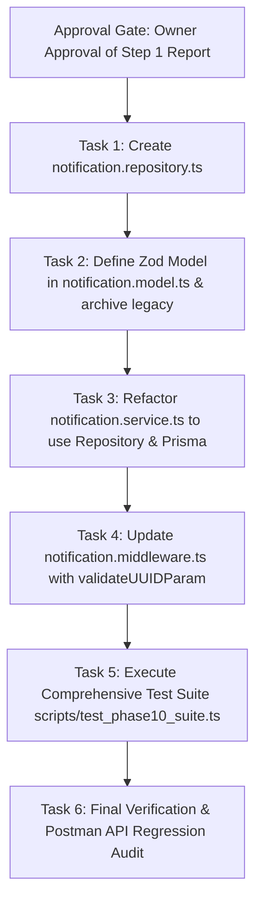

# PHASE 10: NOTIFICATION MIGRATION — PRE-IMPLEMENTATION AUDIT REPORT

**Project:** TMDEMY E-Learning Backend  
**Phase:** 10 — Notification Migration  
**Step:** Step 1 — Read-Only Audit & Architectural Planning  
**Target Database:** PostgreSQL 16.11 (`tmdemy`)  
**Target ORM:** Prisma ORM 6.4.1  
**Legacy Database:** MongoDB Atlas (`e-learning`)  
**Backend Framework:** Node.js / Express.js / TypeScript (strict mode)  
**Execution Mode:** STRICT READ-ONLY AUDIT (Zero code/schema modifications)  
**Date:** 2026-10-04  

---

## A. EXECUTIVE SUMMARY

### 1. Context & Objectives
Phase 10 addresses the migration of the **Notification Module** from MongoDB/Mongoose to PostgreSQL/Prisma ORM. Following the successful completion and acceptance of Phases 1 through 9 (including Auth, Courses, Orders, Ratings, Progress, Comments, and Chat), Notification represents one of the final remaining modules before Phase 11 (Cleanup & Mongoose Decommission).

### 2. Current State Assessment
- **Historical Migration Quality:** During Phase 10 of historical data migration, all 28 notification records from MongoDB were migrated to PostgreSQL with 100% referential integrity and 0 orphaned receiver/sender foreign keys.
- **Cross-Module Tension / Bug Root Cause:** Currently, domain services migrated in Phases 2–9 (`order.service.ts`, `comment.service.ts`, `rating.service.ts`, `lesson.service.ts`, `course.service.ts`, `quizSubmission.service.ts`, `admin.service.ts`) pass PostgreSQL UUID strings as `senderId`, `receiverId`, and `relatedId` to `pushNotificationService`. Because `pushNotificationService` still attempts to write to MongoDB using Mongoose `NotificationModel`, Mongoose throws `Cast to ObjectId failed` runtime errors. Migrating Notification to PostgreSQL will immediately resolve this cross-module friction and restore complete notification delivery across the platform.
- **Zero Direct Mongoose Leaks in Domain Services:** Crucially, NO external service directly imports or queries `NotificationModel`. All 9 caller sites interact exclusively via the centralized `pushNotificationService({ senderId, receiverId, type, message, relatedId })` abstraction. This makes the migration surface exceptionally clean and self-contained.

---

## B. EXISTING MONGODB STRUCTURE

### 1. Mongoose Model Definition (`src/models/notification.model.ts`)
```typescript
interface INotification {
  sender: mongoose.Types.ObjectId;   // Reference to User
  receiver: mongoose.Types.ObjectId; // Reference to User
  type: ENotificationType;           // Enum
  message: string;                   // Notification content
  relatedId?: mongoose.Types.ObjectId; // Reference entity (course, order, etc.)
  read: boolean;                     // Read status (default: false)
  createdAt: Date;
  updatedAt: Date;
}
```

### 2. Enum Mapping
Defined in `src/models/notification.model.ts`:
- `ENotificationType`: `COMMENT`, `RATING`, `ORDER`, `MESSAGE`, `SYSTEM`, `COURSE`, `LESSON`, `COMMENT_REPLY`, `QUIZ`.

### 3. Indexes & Constraints in MongoDB
- Standard auto-generated `_id` primary key index.
- Timestamps enabled: `createdAt`, `updatedAt`.
- No compound indices on `(receiver, read, createdAt)` were defined in the legacy Mongoose schema.

---

## C. PRISMA SCHEMA ANALYSIS

### 1. PostgreSQL Schema Definition (`prisma/schema.prisma`)
The `Notification` model and `ENotificationType` enum are already pre-defined in `prisma/schema.prisma` (lines 603–619):

```prisma
enum ENotificationType {
  COMMENT
  RATING
  ORDER
  MESSAGE
  SYSTEM
  COURSE
  LESSON
  COMMENT_REPLY
  QUIZ
}

model Notification {
  id         String            @id @default(uuid()) @db.Uuid
  senderId   String?           @map("sender_id") @db.Uuid
  receiverId String            @map("receiver_id") @db.Uuid
  type       ENotificationType
  message    String            @db.Text
  relatedId  String?           @map("related_id") @db.VarChar(255)
  isRead     Boolean           @default(false) @map("is_read")
  createdAt  DateTime          @default(now()) @map("created_at") @db.Timestamptz(6)
  updatedAt  DateTime          @updatedAt @map("updated_at") @db.Timestamptz(6)

  sender   User? @relation("NotificationSender", fields: [senderId], references: [id], onDelete: SetNull)
  receiver User  @relation("NotificationReceiver", fields: [receiverId], references: [id], onDelete: Cascade)

  @@index([receiverId, isRead, createdAt])
  @@map("notifications")
}
```

### 2. Schema Comparison & Mapping Matrix

| Attribute / Field | Mongoose (`NotificationModel`) | Prisma (`Notification`) | Compatibility & Migration Notes |
| :--- | :--- | :--- | :--- |
| **Table / Collection** | `notifications` | `notifications` | Direct 1:1 match |
| **Primary Key** | `_id` (ObjectId) | `id` (UUID v4) | `withCompatId` required for API backward compatibility |
| **Sender** | `sender` (ObjectId ref User, required) | `senderId` (UUID nullable, `onDelete: SetNull`) | Prisma is more robust: system notifications or deleted users set sender to `null` |
| **Receiver** | `receiver` (ObjectId ref User, required) | `receiverId` (UUID, `onDelete: Cascade`) | Matches business rule: cascade on user account deletion |
| **Type** | `ENotificationType` (9 values) | `ENotificationType` (9 values) | 100% exact match across all enum keys |
| **Message** | `message` (String) | `message` (Text) | Direct 1:1 match |
| **Related Entity** | `relatedId` (ObjectId) | `relatedId` (VarChar 255) | Prisma supports UUIDs or arbitrary string references |
| **Read Status** | `read` (Boolean, default false) | `isRead` (Boolean, default false) | Field name difference: serializer must provide `read` alias |
| **Timestamps** | `createdAt`, `updatedAt` | `createdAt`, `updatedAt` (Timestamptz) | Native PostgreSQL timestamptz |
| **Indexes** | Default `_id` | Compound: `[receiverId, isRead, createdAt]` | Optimized for query pattern `where: { receiverId }, orderBy: createdAt DESC` |

### 3. Conclusion on Prisma Schema
- **Status:** **FULLY COMPATIBLE**. No schema changes, no migrations, and no `prisma db push` are necessary.

---

## D. NOTIFICATION CALL SITES

Comprehensive static code audit identified **9 call sites across 7 services** where notifications are triggered. All of them invoke `pushNotificationService`:

| Calling Service | Method / Line | Triggering Event | Notification Type | Sender ID | Receiver ID | Related ID |
| :--- | :--- | :--- | :--- | :--- | :--- | :--- |
| `src/services/rating.service.ts` | `createRatingService` (L75) | Student reviews course | `RATING` | Student UUID | Course Author UUID | Course UUID |
| `src/services/quizSubmission.service.ts` | `submitQuizService` (L165) | Student submits quiz | `QUIZ` | Student UUID | Quiz Author UUID | Quiz UUID |
| `src/services/order.service.ts` | `createOrderService` (L230) | Student places order | `ORDER` | Student UUID | Course Author UUID | Order UUID |
| `src/services/order.service.ts` | `checkPaymentStatusService` (L479) | Order payment completed | `ORDER` | System / Course Author | Student UUID | Order UUID |
| `src/services/lesson.service.ts` | `createLessonService` (L137) | New lesson created | `LESSON` | Instructor UUID | Enrolled Students | Lesson UUID |
| `src/services/course.service.ts` | `createCourseService` (L239) | Course submitted | `COURSE` | Instructor UUID | Admin UUIDs | Course UUID |
| `src/services/comment.service.ts` | `createCommentService` (L155) | Course comment posted | `COMMENT` | Commenter UUID | Course Author UUID | Comment UUID |
| `src/services/comment.service.ts` | `createCommentService` (L164) | Comment reply posted | `COMMENT_REPLY` | Reply Author UUID | Parent Comment Author | Parent Comment UUID |
| `src/services/admin.service.ts` | `updateCourseStatusService` (L483) | Course approved/rejected | `COURSE` | Admin UUID | Instructor UUID | Course UUID |

> **Key Observation:** Because every domain service interacts exclusively with `pushNotificationService`, migrating `pushNotificationService` and `notification.service.ts` to a functional Prisma repository automatically migrates 100% of notification generation across the entire backend.

---

## E. API CONTRACT AUDIT

### 1. HTTP Endpoints Specification

#### `GET /api/notifications`
- **Controller:** `getNotificationsController`
- **Middleware:** `getNotificationsValidator` -> `verifyAccessToken`
- **Query Parameters:**
  - `page`: optional integer (default: 1)
  - `limit`: optional integer (default: 10)
  - `type`: optional filter (must match `ENotificationType`)
- **Headers:** `Authorization: Bearer <accessToken>`
- **Response Format (200 OK):**
```json
{
  "message": "Get notifications successfully",
  "result": {
    "notifications": [
      {
        "id": "c6218d6a-5c2f-410a-9d21-f8a61da52601",
        "_id": "c6218d6a-5c2f-410a-9d21-f8a61da52601",
        "sender": {
          "id": "f5e921d2-2580-4965-9a86-7a87c1cb087b",
          "_id": "f5e921d2-2580-4965-9a86-7a87c1cb087b",
          "username": "johndoe",
          "avatar": "https://..."
        },
        "receiver": "...",
        "receiverId": "...",
        "type": "ORDER",
        "message": "You have a new order",
        "relatedId": "b186b51e-e2c7-43ca-a486-d24e5ef90be6",
        "read": false,
        "isRead": false,
        "createdAt": "2026-03-20T10:00:00.000Z",
        "updatedAt": "2026-03-20T10:00:00.000Z"
      }
    ],
    "pagination": {
      "page": 1,
      "limit": 10,
      "total": 28,
      "totalPages": 3
    }
  }
}
```

#### `PATCH /api/notifications/read/:id`
- **Controller:** `markNotificationReadController`
- **Middleware:** `notificationIdValidator` -> `verifyAccessToken`
- **URL Parameters:** `id` (Notification UUID)
- **Headers:** `Authorization: Bearer <accessToken>`
- **Response Format (200 OK):**
```json
{
  "message": "Mark notification as read successfully",
  "result": {
    "id": "c6218d6a-5c2f-410a-9d21-f8a61da52601",
    "_id": "c6218d6a-5c2f-410a-9d21-f8a61da52601",
    "read": true,
    "isRead": true,
    "updatedAt": "2026-10-04T14:00:00.000Z"
  }
}
```
- **Error Responses:**
  - `404 Not Found`: Notification does not exist.
  - `403 Forbidden`: Authenticated user is not the `receiverId` of this notification.
  - `422 Unprocessable Entity`: Invalid UUID parameter.

### 2. Middleware Inconsistencies Detected
In [src/middlewares/notification.middleware.ts](file:///d:/e-learning_server/src/middlewares/notification.middleware.ts):
- Line 8: `notificationIdValidator` currently validates using `mongoose.Types.ObjectId.isValid(value)`. This causes valid PostgreSQL UUIDs to be rejected with HTTP 422! It must be replaced with `validateUUIDParam`.
- Line 25: `getNotificationsValidator` enum check only permitted `['system', 'order', 'comment', 'rating', 'message']`. The remaining 4 valid enum types (`course`, `lesson`, `comment_reply`, `quiz`) were omitted. It must be updated to validate against all 9 Prisma enum values (case-insensitively).

---

## F. SOCKET.IO EVENTS & REALTIME FLOW

### 1. Event Specification
- **Event Name:** `new_notification`
- **Target Room:** `${receiverId}` (The user's personal room)
- **Payload Structure:**
```typescript
{
  id: string,
  _id: string,
  sender: { id: string, username: string, avatar: string } | null,
  receiverId: string,
  type: ENotificationType,
  message: string,
  relatedId?: string | null,
  read: boolean,
  isRead: boolean,
  createdAt: Date
}
```

### 2. Authentication & Delivery Mechanism
- In Phase 9 (Chat Migration), `src/socket/initSocket.ts` was upgraded to strictly authenticate incoming Socket connections via JWT `verifyAccessToken`. Upon successful verification, every authenticated socket joins a personal room named with their `user.id` (UUID):
  ```typescript
  socket.join(user.id);
  ```
- Therefore, calling `getIO().to(receiverId).emit('new_notification', payload)` delivers the event exclusively to all active sockets belonging to `receiverId`.
- **Transaction Safety & Timing:** Socket emissions must be dispatched **after** the database write succeeds. Realtime broadcast errors must be caught and logged without aborting or rolling back HTTP requests or caller service transactions.

---

## G. DATABASE STATUS (`tmdemy` PostgreSQL)

Direct audit executed via Prisma Client:
- **PostgreSQL Version:** 16.11
- **Prisma ORM Version:** 6.4.1
- **Total Notification Records:** **28 rows**
- **Orphan Check:**
  - Records with non-existent `receiverId`: **0**
  - Records with invalid `senderId`: **0**
- **Distribution by Type:**
  - `ORDER`: 9
  - `COMMENT`: 9
  - `QUIZ`: 5
  - `COURSE`: 2
  - `LESSON`: 1
  - `COMMENT_REPLY`: 1
  - `RATING`: 1
- **Distribution by Read Status:**
  - `isRead = false`: 27
  - `isRead = true`: 1
- **Table Constraints & Indices:**
  - Primary Key: `notifications_pkey` (UUID)
  - Foreign Keys: `notifications_sender_id_fkey` (`users.id`, SetNull), `notifications_receiver_id_fkey` (`users.id`, Cascade)
  - Index: `notifications_receiver_id_is_read_created_at_idx`

---

## H. MIGRATION GAP ANALYSIS

| Component | Current State (MongoDB) | Target State (PostgreSQL/Prisma) | Implementation Gap & Action Required |
| :--- | :--- | :--- | :--- |
| **Repository** | No repository exists (direct `NotificationModel` calls in service) | Pure Functional Repository (`src/repositories/notification.repository.ts`) | Create repository with `createNotification`, `findNotificationById`, `findNotificationsByUser`, `countNotificationsByUser`, `markAsRead`, `markAllAsRead` |
| **Service** | `src/services/notification.service.ts` uses Mongoose queries & `new NotificationModel()` | Refactored service using `notification.repository.ts` | Remove all Mongoose imports; replace queries with repository functions; ensure `withCompatId` |
| **Middleware** | `src/middlewares/notification.middleware.ts` validates MongoDB ObjectId | Express Validator with `validateUUIDParam` | Replace `ObjectId.isValid` with `validateUUIDParam`; support all 9 enums |
| **Model / DTO** | `src/models/notification.model.ts` is Mongoose schema | Zod Application Model (`src/models/notification.model.ts`) | Convert to Zod schema & types; rename legacy Mongoose schema to `notification.legacy.model.ts` |
| **Controller** | Returns Mongoose documents | Formats response with `withCompatId` and `read` / `isRead` aliases | Ensure existing API response contract is 100% preserved |

---

## I. PROPOSED FILE CHANGES (FOR STEP 2)

| File Path | Action | Description & Scope |
| :--- | :--- | :--- |
| `src/repositories/notification.repository.ts` | **CREATE** | Pure functional repository exporting CRUD operations with Prisma Client Singleton & transaction support (`tx?: PrismaTransactionClient`). |
| `src/models/notification.model.ts` | **MODIFY / REPLACE** | Modern Zod Application Model exporting `NotificationSchema`, `CreateNotificationSchema`, and inferred TypeScript types. |
| `src/models/notification.legacy.model.ts` | **CREATE** | Preserves legacy Mongoose `NotificationModel` for rollback / historical compatibility until Phase 11. |
| `src/services/notification.service.ts` | **MODIFY** | Eliminate Mongoose dependencies; integrate `notification.repository.ts`; preserve Socket.IO emissions. |
| `src/middlewares/notification.middleware.ts` | **MODIFY** | Replace MongoDB `ObjectId.isValid` with `validateUUIDParam`; update enum validation list to all 9 valid types. |
| `scripts/test_phase10_suite.ts` | **CREATE** | Comprehensive end-to-end regression test suite covering repository, service, middleware, and API contract. |

---

## J. RISK ASSESSMENT & MITIGATION STRATEGY

1. **Risk: Breaking Call Sites in Migrated Services**
   - *Analysis:* 9 call sites in 7 services call `pushNotificationService`.
   - *Mitigation:* Preserve the exact function signature of `pushNotificationService(data: CreateNotificationDTO)`. Since caller services already provide UUIDs, transitioning to Prisma will fix existing runtime cast failures with zero changes required in callers.
2. **Risk: Socket.IO Emission Failures Blocking Transactions**
   - *Analysis:* If Socket.IO emission fails or encounters network delay, it could degrade API performance.
   - *Mitigation:* Wrap `io.to(...).emit(...)` in a `try...catch` block. Socket broadcast failure must log a warning but never throw or disrupt database persistence.
3. **Risk: Frontend Compatibility (`_id` vs `id`, `read` vs `isRead`)**
   - *Analysis:* MongoDB used `_id` and `read`. Prisma schema uses `id` and `isRead`.
   - *Mitigation:* The repository/service serializer will supply both `id` / `_id` and `read` / `isRead` on all notification objects via `withCompatId`.
4. **Risk: MongoDB Dual-Stack Isolation**
   - *Analysis:* Other non-migrated modules or tests might still rely on MongoDB connection.
   - *Mitigation:* Leave `src/config/dbConnect.ts` completely untouched. Keep legacy model in `notification.legacy.model.ts`.

---

## K. STEP 2 IMPLEMENTATION PLAN



1. **Task 1: Functional Repository Implementation (`src/repositories/notification.repository.ts`)**
   - Implement `createNotification(data, tx?)`.
   - Implement `findNotificationById(id, tx?)`.
   - Implement `findNotificationsByUser(receiverId, options, tx?)`.
   - Implement `countNotificationsByUser(receiverId, filter?, tx?)`.
   - Implement `markNotificationAsRead(id, receiverId, tx?)`.
   - Implement `markAllNotificationsAsRead(receiverId, tx?)`.
2. **Task 2: Model & DTO Integration (`src/models/notification.model.ts`)**
   - Move Mongoose schema to `src/models/notification.legacy.model.ts`.
   - Define Zod schemas and inferred types for Notification.
3. **Task 3: Service Layer Refactoring (`src/services/notification.service.ts`)**
   - Replace Mongoose queries with repository calls.
   - Retain Socket.IO `new_notification` emission inside `pushNotificationService`.
   - Ensure `withCompatId` compatibility decoration.
4. **Task 4: Validator & Middleware Migration (`src/middlewares/notification.middleware.ts`)**
   - Replace `ObjectId.isValid` with `validateUUIDParam`.
   - Expand enum query filter validation to accept all 9 `ENotificationType` values.
5. **Task 5: Verification & Quality Assurance**
   - Execute TypeScript strict type checking (`npx tsc --noEmit`).
   - Run end-to-end automated test script testing CRUD, pagination, filtering, ownership authorization, and socket emission.
   - Verify zero Mongoose queries in Notification module.

---

## L. ACCEPTANCE CRITERIA

- [ ] **Functional Repository:** `src/repositories/notification.repository.ts` is 100% functional (no classes, no `this`, no `any`, accepts optional `tx`).
- [ ] **Zero Direct Mongoose Dependencies:** No calls to `NotificationModel` or `mongoose` inside `notification.service.ts` or `notification.middleware.ts`.
- [ ] **UUID Compliance:** All endpoints accept and validate RFC 4122 UUID v4 strings.
- [ ] **API Contract Frozen:** `GET /api/notifications` and `PATCH /api/notifications/read/:id` return identical JSON response structures with `_id` and `read` compatibility fields.
- [ ] **Realtime Socket Integration:** `new_notification` event continues to be emitted to the authenticated user's room `${receiverId}`.
- [ ] **Existing Domain Services Unbroken:** All 9 notification call sites (`order`, `rating`, `quiz`, `course`, `lesson`, `comment`, `admin`) successfully create notifications without runtime cast errors.
- [ ] **Data Integrity:** All 28 existing PostgreSQL notification records are preserved intact.
- [ ] **Strict Typing:** 0 TypeScript compile errors under strict mode.

---

> [!IMPORTANT]
> **APPROVAL GATE (MANDATORY STOP):**
> Step 1 Read-Only Audit is complete. In strict adherence to project governance and `AGENTS.md`, no source code has been altered. Awaiting Project Owner review and formal authorization before proceeding to **Step 2: Full Implementation**.
