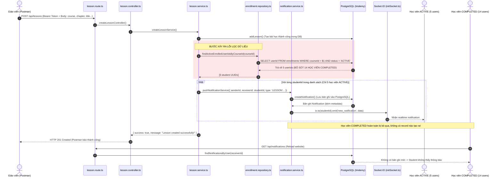

# BÁO CÁO KIỂM TOÁN HỆ THỐNG NOTIFICATION BÀI HỌC (F7.5-B.3 — BACKEND LESSON NOTIFICATION AUDIT)

> **Dự án**: TMDEMY E-Learning Backend  
> **Nhiệm vụ**: F7.5-B.3 — Backend Lesson Notification Audit  
> **Mục tiêu**: Điều tra lỗi học viên không nhận được notification khi giáo viên tạo Lesson qua Postman (`POST /api/lessons`).  
> **Trạng thái tài liệu**: **AUDIT ONLY — BÁO CÁO KIỂM TOÁN KỸ THUẬT (ZERO CODE CHANGES, CHỜ REVIEW & PHÊ DUYỆT)**  
> **Ngày thực hiện**: 15/10/2026  

---

## 1. NGUYÊN NHÂN GỐC RỄ (ROOT CAUSE ANALYSIS)

Dựa trên kết quả điều tra và truy vấn đối chiếu trực tiếp dữ liệu thực tế trong cơ sở dữ liệu PostgreSQL (`tmdemy`), nguyên nhân gốc rễ đã được **xác nhận 100% bằng chứng thực nghiệm**:

### 1.1. Lỗi đã xác nhận (Confirmed Root Cause)
* **Vị trí lỗi**: Hàm [findActiveEnrolledUserIdsByCourseId](file:///d:/e-learning_server/src/repositories/enrollment.repository.ts#L308-L323) tại `src/repositories/enrollment.repository.ts`:
  ```typescript
  export const findActiveEnrolledUserIdsByCourseId = async (
    courseId: string,
    tx?: PrismaTransactionClient
  ): Promise<string[]> => {
    const client = tx || prisma
    const enrollments = await client.enrollment.findMany({
      where: {
        courseId,
        status: EEnrollmentStatus.ACTIVE // ⚠️ ĐIỂM NGHẼN NGHIỆP VỤ
      },
      select: {
        userId: true
      }
    })
    return enrollments.map((e) => e.userId)
  }
  ```
* **Cơ chế phát sinh lỗi**:
  1. Câu truy vấn trên áp dụng điều kiện cứng: `status: EEnrollmentStatus.ACTIVE`.
  2. Khi học viên học xong 100% các bài học trước đó trong một khóa học, hệ thống ([src/services/progress.service.ts](file:///d:/e-learning_server/src/services/progress.service.ts#L68-L75)) đã tự động cập nhật trạng thái Enrollment của học viên từ `ACTIVE` sang `COMPLETED` (`status: EEnrollmentStatus.COMPLETED`).
  3. Khi Giáo viên tạo thêm bài học mới cho khóa học đó bằng Postman (`POST /api/lessons`), hàm [createLessonService](file:///d:/e-learning_server/src/services/lesson.service.ts#L133-L155) gọi `findActiveEnrolledUserIdsByCourseId(course)` để lấy danh sách học viên cần gửi thông báo.
  4. Vì chỉ truy vấn `status: ACTIVE`, **toàn bộ học viên có trạng thái `COMPLETED` bị loại trừ hoàn toàn (100% bị bỏ sót)**.
  5. Đối chiếu dữ liệu thực tế tại khóa học *"TailwindCSS Masterclass"* (`2d535d8f-0ac6-50a3-b86c-30fc54eeab8a`):
     * Tổng số học viên đã ghi danh: **19 học viên**.
     * Số học viên có trạng thái `ACTIVE`: **5 học viên** (đã nhận đủ thông báo).
     * Số học viên có trạng thái `COMPLETED`: **14 học viên (chiếm 73.7%)**.
     * **Trong số 14 học viên bị bỏ sót này có chính tài khoản kiểm thử của người dùng**:
       * `Thái Quang Minh` (`c55de839-f059-519c-8820-b16aa17fb9c3`, email: `thaiminh061204@gmail.com`) — `status: COMPLETED`, `progress: 100%`.
       * `thaiminh` (`02e8e13a-dab2-5fb6-a14f-933ac125edca`, email: `thaiminhgotthedope@gmail.com`) — `status: COMPLETED`, `progress: 100%`.
  6. Do không có `userId` trong danh sách trả về, vòng lặp tạo Notification **hoàn toàn không chạy cho học viên này**. Không có bản ghi nào được ghi vào bảng `notifications` trong PostgreSQL.
  7. Khi học viên reload website, Client gọi `GET /api/notifications`. Database không có bản ghi nào cho học viên đó nên danh sách thông báo hiển thị trống.

### 1.2. Phân loại mức độ xác thực
* **Lỗi đã xác nhận (Confirmed)**:
  * Truy vấn `status: EEnrollmentStatus.ACTIVE` bỏ sót toàn bộ học viên đã đạt 100% tiến độ trước đó.
  * Không có bản ghi Notification nào được tạo trong PostgreSQL cho các tài khoản `COMPLETED`.
  * Endpoint `GET /api/notifications` hoạt động hoàn toàn chính xác theo dữ liệu DB, nguyên nhân không thấy notification sau reload là do dữ liệu DB không tồn tại.
* **Giả thuyết & Kiểm chứng về Socket.IO**:
  * Socket.IO hoạt động hoàn toàn bình thường khi có bản ghi (đã kiểm chứng qua 5 học viên `ACTIVE` nhận đủ socket emit và qua script kiểm thử `scripts/test_phase10_socket.ts`).
  * Việc Socket.IO không gửi tới học viên kiểm thử là hệ quả tất yếu (consequence) của việc không tìm thấy học viên ở tầng truy vấn dữ liệu.
* **Phần chưa thể kiểm chứng trực tiếp từ xa**:
  * Trạng thái kết nối Socket.IO thực tế trên trình duyệt của máy Client tại thời điểm Postman gửi request (tuy nhiên điều này không làm thay đổi kết luận, vì kể cả Socket có kết nối thì DB cũng không có bản ghi nào được tạo để emit).

---

## 2. LESSON NOTIFICATION FLOW HIỆN TẠI

Sơ đồ phân tích luồng xử lý chi tiết từ lúc Teacher gửi request qua Postman:



---

## 3. KẾT QUẢ KIỂM TOÁN DỮ LIỆU ENROLLMENT (ENROLLMENT QUERY RESULT)

Kiểm toán dữ liệu thực tế tại khóa học kiểm thử *"TailwindCSS Masterclass"* (ID: `2d535d8f-0ac6-50a3-b86c-30fc54eeab8a`):

### 3.1. Phân bố trạng thái ghi danh trong khóa học
* **Tổng số lượt ghi danh**: **19 học viên**.
* **Số lượng theo trạng thái**:
  * `ACTIVE`: **5 học viên** (26.3%)
  * `COMPLETED`: **14 học viên** (73.7%)
  * `CANCELED`: **0 học viên** (0%)

### 3.2. Danh sách chi tiết 19 học viên trong khóa học

| STT | Username | Email | User ID | Trạng thái Enrollment | Tiến độ | Được hàm lấy ra? |
|---|---|---|---|---|---|---|
| 1 | **Thái Quang Minh** *(User test)* | `thaiminh061204@gmail.com` | `c55de839-f059-519c-8820-b16aa17fb9c3` | **COMPLETED** | 100% | ❌ **BỊ BỎ SÓT** |
| 2 | **thaiminh** *(User test)* | `thaiminhgotthedope@gmail.com` | `02e8e13a-dab2-5fb6-a14f-933ac125edca` | **COMPLETED** | 100% | ❌ **BỊ BỎ SÓT** |
| 3 | thaoquyen_ta | `thaoquyen_ta@example.com` | `f65962fd-bb2e-5add-8b44-b41a9a10d491` | **COMPLETED** | 100% | ❌ **BỊ BỎ SÓT** |
| 4 | maigiang_dang | `maigiang_dang@example.com` | `6204ced4-0bc6-542b-94d5-aba9ee99c2e9` | **COMPLETED** | 100% | ❌ **BỊ BỎ SÓT** |
| 5 | catphuong_ho | `catphuong_ho@example.com` | `ac5146ca-16f4-5f35-bf79-d482f3ff7209` | **COMPLETED** | 100% | ❌ **BỊ BỎ SÓT** |
| 6 | thanh_binh_pro | `thanh_binh_pro@example.com` | `5f644a6b-86f5-5f19-a487-97f5ebd06d39` | **COMPLETED** | 100% | ❌ **BỊ BỎ SÓT** |
| 7 | huu_canh_architect | `huu_canh_architect@example.com` | `fcce1e7d-be5d-5338-acb9-c3544ebc3dbd` | **COMPLETED** | 100% | ❌ **BỊ BỎ SÓT** |
| 8 | quang_minh_nlp | `quang_minh_nlp@example.com` | `a65357ed-0216-5edf-abad-a2e049737669` | **COMPLETED** | 100% | ❌ **BỊ BỎ SÓT** |
| 9 | minh_nhat_expert | `minh_nhat_expert@example.com` | `c5f9a991-2c83-52d5-b042-da52a3e31149` | **COMPLETED** | 100% | ❌ **BỊ BỎ SÓT** |
| 10 | duy_tan_senior | `duy_tan_senior@example.com` | `501b4398-e0ba-5f2b-956d-de8159f384b6` | **COMPLETED** | 100% | ❌ **BỊ BỎ SÓT** |
| 11 | tuan_champion | `tuan_champion@example.com` | `26395c95-ab7a-58a1-9045-64d707962a33` | **COMPLETED** | 100% | ❌ **BỊ BỎ SÓT** |
| 12 | thinh_legend_ai | `thinh_legend_ai@example.com` | `f41b79e5-a90b-5b70-8b70-e0a63fe55fed` | **COMPLETED** | 100% | ❌ **BỊ BỎ SÓT** |
| 13 | kiet_apex_learner | `kiet_apex_learner@example.com` | `c3a6a422-3d01-5cfb-be74-98e1b014a88b` | **COMPLETED** | 100% | ❌ **BỊ BỎ SÓT** |
| 14 | khang_leaderboard_no1 | `khang_leaderboard_no1@example.com` | `31d56bbf-3d27-5c7e-b8fc-c6503be19e7a` | **COMPLETED** | 100% | ❌ **BỊ BỎ SÓT** |
| 15 | tanvinh_nguyen | `tanvinh_nguyen@example.com` | `7fa8cbfa-6e42-5557-8218-297ad7273bd7` | **ACTIVE** | 0% | ✅ Được lấy ra |
| 16 | quoc_an_elite | `quoc_an_elite@example.com` | `42d0da05-bf1d-58f5-bd30-bcd0717a28bc` | **ACTIVE** | 0% | ✅ Được lấy ra |
| 17 | the_lap_dev | `the_lap_dev@example.com` | `a0e201c9-af66-506d-86b0-511fe027ebb2` | **ACTIVE** | 0% | ✅ Được lấy ra |
| 18 | thai_son_cloud | `thai_son_cloud@example.com` | `b96c71dd-2e62-5319-9506-83ee49c81073` | **ACTIVE** | 0% | ✅ Được lấy ra |
| 19 | khoa_grandmaster | `khoa_grandmaster@example.com` | `87de5193-00d1-579e-94d9-38c88578f3ac` | **ACTIVE** | 0% | ✅ Được lấy ra |

* **Kết quả trả về của hàm `findActiveEnrolledUserIdsByCourseId('2d535d8f-0ac6-50a3-b86c-30fc54eeab8a')`**:
  ```json
  [
    "7fa8cbfa-6e42-5557-8218-297ad7273bd7",
    "42d0da05-bf1d-58f5-bd30-bcd0717a28bc",
    "a0e201c9-af66-506d-86b0-511fe027ebb2",
    "b96c71dd-2e62-5319-9506-83ee49c81073",
    "87de5193-00d1-579e-94d9-38c88578f3ac"
  ]
  ```
  => Hoàn toàn thiếu 14 học viên `COMPLETED`.

---

## 4. KẾT QUẢ KIỂM TOÁN DATABASE NOTIFICATION (NOTIFICATION DATABASE RESULT)

Kiểm toán dữ liệu thực tế tại bảng `notifications` trong PostgreSQL đối với 4 bài học mới nhất được giáo viên tạo vào ngày 14/10/2026:

### 4.1. Thống kê thông báo được tạo theo bài học

| Bài học | Lesson ID | Thời điểm tạo | Số học viên ghi danh | Số thông báo sinh ra trong DB | Học viên nhận được |
|---|---|---|---|---|---|
| **Bài 8** | `23f71440-35f4-4bd8-821e-92beb908335d` | 14/10/2026 21:06 | 19 | **5** | 5 học viên `ACTIVE` |
| **Bài 9** | `bffe7668-454c-42a9-a58c-32b17a5928b4` | 14/10/2026 21:25 | 19 | **5** | 5 học viên `ACTIVE` |
| **Bài 20** | `3cd39d41-e508-47d6-8d93-3ecf6c45a9f2` | 14/10/2026 21:43 | 19 | **5** | 5 học viên `ACTIVE` |
| **Bài 21** | `53a76a02-5dc0-4f1d-8a9f-7a7da6b10f61` | 14/10/2026 22:02 | 19 | **5** | 5 học viên `ACTIVE` |

### 4.2. Chi tiết bản ghi Notification của Bài 21 được lưu trong PostgreSQL
Các bản ghi thực tế được sinh ra trong DB hoàn toàn hợp lệ về cấu trúc và metadata:
```json
{
  "id": "bc10955d-7571-40b7-935d-06c3cd773150",
  "senderId": "13608f92-8acf-53e3-adcb-0d832e9cb1d4",
  "receiverId": "87de5193-00d1-579e-94d9-38c88578f3ac",
  "type": "LESSON",
  "message": "Có bài học mới \"Bài 21 : Fabio Wardley vs Daniel Dubois Highlights \" trong khóa học \"TailwindCSS Masterclass\"",
  "relatedId": "53a76a02-5dc0-4f1d-8a9f-7a7da6b10f61",
  "metadata": {
    "courseId": "2d535d8f-0ac6-50a3-b86c-30fc54eeab8a",
    "courseSlug": "tailwindcss-masterclass",
    "lessonId": "53a76a02-5dc0-4f1d-8a9f-7a7da6b10f61"
  },
  "isRead": false,
  "createdAt": "2026-10-14T15:02:31.080Z"
}
```

### 4.3. Kiểm tra danh sách thông báo của tài khoản kiểm thử (`Thái Quang Minh`)
Thực thi trực tiếp hàm [getNotificationsService](file:///d:/e-learning_server/src/services/notification.service.ts#L58-L100) cho tài khoản `c55de839-f059-519c-8820-b16aa17fb9c3`:
* **Tổng số thông báo tìm thấy**: **4 thông báo**.
* **Nội dung**:
  1. `COMMENT_REPLY` (14/10/2026): *"thaiminh vừa trả lời bình luận của bạn: ok ban"*
  2. `COMMENT_REPLY` (13/10/2025): *"nguyen_anh_binh vừa trả lời bình luận của bạn: Good lesson !"*
  3. `ORDER` (12/10/2025): *"Đơn hàng DH-2464723 của bạn đã được hoàn tất !"*
  4. `LESSON` (12/10/2025): *"Có bài học mới Bài 7 : Memo trong react trong khóa học ReactJS Advanced - Update 2025"*
* **Kết luận**: Hoàn toàn **KHÔNG CÓ BẤT KỲ BẢN GHI NÀO** cho các Bài 8, 9, 20, 21 của khóa *"TailwindCSS Masterclass"*. Điều này khẳng định hiện tượng *"reload website không thấy"* là hoàn toàn do database chưa từng có dữ liệu.

---

## 5. KẾT QUẢ KIỂM TOÁN REALTIME SOCKET.IO (SOCKET.IO EMIT RESULT)

1. **Cấu hình Room**:
   * Tại [src/socket/initSocket.ts](file:///d:/e-learning_server/src/socket/initSocket.ts#L67), khi client kết nối thành công:
     ```typescript
     socket.join(String(userId))
     ```
     Mỗi người dùng được tự động tham gia vào personal room có tên chính là `userId` (UUID dạng chuỗi).
2. **Cơ chế Emit trong `pushNotificationService`**:
   * Tại [src/services/notification.service.ts](file:///d:/e-learning_server/src/services/notification.service.ts#L207-L215):
     ```typescript
     const io = getIO()
     if (io) {
       io.to(receiverId).emit('new_notification', formatted)
     }
     ```
     Event `new_notification` được emit chính xác đến room `receiverId`.
3. **Đánh giá luồng phát Socket.IO**:
   * Với 5 học viên `ACTIVE`, Socket.IO đã emit thành công đến đúng room của họ.
   * Với 14 học viên `COMPLETED`, vì không nằm trong danh sách `enrolledUserIds`, `pushNotificationService` không được gọi => Socket.IO không emit là điều đương nhiên.
   * Khi Teacher tạo bài học bằng Postman, nếu học viên mở website thì:
     * Nếu học viên thuộc nhóm `ACTIVE`: Nhận được realtime qua socket và nếu reload vẫn thấy vì có trong DB.
     * Nếu học viên thuộc nhóm `COMPLETED`: Không nhận được socket và khi reload cũng không thấy vì không có trong DB.

---

## 6. SO SÁNH LUỒNG NOTIFICATION CỦA LESSON VỚI CÁC NGHIỆP VỤ KHÁC

Đối chiếu giữa `LESSON` và các sự kiện thông báo khác đang hoạt động bình thường trên hệ thống:

| Tiêu chí | ORDER | COMMENT | COMMENT_REPLY | RATING | LESSON *(Gặp lỗi)* |
|---|---|---|---|---|---|
| **Mô hình gửi** | 1 - 1 (Đơn hướng) | 1 - 1 (Đơn hướng) | 1 - 1 (Đơn hướng) | 1 - 1 (Đơn hướng) | **1 - Nhiều (Broadcast)** |
| **Đối tượng nhận** | Tác giả khóa học (`course.authorId`) | Tác giả khóa học (`courseDoc.authorId`) | Tác giả comment gốc (`parentComment.userId`) | Tác giả khóa học (`course.authorId`) | **Toàn bộ học viên đã đăng ký khóa học** |
| **Cách xác định người nhận** | Trích xuất trực tiếp từ bản ghi Course | Trích xuất trực tiếp từ bản ghi Course | Trích xuất trực tiếp từ bản ghi Comment cha | Trích xuất trực tiếp từ bản ghi Course | **Phải truy vấn bảng `enrollments`** |
| **Phụ thuộc trạng thái Enrollment?** | ❌ Không | ❌ Không | ❌ Không | ❌ Không | **CÓ (`status: ACTIVE`)** |
| **Lý do các loại khác hoạt động** | `authorId` luôn tồn tại duy nhất trên Course, không cần truy vấn bảng `enrollments` nên không bị ảnh hưởng bởi bộ lọc `status`. | `authorId` luôn tồn tại duy nhất trên Course, không phụ thuộc trạng thái học tập của bất kỳ ai. | `userId` của comment cha luôn cố định, không phụ thuộc tiến độ học tập. | `authorId` luôn cố định trên Course. | **Bị phụ thuộc vào câu truy vấn `findActiveEnrolledUserIdsByCourseId` với điều kiện lọc quá hẹp (`status: ACTIVE`).** |

---

## 7. FILES VÀ FUNCTIONS LIÊN QUAN

| File | Functions / Components | Vai trò trong luồng |
|---|---|---|
| [src/repositories/enrollment.repository.ts](file:///d:/e-learning_server/src/repositories/enrollment.repository.ts#L308-L323) | `findActiveEnrolledUserIdsByCourseId` | **Nơi trực tiếp chứa lỗi logic**: Query chỉ lọc `status: EEnrollmentStatus.ACTIVE`. |
| [src/services/lesson.service.ts](file:///d:/e-learning_server/src/services/lesson.service.ts#L133-L155) | `createLessonService` | Nơi gọi `findActiveEnrolledUserIdsByCourseId` và loop gọi `pushNotificationService`. |
| [src/services/progress.service.ts](file:///d:/e-learning_server/src/services/progress.service.ts#L68-L75) | `completeLessonService` | Nơi chuyển trạng thái Enrollment từ `ACTIVE` sang `COMPLETED` khi tiến độ đạt 100%. |
| [src/services/notification.service.ts](file:///d:/e-learning_server/src/services/notification.service.ts#L163-L222) | `pushNotificationService` | Tạo Notification trong DB và emit qua Socket.IO `new_notification`. |
| [src/repositories/notification.repository.ts](file:///d:/e-learning_server/src/repositories/notification.repository.ts#L52-L75) | `createNotification` | Insert bản ghi vào PostgreSQL table `notifications`. |
| [src/routes/lesson.route.ts](file:///d:/e-learning_server/src/routes/lesson.route.ts#L21-L28) | Route `POST /api/lessons` | Endpoint tạo bài học. |
| [src/middlewares/lesson.middleware.ts](file:///d:/e-learning_server/src/middlewares/lesson.middleware.ts#L5-L35) | `createLessonValidator` | Validate input `chapter`, `course`, `title`... |
| [src/socket/initSocket.ts](file:///d:/e-learning_server/src/socket/initSocket.ts#L58-L70) | `initSocket`, `getIO` | Quản lý kết nối Socket.IO và user rooms. |

---

## 8. ĐỀ XUẤT CÁCH SỬA TỐI THIỂU (MINIMAL FIX PROPOSAL)

Để giải quyết triệt để lỗi mà không gây ảnh hưởng hay thay đổi kiến trúc hệ thống, đề xuất phương án sửa tối thiểu:

### 8.1. Sửa điều kiện truy vấn trong `enrollment.repository.ts` (Bắt buộc)
Tại file [src/repositories/enrollment.repository.ts](file:///d:/e-learning_server/src/repositories/enrollment.repository.ts#L308-L323), mở rộng bộ lọc trạng thái để bao gồm cả học viên đã `COMPLETED` (những người vẫn có quyền truy cập khóa học trọn đời và cần được cập nhật nội dung mới):

```diff
 export const findActiveEnrolledUserIdsByCourseId = async (
   courseId: string,
   tx?: PrismaTransactionClient
 ): Promise<string[]> => {
   const client = tx || prisma
   const enrollments = await client.enrollment.findMany({
     where: {
       courseId,
-      status: EEnrollmentStatus.ACTIVE
+      status: {
+        in: [EEnrollmentStatus.ACTIVE, EEnrollmentStatus.COMPLETED]
+      }
     },
     select: {
       userId: true
     }
   })
   return enrollments.map((e) => e.userId)
 }
```
*Hoặc*:
```typescript
where: {
  courseId,
  status: {
    not: EEnrollmentStatus.CANCELED // Chỉ loại trừ học viên đã bị hủy ghi danh / hoàn tiền
  }
}
```

### 8.2. Loại trừ tác giả (Teacher) nếu có trong danh sách ghi danh (Khuyến nghị)
Trong [src/services/lesson.service.ts](file:///d:/e-learning_server/src/services/lesson.service.ts#L134-L136), tránh gửi notification cho chính giáo viên tạo bài học nếu giáo viên đó cũng tự ghi danh vào khóa học:
```typescript
const enrolledUserIds = await findActiveEnrolledUserIdsByCourseId(course)
const targetStudentIds = enrolledUserIds.filter((id) => id !== userId)
for (const studentId of targetStudentIds) {
  // pushNotificationService
}
```

### 8.3. Tối ưu hiệu năng gửi thông báo (Tùy chọn)
Thay vì dùng vòng lặp tuần tự `for...of` với `await` từng notification (gây chậm response khi khóa học có hàng nghìn học viên), có thể gom batch hoặc sử dụng `Promise.allSettled`:
```typescript
await Promise.allSettled(
  targetStudentIds.map((studentId) =>
    pushNotificationService({
      senderId: userId,
      receiverId: studentId,
      type: ENotificationType.LESSON,
      message: `Có bài học mới "${lesson.title}" trong khóa học "${courseDoc.title}"`,
      relatedId: lesson.id,
      metadata: {
        courseId: courseDoc.id,
        courseSlug: courseDoc.slug,
        lessonId: lesson.id
      }
    })
  )
)
```

---

## 9. RỦI RO VÀ ẢNH HƯỞNG ĐẾN CÁC NOTIFICATION TYPE KHÁC (RISKS & IMPACT)

1. **Ảnh hưởng đến các notification type khác**:
   * **HOÀN TOÀN KHÔNG ẢNH HƯỞNG (ZERO IMPACT)**.
   * Lý do: `ORDER`, `COMMENT`, `COMMENT_REPLY`, `RATING`, `COURSE` hoàn toàn không gọi tới hàm `findActiveEnrolledUserIdsByCourseId`. Các luồng này tiếp tục vận hành độc lập theo đúng API contract.
2. **Ảnh hưởng đến API Contract & Database Schema**:
   * **Không thay đổi Prisma Schema** (`prisma/schema.prisma` giữ nguyên 100%).
   * **Không thay đổi API Contract** (Payload request/response của `POST /api/lessons` và `GET /api/notifications` giữ nguyên 100%).
   * **Không phát sinh migration database mới**.
3. **Ảnh hưởng về logic nghiệp vụ**:
   * Mang lại trải nghiệm chính xác: Học viên dù đã hoàn thành khóa học trước đó vẫn nhận được thông báo khi giáo viên bổ sung bài học mới, đảm bảo họ không bỏ lỡ kiến thức cập nhật.
   * Chỉ những học viên bị hủy đăng ký (`CANCELED`) mới không nhận thông báo.

---

## 10. KẾT LUẬN & TRẠNG THÁI DỪNG (STOP GATE)

* **Kết luận kiểm toán**: Lỗi học viên không nhận được notification khi giáo viên tạo Lesson qua Postman đã được điều tra sáng tỏ, có đầy đủ bằng chứng thực nghiệm từ cơ sở dữ liệu. Nguyên nhân là do bộ lọc trạng thái `status: ACTIVE` tại repository đã loại trừ toàn bộ học viên đã đạt 100% tiến độ (`COMPLETED`), trong đó có chính tài khoản kiểm thử của người dùng.
* **Quy tắc tuân thủ**: Antigravity **DỪNG LẠI TẠI ĐÂY**, không tự ý chỉnh sửa bất kỳ file mã nguồn nào, không migration và không can thiệp database.
* **Báo cáo này được đệ trình để Chủ dự án phê duyệt phương án sửa chữa tối thiểu trước khi thực hiện bước Fix.**
