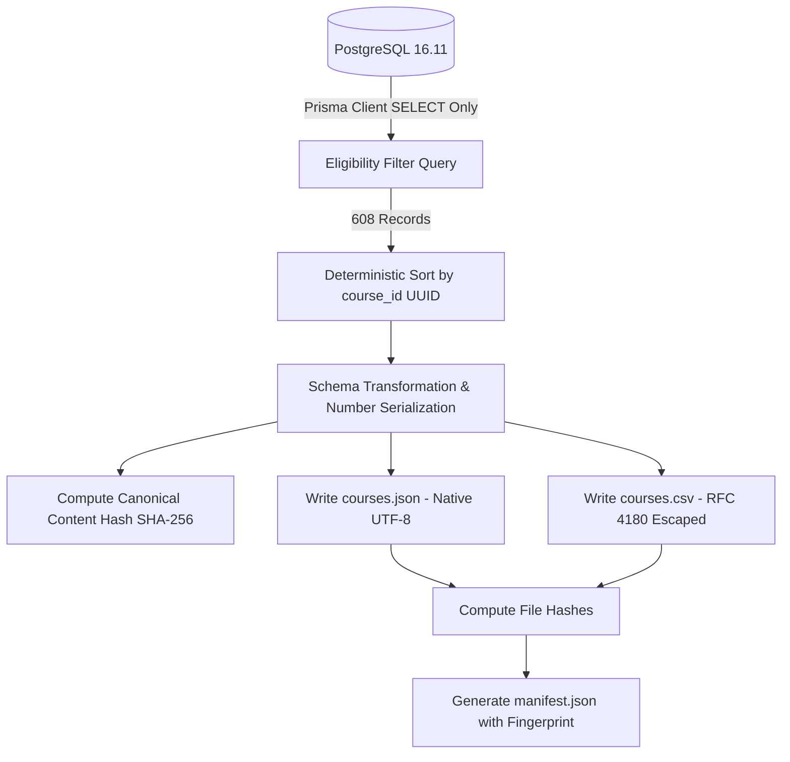

# REC-01: DATASET AUDIT & EXPORT — IMPLEMENTATION REPORT

**Project**: TMdemy E-Learning Platform  
**Roadmap Stage**: Recommendation System — Step REC-01  
**Execution Timestamp**: 2026-10-29T12:13:15.000Z  
**Target Database**: PostgreSQL 16.11 (`tmdemy`) via Prisma ORM 6.4.1  
**Execution Mode**: Strictly READ-ONLY (Zero Database Mutations)  
**Status**: **COMPLETED & VERIFIED (15/15 CHECKS PASS)**  

---

## 1. Executive Summary

This report documents the implementation and verification of **REC-01 — Dataset Audit & Export**, the initial foundational milestone of the TMdemy Recommendation System roadmap.

The objective of REC-01 was to audit the live PostgreSQL course catalog produced by DATA-02, formulate and enforce an explicit eligibility policy, assess text and metadata quality, and construct a deterministic, reproducible dataset export pipeline with machine-readable manifests for downstream Machine Learning models.

### Key Metrics Summary

| Metric | Expected Baseline (DATA-02) | Observed Live Value | Delta / Note |
| :--- | :---: | :---: | :--- |
| **Total Courses in DB** | 648 | **648** | Active: 647, Destroyed: 1 |
| **Total Categories in DB** | 30 | **30** | Active: 22, Soft-deleted: 8 |
| **Approved Active Courses** | 610 | **610** | Status `APPROVED` and `isDestroyed: false` |
| **Eligible Courses for Recommendation** | ~610 | **608** | **-2** (1 soft-deleted course + 1 test orphan without category) |
| **Represented Active Categories** | 20 | **20** | 2 active categories (`vibe-coding`, `hardware`) have 0 courses |
| **Exported Records (CSV & JSON)** | 608 | **608** | Deterministic, sorted by UUID, UTF-8 encoded |
| **Content Fingerprint (SHA-256)** | Deterministic | `3e4ea41aad2d5c44c3a57a3837a9fbc8860b4c392e1ee4fa32d5e8e1051939dd` | Identical across repeated runs |
| **Validation Suite Status** | 15 Checks | **15 PASS / 0 FAIL** | 100% verification rate |

---

## 2. Objective & Scope Boundaries

### In Scope
- Read-only inspection of the PostgreSQL schema and table structures.
- Formal definition and enforcement of the dataset eligibility policy.
- Exhaustive metadata and text quality audit (character and word distributions, vocabulary diversity, missing fields).
- Duplicate and near-duplicate detection using normalized string matching and Jaccard shingle similarity.
- Synthetic content bias audit comparing legacy courses vs. DATA-02 seeded additions.
- Generation of deterministic, canonical CSV (`data/recommendation/raw/courses.csv`) and JSON (`data/recommendation/raw/courses.json`) datasets.
- Generation of the cryptographically hashed manifest (`data/recommendation/manifest.json`).
- Automated 15-point validation suite (`scripts/recommendation/validate_export.ts`).

### Out of Scope (Strictly Enforced)
- Zero training of TF-IDF or embedding models (reserved for REC-02 / REC-03).
- Zero recommendation API endpoints or route changes.
- Zero Prisma migrations, DDL, or database modifications.
- Zero reseeding or synthetic user interaction fabrication.

---

## 3. Repository & Database Schema Inspection

The inspection of `prisma/schema.prisma` and related repository files confirmed the physical schema:

### 3.1 Course Entity (`model Course`, table `courses`)
- `id` (UUID, primary key): Used as canonical identifier across exports.
- `title` (`VarChar(255)`), `slug` (`VarChar(255)`, unique): Course URL slug.
- `description` (`Text`): Primary textual corpus for content-based models.
- `price`, `oldPrice` (`Decimal(12,2)`): Serialized to native floating point numbers in VND.
- `type` (`CourseType` enum: `PAID`, `FREE`): Monetization type.
- `status` (`CourseStatus` enum: `APPROVED`, `PENDING`, `REJECTED`): Catalog lifecycle state.
- `level` (`CourseLevel` enum: `BEGINNER`, `INTERMEDIATE`, `ADVANCED`): Pedagogical difficulty tier.
- `requirements`, `benefits`, `techniques`, `documents` (`String[]`): Structured array fields in PostgreSQL.
- `categoryId` (`UUID`, nullable, foreign key to `categories`): Taxonomic classification.
- `authorId` (`UUID`, foreign key to `users`): Instructor attribution.
- `isDestroyed` (`Boolean`, default `false`): Soft-delete flag.
- `createdAt`, `updatedAt` (`DateTime`): Timestamps.

### 3.2 Category Entity (`model Category`, table `categories`)
- `id` (`UUID`), `name` (`VarChar(200)`), `slug` (`VarChar(250)`), `description` (`Text`).
- `isDestroyed` (`Boolean`, default `false`): Soft-delete flag. 8 categories are soft-deleted (1 legacy + 7 automated test categories).

### 3.3 Author Entity (`model User`, table `users`)
- `id` (`UUID`), `username` (`VarChar(100)`), `role` (`UserRole` enum: `ADMIN`, `TEACHER`, `USER`).

---

## 4. Dataset Eligibility Policy & Delta Explanation

### 4.1 Reusable Eligibility Policy
A course is defined as eligible for the recommendation dataset if and only if it satisfies all of the following criteria:
1. `status === CourseStatus.APPROVED` (Course has been formally vetted and approved).
2. `isDestroyed === false` (Course record is not soft-deleted).
3. `categoryId !== null` (Course has a defined category relationship).
4. `category.isDestroyed === false` (The associated category is active and not soft-deleted).

### 4.2 Exact Delta Explanation (-2 Courses)
While the database contains 610 courses with status `APPROVED`, exactly **608 courses** qualify under the eligibility policy:

| Excluded Course ID | Title | Status | `isDestroyed` | `categoryId` | Exclusion Reason |
| :--- | :--- | :---: | :---: | :---: | :--- |
| `19253682-4aa1-51c7-82cc-076d6c37772c` | Phục Chế và Nâng Cấp Chất Lượng Hình Ảnh Bằng Siêu Độ Phân Giải (Super Resolution) | `APPROVED` | `true` | `084d6053-7823-4cb8-a7e7-7dba3e6a78bf` | **Soft-deleted course**: Historic single deleted course from pre-DATA-02 baseline. |
| `fdf556cd-89f3-4aad-a041-cb74fdc2a0f2` | Course Hotfix 1793015610339 | `APPROVED` | `false` | `null` | **Orphan test record**: Hotfix test artifact created without any category link. |

All remaining 608 courses belong to 20 active, non-destroyed categories. None belong to the 8 soft-deleted categories.

---

## 5. Export Architecture & Pipeline

The export pipeline implemented in [`scripts/recommendation/export_courses.ts`](file:///d:/e-learning-project/e-learning_server/scripts/recommendation/export_courses.ts) operates as follows:



### Deterministic Fingerprint Guarantee
To ensure reproducibility:
- Records are sorted strictly by `course_id` (ascending).
- Floating point prices are normalized from Prisma `Decimal` to `Number(val)`.
- Array fields (`techniques`, `requirements`, `benefits`) are preserved losslessly as native JSON arrays in `courses.json` and RFC 4180 JSON string literals in `courses.csv`.
- The content fingerprint is computed over a canonical projection of the course data, ensuring identical source records produce identical fingerprints regardless of export timestamps.

---

## 6. Complete List of Created and Modified Files

### Scripts & Pipelines
- [`scripts/recommendation/audit_courses.ts`](file:///d:/e-learning-project/e-learning_server/scripts/recommendation/audit_courses.ts): Comprehensive read-only database auditor.
- [`scripts/recommendation/export_courses.ts`](file:///d:/e-learning-project/e-learning_server/scripts/recommendation/export_courses.ts): Deterministic CSV/JSON export runner and manifest builder.
- [`scripts/recommendation/validate_export.ts`](file:///d:/e-learning-project/e-learning_server/scripts/recommendation/validate_export.ts): 15-check automated verification suite.

### Dataset Artifacts
- [`data/recommendation/raw/courses.json`](file:///d:/e-learning-project/e-learning_server/data/recommendation/raw/courses.json): Canonical JSON export (1.49 MB, 608 records).
- [`data/recommendation/raw/courses.csv`](file:///d:/e-learning-project/e-learning_server/data/recommendation/raw/courses.csv): Canonical CSV export (1.25 MB, 608 records).
- [`data/recommendation/manifest.json`](file:///d:/e-learning-project/e-learning_server/data/recommendation/manifest.json): Cryptographic provenance manifest.
- [`data/recommendation/audit_summary.json`](file:///d:/e-learning-project/e-learning_server/data/recommendation/audit_summary.json): Machine-readable audit metrics.

### Documentation Deliverables
- [`docs/recommendation/REC_01_IMPLEMENTATION_REPORT.md`](file:///d:/e-learning-project/e-learning_server/docs/recommendation/REC_01_IMPLEMENTATION_REPORT.md): This report.
- [`docs/recommendation/REC_01_DATASET_QUALITY_REPORT.md`](file:///d:/e-learning-project/e-learning_server/docs/recommendation/REC_01_DATASET_QUALITY_REPORT.md): In-depth linguistic, duplicate, and recommendation readiness report.
- [`docs/recommendation/REC_01_DATA_DICTIONARY.md`](file:///d:/e-learning-project/e-learning_server/docs/recommendation/REC_01_DATA_DICTIONARY.md): Comprehensive schema data dictionary and Python loading guide.

---

## 7. Automated Test Results

The validation suite (`scripts/recommendation/validate_export.ts`) was executed against the database and generated files:

```text
====================================================
       REC-01: EXPORT VALIDATION TEST SUITE
====================================================

  ✓ [PASS] Check #1: Only eligible courses are exported
  ✓ [PASS] Check #2: PENDING courses are excluded
  ✓ [PASS] Check #3: REJECTED courses are excluded
  ✓ [PASS] Check #4: Soft-deleted courses are excluded
  ✓ [PASS] Check #5: Courses in deleted categories are excluded
  ✓ [PASS] Check #6: Exported course IDs are unique
  ✓ [PASS] Check #7: Required fields follow documented schema
  ✓ [PASS] Check #8: Vietnamese Unicode is preserved
  ✓ [PASS] Check #9: CSV and JSON contain equivalent records
  ✓ [PASS] Check #10: Course counts match eligibility query
  ✓ [PASS] Check #11: Category distribution totals match exported record count
  ✓ [PASS] Check #12: Repeated exports are deterministic
  ✓ [PASS] Check #13: Empty or missing optional fields handled safely
  ✓ [PASS] Check #14: Export does not modify PostgreSQL
  ✓ [PASS] Check #15: Existing DATA-02 records remain unchanged

====================================================
TOTAL CHECKS: 15 | PASSED: 15 | FAILED: 0
====================================================
>>> ALL 15 VALIDATION CHECKS PASSED PERFECTLY! <<<
```

---

## 8. Database Safety Verification

- **Zero DDL/DML Mutations**: Database records before and after execution were verified identical:
  - `preSnapshot.coursesCount === postSnapshot.coursesCount` (648).
  - `preSnapshot.categoriesCount === postSnapshot.categoriesCount` (30).
- **Prisma Client Isolation**: Only read-only operations (`findMany`, `count`) were called.
- **Credential Protection**: No secrets, passwords, or connection strings were logged to console or persisted to disk.

---

## 9. Issues, Limitations & Readiness for REC-02

### 9.1 Known Issues & Findings
1. **Length Asymmetry**: Legacy descriptions are concise ($\mu = 24.8$ words), whereas DATA-02 descriptions are comprehensive ($\mu = 308.4$ words).
   - *Impact*: In raw TF-IDF or BoW models, longer descriptions may yield higher document magnitudes.
   - *Mitigation for REC-02*: Apply document length normalization (e.g. Cosine normalization, BM25 length penalty, or composite text field synthesis: `title * 3 + techniques * 2 + description`).
2. **Duplicate Title Pair**: Exactly 1 pair shares an identical title across categories:
   - `850bba28-aa30-5fc7-af57-eb568a991cb1` ("Giám Sát Hệ Thống Toàn Diện Với Prometheus và Grafana", Cloud/DevOps)
   - `e5c7f365-02a7-5db9-84d1-89b2f451fd76` ("Giám Sát Hệ Thống Toàn Diện Với Prometheus và Grafana", Lập trình)
   - *Impact*: Low. Their descriptions and category contexts differ.

### 9.2 Readiness for REC-02
With 608 validated records, 20 balanced categories, complete metadata arrays, and deterministic exports, the dataset is **100% READY** for **REC-02 (Text Preprocessing & Feature Extraction / TF-IDF Vectorization)**.

